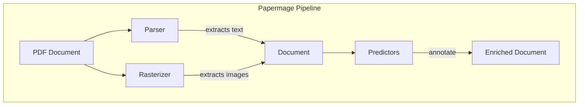
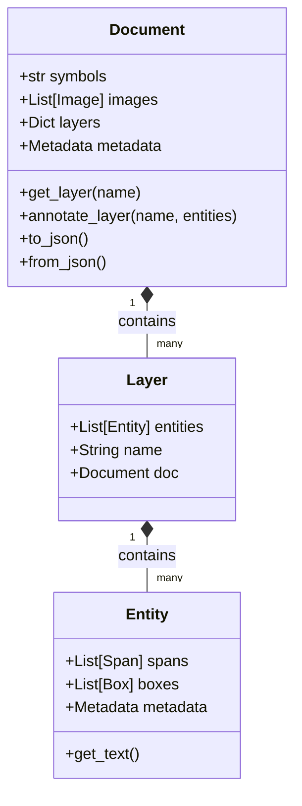
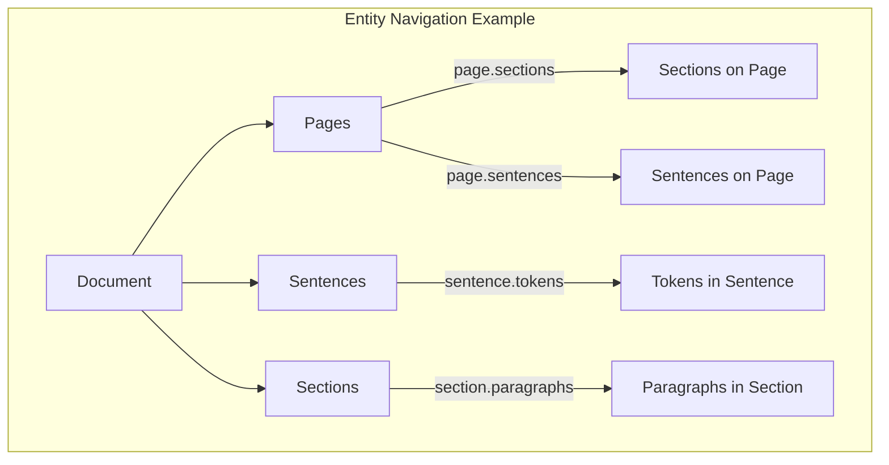

<!-- source: DeepWiki mcp.deepwiki.com · repo allenai/papermage · page 7 Getting Started · fetched 2026-10-26 -->

# Getting Started

<details>
<summary>Relevant source files</summary>

The following files were used as context for generating this wiki page:

- [README.md](README.md)
- [examples/quick_start_demo.ipynb](examples/quick_start_demo.ipynb)
- [pyproject.toml](pyproject.toml)
- [tests/fixtures/2020.acl-main.447.pdf](tests/fixtures/2020.acl-main.447.pdf)

</details>


This guide provides a practical introduction to using the Papermage library for processing, analyzing, and extracting structured information from scientific PDFs. It covers installation, basic usage patterns, and key concepts to help you get up and running quickly.

For detailed installation instructions, see [Installation](#7.1). For step-by-step examples of processing your first document, see [Quick Start](#7.2).

## Prerequisites

Before installing Papermage, ensure you have:

- Python 3.8 or newer
- Pip or Conda for package management
- For MacOS users: Poppler (required for PDF rendering)

## Installation Options

Papermage can be installed via pip with different sets of dependencies:

```bash
# Basic installation
pip install papermage

# Full installation with all dependencies
pip install 'papermage[dev,predictors,visualizers]'

# From source
git clone https://github.com/allenai/papermage.git
cd papermage
pip install -e '.[dev,predictors,visualizers]'
```

MacOS users will need to install Poppler:

```bash
conda install poppler
```

Sources: [pyproject.toml:1-142](), [README.md:5-29]()

## Key Components

Papermage operates through three main component types that work together to process PDF documents:



1. **Parsers**: Extract text and basic structure from PDFs
2. **Rasterizers**: Convert PDF pages to images
3. **Predictors**: Add annotations to identify document elements (sentences, sections, figures, etc.)

These components are typically orchestrated through a **Recipe**, which controls the processing pipeline.

Sources: [README.md:160-169]()

## Core Data Model

The central component in Papermage is the `Document` class, which organizes content through a system of layers and entities:



- **Document**: Contains the full text (`symbols`), page images, and multiple annotation layers
- **Layer**: A collection of related entities (e.g., sentences, paragraphs, figures)
- **Entity**: A discrete element in the document with position information:
  - `spans`: Text positions within the document's symbols
  - `boxes`: Visual bounding boxes on pages
  
For more details about the data model, see [Core Data Model](#2).

Sources: [README.md:54-157]()

## Basic Usage

Here's how to process a PDF document using the default `CoreRecipe`:

```python
# Import the core recipe
from papermage.recipes import CoreRecipe

# Create a recipe instance
recipe = CoreRecipe()

# Process a PDF file
doc = recipe.run("path/to/your/document.pdf")

# Access document content through entity layers
for page in doc.pages:
    print(f"=== PAGE {page.id} ===")
    
    # Access sections on this page
    for section in page.sections:
        print(f"SECTION: {section.text[:50]}...")
        
        # Access sentences in this section
        for sentence in section.sentences:
            print(f"  - {sentence.text}")
```

Sources: [README.md:44-52](), [README.md:85-97]()

## Document Structure Navigation

Papermage's powerful indexing system allows intuitive navigation between different layers of document structure:



You can check which layers are available in a document:

```python
# List all available entity layers
print(doc.layers)
```

Common layers include: `pages`, `tokens`, `sentences`, `sections`, `figures`, `tables`, etc.

Sources: [README.md:85-130]()

## Saving and Loading Documents

Papermage documents can be serialized to JSON for saving and loading:

```python
import json

# Save document to JSON
with open('document.json', 'w') as f:
    json.dump(doc.to_json(), f, indent=2)

# Load document from JSON
from papermage.document import Document
with open('document.json', 'r') as f:
    doc_data = json.load(f)
    doc = Document.from_json(doc_data)
```

Sources: [README.md:172-208]()

## Next Steps

After getting familiar with the basics, you can:

1. Explore different recipes for various document processing needs
2. Create custom predictors for specialized document analysis
3. Build applications that leverage the structured document data

For more examples and detailed API documentation, refer to the other sections of this wiki.

---

