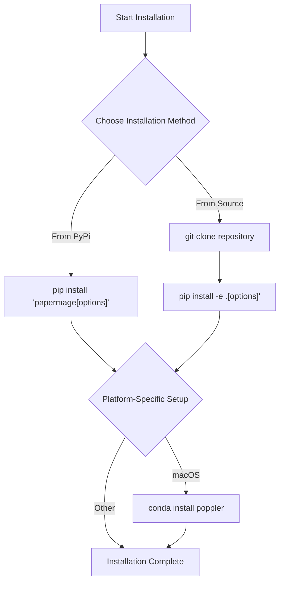
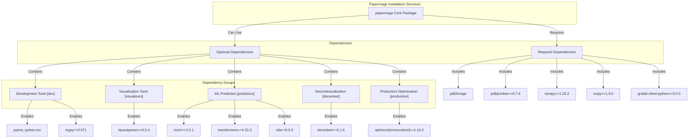
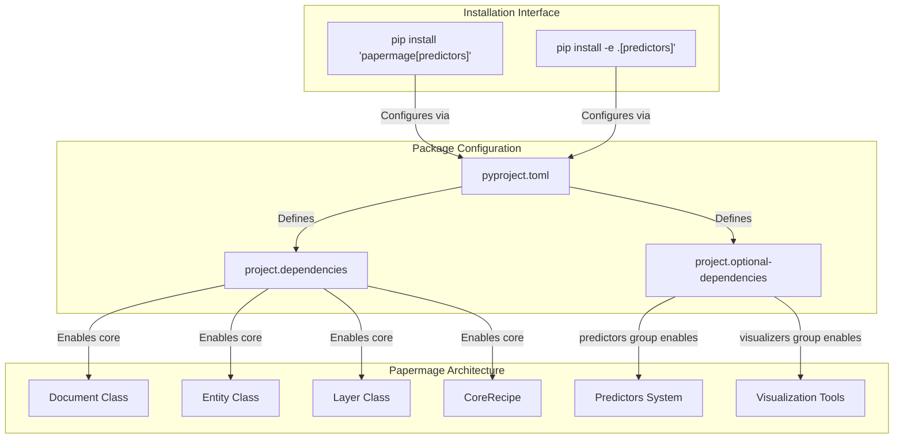

<!-- source: DeepWiki mcp.deepwiki.com · repo allenai/papermage · page 7.1 Installation · fetched 2026-10-26 -->

# Installation

<details>
<summary>Relevant source files</summary>

The following files were used as context for generating this wiki page:

- [.github/workflows/papermage-ci.yml](.github/workflows/papermage-ci.yml)
- [.gitignore](.gitignore)
- [README.md](README.md)
- [docs/README.md](docs/README.md)
- [docs/logo.jpg](docs/logo.jpg)
- [papermage/trainers/__init__.py](papermage/trainers/__init__.py)
- [pyproject.toml](pyproject.toml)
- [scripts/push_to_pypi.sh](scripts/push_to_pypi.sh)
- [tests/fixtures/2020.acl-main.447.pdf](tests/fixtures/2020.acl-main.447.pdf)
- [tests/fixtures/predictor_training_docs.jsonl](tests/fixtures/predictor_training_docs.jsonl)

</details>


This page provides comprehensive instructions for installing the Papermage library. Papermage is a toolkit for processing, representing, and manipulating scientific PDFs, and proper installation ensures you can access all its features. For information on how to use Papermage after installation, see [Quick Start](#7.2).

## Overview of Installation Options

Papermage can be installed either from PyPI (Python Package Index) or directly from source. There are also several optional dependency groups that enable additional functionality for different use cases.



Sources: [pyproject.toml:1-207](). [README.md:1-212]()

## System Requirements

### Python Version
Papermage requires Python 3.8 or newer. This requirement is specified in the project configuration:

```
requires-python = '>=3.8'
```

### System Dependencies
Depending on your operating system, you may need to install additional system packages:

- **macOS**: Requires poppler for PDF processing
- **Linux**: Most dependencies are handled automatically through pip

Sources: [pyproject.toml:7-7](). [README.md:25-28](), [.github/workflows/papermage-ci.yml:29-30]()

## Installation Methods

### From PyPI

For most users, installing from PyPI is the simplest option:

```bash
pip install papermage
```

To include optional dependencies for additional functionality:

```bash
pip install 'papermage[dev,predictors,visualizers]'
```

Note: You may need to add/remove quotes depending on your command line shell.

### From Source

For development or to access the latest features:

1. Clone the repository:
   ```bash
   git clone https://github.com/allenai/papermage
   cd papermage
   ```

2. Install the package in development mode:
   ```bash
   pip install -e '.[dev,predictors,visualizers]'
   ```

Sources: [README.md:12-22](), [pyproject.toml:1-207]()

## Dependency Structure

Papermage's dependencies are organized into distinct groups that enable different functionality:



Sources: [pyproject.toml:8-141]()

## Required Dependencies

The core Papermage package depends on the following libraries:

| Dependency | Version | Purpose |
|------------|---------|---------|
| tqdm | - | Progress bars for long-running operations |
| pdf2image | - | Converting PDF pages to images |
| pdfplumber | 0.7.4 | PDF text extraction |
| requests | - | API communication |
| numpy | >=1.23.2 | Numerical operations |
| scipy | >=1.9.0 | Scientific computing |
| ncls | 0.0.68 | Nested containment list |
| necessary | >=0.3.2 | Utility library |
| grobid-client-python | 0.0.5 | GROBID client for structured document parsing |
| charset-normalizer | - | Character encoding detection |

These dependencies are automatically installed when you install Papermage.

Sources: [pyproject.toml:8-19]()

## Optional Dependency Groups

Papermage offers several optional dependency groups that enable additional functionality:

### Development (`dev`)

Tools for development, testing, and type checking:

```bash
pip install 'papermage[dev]'
```

Includes pytest, pytest-xdist, pytest-cov, and mypy for testing and type checking.

### Visualizers (`visualizers`)

Tools for visualizing documents and entities:

```bash
pip install 'papermage[visualizers]'
```

Includes layoutparser for document visualization.

### Predictors (`predictors`)

Machine learning models and tools for document structure prediction:

```bash
pip install 'papermage[predictors]'
```

Includes numerous ML libraries like torch, transformers, layoutparser, and more.

### Decontext (`decontext`)

Tools for document decontextualization:

```bash
pip install 'papermage[decontext]'
```

Adds the decontext library.

### Production (`production`)

Optimization tools for production environments:

```bash
pip install 'papermage[production]'
```

Adds the optimum library with ONNX runtime for optimized inference.

Sources: [pyproject.toml:107-141]()

## Installation and Component Relationship

The following diagram illustrates how the installation process connects to the functional components of the Papermage system:



Sources: [pyproject.toml:1-207](), [README.md:54-97]()

## Platform-Specific Considerations

### macOS

On macOS, you'll need to install poppler, which is used by pdf2image for PDF processing:

```bash
conda install poppler
```

This is necessary because pdf2image requires poppler for converting PDFs to images.

### Linux (Ubuntu/Debian)

For the CI pipeline, the following packages are installed:

```bash
sudo apt-get update
sudo apt-get -y install poppler-utils
```

If you encounter issues with pdf2image or other PDF processing utilities on Linux, installing poppler-utils may help.

Sources: [README.md:25-28](), [.github/workflows/papermage-ci.yml:29-30]()

## Verifying Installation

To verify that Papermage is installed correctly, you can run a simple test:

```python
from papermage.recipes import CoreRecipe

recipe = CoreRecipe()
# If no errors occur, installation is successful
```

## Troubleshooting

### Common Issues

1. **ImportError or ModuleNotFoundError**: Ensure you've installed the correct optional dependencies for the features you're trying to use.

2. **PDF Processing Errors**: If encountering errors related to PDF processing:
   - On macOS: Check that poppler is installed (`conda install poppler`)
   - On Linux: Install poppler-utils (`apt-get install poppler-utils`)

3. **Version Conflicts**: If you encounter dependency version conflicts, consider creating a new virtual environment:
   ```bash
   conda create -n papermage python=3.11
   conda activate papermage
   pip install 'papermage[dev,predictors,visualizers]'
   ```

Sources: [README.md:6-28](), [.github/workflows/papermage-ci.yml:13-44]()

## Conclusion

You've now learned how to install Papermage and its optional dependencies. For information on how to use Papermage to process documents, see [Quick Start](#7.2).

---

