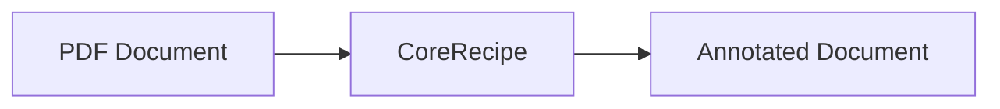
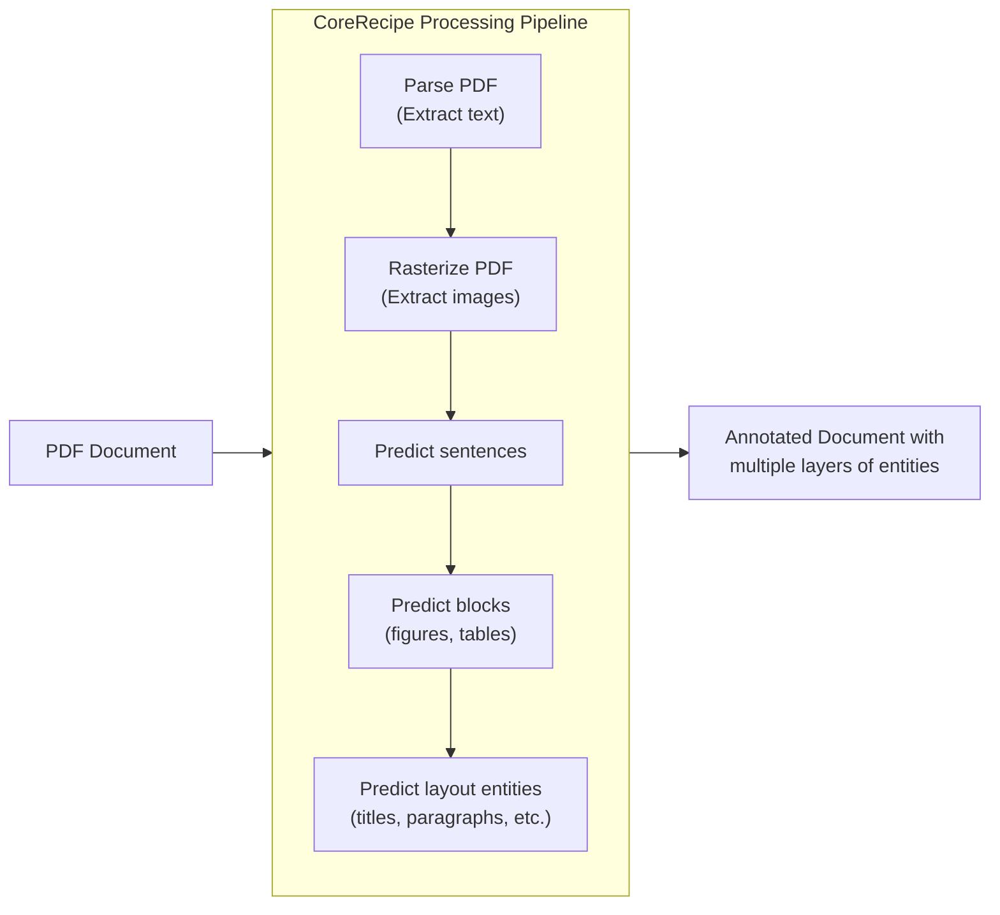
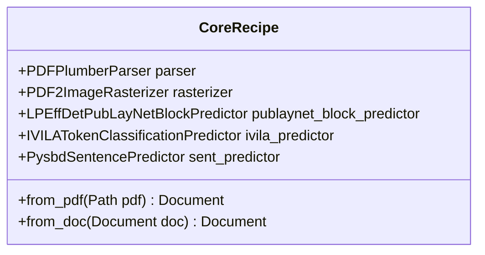
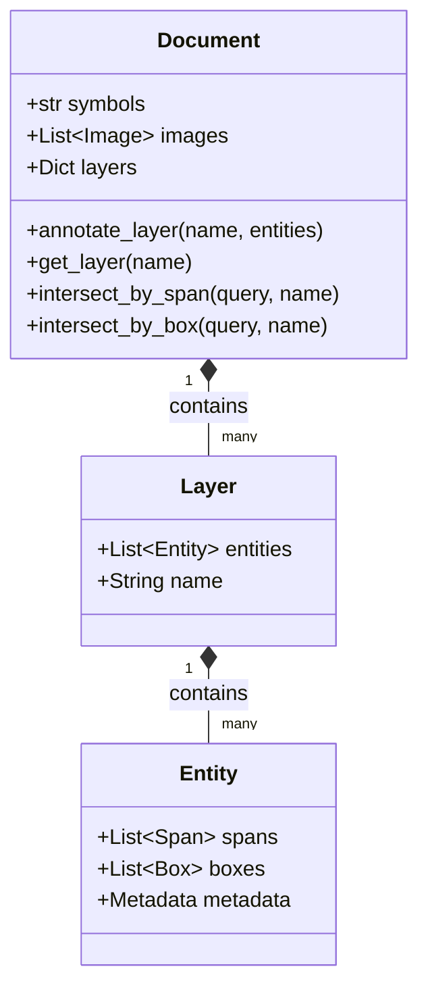
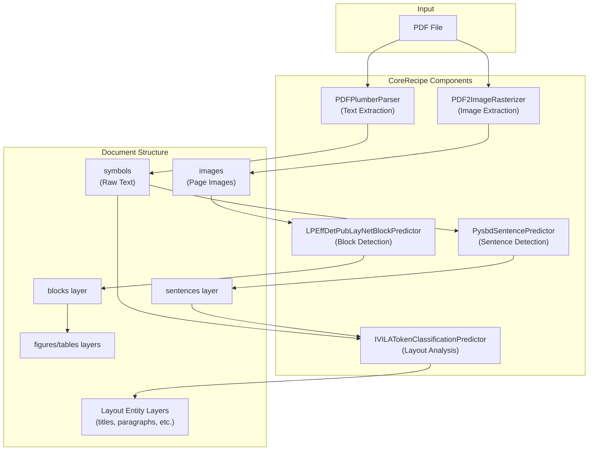

<!-- source: DeepWiki mcp.deepwiki.com · repo allenai/papermage · page 7.2 Quick Start · fetched 2026-10-26 -->

# Quick Start

<details>
<summary>Relevant source files</summary>

The following files were used as context for generating this wiki page:

- [examples/quick_start_demo.ipynb](examples/quick_start_demo.ipynb)
- [papermage/recipes/core_recipe.py](papermage/recipes/core_recipe.py)

</details>


This page provides a step-by-step guide to help you process your first document using the Papermage library. You'll learn how to set up a basic document processing pipeline, extract structured information from a PDF, and access the resulting annotations.

For installation instructions, see [Installation](#7.1).

## 1. Basic Processing Workflow

Papermage's core functionality revolves around processing PDF documents into structured representations. Here's the basic workflow:



At a more detailed level, the processing pipeline includes several steps:



Sources: [papermage/recipes/core_recipe.py:101-152]()

## 2. Setting Up Your First Document Processor

To process a PDF document with Papermage, you'll use the `CoreRecipe` class, which orchestrates the entire document processing pipeline.

```python
from pathlib import Path
from papermage.recipes.core_recipe import CoreRecipe

# Initialize the recipe with default models
recipe = CoreRecipe()

# Process a PDF document
pdf_path = Path("path/to/your/document.pdf")
document = recipe.from_pdf(pdf=pdf_path)
```

The `CoreRecipe` initializes several components:



Sources: [papermage/recipes/core_recipe.py:77-100]()

## 3. Understanding the Processing Steps

When you call `recipe.from_pdf()`, the following steps are executed:

1. **PDF Parsing**: Extracts text content from the PDF
2. **Rasterization**: Converts PDF pages to images
3. **Sentence Detection**: Identifies sentence boundaries in the text
4. **Block Detection**: Identifies block-level elements like figures and tables
5. **Layout Analysis**: Recognizes document structure elements like titles, paragraphs, etc.

Each step enriches the document with a new layer of annotations, which you can access later.

Sources: [papermage/recipes/core_recipe.py:101-152]()

## 4. Accessing Document Content

After processing, the document contains multiple layers of annotations that you can access and use:

```python
# Get all sentences in the document
sentences = document.get_layer("sentences").entities

# Get all detected figures
figures = document.get_layer("figures").entities

# Get all titles
titles = document.get_layer("titles").entities

# Access text content of the first title
if titles:
    first_title = titles[0]
    title_text = document.symbols[first_title.spans[0].start:first_title.spans[0].end]
    print(f"Document title: {title_text}")
```

The document structure follows this organization:



Sources: [papermage/recipes/core_recipe.py:12-42]()

## 5. Example: Processing a Document and Extracting Key Information

Here's a complete example of processing a document and extracting key information:

```python
from pathlib import Path
import json
from papermage.recipes.core_recipe import CoreRecipe

# Initialize the recipe
recipe = CoreRecipe()

# Process a PDF document
pdf_path = Path("example.pdf")
document = recipe.from_pdf(pdf=pdf_path)

# Extract and print document statistics
print(f"Document has {len(document.get_layer('pages').entities)} pages")
print(f"Document has {len(document.get_layer('sentences').entities)} sentences")
print(f"Document has {len(document.get_layer('figures').entities)} figures")
print(f"Document has {len(document.get_layer('tables').entities)} tables")

# Extract title and abstract if available
titles = document.get_layer("titles").entities
abstracts = document.get_layer("abstracts").entities

if titles:
    title_text = document.symbols[titles[0].spans[0].start:titles[0].spans[0].end]
    print(f"Title: {title_text}")

if abstracts:
    abstract_text = document.symbols[abstracts[0].spans[0].start:abstracts[0].spans[0].end]
    print(f"Abstract: {abstract_text}")

# Save the processed document
with open("processed_document.json", "w") as f:
    json.dump(document.to_json(), f, indent=2)
```

Sources: [papermage/recipes/core_recipe.py:155-167]()

## 6. Available Document Layers

The `CoreRecipe` creates the following layers in the document, which you can access using `document.get_layer(name)`:

| Layer Name | Description | Access Key |
|------------|-------------|------------|
| Pages | Page boundaries | "pages" |
| Sentences | Detected sentences | "sentences" |
| Blocks | Detected layout blocks | "blocks" |
| Figures | Detected figures | "figures" |
| Tables | Detected tables | "tables" |
| Titles | Document and section titles | "titles" |
| Paragraphs | Text paragraphs | "paragraphs" |
| Authors | Author information | "authors" |
| Abstracts | Document abstracts | "abstracts" |
| Sections | Document sections | "sections" |
| Lists | Bulleted or numbered lists | "lists" |
| Captions | Figure and table captions | "captions" |
| Headers | Page headers | "headers" |
| Footers | Page footers | "footers" |

Sources: [papermage/recipes/core_recipe.py:57-74]()

## 7. Simplified Processing Flow from Code to Output

This diagram maps the code components to the processing steps and output:



Sources: [papermage/recipes/core_recipe.py:101-152]()

## 8. Next Steps

Now that you've processed your first document with Papermage, you can:

- Learn more about the Core Data Model to understand the [Document Structure](#2.1) and [Entity and Layer System](#2.2)
- Explore different [Predictors](#4) for specialized document analysis tasks
- Investigate the [Visualization](#6.1) tools to visualize document annotations
- Use the [Indexing and Retrieval](#2.4) features to search for specific content within documents