# Page: Overview

# Overview

<details>
<summary>Relevant source files</summary>

The following files were used as context for generating this wiki page:

- [README.md](README.md)
- [papermage/magelib/__init__.py](papermage/magelib/__init__.py)
- [papermage/magelib/document.py](papermage/magelib/document.py)
- [papermage/magelib/names.py](papermage/magelib/names.py)
- [papermage/recipes/core_recipe.py](papermage/recipes/core_recipe.py)
- [pyproject.toml](pyproject.toml)
- [tests/fixtures/2020.acl-main.447.pdf](tests/fixtures/2020.acl-main.447.pdf)

</details>


Papermage is a unified toolkit for processing, representing, and manipulating scientific PDFs. It provides a structured framework for extracting, analyzing, and annotating content from academic papers, enabling advanced document understanding and manipulation.

This overview introduces the key concepts, architecture, and workflow of the Papermage library. For more detailed information on specific components, please refer to the corresponding sections in this wiki.

## Core Concepts

Papermage is built around three fundamental concepts:

1. **Document**: The central data structure that represents a scientific paper, containing both text and visual elements.

2. **Entity**: Represents a segment of document content (e.g., a sentence, paragraph, or figure) with both textual and spatial properties.

3. **Layer**: A collection of entities of the same type (e.g., all sentences, all figures) within a document.

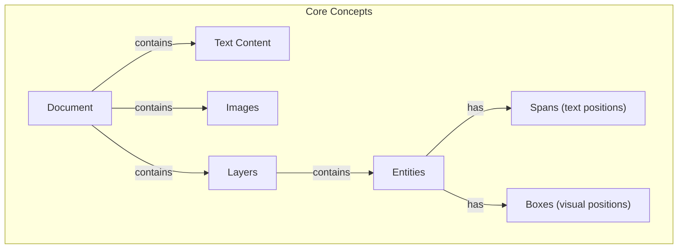

Sources: [papermage/magelib/document.py:33-174](), [papermage/magelib/__init__.py:9-86]()

## System Architecture

Papermage is organized into several key components that work together to process and represent scientific documents:

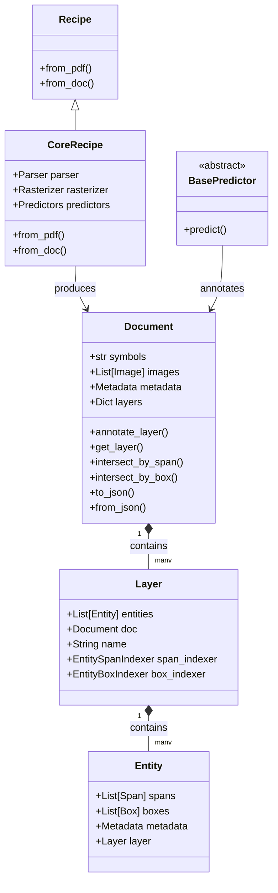

Sources: [papermage/magelib/document.py:33-196](), [papermage/recipes/core_recipe.py:77-152]()

## Document Processing Workflow

The Papermage workflow follows these general steps:

1. **Parsing**: Extract text and structural information from PDFs
2. **Rasterization**: Convert PDF pages to images
3. **Prediction**: Apply models to identify and classify document elements
4. **Annotation**: Add structured information to the document

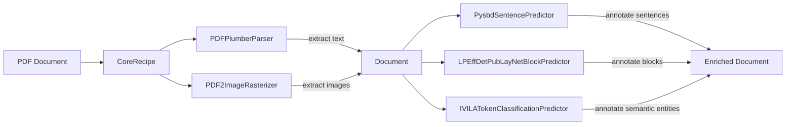

Sources: [papermage/recipes/core_recipe.py:77-152]()

## Layer Types and Entity Classification

Papermage provides support for a wide range of document elements organized as layers:

| Layer Type | Description | Example Use |
|------------|-------------|-------------|
| Tokens | Basic text units | Tokenization, word analysis |
| Sentences | Text segments ending with punctuation | NLP analysis, content extraction |
| Blocks | Visual layout blocks | Layout analysis |
| Figures | Image elements in the document | Figure extraction, visual analysis |
| Tables | Tabular data in the document | Data extraction |
| Sections | Logical document sections | Document structure analysis |
| Paragraphs | Text paragraphs | Content extraction |
| Titles | Document and section titles | Metadata extraction |
| Abstracts | Paper abstracts | Content summarization |
| Equations | Mathematical formulas | Formula extraction |

Sources: [papermage/magelib/names.py:1-38](), [papermage/recipes/core_recipe.py:57-74]()

## Usage Example

The typical usage pattern for Papermage involves creating a Document from a PDF, then accessing its structured content:

```python
# Create a Document from a PDF
from papermage.recipes import CoreRecipe

recipe = CoreRecipe()
doc = recipe.from_pdf("path/to/paper.pdf")

# Access document content through layers
for page in doc.pages:
    for section in page.sections:
        print(f"Section: {section.text}")
        
        for paragraph in section.paragraphs:
            print(f"  Paragraph: {paragraph.text}")
            
            for sentence in paragraph.sentences:
                print(f"    Sentence: {sentence.text}")
```

Sources: [README.md:47-52](), [README.md:84-97]()

## Entity Representation and Indexing

Each Entity in Papermage has two key positional representations:

1. **Spans**: Text positions within the document's symbols string
2. **Boxes**: Visual positions on the document pages

These representations allow for both textual and spatial querying within the document:

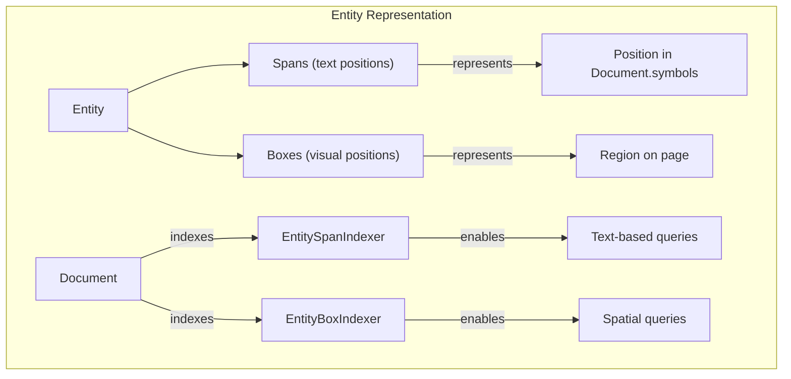

Sources: [README.md:148-158](), [papermage/magelib/document.py:190-196]()

## Document Serialization

Papermage allows documents to be serialized to JSON and reconstructed later:

```python
# Save document to JSON
with open('document.json', 'w') as f_out:
    json.dump(doc.to_json(), f_out, indent=4)

# Load document from JSON
with open('document.json') as f_in:
    doc_dict = json.load(f_in)
    doc = Document.from_json(doc_dict)
```

Sources: [README.md:174-204](), [papermage/magelib/document.py:128-171]()

## Core Dependencies

Papermage builds upon several key libraries to provide its functionality:

| Component | Main Dependencies |
|-----------|------------------|
| Parsing | pdfplumber |
| Rasterization | pdf2image |
| Layout Analysis | layoutparser, effdet |
| Text Processing | pysbd, transformers |
| Visual Layout Analysis | villa, ivila |

Sources: [pyproject.toml:8-38](), [pyproject.toml:114-134]()

---

# Page: Core Data Model

# Core Data Model

<details>
<summary>Relevant source files</summary>

The following files were used as context for generating this wiki page:

- [papermage/magelib/__init__.py](papermage/magelib/__init__.py)
- [papermage/magelib/document.py](papermage/magelib/document.py)
- [papermage/magelib/entity.py](papermage/magelib/entity.py)
- [papermage/magelib/layer.py](papermage/magelib/layer.py)
- [papermage/magelib/names.py](papermage/magelib/names.py)
- [papermage/predictors/vila_predictors.py](papermage/predictors/vila_predictors.py)
- [tests/test_magelib/test_document.py](tests/test_magelib/test_document.py)
- [tests/test_magelib/test_indexer.py](tests/test_magelib/test_indexer.py)

</details>


The Core Data Model in Papermage defines the fundamental data structures that represent documents and their content. This foundation enables the extraction, annotation, and manipulation of document information through a flexible and hierarchical representation system. This page explains the key components of this model and how they relate to each other.

For information about how documents are processed using these structures, see [Document Processing Pipeline](#3).

## Overview

Papermage's Core Data Model is designed around a Document-Entity-Layer architecture. This system allows representation of both textual and visual content while maintaining the relationships between different document elements.

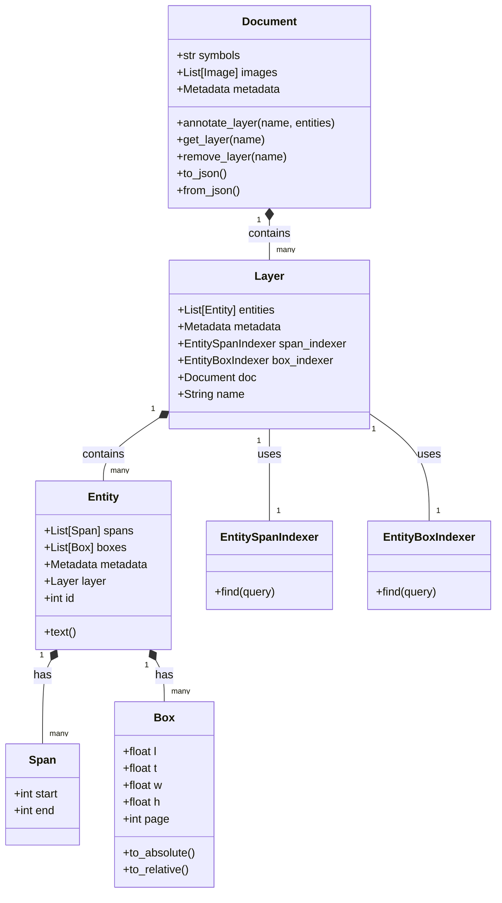

Sources: [papermage/magelib/document.py:33-196](), [papermage/magelib/entity.py:20-199](), [papermage/magelib/layer.py:22-123]()

## Document Structure

The `Document` class is the central data structure in Papermage. It represents a complete document with its content and structural annotations.

### Key Properties

| Property | Type | Description |
|----------|------|-------------|
| `symbols` | `str` | The raw text content of the document |
| `images` | `List[Image]` | Images extracted from the document |
| `metadata` | `Metadata` | Additional document metadata |
| `layers` | `List[str]` | Names of all available layers |

Sources: [papermage/magelib/document.py:44-51](), [papermage/magelib/document.py:57-59]()

### Layer Management

A Document contains multiple layers of annotations. Each layer represents a specific type of document element (e.g., tokens, sentences, paragraphs) and contains a collection of entities of that type.

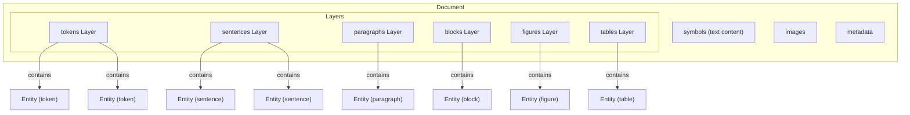

The Document class provides methods to annotate, retrieve, and remove layers:

- `annotate_layer(name, entities)`: Adds a new layer with the given name and entities
- `get_layer(name)`: Retrieves a layer by name
- `remove_layer(name)`: Removes a layer by name

Sources: [papermage/magelib/document.py:69-99](), [papermage/magelib/names.py:7-37]()

### Document Serialization

Document objects can be serialized to and from JSON format:

- `to_json()`: Converts the document to a JSON-serializable dictionary
- `from_json()`: Creates a Document object from a JSON dictionary

Sources: [papermage/magelib/document.py:128-171]()

## Entity and Layer System

### Entities

An `Entity` represents an annotated unit in a document, such as a token, sentence, paragraph, or figure. Entities are positioned using spans (text positions) and/or boxes (visual positions).

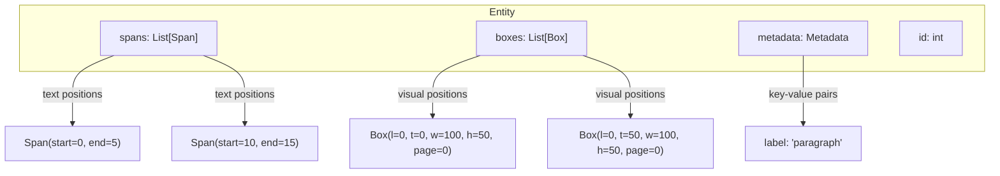

Key features of an Entity:

- Can have both text positions (spans) and visual positions (boxes)
- Has metadata containing additional information
- Can extract its text content from the document
- References its parent layer and has a unique ID within that layer

Sources: [papermage/magelib/entity.py:20-199]()

### Layers

A `Layer` is a collection of entities of the same type. It provides methods for accessing and managing these entities, as well as indexing for efficient retrieval.

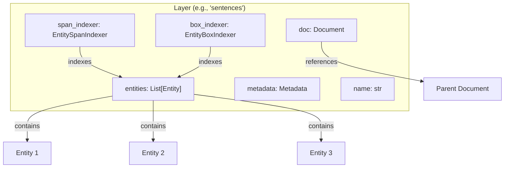

Layers act as both collections and indexers:

- Support standard list operations (indexing, iteration, length)
- Maintain span and box indexers for efficient entity retrieval
- Reference their parent document for cross-layer querying

Sources: [papermage/magelib/layer.py:22-123]()

## Span and Box Representations

### Spans

A `Span` represents a text position in the document's symbols:

- `start`: The starting character index
- `end`: The ending character index (exclusive)

Spans are used to extract text content from the document:

```python
document.symbols[span.start:span.end]  # Gets the text content for this span
```

### Boxes

A `Box` represents a visual position on a page:

- `l`: Left coordinate (x-position)
- `t`: Top coordinate (y-position)
- `w`: Width
- `h`: Height
- `page`: Page number

Boxes use normalized coordinates (0-1) relative to the page dimensions, but can be converted to absolute pixel coordinates using:

```python
box.to_absolute(page_width=width, page_height=height)
```

Sources: [papermage/magelib/entity.py:138-185]()

## Indexing and Retrieval

The Papermage data model includes specialized indexers for efficient entity retrieval based on text or visual position overlap.

### Entity Indexers

- `EntitySpanIndexer`: Indexes entities based on their text spans
- `EntityBoxIndexer`: Indexes entities based on their visual boxes

These indexers are used to find entities that overlap with a query entity:

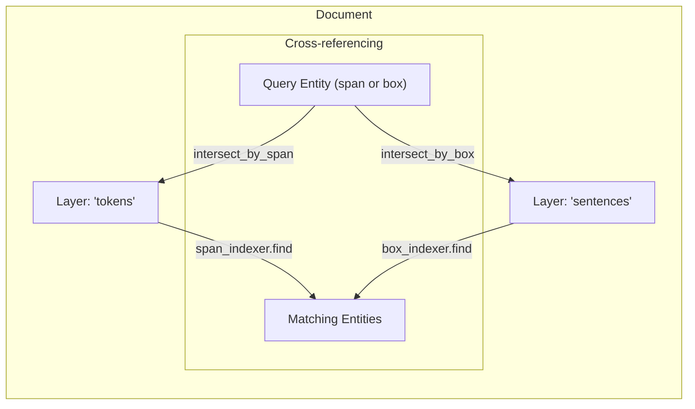

### Cross-Layer Referencing

The Document provides methods for cross-referencing entities between layers:

- `intersect_by_span(query, name)`: Finds entities in the named layer that intersect with the query entity's spans
- `intersect_by_box(query, name)`: Finds entities in the named layer that intersect with the query entity's boxes

This allows for rich queries such as finding all tokens within a paragraph, or all figures overlapping with a specific text region.

Sources: [papermage/magelib/document.py:176-196](), [tests/test_magelib/test_document.py:93-211](), [tests/test_magelib/test_indexer.py:19-126]()

## Practical Example

Here's a practical example of how these components work together:

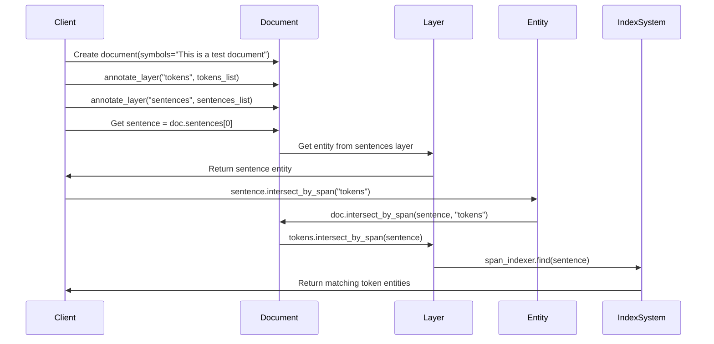

This example demonstrates:
1. Creating a document with text content
2. Annotating it with token and sentence layers
3. Retrieving a sentence entity
4. Finding all tokens that overlap with the sentence

Sources: [tests/test_magelib/test_document.py:20-45](), [tests/test_magelib/test_document.py:93-152]()

## Conclusion

The Core Data Model in Papermage provides a flexible and powerful representation system for document content. Through its Document-Entity-Layer architecture, it supports both textual and visual annotations, efficient cross-referencing, and rich querying capabilities. This foundation enables the sophisticated document processing pipelines and analysis tools built on top of it.

---

# Page: Document Structure

# Document Structure

<details>
<summary>Relevant source files</summary>

The following files were used as context for generating this wiki page:

- [papermage/magelib/__init__.py](papermage/magelib/__init__.py)
- [papermage/magelib/document.py](papermage/magelib/document.py)
- [papermage/magelib/names.py](papermage/magelib/names.py)
- [tests/test_magelib/test_document.py](tests/test_magelib/test_document.py)
- [tests/test_magelib/test_indexer.py](tests/test_magelib/test_indexer.py)

</details>


## Purpose and Scope

This document explains the core `Document` class in Papermage, which serves as the central data structure for representing document content and annotations. The Document acts as a container that holds both the textual content and visual elements of a document, along with structured annotations organized in layers.

For information about the Entity and Layer system that powers annotations, see [Entity and Layer System](#2.2). For details on how spans and boxes represent positions within documents, see [Span and Box Representations](#2.3).

## Document Class Overview

The `Document` class is defined in the Papermage library as the foundational data structure that represents processed documents. It contains text content, images, metadata, and layers of annotations that represent different aspects of document structure.

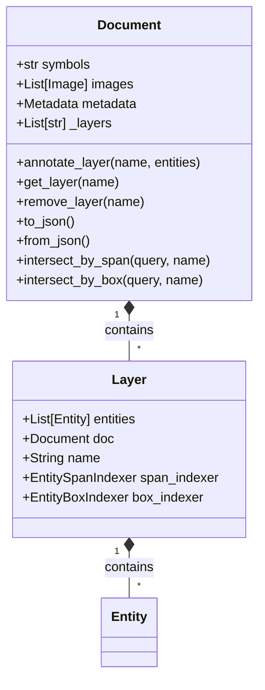

Sources: 
- [papermage/magelib/document.py:33-174]()
- [papermage/magelib/__init__.py:9-10]()

## Document Initialization

A `Document` object must be initialized with at least one of the following:
- `symbols`: A string containing the document's text content
- `images`: A list of `Image` objects representing the document's visual content

```python
# Create a document with text content
doc = Document(symbols="This is a test document")

# Create a document with both text and images
doc = Document(symbols="Text content", images=[image1, image2])
```

If neither `symbols` nor `images` is provided, the constructor will raise a `ValueError`.

Sources:
- [papermage/magelib/document.py:44-55]()
- [tests/test_magelib/test_document.py:21-23]()

## Document Structure Hierarchy

The Document structure can be visualized as a hierarchical organization of content, with layers representing different levels of document structure:

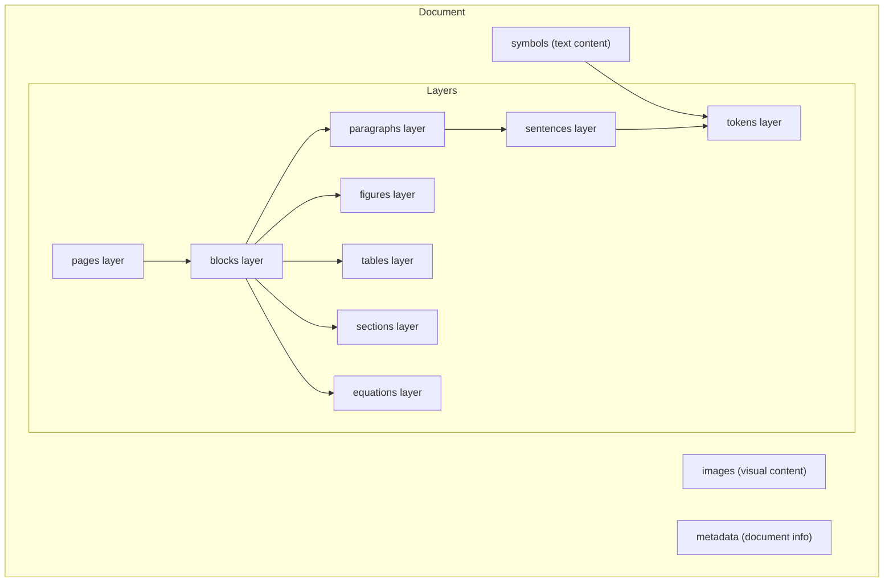

Sources:
- [papermage/magelib/document.py:33-41]()
- [papermage/magelib/names.py:7-37]()

## Layer Management

The Document class provides methods for adding, accessing, and removing layers of annotations.

### Adding Layers

Layers are added using the `annotate_layer` method, which takes a name and a list of entities:

```python
# Create some token entities
tokens = [Entity(spans=[(0, 4)]), Entity(spans=[(5, 9)])]

# Add the tokens layer to the document
doc.annotate_layer(name="tokens", entities=tokens)
```

The method validates the layer name, creates a new Layer object, and adds it to the document.

### Accessing Layers

Layers can be accessed either as attributes or using the `get_layer` method:

```python
# Access as attribute
tokens = doc.tokens

# Access using get_layer
tokens = doc.get_layer(name="tokens")
```

### Removing Layers

Layers can be removed using the `remove_layer` method:

```python
doc.remove_layer(name="tokens")
```

Sources:
- [papermage/magelib/document.py:69-99]()
- [tests/test_magelib/test_document.py:31-43]()

## Standard Layer Types

Papermage defines standard names for common types of document elements, which are used as layer names:

| Layer Name | Description |
|------------|-------------|
| `pages` | Document pages |
| `tokens` | Individual tokens (words or characters) |
| `rows` | Rows of text |
| `blocks` | Text blocks or regions |
| `sentences` | Sentences in the document |
| `paragraphs` | Paragraphs in the document |
| `titles` | Document and section titles |
| `authors` | Author information |
| `abstracts` | Document abstracts |
| `sections` | Document sections |
| `figures` | Figures and diagrams |
| `tables` | Tables in the document |
| `equations` | Mathematical equations |
| `bibliographies` | Bibliography entries |

Sources:
- [papermage/magelib/names.py:7-37]()
- [papermage/magelib/document.py:34-41]()

## Entity Cross-referencing

One of the most powerful features of the Document model is entity cross-referencing, which allows querying relationships between entities in different layers.

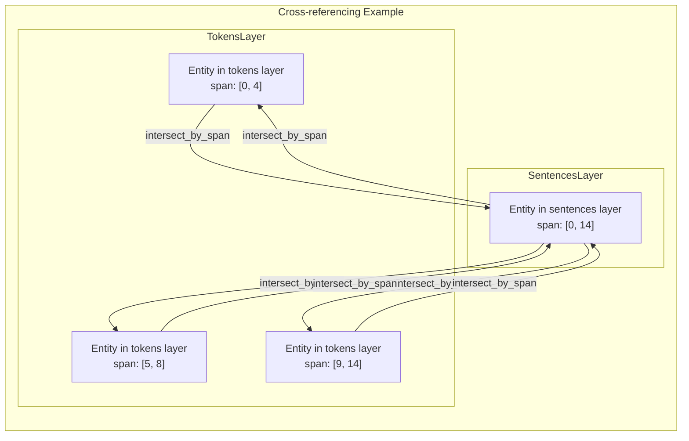

Cross-referencing can be performed in two ways:

1. Using entity attribute access (implicitly uses spans for intersection):
```python
# Get all tokens that intersect with a sentence
tokens_in_sentence = sentence.tokens

# Get all sentences that contain a token
sentences_with_token = token.sentences
```

2. Using explicit intersection methods:
```python
# Find entities by span intersection
tokens_in_sentence = doc.intersect_by_span(query=sentence, name="tokens")

# Find entities by box (visual) intersection
tokens_in_sentence = doc.intersect_by_box(query=sentence, name="tokens")
```

Sources:
- [papermage/magelib/document.py:176-196]()
- [tests/test_magelib/test_document.py:93-152]()

## Serialization

Documents can be serialized to and from JSON for storage and exchange.

### To JSON

```python
# Serialize the entire document
doc_json = doc.to_json()

# Serialize specific layers
doc_json = doc.to_json(layers=["tokens", "sentences"])

# Include images in serialization
doc_json = doc.to_json(with_images=True)
```

The JSON output follows this structure:
```json
{
    "symbols": "document text content",
    "metadata": {"key": "value"},
    "entities": {
        "tokens": [{"spans": [[0, 4]], "boxes": [[0, 0, 1, 1, 0]]}, ...],
        "sentences": [{"spans": [[0, 23]], "boxes": [[0, 0, 10, 1, 0]]}, ...],
        ...
    },
    "relations": {}
}
```

### From JSON

```python
# Deserialize a document
doc = Document.from_json(doc_json)
```

Sources:
- [papermage/magelib/document.py:128-171]()
- [tests/test_magelib/test_document.py:51-91]()

## Layer Name Validation

When adding a layer, the Document class validates that the layer name:
- Is not one of the special fields (symbols, images, metadata)
- Does not already exist in the document
- Does not clash with Document class properties

```python
def validate_layer_name_availability(self, name: str) -> None:
    if name in self.layers:
        raise AssertionError(f"{name} not allowed Document.SPECIAL_FIELDS.")
    if name in self.layers:
        raise AssertionError(f'{name} already exists. Try `doc.remove_layer("{name}")` first.')
    if name in dir(self):
        raise AssertionError(f"{name} clashes with Document class properties.")
```

Sources:
- [papermage/magelib/document.py:61-67]()

## Cross-referencing with Missing Fields

When cross-referencing entities that are missing spans or boxes, the system handles these cases gracefully:

- If searching by span but entities don't have spans, empty results are returned
- If searching by box but entities don't have boxes, empty results are returned

```python
# If chunks have boxes but no spans:
doc.intersect_by_span(query=doc.chunks[0], name="tokens")  # Returns []

# If tokens have spans but no boxes:
doc.intersect_by_box(query=doc.tokens[0], name="chunks")  # Returns []
```

Sources:
- [tests/test_magelib/test_document.py:180-212]()

## Indexing System

The Document uses specialized indexers for efficient entity lookup:

1. `EntitySpanIndexer`: Indexes entities by their text spans
2. `EntityBoxIndexer`: Indexes entities by their visual boxes

These indexers are automatically created for each layer and enable fast cross-referencing operations.

Sources:
- [tests/test_magelib/test_indexer.py:19-127]()
- [papermage/magelib/__init__.py:13]()

## Document Properties and Methods

| Property/Method | Description |
|-----------------|-------------|
| `symbols` | Text content of the document |
| `images` | List of images in the document |
| `metadata` | Document metadata dictionary |
| `layers` | List of all layer names |
| `annotate_layer(name, entities)` | Adds a new layer |
| `get_layer(name)` | Gets a layer by name |
| `remove_layer(name)` | Removes a layer |
| `to_json()` | Serializes to JSON |
| `from_json()` | Deserializes from JSON |
| `intersect_by_span(query, name)` | Finds entities by span intersection |
| `intersect_by_box(query, name)` | Finds entities by box intersection |

Sources:
- [papermage/magelib/document.py:33-196]()

---

# Page: Entity and Layer System

# Entity and Layer System

<details>
<summary>Relevant source files</summary>

The following files were used as context for generating this wiki page:

- [papermage/magelib/__init__.py](papermage/magelib/__init__.py)
- [papermage/magelib/document.py](papermage/magelib/document.py)
- [papermage/magelib/entity.py](papermage/magelib/entity.py)
- [papermage/magelib/layer.py](papermage/magelib/layer.py)
- [papermage/magelib/names.py](papermage/magelib/names.py)
- [papermage/predictors/vila_predictors.py](papermage/predictors/vila_predictors.py)
- [tests/test_magelib/test_document.py](tests/test_magelib/test_document.py)
- [tests/test_magelib/test_indexer.py](tests/test_magelib/test_indexer.py)

</details>


## Purpose and Overview

The Entity and Layer System is the core annotation framework in Papermage that enables representing, managing, and querying structured information extracted from documents. This system provides a flexible way to organize various types of document annotations (such as tokens, sentences, paragraphs, etc.) into logical groupings called Layers, which contain individual annotation units called Entities.

This page explains the structure and functionality of the Entity and Layer classes, how they interact with Documents, and the mechanisms for cross-referencing and searching annotations.

For information about how entities are located in a document, see [Span and Box Representations](#2.3). For information about efficient entity lookup, see [Indexing and Retrieval](#2.4).

## Core Concepts and Relationships

The Entity and Layer System follows a structured hierarchy to organize annotations:

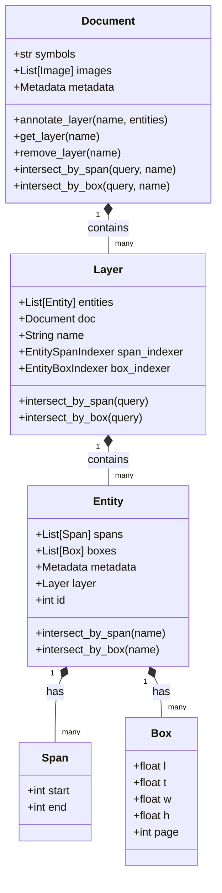

Sources: [papermage/magelib/document.py:33-72](). [papermage/magelib/layer.py:22-37](). [papermage/magelib/entity.py:20-41]().

## Entity Class

An Entity is an individual annotation unit within a document, representing a specific element like a token, sentence, paragraph, or any other documentable unit.

### Key Features of Entity

- Requires at least one of spans (text positions) or boxes (visual bounding boxes)
- Can contain metadata about the entity (e.g., text, label, type)
- References its parent Layer to enable cross-document queries
- Has a unique ID within its layer, establishing a reading order
- Provides methods to access related entities in other layers
- Can be serialized to and from JSON

### Entity Structure and Properties

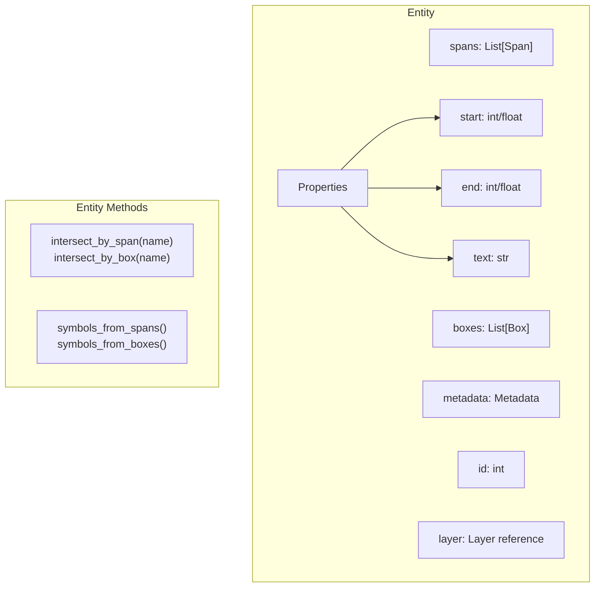

Sources: [papermage/magelib/entity.py:20-98](). [papermage/magelib/entity.py:137-188]().

### Creating and Using Entities

Entities are typically created with spans (text positions) and/or boxes (visual positions):

```python
# Create an entity with spans
entity = Entity(spans=[Span(0, 10)])

# Create an entity with both spans and boxes
entity = Entity(
    spans=[Span(0, 10)], 
    boxes=[Box(10, 20, 100, 30, page=0)],
    metadata=Metadata(label="paragraph")
)
```

An entity can access its text content through several mechanisms:

1. From the `metadata` if explicitly set
2. From the document's `symbols` using spans
3. From intersecting tokens using boxes

Sources: [papermage/magelib/entity.py:137-188](). [tests/test_magelib/test_document.py:94-153]().

## Layer Class

A Layer is a collection of related Entities that represents a specific type of annotation on a document (e.g., tokens, sentences, paragraphs).

### Key Features of Layer

- Contains a list of entities of the same type
- Manages entity indexing and retrieval
- Provides efficient lookup via span and box indexers
- Enables cross-referencing between different layers
- Can be serialized to and from JSON
- Has a name that identifies the type of annotations it contains

### Layer Structure 

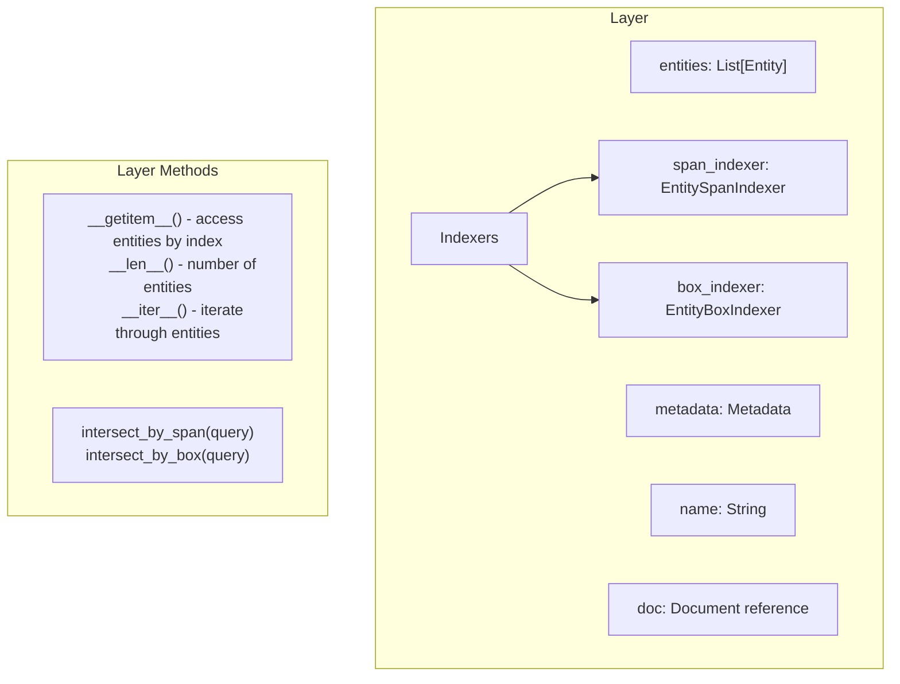

Sources: [papermage/magelib/layer.py:22-110](). [papermage/magelib/document.py:73-92]().

## Document-Entity-Layer Integration

The integration between Documents, Layers, and Entities enables a powerful cross-referencing system where entities in one layer can be used to find related entities in other layers.

### Layer Annotation Process

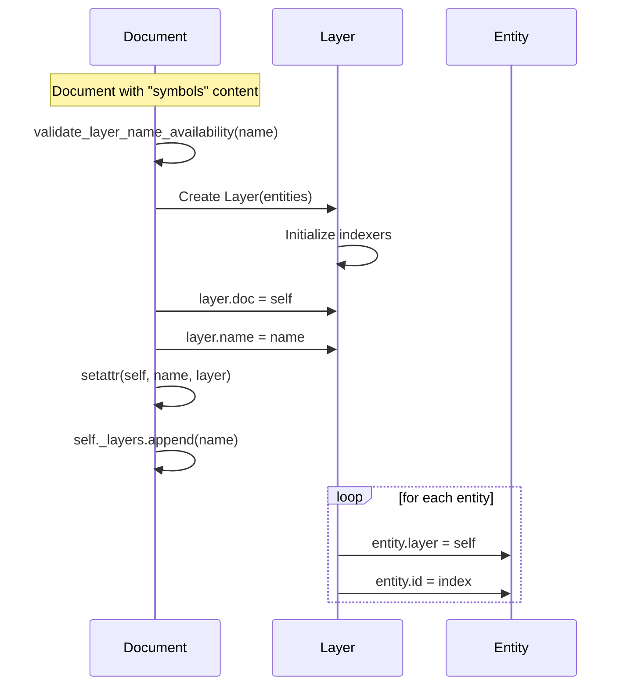

Sources: [papermage/magelib/document.py:73-99](). [papermage/magelib/layer.py:28-37]().

### Cross-Referencing Between Layers

One of the most powerful features of the Entity and Layer system is the ability to cross-reference entities across different layers. This allows for queries like "find all sentences that contain this token" or "find all paragraphs that overlap with this box."

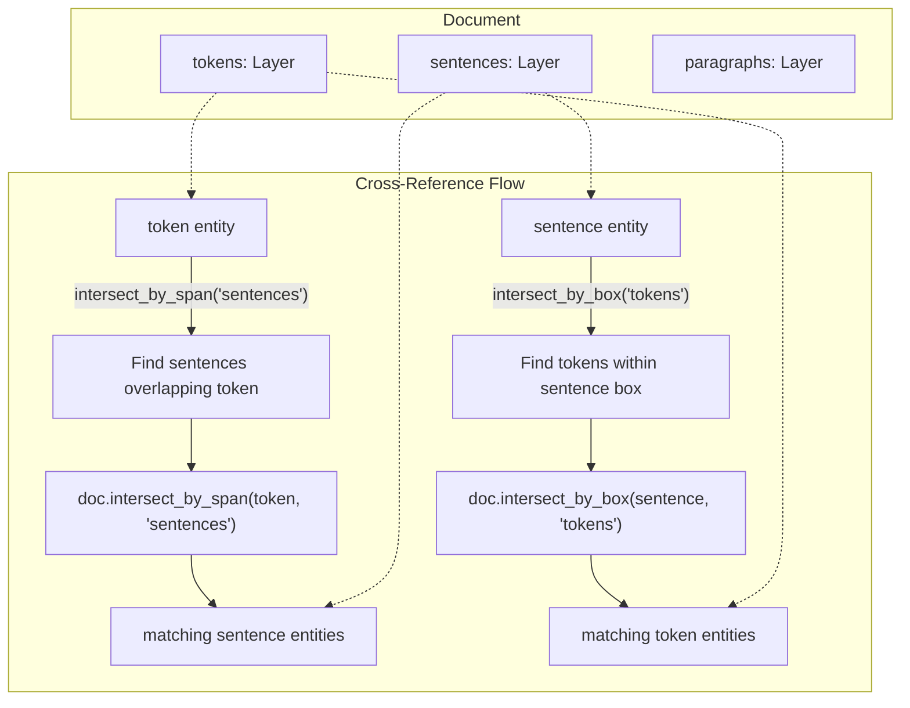

Sources: [papermage/magelib/entity.py:99-135](). [tests/test_magelib/test_document.py:93-152]().

## Standard Layer Types

Papermage defines a set of standard layer names for common document elements:

| Layer Name | Description | Layer Name | Description |
|------------|-------------|------------|-------------|
| tokens | Individual tokens/words | paragraphs | Paragraph blocks |
| rows | Horizontal text rows | pages | Document pages |
| blocks | Visual layout blocks | titles | Document titles |
| words | Word units | authors | Author information |
| sentences | Sentence units | abstracts | Abstract sections |
| sections | Document sections | figures | Figure elements |
| tables | Table elements | captions | Figure/table captions |

Sources: [papermage/magelib/names.py:1-38](). [papermage/magelib/__init__.py:47-86]().

## Practical Example

The following example demonstrates how to use the Entity and Layer system to create and query document annotations:

```python
# Create a document
doc = Document("This is a test document!")

# Create token entities with spans and boxes
tokens = [
    Entity(spans=[Span(0, 4)], boxes=[Box(0, 0, 0.5, 0.5, page=0)]),
    Entity(spans=[Span(5, 7)], boxes=[Box(1, 1, 0.5, 0.5, page=0)]),
    Entity(spans=[Span(8, 9)], boxes=[Box(2, 2, 0.5, 0.5, page=0)]),
    # ...
]

# Create sentence entities 
sentences = [
    Entity(spans=[Span(0, 9)], boxes=[Box(0, 0, 2.01, 2.01, page=0)]),
    Entity(spans=[Span(10, 24)], boxes=[Box(3.0, 3.0, 4.0, 4.0, page=0)]),
]

# Annotate the document with layers
doc.annotate_layer(name="tokens", entities=tokens)
doc.annotate_layer(name="sentences", entities=sentences)

# Find tokens that intersect with the first sentence (by span)
tokens_in_sentence = doc.intersect_by_span(query=sentences[0], name="tokens")

# Find sentences that intersect with a specific token (by box)
sentences_with_token = doc.intersect_by_box(query=tokens[0], name="sentences")

# Entity can directly access related entities in other layers
first_sentence = sentences[0]
tokens_in_first_sentence = first_sentence.intersect_by_span(name="tokens")
```

Sources: [tests/test_magelib/test_document.py:20-152]().

## Entity and Layer Serialization

Both Entities and Layers can be serialized to and from JSON for storage or transmission:

```mermaid
graph TD
    subgraph "Entity Serialization"
        E["Entity"] -->|"to_json()"| EJSON["JSON representation
        {
          spans: [[start, end], ...],
          boxes: [[l, t, w, h, page], ...],
          metadata: {...}
        }"]
        
        EJSON -->|"Entity.from_json()"| E
    end
    
    subgraph "Document Serialization"
        D["Document"] -->|"to_json()"| DJSON["JSON representation
        {
          symbols: \"...\",
          metadata: {...},
          entities: {
            layer1: [{...}, {...}],
            layer2: [{...}, {...}]
          }
        }"]
        
        DJSON -->|"Document.from_json()"| D
    end
```

Sources: [papermage/magelib/entity.py:47-62](). [papermage/magelib/document.py:128-171]().

## Implementation Details

### Entity Reference Management

Entities maintain references to their parent Layer, and Layers maintain references to their parent Document. This bidirectional relationship enables efficient navigation up and down the hierarchy:

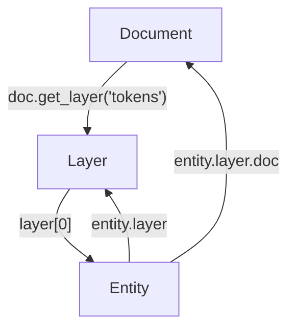

When attaching entities to layers, each entity gets a unique ID that represents its position within the layer:

```python
# When initializing a Layer with entities
for i, entity in enumerate(entities):
    entity.layer = self
    entity.id = i
```

Sources: [papermage/magelib/layer.py:28-37](). [papermage/magelib/entity.py:64-93]().

## Conclusion

The Entity and Layer System provides a flexible and powerful approach to representing and accessing document annotations in Papermage. By organizing annotations into layers of entities, each with spans and/or boxes, the system enables efficient cross-referencing between different types of annotations, making it possible to build complex document understanding applications.

The clear separation of concerns between Documents (containing the raw content), Layers (organizing related annotations), and Entities (representing individual annotations) creates a maintainable and extensible architecture for document processing.

---

# Page: Span and Box Representations

# Span and Box Representations

<details>
<summary>Relevant source files</summary>

The following files were used as context for generating this wiki page:

- [papermage/magelib/box.py](papermage/magelib/box.py)
- [papermage/magelib/entity.py](papermage/magelib/entity.py)
- [papermage/magelib/image.py](papermage/magelib/image.py)
- [papermage/magelib/layer.py](papermage/magelib/layer.py)
- [papermage/magelib/span.py](papermage/magelib/span.py)
- [papermage/predictors/vila_predictors.py](papermage/predictors/vila_predictors.py)

</details>


This page covers the fundamental position representations used in the papermage library: Spans for textual positions and Boxes for visual positions. These building blocks are essential for understanding how document elements are represented in the system. For information about how these are used in Entities and Layers, see [Entity and Layer System](#2.2). For details on how they support indexing and retrieval operations, see [Indexing and Retrieval](#2.4).

## Overview

Papermage uses two primary position representations that serve different but complementary purposes:

1. **Spans**: Text-based intervals that reference positions within the document's text (symbols)
2. **Boxes**: Visual regions that reference areas on the document's pages

These representations allow the system to connect textual and visual elements, enabling sophisticated document understanding capabilities.

## Span Representation

The `Span` class represents a text interval with start and end positions that reference locations within a document's text content.

```mermaid
classDiagram
    class Span {
        +int start
        +int end
        +to_json()
        +from_json()
        +is_overlap(Span)
        +create_enclosing_span(spans)
    }
```

Sources: [papermage/magelib/span.py:1-65]()

### Core Attributes

- **start**: An integer representing the starting position in the document's text
- **end**: An integer representing the ending position in the document's text

### Key Functionality

- **JSON Serialization**: `to_json()` and `from_json()` methods for serialization
- **Overlap Detection**: The `is_overlap()` method determines if two spans overlap
- **Span Creation**: Static method `create_enclosing_span()` creates a span that encloses multiple spans

### Overlap Logic

The `is_overlap()` method determines if two spans overlap using the following logic:

```mermaid
flowchart LR
    A["Span A (start, end)"] --> Check
    B["Span B (start, end)"] --> Check
    Check{{"Check for overlap"}}
    Check --> C["A.start ≤ B.start < A.end"]
    Check --> D["B.start ≤ A.start < B.end"]
    Check --> E["A = B"]
    C --> Result["Overlapping"]
    D --> Result
    E --> Result
```

Sources: [papermage/magelib/span.py:48-50]()

## Box Representation

The `Box` class represents a rectangular region on a document page, defined by position, dimensions, and page number.

```mermaid
classDiagram
    class Box {
        +float l
        +float t
        +float w
        +float h
        +int page
        +to_json()
        +from_json()
        +from_xy_coordinates()
        +xy_coordinates
        +center
        +to_relative()
        +to_absolute()
        +is_overlap()
        +create_enclosing_box()
    }
```

Sources: [papermage/magelib/box.py:1-156]()

### Core Attributes

- **l**: Left position (x-coordinate)
- **t**: Top position (y-coordinate) 
- **w**: Width of the box
- **h**: Height of the box
- **page**: Page number where the box is located

### Coordinate Systems

Boxes can work with both absolute coordinates (in pixels) and relative coordinates (normalized to page dimensions):

```mermaid
flowchart LR
    subgraph "Absolute Coordinates (pixels)"
        A["Box(l=100, t=200, w=300, h=400, page=0)"]
    end
    
    subgraph "Relative Coordinates (0-1 scale)"
        B["Box(l=0.1, t=0.2, w=0.3, h=0.4, page=0)"]
    end
    
    A --"to_relative(1000, 1000)"--> B
    B --"to_absolute(1000, 1000)"--> A
```

Sources: [papermage/magelib/box.py:96-114]()

### Key Functionality

- **Coordinate Conversion**: 
  - `to_relative()`: Converts absolute coordinates to relative (0-1 range)
  - `to_absolute()`: Converts relative coordinates to absolute (pixel values)
- **Coordinate Access**:
  - `xy_coordinates`: Returns (x1, y1, x2, y2) tuple
  - `center`: Returns the center point of the box
- **Box Creation**:
  - `from_xy_coordinates()`: Creates a box from (x1, y1, x2, y2) coordinates
  - `create_enclosing_box()`: Creates a box that encloses multiple boxes

### Overlap Detection

Box overlap detection works by checking overlap on both x and y axes:

```mermaid
flowchart TD
    Start["Check overlap"] --> SamePage{"Same page?"}
    SamePage -- "No" --> NoOverlap["No overlap"]
    SamePage -- "Yes" --> CheckX["Check x-axis overlap"]
    CheckX -- "No overlap" --> NoOverlap
    CheckX -- "Overlaps" --> CheckY["Check y-axis overlap"]
    CheckY -- "No overlap" --> NoOverlap
    CheckY -- "Overlaps" --> Overlap["Boxes overlap"]
```

Sources: [papermage/magelib/box.py:120-141]()

## Entities with Spans and Boxes

The `Entity` class combines both Span and Box representations, allowing it to reference both textual and visual elements in a document.

```mermaid
classDiagram
    class Entity {
        +List~Span~ spans
        +List~Box~ boxes
        +Metadata metadata
        +start
        +end
        +text
        +symbols_from_spans
        +symbols_from_boxes
        +intersect_by_span()
        +intersect_by_box()
    }
    
    class Span {
        +int start
        +int end
    }
    
    class Box {
        +float l
        +float t
        +float w
        +float h
        +int page
    }
    
    Entity "1" *-- "many" Span
    Entity "1" *-- "many" Box
```

Sources: [papermage/magelib/entity.py:1-198]()

### Entity Requirements

An Entity must have at least one Span or one Box:

```mermaid
flowchart LR
    Start["Create Entity"] --> Check{"spans or boxes?"}
    Check -- "Neither" --> Error["Error: At least one required"]
    Check -- "At least one" --> Valid["Valid Entity created"]
```

Sources: [papermage/magelib/entity.py:23-35]()

### Text Access Methods

Entities can access their text content in multiple ways:

1. **From Metadata**: Pre-stored text in metadata
2. **From Spans**: Text derived from spans and document symbols
3. **From Boxes**: Text derived from boxes by finding intersecting tokens

```mermaid
flowchart TD
    Text["Entity.text"] --> Metadata{"Metadata text exists?"}
    Metadata -- "Yes" --> MetadataText["Return metadata text"]
    Metadata -- "No" --> Spans{"Has spans?"}
    Spans -- "Yes" --> SpansText["Return text from spans"]
    Spans -- "No" --> Boxes{"Has boxes?"}
    Boxes -- "Yes" --> BoxesText["Return text from intersecting tokens"]
    Boxes -- "No" --> EmptyText["Return empty string"]
```

Sources: [papermage/magelib/entity.py:173-184]()

## Using Spans and Boxes in Document Processing

Spans and Boxes play critical roles in document processing within the papermage system:

### In Tokenization and Content Analysis

Spans are primarily used for text-based operations:
- Identifying token boundaries
- Representing sentences and paragraphs
- Processing content sequentially

### In Layout Analysis

Boxes are used for visual layout understanding:
- Representing physical positions of elements
- Detecting visual blocks
- Working with images and figures

### Coordinate Normalization for Model Input

When preparing visual layout analysis, box coordinates are normalized to a standard size:

```mermaid
flowchart LR
    subgraph "Document Processing"
        A["Original document page"] --> B["Extract tokens with boxes"]
        B --> C["Normalize coordinates"]
        C --> D["Pass to layout model"]
    end
```

Sources: [papermage/predictors/vila_predictors.py:71-92]()

## Practical Usage Examples

### Converting Document Page to Model Input

The VILA predictor shows how Boxes are used to prepare document layout for machine learning models:

```mermaid
flowchart TD
    Document["Document page"] --> Extract["Extract tokens with boxes"]
    Extract --> Convert["Convert to absolute coordinates"]
    Convert --> Associate["Associate with visual blocks"]
    Associate --> CreateDict["Create PDF dict for model"]
```

Sources: [papermage/predictors/vila_predictors.py:122-173]()

### Determining Text from Visual Positions

Entities can extract text content from visual positions by:
1. Finding tokens that intersect with the Entity's boxes
2. Extracting the text content from those tokens

```mermaid
flowchart LR
    BoxEntity["Entity with boxes"] --> FindTokens["Find intersecting tokens"]
    FindTokens --> ExtractText["Extract text from token spans"]
    ExtractText --> CombineText["Combine text fragments"]
```

Sources: [papermage/magelib/entity.py:158-170]()

## Best Practices

When working with Spans and Boxes in papermage:

1. **Use Spans** when working with textual content or when sequential order matters
2. **Use Boxes** when working with visual layout or when spatial relationships matter
3. **Use Both** in entities that need to connect textual and visual representations
4. **Consider Coordinate Systems**:
   - Relative coordinates (0-1) are better for storage and portability
   - Absolute coordinates (pixels) are needed for visualization and some processing tasks

| Representation | Best For | Key Methods | Common Use Cases |
|----------------|----------|-------------|------------------|
| Span | Text positions | `is_overlap()`, `create_enclosing_span()` | Tokens, sentences, paragraphs |
| Box | Visual regions | `is_overlap()`, `to_relative()`, `to_absolute()` | Blocks, figures, tables, layout elements |

Sources: [papermage/magelib/span.py:1-65](), [papermage/magelib/box.py:1-156]()

## Summary

Span and Box representations form the foundation of the papermage document model:

- **Spans** provide text-based positioning with start and end indices
- **Boxes** provide visual positioning with coordinates, dimensions, and page numbers
- **Entities** can combine both representations to create a comprehensive document model
- The system provides efficient methods for working with both types of positions
- These representations enable sophisticated document understanding by connecting textual content with visual layout

---

# Page: Indexing and Retrieval

# Indexing and Retrieval

<details>
<summary>Relevant source files</summary>

The following files were used as context for generating this wiki page:

- [papermage/magelib/indexer.py](papermage/magelib/indexer.py)
- [papermage/utils/annotate.py](papermage/utils/annotate.py)
- [tests/fixtures/2304.02623v1.json](tests/fixtures/2304.02623v1.json)
- [tests/fixtures/preprocessed_training_docs_tiny.pt](tests/fixtures/preprocessed_training_docs_tiny.pt)
- [tests/test_magelib/test_document.py](tests/test_magelib/test_document.py)
- [tests/test_magelib/test_indexer.py](tests/test_magelib/test_indexer.py)

</details>


This page describes the indexing system used within the papermage library for efficient entity search and cross-referencing between different layers in documents. The indexing and retrieval capabilities enable fast lookups of entities based on their span or spatial positions, facilitating powerful cross-document analysis.

For details about the underlying Span and Box representations used by the indexing system, see [Span and Box Representations](#2.3).

## Overview

The indexing system in papermage enables efficient lookup of entities based on either text spans or visual position (boxes). This is a critical component that powers cross-referencing between different annotation layers, such as finding all tokens within a paragraph, or all figures within a section.

```mermaid
graph TD
    subgraph "Indexing System"
        Indexer["Indexer (abstract)"]
        EntitySpanIndexer["EntitySpanIndexer"]
        EntityBoxIndexer["EntityBoxIndexer"]
        
        Indexer -->|implements| EntitySpanIndexer
        Indexer -->|implements| EntityBoxIndexer
    end
    
    subgraph "Document Operations"
        Doc["Document"]
        Find["find()"]
        IntersectSpan["intersect_by_span()"]
        IntersectBox["intersect_by_box()"]
        
        Doc -->|uses| Find
        Doc -->|uses| IntersectSpan
        Doc -->|uses| IntersectBox
        
        IntersectSpan -->|uses| EntitySpanIndexer
        IntersectBox -->|uses| EntityBoxIndexer
    end
    
    subgraph "Entity Query Example"
        Paragraph["Paragraph Entity"]
        Tokens["Token Entities"]
        
        Paragraph -->|"find overlapping tokens"| Tokens
    end
```

Sources: [papermage/magelib/indexer.py:19-26](), [tests/test_magelib/test_document.py:93-151]()

## Core Indexer Classes

The indexing system is built around two primary indexer implementations that share a common interface but use different search criteria:

### Indexer Interface

All indexers in papermage share a common abstract base class that defines the core functionality:

```mermaid
classDiagram
    class Indexer {
        <<abstract>>
        +find(query: Entity) -> List[Entity]
    }
    
    class EntitySpanIndexer {
        -_entities: List[Entity]
        -_index: NCLS
        +__init__(entities: List[Entity])
        -_ensure_disjoint() -> None
        +find(query: Entity) -> List[Entity]
    }
    
    class EntityBoxIndexer {
        -_entities: List[Entity]
        -_box_id_to_entity_id: Dict
        -_boxes: List[Box]
        -_np_boxes_x1, _np_boxes_y1, etc.
        +__init__(entities: List[Entity], allow_overlap: bool)
        -_find_overlap_boxes(query: Box) -> List[int]
        -_find_overlap_entities(query: Box) -> List[int]
        -_ensure_disjoint() -> None
        +find(query: Entity) -> List[Entity]
    }
    
    Indexer <|-- EntitySpanIndexer
    Indexer <|-- EntityBoxIndexer
```

Sources: [papermage/magelib/indexer.py:19-26]()

### EntitySpanIndexer

`EntitySpanIndexer` provides efficient lookup of entities based on text span overlap. It uses a Nested Containment List (NCLS) data structure for fast intersection queries.

```python
# Example usage of EntitySpanIndexer
entities_to_index = [
    Entity(spans=[Span(0, 5), Span(5, 8)]),
    Entity(spans=[Span(9, 10)]),
    Entity(spans=[Span(100, 105)])
]

index = EntitySpanIndexer(entities_to_index)

# Query with an entity that has overlapping spans
query = Entity(spans=[Span(1, 7), Span(9, 20)])
matches = index.find(query)  # Will find entities that overlap with query spans
```

Key features:
- Requires indexed entities to have non-overlapping spans
- Built on the NCLS data structure for O(log n) lookup time
- Used for text-based entity retrieval

Sources: [papermage/magelib/indexer.py:29-99](), [tests/test_magelib/test_indexer.py:19-70]()

### EntityBoxIndexer

`EntityBoxIndexer` enables efficient lookup of entities based on visual box overlap. It uses NumPy arrays and vectorized operations for fast spatial queries.

```python
# Example usage of EntityBoxIndexer
entities_to_index = [
    Entity(boxes=[Box(0, 0, 1, 1, page=0), Box(2, 2, 1, 1, page=0)]),
    Entity(boxes=[Box(4, 4, 1, 1, page=0)]),
    Entity(boxes=[Box(100, 100, 1, 1, page=0)])
]

index = EntityBoxIndexer(entities_to_index)

# Query with an entity that has overlapping boxes
query = Entity(boxes=[Box(1, 1, 5, 5, page=0)])
matches = index.find(query)  # Will find entities with boxes that overlap with query boxes
```

Key features:
- Can optionally allow indexed entities to have overlapping boxes
- Uses NumPy for vectorized computation of spatial overlaps
- Accounts for page numbers when determining overlaps
- Used for visual/spatial entity retrieval

Sources: [papermage/magelib/indexer.py:102-172](), [tests/test_magelib/test_indexer.py:72-126]()

## Cross-Referencing in Documents

The Document class provides several methods for cross-referencing entities across different layers, all powered by the indexing system.

```mermaid
sequenceDiagram
    participant Client
    participant Document
    participant Layer
    participant EntitySpanIndexer
    participant EntityBoxIndexer
    
    Client->>Document: doc.intersect_by_span(query_entity, "tokens")
    Document->>Layer: Get "tokens" layer
    Layer->>EntitySpanIndexer: Find overlapping entities
    EntitySpanIndexer-->>Document: Return matching entities
    Document-->>Client: Return results
    
    Client->>Document: doc.intersect_by_box(query_entity, "figures")
    Document->>Layer: Get "figures" layer
    Layer->>EntityBoxIndexer: Find overlapping entities
    EntityBoxIndexer-->>Document: Return matching entities
    Document-->>Client: Return results
    
    Client->>Document: doc.chunks[0].tokens (attribute access)
    Note over Document: Implicitly uses intersect_by_span
    Document->>Layer: Get "tokens" layer
    Layer->>EntitySpanIndexer: Find entities overlapping with chunks[0]
    EntitySpanIndexer-->>Document: Return matching entities
    Document-->>Client: Return results
```

Sources: [tests/test_magelib/test_document.py:93-151]()

### Cross-Reference Methods

The Document class provides three main methods for cross-referencing:

1. `intersect_by_span(query, name)`: Finds entities in the specified layer that have spans overlapping with the query entity's spans.

2. `intersect_by_box(query, name)`: Finds entities in the specified layer that have boxes overlapping with the query entity's boxes.

3. `find(query, name)`: A unified method that accepts either a Span or Box as query and delegates to the appropriate intersection method.

Sources: [tests/test_magelib/test_document.py:231-247]()

### Attribute-Based Access

In addition to the explicit methods, Document also supports a convenient attribute-based access pattern for cross-referencing:

```python
# Get all tokens that overlap with the first chunk (by span)
tokens_in_chunk = doc.chunks[0].tokens

# Equivalent to:
tokens_in_chunk = doc.intersect_by_span(query=doc.chunks[0], name="tokens")
```

This works because the Document class implements a dynamic `__getattr__` method that performs the appropriate intersection based on the entity's available spans or boxes.

Sources: [tests/test_magelib/test_document.py:114-126]()

## Handling Edge Cases

The indexing system is designed to handle various edge cases gracefully:

### Missing Spans or Boxes

When entities are missing either spans or boxes, the cross-referencing methods return empty results:

```python
# Entities with spans but no boxes
tokens = [Entity(spans=[[0, 4]]) for _ in range(6)]
# Entities with boxes but no spans
chunks = [Entity(boxes=[[0, 0, 2.01, 2.01, 0]]) for _ in range(3)]

doc.annotate_layer(name="tokens", entities=tokens)
doc.annotate_layer(name="chunks", entities=chunks)

# Box-based intersection will return empty results
doc.intersect_by_box(query=doc.tokens[0], name="chunks")  # Returns []
```

Sources: [tests/test_magelib/test_document.py:180-211]()

### Disjoint Entity Constraints

By default, `EntitySpanIndexer` requires all indexed entities to have non-overlapping spans. This constraint can be verified using the `_ensure_disjoint` method. The `EntityBoxIndexer` can optionally allow overlapping boxes with the `allow_overlap` parameter.

```python
# This will raise a ValueError due to overlapping spans
entities = [Entity(spans=[Span(0, 5), Span(4, 7)])]
indexer = EntitySpanIndexer(entities=entities)  # Raises ValueError

# This will also raise a ValueError
entities = [
    Entity(spans=[Span(0, 5), Span(5, 8)]), 
    Entity(spans=[Span(6, 10)])
]
indexer = EntitySpanIndexer(entities)  # Raises ValueError
```

Sources: [papermage/magelib/indexer.py:62-78](), [tests/test_magelib/test_indexer.py:23-33]()

## Practical Applications

The indexing and retrieval system enables many practical document processing use cases:

1. **Hierarchical Access**: Easily navigate between different granularities of document representation (e.g., from paragraphs to sentences to tokens).

2. **Spatial Analysis**: Find entities based on their visual position in the document, such as identifying all elements within a specific region.

3. **Cross-Modal Alignment**: Connect textual entities with visual elements by finding overlaps between text spans and visual boxes.

4. **Annotation Enrichment**: Create new layers of annotations based on existing ones by finding and processing intersecting entities.

```mermaid
graph LR
    subgraph "Document Structure"
        Document(["Document"])
        Layers["Layer Collection"]
        Sections["Sections Layer"]
        Paragraphs["Paragraphs Layer"]
        Sentences["Sentences Layer"]
        Tokens["Tokens Layer"]
        
        Document -->|contains| Layers
        Layers -->|contains| Sections
        Layers -->|contains| Paragraphs
        Layers -->|contains| Sentences
        Layers -->|contains| Tokens
    end
    
    subgraph "Cross-Referencing Examples"
        GetTokens["Get all tokens in paragraph"]
        GetSentences["Get all sentences in section"]
        ClassifyParagraph["Classify paragraph by tokens"]
        
        Paragraphs -->|intersect_by_span| GetTokens
        Sections -->|intersect_by_span| GetSentences
        Tokens -->|intersect_by_span| ClassifyParagraph
    end
```

Sources: [tests/test_magelib/test_document.py:93-151]()

## Performance Considerations

The indexing system is designed for efficient entity lookup, but there are important performance considerations:

1. **Indexing Cost**: Building indexes can be expensive for documents with many entities. Indexes are built lazily when needed.

2. **Query Complexity**: The performance of queries depends on the number of spans or boxes in both the query entity and the indexed entities.

3. **Disjoint Constraint**: Enforcing the disjoint constraint requires O(n²) time for `EntitySpanIndexer` during initialization, which could be slow for large entity collections.

4. **Page-Aware Box Operations**: Box intersection operations account for page numbers, which means entities on different pages won't intersect regardless of their spatial overlap.

5. **Order Preservation**: The `find` method returns entities in their original document order to maintain semantic coherence.

Sources: [papermage/magelib/indexer.py:95-98](), [papermage/magelib/indexer.py:134-140]()

## Summary

The papermage indexing and retrieval system provides powerful tools for efficient entity lookup and cross-referencing. Through the combination of text-based span indexing and spatial box indexing, it enables complex document analysis tasks with a simple, consistent interface. This system is a core part of the document processing pipeline and supports many of the library's higher-level features.

---

# Page: Document Processing Pipeline

# Document Processing Pipeline

<details>
<summary>Relevant source files</summary>

The following files were used as context for generating this wiki page:

- [papermage/recipes/core_recipe.py](papermage/recipes/core_recipe.py)
- [scripts/get_thumbnails_for_papers.py](scripts/get_thumbnails_for_papers.py)
- [tests/fixtures/2302.07302v1.pdf](tests/fixtures/2302.07302v1.pdf)
- [tests/test_predictors/test_vila_predictor.py](tests/test_predictors/test_vila_predictor.py)
- [tests/test_recipes/test_core_recipe.py](tests/test_recipes/test_core_recipe.py)

</details>


## Purpose and Scope

This document explains the document processing pipeline in the papermage library, focusing on the conversion of PDFs into structured Document objects with multiple layers of annotations. The pipeline incorporates PDF parsing, rasterization, and the application of various predictors to identify and annotate different types of entities within documents.

For information about the underlying data structures that represent documents and their content, see the [Core Data Model](#2) documentation.

## Pipeline Overview

The document processing pipeline is primarily implemented through the `CoreRecipe` class, which orchestrates the entire conversion process from PDF to an enriched Document object.

### Pipeline Workflow Diagram

```mermaid
flowchart TD
    PDF["PDF Document"] --> Parser["PDFPlumberParser"]
    PDF --> Rasterizer["PDF2ImageRasterizer"]
    Parser --> |"parse()"| Document["Document with Text"]
    Rasterizer --> |"rasterize()"| Images["Page Images"]
    Images --> |"annotate_images()"| Document
    
    Document --> SentPredictor["PysbdSentencePredictor"]
    Document --> BlockPredictor["LPEffDetPubLayNetBlockPredictor"]
    
    SentPredictor --> |"predict()"| Sentences["Sentences Layer"]
    BlockPredictor --> |"predict()"| Blocks["Blocks Layer"]
    
    Sentences --> |"annotate_layer()"| EnrichedDocument["Document with Layers"]
    Blocks --> |"annotate_layer()"| EnrichedDocument
    
    Blocks --> FigureExtraction["Figure/Table Extraction"]
    FigureExtraction --> |"annotate_layer()"| EnrichedDocument
    
    EnrichedDocument --> VILAPredictor["IVILATokenClassificationPredictor"]
    VILAPredictor --> |"predict()"| VILAEntities["VILA Entities"]
    VILAEntities --> |"group_by()"| GroupedEntities["Semantic Entity Layers"]
    GroupedEntities --> |"annotate()"| FinalDocument["Final Document"]
```

Sources: [papermage/recipes/core_recipe.py:78-152]()

## Key Components

### CoreRecipe

The `CoreRecipe` class is the central orchestrator of the document processing pipeline, initializing all necessary components and providing methods to process PDFs.

```mermaid
classDiagram
    class CoreRecipe {
        +parser: PDFPlumberParser
        +rasterizer: PDF2ImageRasterizer
        +publaynet_block_predictor: LPEffDetPubLayNetBlockPredictor
        +ivila_predictor: IVILATokenClassificationPredictor
        +sent_predictor: PysbdSentencePredictor
        +from_pdf(pdf: Path): Document
        +from_doc(doc: Document): Document
    }
    
    class PDFPlumberParser {
        +parse(input_pdf_path: Path): Document
    }
    
    class PDF2ImageRasterizer {
        +rasterize(input_pdf_path: Path, dpi: int): List[Image]
        +attach_images(images: List[Image], doc: Document): None
    }
    
    class BasePredictor {
        <<abstract>>
        +predict(doc: Document): List[Entity]
    }
    
    class PysbdSentencePredictor {
        +predict(doc: Document): List[Entity]
    }
    
    class LPEffDetPubLayNetBlockPredictor {
        +predict(doc: Document): List[Entity]
    }
    
    class IVILATokenClassificationPredictor {
        +predict(doc: Document): List[Entity]
    }
    
    BasePredictor <|-- PysbdSentencePredictor
    BasePredictor <|-- LPEffDetPubLayNetBlockPredictor
    BasePredictor <|-- IVILATokenClassificationPredictor
    
    CoreRecipe --> PDFPlumberParser: uses
    CoreRecipe --> PDF2ImageRasterizer: uses
    CoreRecipe --> PysbdSentencePredictor: uses
    CoreRecipe --> LPEffDetPubLayNetBlockPredictor: uses
    CoreRecipe --> IVILATokenClassificationPredictor: uses
```

Sources: [papermage/recipes/core_recipe.py:77-99]()

### Pipeline Components

The pipeline consists of several specialized components that work together:

#### 1. PDF Parser

The `PDFPlumberParser` extracts text and layout information from the PDF document, creating the initial Document object with text content.

Sources: [papermage/recipes/core_recipe.py:89](), [papermage/parsers/pdfplumber_parser.py]()

#### 2. PDF Rasterizer

The `PDF2ImageRasterizer` converts each PDF page into images, which are then attached to the Document object, enabling visual processing.

Sources: [papermage/recipes/core_recipe.py:90](), [papermage/rasterizers/rasterizer.py]()

#### 3. Predictors

Various predictors analyze the document and identify different types of entities:

- **PysbdSentencePredictor**: Identifies sentence boundaries within the document text
- **LPEffDetPubLayNetBlockPredictor**: Detects visual blocks like figures, tables, and text regions
- **IVILATokenClassificationPredictor**: Classifies document components using Visual Layout Analysis

Sources: [papermage/recipes/core_recipe.py:96-98]()

## Processing Steps

### 1. Recipe Initialization

When a `CoreRecipe` is created, it initializes all the necessary components:

```python
def __init__(
    self,
    ivila_predictor_path: str = "allenai/ivila-row-layoutlm-finetuned-s2vl-v2",
    bio_roberta_predictor_path: str = "allenai/vila-roberta-large-s2vl-internal",
    svm_word_predictor_path: str = "...",
    dpi: int = 72,
):
    # Initialize components
    self.parser = PDFPlumberParser()
    self.rasterizer = PDF2ImageRasterizer()
    self.publaynet_block_predictor = LPEffDetPubLayNetBlockPredictor.from_pretrained()
    self.ivila_predictor = IVILATokenClassificationPredictor.from_pretrained(ivila_predictor_path)
    self.sent_predictor = PysbdSentencePredictor()
```

Sources: [papermage/recipes/core_recipe.py:78-99]()

### 2. PDF Processing

The `from_pdf` method handles the initial processing of a PDF file:

```mermaid
sequenceDiagram
    participant Client
    participant CoreRecipe as "CoreRecipe"
    participant Parser as "PDFPlumberParser"
    participant Rasterizer as "PDF2ImageRasterizer"
    
    Client->>CoreRecipe: from_pdf(pdf_path)
    CoreRecipe->>Parser: parse(pdf_path)
    Parser-->>CoreRecipe: document
    CoreRecipe->>Rasterizer: rasterize(pdf_path, dpi)
    Rasterizer-->>CoreRecipe: images
    CoreRecipe->>CoreRecipe: document.annotate_images(images)
    CoreRecipe->>Rasterizer: attach_images(images, document)
    CoreRecipe->>CoreRecipe: from_doc(document)
    CoreRecipe-->>Client: enriched document
```

Sources: [papermage/recipes/core_recipe.py:101-109]()

### 3. Entity Prediction and Annotation

The `from_doc` method applies various predictors to identify entities and annotate the document:

#### 3.1. Sentence Prediction

Identify and annotate sentences in the document:

```python
sentences = self.sent_predictor.predict(doc=doc)
doc.annotate_layer(name=SentencesFieldName, entities=sentences)
```

Sources: [papermage/recipes/core_recipe.py:116-118]()

#### 3.2. Block Prediction

Identify and annotate layout blocks in the document:

```python
blocks = self.publaynet_block_predictor.predict(doc=doc)
doc.annotate_layer(name=BlocksFieldName, entities=blocks)
```

Sources: [papermage/recipes/core_recipe.py:120-124]()

#### 3.3. Figure and Table Extraction

Extract figures and tables from the predicted blocks:

```python
for block in blocks:
    if block.metadata.type == "Figure":
        figure = Entity(boxes=block.boxes)
        figures.append(figure)
    elif block.metadata.type == "Table":
        table = Entity(boxes=block.boxes)
        tables.append(table)
doc.annotate_layer(name=FiguresFieldName, entities=figures)
doc.annotate_layer(name=TablesFieldName, entities=tables)
```

Sources: [papermage/recipes/core_recipe.py:126-137]()

#### 3.4. VILA Entity Prediction

Predict and annotate semantic entities using the VILA predictor:

```python
vila_entities = self.ivila_predictor.predict(doc=doc)
doc.annotate_layer(name="vila_entities", entities=vila_entities)

# Process VILA entities
for entity in vila_entities:
    entity.boxes = [
        Box.create_enclosing_box(
            [b for t in doc.intersect_by_span(entity, name=TokensFieldName) for b in t.boxes]
        )
    ]
    
# Group entities by type
preds = group_by(entities=vila_entities, metadata_field="label", metadata_values_map=VILA_LABELS_MAP)
doc.annotate(*preds)
```

Sources: [papermage/recipes/core_recipe.py:140-152]()

## Entity Types

The pipeline identifies and annotates various types of document entities. The VILA predictor, in particular, identifies a wide range of semantic components mapped as follows:

| VILA Label      | Entity Type in papermage     |
|-----------------|------------------------------|
| Title           | TitlesFieldName              |
| Paragraph       | ParagraphsFieldName          |
| Author          | AuthorsFieldName             |
| Abstract        | AbstractsFieldName           |
| Keywords        | KeywordsFieldName            |
| Section         | SectionsFieldName            |
| List            | ListsFieldName               |
| Bibliography    | BibliographiesFieldName      |
| Equation        | EquationsFieldName           |
| Algorithm       | AlgorithmsFieldName          |
| Caption         | CaptionsFieldName            |
| Header          | HeadersFieldName             |
| Footer          | FootersFieldName             |
| Footnote        | FootnotesFieldName           |

Sources: [papermage/recipes/core_recipe.py:57-74]()

## Using the Pipeline

Here's a basic example of using the CoreRecipe to process a PDF:

```python
from papermage.recipes import CoreRecipe
from pathlib import Path

# Create a CoreRecipe instance
recipe = CoreRecipe()

# Process a PDF file
pdf_path = Path("sample.pdf")
doc = recipe.from_pdf(pdf=pdf_path)

# Access annotated entities
sentences = doc.get_layer("sentences")
blocks = doc.get_layer("blocks")
figures = doc.get_layer("figures")
tables = doc.get_layer("tables")
titles = doc.get_layer("titles")
paragraphs = doc.get_layer("paragraphs")
```

Sources: [tests/test_recipes/test_core_recipe.py:13-34]()

## Applications

The document processing pipeline enables a wide range of applications:

1. **Document Structure Analysis**: Extract the logical structure of documents
2. **Content Extraction**: Isolate specific content types (figures, tables, equations)
3. **Semantic Analysis**: Identify and analyze document components by type
4. **Layout Understanding**: Extract layout information for downstream tasks
5. **Information Retrieval**: Enable targeted search within specific document components

## Conclusion

The document processing pipeline provides a comprehensive framework for converting PDFs into richly annotated Document objects. By applying a sequence of specialized processors, it progressively builds layers of annotations that capture both the visual layout and semantic structure of the document.

This pipeline serves as the foundation for document understanding tasks within the papermage library, enabling applications that require detailed analysis of document content and structure.

For more details on specific components of the pipeline, see the [Parsers](#3.2) documentation and the [Predictors](#4) section.

---

# Page: CoreRecipe

# CoreRecipe

<details>
<summary>Relevant source files</summary>

The following files were used as context for generating this wiki page:

- [README.md](README.md)
- [papermage/recipes/core_recipe.py](papermage/recipes/core_recipe.py)
- [pyproject.toml](pyproject.toml)
- [scripts/get_thumbnails_for_papers.py](scripts/get_thumbnails_for_papers.py)
- [tests/fixtures/2020.acl-main.447.pdf](tests/fixtures/2020.acl-main.447.pdf)
- [tests/fixtures/2302.07302v1.pdf](tests/fixtures/2302.07302v1.pdf)
- [tests/test_predictors/test_vila_predictor.py](tests/test_predictors/test_vila_predictor.py)
- [tests/test_recipes/test_core_recipe.py](tests/test_recipes/test_core_recipe.py)

</details>


CoreRecipe is the primary document processing pipeline in papermage, responsible for converting PDF scientific papers into structured Document objects with various layers of annotations. It serves as the standard recipe for processing scientific PDFs, incorporating parsers, rasterizers, and predictors to extract and annotate document content.

This page details the implementation, components, and processing flow of CoreRecipe. For information about simpler recipes with fewer features, see [Minimal Recipes](#3.3).

## Architecture and Components

CoreRecipe builds on the Recipe base class, implementing a full pipeline for PDF processing:

```mermaid
classDiagram
    class Recipe {
        <<abstract>>
        +run(pdf_path)
    }
    
    class CoreRecipe {
        -PDFPlumberParser parser
        -PDF2ImageRasterizer rasterizer
        -PysbdSentencePredictor sent_predictor
        -LPEffDetPubLayNetBlockPredictor publaynet_block_predictor
        -IVILATokenClassificationPredictor ivila_predictor
        +__init__(ivila_predictor_path, bio_roberta_predictor_path, svm_word_predictor_path, dpi)
        +from_pdf(pdf)
        +from_doc(doc)
    }
    
    Recipe <|-- CoreRecipe
```

Sources: [papermage/recipes/core_recipe.py:77-101]()

CoreRecipe integrates the following components:

| Component | Class | Purpose |
|-----------|-------|---------|
| Parser | `PDFPlumberParser` | Extracts text content from PDFs |
| Rasterizer | `PDF2ImageRasterizer` | Converts PDF pages to images |
| Sentence Predictor | `PysbdSentencePredictor` | Segments text into sentences |
| Block Predictor | `LPEffDetPubLayNetBlockPredictor` | Identifies layout blocks (figures, tables) |
| Entity Predictor | `IVILATokenClassificationPredictor` | Classifies text regions into semantic entities |

The initialization of CoreRecipe instantiates these components with configurable paths to pre-trained models:

```python
def __init__(
    self,
    ivila_predictor_path: str = "allenai/ivila-row-layoutlm-finetuned-s2vl-v2",
    bio_roberta_predictor_path: str = "allenai/vila-roberta-large-s2vl-internal",
    svm_word_predictor_path: str = "https://ai2-s2-research-public.s3.us-west-2.amazonaws.com/mmda/models/svm_word_predictor.tar.gz",
    dpi: int = 72,
):
```

Sources: [papermage/recipes/core_recipe.py:78-99]()

## Processing Pipeline

CoreRecipe implements a multi-stage processing pipeline converting PDFs to structured documents:

```mermaid
flowchart TD
    PDF["PDF Document"] --> Parser["PDFPlumberParser.parse()"]
    Parser --> Doc["Basic Document"]
    
    PDF --> Rasterizer["PDF2ImageRasterizer.rasterize()"]
    Rasterizer --> Images["Page Images"]
    
    Doc --> AttachImages["Attach Images to Document"]
    Images --> AttachImages
    
    AttachImages --> SentencePredictor["PysbdSentencePredictor.predict()"]
    SentencePredictor --> Sentences["Sentence Entities"]
    
    Sentences --> BlockPredictor["LPEffDetPubLayNetBlockPredictor.predict()"]
    BlockPredictor --> Blocks["Block Entities"]
    
    Blocks --> ExtractFiguresTables["Extract Figures & Tables"]
    ExtractFiguresTables --> |figures| Figures["Figure Entities"]
    ExtractFiguresTables --> |tables| Tables["Table Entities"]
    
    Figures --> VILAPredictor["IVILATokenClassificationPredictor.predict()"]
    Tables --> VILAPredictor
    VILAPredictor --> VILAEntities["VILA Entities"]
    
    VILAEntities --> GroupEntities["Group by Entity Type"]
    GroupEntities --> SemanticLayers["Semantic Layers (titles, paragraphs, etc.)"]
    
    SemanticLayers --> FinalDoc["Final Annotated Document"]
```

Sources: [papermage/recipes/core_recipe.py:101-152]()

### from_pdf Method

The `from_pdf` method takes a PDF file path and processes it:

1. Parse the PDF using `PDFPlumberParser` to extract text
2. Rasterize the PDF using `PDF2ImageRasterizer` to convert pages to images
3. Attach rasterized images to the document
4. Call `from_doc` to complete the processing

```python
def from_pdf(self, pdf: Path) -> Document:
    self.logger.info("Parsing document...")
    doc = self.parser.parse(input_pdf_path=pdf)
    
    self.logger.info("Rasterizing document...")
    images = self.rasterizer.rasterize(input_pdf_path=pdf, dpi=self.dpi)
    doc.annotate_images(images=list(images))
    self.rasterizer.attach_images(images=images, doc=doc)
    return self.from_doc(doc=doc)
```

Sources: [papermage/recipes/core_recipe.py:101-109]()

### from_doc Method

The `from_doc` method takes a Document object and enriches it with predicted layers:

1. Predict sentences using `PysbdSentencePredictor`
2. Predict layout blocks using `LPEffDetPubLayNetBlockPredictor`
3. Extract figures and tables from blocks based on block type
4. Predict VILA entities using `IVILATokenClassificationPredictor`
5. Create enclosing boxes for VILA entities
6. Group entities into document layers using `group_by` utility

```python
def from_doc(self, doc: Document) -> Document:
    self.logger.info("Predicting sentences...")
    sentences = self.sent_predictor.predict(doc=doc)
    doc.annotate_layer(name=SentencesFieldName, entities=sentences)
    
    self.logger.info("Predicting blocks...")
    blocks = self.publaynet_block_predictor.predict(doc=doc)
    doc.annotate_layer(name=BlocksFieldName, entities=blocks)
    
    # Extract figures and tables
    # Predict VILA entities
    # Group entities into layers
    
    return doc
```

Sources: [papermage/recipes/core_recipe.py:111-152]()

## VILA Entity Mapping

CoreRecipe maps VILA entity labels to document layer names using a predefined mapping:

```mermaid
graph LR
    VILA["VILA Prediction"] --> TitleEntity["VILA 'Title' Label"]
    VILA --> ParagraphEntity["VILA 'Paragraph' Label"]
    VILA --> AuthorEntity["VILA 'Author' Label"]
    VILA --> AbstractEntity["VILA 'Abstract' Label"]
    VILA --> OtherEntities["...Other Labels"]
    
    TitleEntity --> TitleLayer["titles Layer"]
    ParagraphEntity --> ParagraphLayer["paragraphs Layer"]
    AuthorEntity --> AuthorLayer["authors Layer"]
    AbstractEntity --> AbstractLayer["abstracts Layer"]
    OtherEntities --> OtherLayers["...Other Layers"]
```

The mapping is defined in the `VILA_LABELS_MAP` constant:

| VILA Label | Document Field Name Constant |
|------------|------------------------------|
| "Title" | TitlesFieldName |
| "Paragraph" | ParagraphsFieldName |
| "Author" | AuthorsFieldName |
| "Abstract" | AbstractsFieldName |
| "Keywords" | KeywordsFieldName |
| "Section" | SectionsFieldName |
| "List" | ListsFieldName |
| "Bibliography" | BibliographiesFieldName |
| "Equation" | EquationsFieldName |
| "Algorithm" | AlgorithmsFieldName |
| "Caption" | CaptionsFieldName |
| "Header" | HeadersFieldName |
| "Footer" | FootersFieldName |
| "Footnote" | FootnotesFieldName |

Sources: [papermage/recipes/core_recipe.py:57-74]()

## Output Document Structure

CoreRecipe produces a Document object with the following entity layers:

```mermaid
graph TD
    subgraph "Document"
        symbols["symbols (raw text)"]
        images["images"]
        
        subgraph "layers"
            sentences["sentences"]
            blocks["blocks"]
            figures["figures"]
            tables["tables"]
            vila_entities["vila_entities"]
            
            titles["titles"]
            paragraphs["paragraphs"]
            authors["authors"]
            abstracts["abstracts"]
            keywords["keywords"]
            sections["sections"]
            lists["lists"]
            bibliographies["bibliographies"]
            equations["equations"]
            algorithms["algorithms"]
            captions["captions"]
            headers["headers"]
            footers["footers"]
            footnotes["footnotes"]
        end
    end
```

Sources: [papermage/recipes/core_recipe.py:143-151](), [README.md:102-130]()

## Usage Examples

### Basic Usage

```python
from papermage.recipes import CoreRecipe
from pathlib import Path

# Initialize CoreRecipe
recipe = CoreRecipe()

# Process a PDF file
pdf_path = Path("path/to/paper.pdf")
doc = recipe.from_pdf(pdf=pdf_path)
```

### Accessing Document Layers

Once processed, you can access the various entity layers:

```python
# Access sentences
for sentence in doc.sentences:
    print(f"Sentence: {sentence.text}")

# Access figures
for figure in doc.figures:
    print(f"Figure on page {figure.boxes[0].page}")

# Access semantic entities
for title in doc.titles:
    print(f"Title: {title.text}")

for section in doc.sections:
    print(f"Section: {section.text}")
```

### Saving and Loading Documents

```python
# Save processed document
import json
with open('document.json', 'w') as f:
    json.dump(doc.to_json(), f, indent=2)

# Load document
from papermage.magelib import Document
with open('document.json', 'r') as f:
    loaded_doc = Document.from_json(json.load(f))
```

Sources: [README.md:44-209](), [papermage/recipes/core_recipe.py:155-167]()

## Command-Line Interface

CoreRecipe provides a command-line interface for processing PDF files:

```
python -m papermage.recipes.core_recipe --pdf path/to/paper.pdf --output output.json
```

This will process the PDF and save the resulting document as a JSON file.

Sources: [papermage/recipes/core_recipe.py:155-167]()

---

# Page: Parsers

# Parsers

<details>
<summary>Relevant source files</summary>

The following files were used as context for generating this wiki page:

- [papermage/parsers/__init__.py](papermage/parsers/__init__.py)
- [papermage/parsers/grobid_parser.py](papermage/parsers/grobid_parser.py)
- [papermage/parsers/parser.py](papermage/parsers/parser.py)
- [papermage/parsers/pdfplumber_parser.py](papermage/parsers/pdfplumber_parser.py)
- [papermage/utils/text.py](papermage/utils/text.py)
- [scripts/evaluation.py](scripts/evaluation.py)

</details>


This document explains the parsers in the papermage library, which are responsible for extracting content from PDF documents and creating the initial Document object. For information about how parsers are used within the overall document processing workflow, see [CoreRecipe](#3.1).

## Overview of Parsers

Parsers are the entry point for document processing in papermage. They take a PDF file as input and extract its content (text, layout, structure) into a structured Document object that serves as the foundation for all subsequent processing. The Document object includes the raw text content (`symbols`) as well as basic structural elements like tokens, rows, and pages.

```mermaid
flowchart LR
    PDF[("PDF File")] --> Parser["Parser"]
    Parser --> Document[("Document")]
    Document --> |"contains"| Symbols["Symbols (Text Content)"]
    Document --> |"contains"| Entities["Basic Entities"]
    Entities --> Tokens["Tokens Layer"]
    Entities --> Rows["Rows Layer"]
    Entities --> Pages["Pages Layer"]
```

Sources: [papermage/parsers/parser.py:15-26](), [papermage/parsers/pdfplumber_parser.py:81-153]()

## Parser Interface

All parsers in papermage implement the `Parser` protocol defined in `parser.py`, which requires a single `parse` method:

```mermaid
classDiagram
    class Parser {
        <<Protocol>>
        +parse(input_pdf_path: str, **kwargs) -> Document
    }
    
    class PDFPlumberParser {
        +token_x_tolerance: float
        +token_y_tolerance: float
        +line_x_tolerance: float
        +line_y_tolerance: float
        +keep_blank_chars: bool
        +use_text_flow: bool
        +parse(input_pdf_path: str) -> Document
    }
    
    class GrobidFullParser {
        +grobid_config: Dict
        +client: GrobidClient
        +parse(input_pdf_path: str, doc: Document) -> Document
    }
    
    Parser <|-- PDFPlumberParser
    Parser <|-- GrobidFullParser
```

Sources: [papermage/parsers/parser.py:15-26]()

## Available Parsers

### PDFPlumberParser

The `PDFPlumberParser` is the primary parser in papermage and is exported directly from the `papermage.parsers` module. It uses the pdfplumber library to extract text and layout information from PDFs.

```mermaid
flowchart TD
    subgraph "PDFPlumberParser.parse()"
        PDF[("PDF Document")] --> ExtractWords["Extract Words"]
        ExtractWords --> TokenizeWords["Tokenize Words"]
        TokenizeWords --> DetectLines["Detect Lines/Rows"]
        DetectLines --> BuildDocument["Assemble Document"]
        BuildDocument --> |"returns"| Document[("Document with\nsymbols, tokens,\nrows, and pages")]
    end
```

Key features:
- Extracts text content while preserving whitespace and line breaks
- Identifies tokens (words) with their positions (boxes)
- Groups tokens into rows and pages
- Captures font information for tokens (name, size)
- Handles document layout and positioning

Configuration options:
- `token_x_tolerance` and `token_y_tolerance`: Control how characters are grouped into tokens
- `line_x_tolerance` and `line_y_tolerance`: Control how tokens are grouped into lines
- `keep_blank_chars`: Whether to keep blank characters as part of tokens
- `use_text_flow`: Whether to use PDF's text flow for ordering
- `split_at_punctuation`: Whether to split tokens at punctuation marks

Sources: [papermage/parsers/pdfplumber_parser.py:81-166](), [papermage/parsers/__init__.py:1-5]()

### GrobidFullParser

The `GrobidFullParser` enhances an existing Document (typically created by PDFPlumberParser) with additional semantic structure extracted by the Grobid service. Grobid is specialized for academic and scientific publications.

```mermaid
flowchart TD
    subgraph "GrobidFullParser.parse()"
        PDF[("PDF Document")] --> ExistingDoc["Existing Document\n(from PDFPlumberParser)"]
        PDF --> GrobidService["Grobid Service"]
        GrobidService --> |"processFulltextDocument"| XMLTEI["XML TEI Output"]
        XMLTEI --> ParseXML["Parse XML onto Document"]
        ExistingDoc --> ParseXML
        ParseXML --> MakeVILAGroups["Create VILA-like Entities"]
        MakeVILAGroups --> |"returns"| EnrichedDoc[("Enriched Document with\nsemantic structure")]
    end
```

Key features:
- Requires a running Grobid server
- Extracts semantic elements like sections, paragraphs, figures, tables, bibliographies, etc.
- Maps Grobid's XML TEI output to papermage's Entity model
- Creates VILA-like entities for semantic elements
- Enhances an existing Document rather than creating a new one

Requirements:
- A running Grobid server (typically Docker-based)
- A pre-existing Document object with at least the following layers: pages, rows, tokens

Sources: [papermage/parsers/grobid_parser.py:88-352]()

## Parser Output Structure

Both parsers produce a Document object, but with different levels of enrichment:

```mermaid
classDiagram
    class Document {
        +str symbols
        +Dict layers
    }
    
    class PDFPlumberOutput {
        +tokens: Layer
        +rows: Layer
        +pages: Layer
    }
    
    class GrobidOutput {
        +tokens: Layer
        +rows: Layer
        +pages: Layer
        +abstract: Layer
        +author: Layer
        +head: Layer
        +list: Layer
        +biblStruct: Layer
        +formula: Layer
        +figure: Layer
        +table: Layer
        +figDesc: Layer
        +p: Layer
        +vila_entities: Layer
    }
    
    Document --> PDFPlumberOutput : "produced by"
    Document --> GrobidOutput : "produced by"
```

Sources: [papermage/parsers/pdfplumber_parser.py:255-359](), [papermage/parsers/grobid_parser.py:283-296](), [papermage/parsers/grobid_parser.py:197-281]()

## Using Parsers

Parsers are typically used as components within a CoreRecipe, but they can also be used directly:

### PDFPlumberParser Usage

```python
from papermage.parsers import PDFPlumberParser

parser = PDFPlumberParser()
document = parser.parse("path/to/document.pdf")
```

### GrobidFullParser Usage

```python
from papermage.parsers import PDFPlumberParser
from papermage.parsers.grobid_parser import GrobidFullParser

# First parse with PDFPlumberParser
base_parser = PDFPlumberParser()
document = base_parser.parse("path/to/document.pdf")

# Then enhance with GrobidFullParser
grobid_parser = GrobidFullParser(grobid_server="http://localhost:8070")
enriched_document = grobid_parser.parse(input_pdf_path="path/to/document.pdf", doc=document)
```

Sources: [papermage/parsers/grobid_parser.py:355-368]()

## Comparison of Parsers

| Feature | PDFPlumberParser | GrobidFullParser |
|---------|------------------|------------------|
| **Dependency** | pdfplumber library | Grobid service |
| **Input** | PDF file | PDF file + existing Document |
| **Processing** | Simple text extraction | Semantic structure extraction |
| **Layers Created** | tokens, rows, pages | All semantic layers (sections, paragraphs, etc.) |
| **Best For** | General PDFs, Basic extraction | Academic papers, Scientific documents |
| **Speed** | Fast | Slower (requires external service) |
| **Setup Complexity** | Low (Python library) | Higher (requires Grobid server) |

Sources: [papermage/parsers/pdfplumber_parser.py:81-166](), [papermage/parsers/grobid_parser.py:88-352]()

## Extending the Parser System

To create a custom parser, implement the Parser protocol:

```python
from papermage.parsers.parser import Parser
from papermage.magelib import Document

class CustomParser(Parser):
    def parse(self, input_pdf_path: str, **kwargs) -> Document:
        # Your parsing logic here
        # ...
        return document
```

Custom parsers can be integrated into a CoreRecipe the same way as the built-in parsers.

Sources: [papermage/parsers/parser.py:15-26]()

---

# Page: Minimal Recipes

# Minimal Recipes

<details>
<summary>Relevant source files</summary>

The following files were used as context for generating this wiki page:

- [README.md](README.md)
- [papermage/recipes/__init__.py](papermage/recipes/__init__.py)
- [papermage/recipes/minimal_pdf_recipe.py](papermage/recipes/minimal_pdf_recipe.py)
- [pyproject.toml](pyproject.toml)
- [tests/fixtures/2020.acl-main.447.pdf](tests/fixtures/2020.acl-main.447.pdf)
- [tests/test_recipes/test_minimal_pdf_recipe.py](tests/test_recipes/test_minimal_pdf_recipe.py)

</details>


## Purpose and Scope

This document describes the minimal recipes available in Papermage for basic document processing. These recipes provide streamlined alternatives to the more comprehensive [CoreRecipe](#3.1) when only basic text extraction or text and image extraction from PDFs are needed. Minimal recipes focus on extracting essential content while omitting more complex entity recognition and annotation steps.

Sources: [papermage/recipes/__init__.py:1-9](), [papermage/recipes/minimal_pdf_recipe.py:1-7]()

## Overview of Minimal Recipes

Papermage offers two minimal recipes:

1. **MinimalTextOnlyRecipe**: Extracts text from a PDF document using PDFPlumberParser
2. **MinimalTextImageRecipe**: Extracts both text and rasterized images from a PDF document

These recipes serve as lightweight alternatives when you don't need the full document processing capabilities of the [CoreRecipe](#3.1), which includes additional annotation layers such as sentence detection, block detection, and entity classification.

Sources: [papermage/recipes/minimal_pdf_recipe.py:1-80]()

### Recipe Hierarchy

```mermaid
classDiagram
    class Recipe {
        <<abstract>>
        +run(pdf_path)
        +from_pdf(pdf)
    }
    
    class CoreRecipe {
        +Parser parser
        +Rasterizer rasterizer
        +TokenPredictor token_predictor
        +SentencePredictor sentence_predictor
        +BlockPredictor block_predictor
        +from_pdf(pdf)
    }
    
    class MinimalTextOnlyRecipe {
        +PDFPlumberParser parser
        +from_pdf(pdf)
    }
    
    class MinimalTextImageRecipe {
        +PDFPlumberParser parser
        +PDF2ImageRasterizer rasterizer
        +int dpi
        +from_pdf(pdf)
    }
    
    Recipe <|-- CoreRecipe
    Recipe <|-- MinimalTextOnlyRecipe
    Recipe <|-- MinimalTextImageRecipe
```

Sources: [papermage/recipes/__init__.py:1-9](), [papermage/recipes/minimal_pdf_recipe.py:17-55]()

## MinimalTextOnlyRecipe

### Description

`MinimalTextOnlyRecipe` is the simplest recipe in Papermage, providing a lightweight way to extract text content from PDF documents. It uses only the `PDFPlumberParser` to extract text and create a basic Document object with tokens.

### Process Flow

```mermaid
flowchart LR
    subgraph "MinimalTextOnlyRecipe"
        PDF["PDF File"] --> PDFPlumberParser
        PDFPlumberParser --> Document["Document with text"]
    end
    
    Document --> |contains| Symbols["symbols (text)"]
    Document --> |contains| Tokens["tokens layer"]
```

Sources: [papermage/recipes/minimal_pdf_recipe.py:43-55](), [tests/test_recipes/test_minimal_pdf_recipe.py:13-22]()

### Implementation Details

The `MinimalTextOnlyRecipe` class:

1. Initializes a `PDFPlumberParser` instance
2. Implements the `from_pdf()` method that:
   - Takes a PDF file path as input
   - Uses the parser to extract text content
   - Returns a Document object containing the extracted text and automatically created tokens

The resulting Document contains:
- The full text content in the `.symbols` attribute
- A basic tokenization in the `.tokens` layer

Sources: [papermage/recipes/minimal_pdf_recipe.py:43-55]()

## MinimalTextImageRecipe

### Description

`MinimalTextImageRecipe` extends the functionality of `MinimalTextOnlyRecipe` by adding image extraction. It uses both `PDFPlumberParser` for text extraction and `PDF2ImageRasterizer` for converting PDF pages into images at a specified resolution.

### Process Flow

```mermaid
flowchart LR
    subgraph "MinimalTextImageRecipe"
        PDF["PDF File"] --> PDFPlumberParser
        PDF --> PDF2ImageRasterizer
        PDFPlumberParser --> Document["Document"]
        PDF2ImageRasterizer --> |add to| Document
    end
    
    Document --> |contains| Symbols["symbols (text)"]
    Document --> |contains| Tokens["tokens layer"]
    Document --> |contains| Images["images"]
```

Sources: [papermage/recipes/minimal_pdf_recipe.py:20-40](), [tests/test_recipes/test_minimal_pdf_recipe.py:24-44]()

### Implementation Details

The `MinimalTextImageRecipe` class:

1. Initializes a `PDFPlumberParser` and a `PDF2ImageRasterizer` instance
2. Allows configuration of the image resolution via the `dpi` parameter (default: 300)
3. Implements the `from_pdf()` method that:
   - Takes a PDF file path as input
   - Uses the parser to extract text content
   - Uses the rasterizer to convert PDF pages to images
   - Annotates the Document with the extracted images
   - Attaches the images to the Document
   - Returns the Document with both text and images

The resulting Document contains:
- The full text content in the `.symbols` attribute
- A basic tokenization in the `.tokens` layer
- Rasterized page images in the `.images` list

Sources: [papermage/recipes/minimal_pdf_recipe.py:20-40](), [tests/test_recipes/test_minimal_pdf_recipe.py:24-44]()

## Comparison with CoreRecipe

The following table highlights the key differences between the minimal recipes and the full CoreRecipe:

| Feature | MinimalTextOnlyRecipe | MinimalTextImageRecipe | CoreRecipe |
|---------|----------------------|------------------------|------------|
| Text extraction | ✓ | ✓ | ✓ |
| Image extraction | ✗ | ✓ | ✓ |
| Tokens | Basic | Basic | Enhanced |
| Sentences | ✗ | ✗ | ✓ |
| Blocks | ✗ | ✗ | ✓ |
| Layout analysis | ✗ | ✗ | ✓ |
| Entity classification | ✗ | ✗ | ✓ |
| Processing speed | Fast | Medium | Slow |
| Memory usage | Low | Medium | High |

Sources: [papermage/recipes/minimal_pdf_recipe.py:1-80](), [papermage/recipes/__init__.py:1-9]()

## Usage Examples

### Basic Text Extraction

```python
from papermage.recipes import MinimalTextOnlyRecipe

# Create recipe
recipe = MinimalTextOnlyRecipe()

# Process a PDF file
doc = recipe.run("path/to/your/document.pdf")

# Access the text content
print(doc.symbols[:100])  # Print the first 100 characters

# Access tokens
for token in doc.tokens[:10]:
    print(token.text)
```

### Text and Image Extraction

```python
from papermage.recipes import MinimalTextImageRecipe

# Create recipe with custom DPI
recipe = MinimalTextImageRecipe(dpi=150)  # Lower DPI for faster processing

# Process a PDF file
doc = recipe.run("path/to/your/document.pdf")

# Access the text content
print(doc.symbols[:100])  # Print the first 100 characters

# Access the images
print(f"Number of pages: {len(doc.images)}")
print(f"First page dimensions: {doc.images[0].pilimage.width}x{doc.images[0].pilimage.height}")
```

### Command Line Usage

The minimal recipes can also be used from the command line:

```bash
python -m papermage.recipes.minimal_pdf_recipe --pdf path/to/document.pdf --output output.json --recipe text_only
```

or

```bash
python -m papermage.recipes.minimal_pdf_recipe --pdf path/to/document.pdf --output output.json --recipe text_image --dpi 150
```

Sources: [papermage/recipes/minimal_pdf_recipe.py:58-80](), [tests/test_recipes/test_minimal_pdf_recipe.py:13-44]()

## Integration with Document Pipeline

```mermaid
flowchart TB
    PDF["PDF Document"] --> TextOnly["MinimalTextOnlyRecipe"]
    PDF --> TextImage["MinimalTextImageRecipe"]
    PDF --> Core["CoreRecipe"]
    
    TextOnly --> |produces| DocText["Document with text only"]
    TextImage --> |produces| DocTextImage["Document with text and images"]
    Core --> |produces| DocFull["Fully annotated Document"]
    
    DocText --> |can be enriched by| CustomPredictors["Custom Predictors"]
    DocTextImage --> |can be enriched by| CustomPredictors
    
    CustomPredictors --> EnrichedDoc["Enriched Document"]
    
    subgraph "Document Usage"
        EnrichedDoc --> |save| JSON["JSON file"]
        DocText --> |save| JSON
        DocTextImage --> |save| JSON
        DocFull --> |save| JSON
        
        JSON --> |load| LoadedDoc["Loaded Document"]
    end
```

Sources: [papermage/recipes/minimal_pdf_recipe.py:1-80](), [README.md:44-208]()

## When to Use Minimal Recipes

Use minimal recipes when:

1. **Speed is critical**: When you need fast extraction of basic content from PDFs
2. **Resource constraints**: When working with limited memory or CPU resources
3. **Simple needs**: When you only need text or basic text and images without advanced entity recognition
4. **Custom pipeline**: When you want to build your own custom processing pipeline starting from a minimal foundation
5. **Batch processing**: When processing large volumes of documents where the full CoreRecipe would be too resource-intensive

The minimal recipes are particularly useful for:
- Initial exploration of PDF content
- Document conversion workflows
- Creating custom processing pipelines
- Scenarios where only text or basic image content is needed

Sources: [papermage/recipes/minimal_pdf_recipe.py:1-7](), [tests/test_recipes/test_minimal_pdf_recipe.py:13-44]()

---

# Page: Predictors

# Predictors

<details>
<summary>Relevant source files</summary>

The following files were used as context for generating this wiki page:

- [papermage/predictors/__init__.py](papermage/predictors/__init__.py)
- [papermage/predictors/base_predictors/base_predictor.py](papermage/predictors/base_predictors/base_predictor.py)
- [papermage/predictors/base_predictors/lp_predictors.py](papermage/predictors/base_predictors/lp_predictors.py)
- [papermage/predictors/span_qa_predictors.py](papermage/predictors/span_qa_predictors.py)
- [papermage/predictors/word_predictors.py](papermage/predictors/word_predictors.py)
- [tests/fixtures/entity_classification_predictor_test_doc_papermage.json](tests/fixtures/entity_classification_predictor_test_doc_papermage.json)
- [tests/test_predictors/test_whitespace_predictor.py](tests/test_predictors/test_whitespace_predictor.py)

</details>


Predictors are a core component in the Papermage document processing pipeline that annotate documents with various types of information. They transform raw document content into structured semantic entities that can be used for further analysis and extraction. This page explains the Predictor system architecture, the base interface, and the various specialized predictors available in Papermage.

For information about how Predictors fit into the overall document processing workflow, see [Document Processing Pipeline](#3) and [CoreRecipe](#3.1). For information about training Predictors, see [Training System](#5).

## Predictor System Architecture

Predictors follow a consistent architecture pattern in Papermage. Each predictor:
1. Takes a `Document` object as input
2. Processes the document content (text, images, or both)
3. Returns a list of `Entity` objects that are used to annotate the document

```mermaid
classDiagram
    class "BasePredictor" {
        +REQUIRED_DOCUMENT_FIELDS: List[str]
        +predict(doc: Document): List[Entity]
        #_predict(doc: Document): List[Entity]
        #_doc_field_checker(doc: Document): None
    }

    class "HFBIOTaggerPredictor" {
        +from_pretrained()
        +preprocess(doc: Document)
        +_predict(doc: Document): List[Entity]
    }

    class "IVILATokenClassificationPredictor" {
        +from_pretrained()
        +_predict(doc: Document): List[Entity]
    }

    class "LPPredictor" {
        +from_pretrained()
        +postprocess(model_outputs, page_index, image)
        +_predict(doc: Document): List[Entity]
    }

    class "SVMWordPredictor" {
        +from_path()
        +from_directory()
        +_predict(doc: Document): List[Entity]
    }

    class "PysbdSentencePredictor" {
        +_predict(doc: Document): List[Entity]
    }

    class "APISpanQAPredictor" {
        +preprocess(doc: Document)
        +_predict(doc: Document): List[Entity]
    }

    "BasePredictor" <|-- "HFBIOTaggerPredictor"
    "BasePredictor" <|-- "IVILATokenClassificationPredictor"
    "BasePredictor" <|-- "LPPredictor"
    "BasePredictor" <|-- "SVMWordPredictor" 
    "BasePredictor" <|-- "PysbdSentencePredictor"
    "BasePredictor" <|-- "APISpanQAPredictor"
    
    "LPPredictor" <|-- "LPEffDetPubLayNetBlockPredictor"
    "LPPredictor" <|-- "LPEffDetFormulaPredictor"
```

Sources: [papermage/predictors/__init__.py:1-22](), [papermage/predictors/base_predictors/base_predictor.py:9-43](), [papermage/predictors/base_predictors/lp_predictors.py:27-121]()

## Base Predictor Interface

All predictors in Papermage extend the `BasePredictor` abstract class, which provides a standardized interface and common functionality:

```mermaid
flowchart TD
    subgraph "BasePredictor Workflow"
        A["Input Document"] --> B["Check Required Fields"]
        B --> C["Call _predict()"]
        C --> D["Return Entity List"]
    end

    subgraph "Implementation Details"
        E["Define REQUIRED_DOCUMENT_FIELDS"] --> F["Implement _predict() method"]
        F --> G["Process document content"]
        G --> H["Return annotated entities"]
    end
```

The `BasePredictor` defines:

1. A standardized `predict()` method that checks document requirements before calling the specialized implementation
2. An abstract `_predict()` method that must be implemented by subclasses
3. A `REQUIRED_DOCUMENT_FIELDS` property that specifies which document fields must be present

Code example of the `BasePredictor` interface:

```python
class BasePredictor:
    @property
    @abstractmethod
    def REQUIRED_DOCUMENT_FIELDS(self) -> List[str]:
        """Specify required fields in the document"""
        raise NotImplementedError
        
    def predict(self, doc: Document) -> List[Entity]:
        """Public interface for prediction"""
        self._doc_field_checker(doc)
        return self._predict(doc=doc)
        
    @abstractmethod
    def _predict(self, doc: Document) -> List[Entity]:
        """Implementation-specific prediction logic"""
        raise NotImplementedError
```

Sources: [papermage/predictors/base_predictors/base_predictor.py:15-43]()

## Types of Predictors

Papermage includes several specialized predictors for different document analysis tasks:

| Predictor Type | Purpose | Required Document Fields |
|----------------|---------|--------------------------|
| Token Predictors | Identify token boundaries in text | `symbols` |
| Word Predictors | Group tokens into words | `tokens` |
| Sentence Predictors | Identify sentence boundaries | `tokens` or `symbols` |
| Block Predictors | Detect layout blocks (e.g., paragraphs, titles) | `pages`, `images` |
| Formula Predictors | Detect mathematical formulas | `pages`, `images` |
| VILA Predictors | Visual Layout Analysis for document structure | Task-specific |
| QA Predictors | Answer questions about document content | Task-specific |

Sources: [papermage/predictors/__init__.py:1-22]()

### Token and Word Predictors

Token predictors identify the basic token units in document text, while word predictors aggregate tokens into meaningful words (especially important for handling hyphenation).

```mermaid
flowchart LR
    subgraph "Tokenization Process"
        A["Raw Document Text"] --> B["HFWhitspaceTokenPredictor"]
        B --> C["Token Entities"]
        C --> D["SVMWordPredictor"]
        D --> E["Word Entities"]
    end
```

The `SVMWordPredictor` is particularly sophisticated, using a machine learning approach to determine when hyphenated text should be joined or kept separate. It follows a multi-step process:

1. Apply whitespace tokenization as initial boundary detection
2. Keep specific punctuation as separate tokens
3. Identify hyphenated word candidates
4. Use an SVM classifier to decide if hyphenated segments should be joined
5. Create word entities from the results

Sources: [papermage/predictors/token_predictors.py](), [papermage/predictors/word_predictors.py:209-537](), [tests/test_predictors/test_whitespace_predictor.py:14-70]()

### Layout and Block Predictors

Layout predictors identify visual structure within documents, primarily working with document images rather than text. The `LPPredictor` class serves as a base for layout parser-based predictors:

```mermaid
flowchart TD
    subgraph "Layout Prediction Process"
        A["Document with Images"] --> B["LPEffDetPubLayNetBlockPredictor"]
        B --> C["Process Each Page Image"]
        C --> D["Detect Blocks via LayoutParser"]
        D --> E["Convert to Box Entities"]
        E --> F["Annotated Document with Block Layer"]
    end
```

Layout predictors typically:
1. Process each page image
2. Apply a pre-trained detection model
3. Convert detected regions to relative Box coordinates
4. Create entities with appropriate metadata

Sources: [papermage/predictors/base_predictors/lp_predictors.py:27-121]()

### Question Answering Predictors

QA predictors enable extracting answers to specific questions from document content. The `APISpanQAPredictor` allows querying information about specific spans:

```mermaid
flowchart LR
    subgraph "QA Prediction Flow"
        A["Document with Selected Span"] --> B["Preprocess for QA"]
        B --> C["Context Extraction"]
        C --> D["Answer Generation"]
        D --> E["Format Answer as Entity"]
    end
```

The QA predictor:
1. Takes a document with a user-selected span
2. Extracts relevant context around the span
3. Processes the question against this context
4. Formats and returns the answer as entities with metadata

Sources: [papermage/predictors/span_qa_predictors.py:24-105]()

## Using Predictors

Predictors are typically used as part of a document processing pipeline, often orchestrated by a Recipe. They can also be used individually for specific annotation tasks. Most predictors follow a similar usage pattern:

```python
# Initialize the predictor
predictor = SomePredictor.from_pretrained(...)

# Apply to a document
entities = predictor.predict(document)

# Annotate the document with the results
document.annotate_layer("layer_name", entities)
```

For more complex scenarios, such as training new predictors or customizing existing ones, refer to the [Training System](#5) page.

## Common Predictor Interfaces

Most predictors provide additional convenience methods beyond the base interface:

| Method | Purpose |
|--------|---------|
| `from_pretrained()` | Initialize a predictor with pre-trained models |
| `from_path()` | Load a predictor from a file path |
| `preprocess()` | Prepare document data for prediction |
| `postprocess()` | Convert raw model outputs to entities |

Sources: [papermage/predictors/word_predictors.py:226-236](), [papermage/predictors/base_predictors/lp_predictors.py:35-59]()

## Implementation Best Practices

When implementing custom predictors, follow these guidelines:

1. Clearly define `REQUIRED_DOCUMENT_FIELDS` to fail early if prerequisites are missing
2. Implement robust preprocessing for your specific task
3. Return properly constructed `Entity` objects with appropriate spans/boxes
4. Include relevant metadata in entities for downstream processing
5. Handle edge cases gracefully with appropriate error messages

For more detailed information about specific predictors:
- For BIO tagging predictors, see [BIO Tagging Predictors](#4.1)
- For visual layout analysis, see [VILA Predictors](#4.2)
- For basic text segmentation, see [Sentence and Word Predictors](#4.3)
- For question answering, see [QA Predictors](#4.4)

---

# Page: BIO Tagging Predictors

# BIO Tagging Predictors

<details>
<summary>Relevant source files</summary>

The following files were used as context for generating this wiki page:

- [papermage/trainers/bio_tagger_predictor_trainer.py](papermage/trainers/bio_tagger_predictor_trainer.py)
- [tests/test_predictors/test_bio_tagger_predictor.py](tests/test_predictors/test_bio_tagger_predictor.py)
- [tests/test_trainers/test_entity_classification_predictor_trainer.py](tests/test_trainers/test_entity_classification_predictor_trainer.py)

</details>


## Purpose and Scope

This document describes the BIO Tagging Predictors in the PaperMage system, which are used for sequence labeling tasks on document text. These predictors implement the Beginning-Inside-Outside (BIO) tagging scheme, a standard approach for detecting and classifying spans of text into semantic categories. The system allows for both using pre-trained models for prediction and training new models on custom data.

For information about other predictors such as the Visual Layout Analysis (VILA) predictors, see [VILA Predictors](#4.2).

## What is BIO Tagging?

BIO tagging is a sequence labeling approach where:
- **B-** (Beginning): Marks the start of an entity
- **I-** (Inside): Marks tokens that are inside an entity
- **O** (Outside): Marks tokens that don't belong to any entity

This approach allows for precise entity boundary detection and classification in text.

## BIO Tagger Architecture

### BIO Tagger in the PaperMage System

Below is a diagram showing where the BIO Tagger fits in the system architecture:

**BIO Tagger in System Context**
```mermaid
classDiagram
    class BasePredictor {
        <<abstract>>
        +REQUIRED_DOCUMENT_FIELDS
        +predict(doc: Document)
        #_predict(doc: Document)
    }
    
    class HFBIOTaggerPredictor {
        +from_pretrained()
        +predict(doc: Document)
        +preprocess(doc: Document)
        +postprocess()
    }
    
    class HFBIOTaggerPredictorTrainer {
        +train(docs_path, val_docs_path, annotations_entity_names)
        +eval(docs_path, annotations_entity_names)
        +preprocess(docs_path, labels_fields)
    }
    
    class Document {
        +str symbols
        +Dict layers
        +annotate_layer(name, entities)
    }
    
    BasePredictor <|-- HFBIOTaggerPredictor
    HFBIOTaggerPredictor --> Document : "predicts on"
    HFBIOTaggerPredictor <-- HFBIOTaggerPredictorTrainer : "trains"
```

Sources: [papermage/trainers/bio_tagger_predictor_trainer.py:16-24](), [papermage/trainers/bio_tagger_predictor_trainer.py:101-105]()

### BIO Prediction Workflow

**BIO Tagger Prediction Process**
```mermaid
flowchart LR
    Doc["Document"] --> Preprocess["preprocess()"]
    Preprocess --> BatchInput["BIOBatch objects"]
    BatchInput --> Model["HF Transformer Model"]
    Model --> RawOutput["Raw predictions"]
    RawOutput --> Postprocess["postprocess()"]
    Postprocess --> Entities["Entity objects with\n metadata.label\n metadata.score"]
    Entities --> AnnotatedDoc["Annotated Document"]
```

Sources: [papermage/predictors/base_predictors/hf_predictors.py](), [tests/test_predictors/test_bio_tagger_predictor.py:65-79]()

## HFBIOTaggerPredictor

The `HFBIOTaggerPredictor` is the main implementation of the BIO tagging approach in PaperMage. It leverages Hugging Face transformer models to perform token classification with BIO labels.

### Key Properties and Parameters

| Property | Description |
|----------|-------------|
| `entity_name` | The layer of the document to use as the unit of prediction (e.g., "tokens") |
| `context_name` | The layer of the document to use as the context for prediction (e.g., "pages" or "sents") |
| `model` | The underlying Hugging Face transformer model |
| `tokenizer` | The tokenizer for the transformer model |
| `id2label` | Mapping from label IDs to label names |
| `label2id` | Mapping from label names to label IDs |

Sources: [tests/test_predictors/test_bio_tagger_predictor.py:36-44](), [tests/test_trainers/test_entity_classification_predictor_trainer.py:36-43]()

### Prediction Process

1. **Preprocessing**: Converts Document entities into input batches for the model
   - Creates `BIOBatch` objects containing tokenized inputs
   - Maps document entities to tokenized subwords
   - Handles token alignment between document tokens and model tokens

2. **Prediction**: Runs the model on the preprocessed batches
   - Produces `BIOPrediction` objects with entity labels and confidence scores
   - Handles masking of subword tokens to ensure proper labeling

3. **Postprocessing**: Converts raw predictions into Document entities
   - Creates Entity objects with label and score metadata
   - Optionally merges adjacent tokens with the same label

Sources: [tests/test_predictors/test_bio_tagger_predictor.py:46-64](), [tests/test_predictors/test_bio_tagger_predictor.py:65-79]()

### Example Usage

To use a pre-trained BIO tagger:

```python
predictor = HFBIOTaggerPredictor.from_pretrained(
    model_name_or_path="allenai/scibert_scivocab_uncased",  # or path to saved model
    entity_name="tokens",                                    # what to classify
    context_name="pages",                                    # context to use
    num_labels=3,
    id2label={0: "O", 1: "B-Title", 2: "I-Title"},
    label2id={"O": 0, "B-Title": 1, "I-Title": 2}
)

# Predict on a document
entities = predictor.predict(doc)
doc.annotate_layer(name="titles", entities=entities)
```

Sources: [tests/test_trainers/test_entity_classification_predictor_trainer.py:36-43](), [tests/test_predictors/test_bio_tagger_predictor.py:36-44](), [tests/test_predictors/test_bio_tagger_predictor.py:72-79]()

## HFBIOTaggerPredictorTrainer

The trainer component allows you to train or fine-tune BIO taggers on your own data.

**BIO Tagger Training Process**
```mermaid
flowchart TD
    Data["Documents with\nannotations"] --> Preprocess["preprocess()"]
    Preprocess --> BIOLabels["Create BIO labels\nfrom annotations"]
    BIOLabels --> Cache["Cache processed data"]
    Cache --> Train["HFBioTaggerPredictorWrapper\ntraining_step()"]
    Train --> Model["Fine-tuned\nmodel"]
    Model --> SaveCheckpoint["Save HF checkpoint"]
    SaveCheckpoint --> NewPredictor["Load as\nHFBIOTaggerPredictor"]
```

Sources: [papermage/trainers/bio_tagger_predictor_trainer.py:101-105](), [papermage/trainers/bio_tagger_predictor_trainer.py:295-316]()

### Training Configuration

The `HFBIOTaggerPredictorTrainConfig` class contains all configuration options for training, including:

| Parameter | Description | Default |
|-----------|-------------|---------|
| `data_path` | Path to training data (JSONL) | Required |
| `label_field` | Field containing the entities to predict | Required |
| `val_data_path` | Path to validation data | None |
| `entity_name` | Entity layer to classify | "tokens" |
| `context_name` | Context layer to use | "pages" |
| `model_name_or_path` | Base model to fine-tune | "allenai/scibert_scivocab_uncased" |
| `learning_rate` | Training learning rate | 5e-4 |
| `max_epochs` | Number of training epochs | 5 |
| `seed` | Random seed for reproducibility | 470 |

Sources: [papermage/trainers/bio_tagger_predictor_trainer.py:429-462]()

### Label Processing

The trainer converts document annotations into BIO labels by:

1. Identifying entity boundaries in the document
2. Assigning B- tags to the first token of each entity
3. Assigning I- tags to subsequent tokens of each entity
4. Assigning O tags to tokens outside any entity

This process supports multiple entity types simultaneously (e.g., "Title", "Author", etc.), creating a unified label space.

Sources: [papermage/trainers/bio_tagger_predictor_trainer.py:178-237]()

### Data Caching

For efficiency, the trainer caches preprocessed data to avoid repeating tokenization and label processing on each run:

```
CACHE_PATH = Path(os.environ.get("PAPERMAGE_CACHE_DIR", Path.home() / ".cache/papermage"))
```

Sources: [papermage/trainers/bio_tagger_predictor_trainer.py:102-106](), [papermage/trainers/bio_tagger_predictor_trainer.py:268-293]()

### Evaluation

The trainer includes evaluation functionality that:
1. Computes precision, recall, and F1 scores
2. Reports both token-level and span-level metrics
3. Saves detailed results for error analysis

Sources: [papermage/trainers/bio_tagger_predictor_trainer.py:327-426]()

### Example Training Usage

```python
from papermage.predictors import HFBIOTaggerPredictor
from papermage.trainers.bio_tagger_predictor_trainer import (
    HFBIOTaggerPredictorTrainConfig,
    HFBIOTaggerPredictorTrainer,
)

# Create a predictor with the desired label structure
predictor = HFBIOTaggerPredictor.from_pretrained(
    model_name_or_path="allenai/scibert_scivocab_uncased",
    entity_name="tokens",
    context_name="pages",
    num_labels=3,
    id2label={0: "O", 1: "B-MyEntityType", 2: "I-MyEntityType"},
    label2id={"O": 0, "B-MyEntityType": 1, "I-MyEntityType": 2},
)

# Configure the trainer
config = HFBIOTaggerPredictorTrainConfig(
    data_path="path/to/training_data.jsonl",
    label_field="my_entity_type",
    val_data_path="path/to/validation_data.jsonl",
    max_epochs=3
)

# Create and run the trainer
trainer = HFBIOTaggerPredictorTrainer(predictor=predictor, config=config)
trainer.train(
    docs_path=config.data_path,
    val_docs_path=config.val_data_path,
    annotations_entity_names=["my_entity_type"]
)
```

Sources: [tests/test_trainers/test_entity_classification_predictor_trainer.py:57-60](), [tests/test_trainers/test_entity_classification_predictor_trainer.py:72-76]()

## Advanced Features

### Multiple Entity Types

The BIO tagger can handle multiple entity types simultaneously by extending the label space:

```python
id2label = {
    0: "O",
    1: "B-Title", 2: "I-Title",
    3: "B-Author", 4: "I-Author",
    5: "B-Abstract", 6: "I-Abstract"
}
label2id = {label: idx for idx, label in id2label.items()}
```

Sources: [papermage/trainers/bio_tagger_predictor_trainer.py:135-145](), [papermage/trainers/bio_tagger_predictor_trainer.py:473-476]()

### Integration with Document Structure

The BIO tagger utilizes the Document-Entity-Layer system of PaperMage:
- Works with any entity type (typically "tokens")
- Can use different contexts (pages, paragraphs, etc.)
- Creates properly formatted entities that can be directly annotated into the document

Sources: [tests/test_predictors/test_bio_tagger_predictor.py:32-34](), [tests/test_predictors/test_bio_tagger_predictor.py:75-76]()

---

# Page: VILA Predictors

# VILA Predictors

<details>
<summary>Relevant source files</summary>

The following files were used as context for generating this wiki page:

- [papermage/magelib/entity.py](papermage/magelib/entity.py)
- [papermage/magelib/layer.py](papermage/magelib/layer.py)
- [papermage/predictors/vila_predictors.py](papermage/predictors/vila_predictors.py)
- [scripts/get_thumbnails_for_papers.py](scripts/get_thumbnails_for_papers.py)
- [tests/fixtures/2302.07302v1.pdf](tests/fixtures/2302.07302v1.pdf)
- [tests/test_predictors/test_vila_predictor.py](tests/test_predictors/test_vila_predictor.py)
- [tests/test_recipes/test_core_recipe.py](tests/test_recipes/test_core_recipe.py)

</details>


## Purpose and Scope

VILA (Visual Layout Analysis) Predictors in papermage are specialized components that analyze document layout and structure by classifying textual elements based on their visual positions, contexts, and content. These predictors are responsible for identifying document elements such as titles, paragraphs, figures, tables, and other semantic structural components in PDF documents.

The VILA Predictors build upon the capabilities of the VILA package but are adapted specifically for integration within the papermage document processing pipeline. They operate at the token level, analyzing both the textual content and spatial information to determine the role of each element in the document.

For information about more general prediction systems, see [Predictors](#4). For token-specific predictors that don't use visual layout, see [BIO Tagging Predictors](#4.1).

## Architecture

### VILA Predictor Class Hierarchy

```mermaid
classDiagram
    class BasePredictor {
        <<abstract>>
        +REQUIRED_DOCUMENT_FIELDS
        +predict(doc: Document)
        #_predict(doc: Document)
    }
    
    class BaseSinglePageTokenClassificationPredictor {
        +REQUIRED_DOCUMENT_FIELDS
        +DEFAULT_SUBPAGE_PER_RUN
        +VILA_MODEL_CLASS
        +__init__(predictor, subpage_per_run)
        +from_pretrained(model_name_or_path)
        +_predict(doc: Document)
        +preprocess(page, page_width, page_height)
        +postprocess(page, model_predictions)
    }
    
    class IVILATokenClassificationPredictor {
        +VILA_MODEL_CLASS = LayoutIndicatorPDFPredictor
        +REQUIRED_DOCUMENT_FIELDS
    }
    
    BasePredictor <|-- BaseSinglePageTokenClassificationPredictor
    BaseSinglePageTokenClassificationPredictor <|-- IVILATokenClassificationPredictor
```

Sources: [papermage/predictors/vila_predictors.py:199-285]()

### Integration with Document Processing Pipeline

```mermaid
flowchart LR
    subgraph "Document Processing"
        PDF["PDF Document"] --> Parser["PDFPlumberParser"]
        Parser --> DocWithText["Document with Text"]
        DocWithText --> Rasterizer["PDF2ImageRasterizer"]
        Rasterizer --> DocWithTextImages["Document with Text and Images"]
        DocWithTextImages --> BlockPredictor["LPEffDetPubLayNetBlockPredictor"]
        BlockPredictor --> DocWithBlocks["Document with Block Annotations"]
        DocWithBlocks --> VILAPredictor["IVILATokenClassificationPredictor"]
        VILAPredictor --> ResultDoc["Document with Semantic Structure"]
    end
```

Sources: [tests/test_predictors/test_vila_predictor.py:66-87](), [tests/test_recipes/test_core_recipe.py:1-35]()

## VILA Prediction Process

### Prediction Workflow

```mermaid
flowchart TB
    subgraph "VILA Prediction Process"
        InputDoc["Document with Tokens & Images"] --> PageLoop["For each Page"]
        PageLoop --> PreprocPage["Preprocess Page"]
        PreprocPage --> ConvertFormat["Convert to PDF dict format"]
        ConvertFormat --> ModelPrediction["Run VILA Model Predictions"]
        ModelPrediction --> ConvertPredictions["Convert predictions to spans"]
        ConvertPredictions --> CreateEntities["Create Entity objects"]
        CreateEntities --> AddToResults["Add to results list"]
        AddToResults --> NextPage["Process next page"]
        NextPage -.-> PageLoop
        NextPage --> ReturnResults["Return annotated entities"]
    end
```

Sources: [papermage/predictors/vila_predictors.py:235-261]()

### Page Processing Detail

```mermaid
sequenceDiagram
    participant Doc as Document
    participant VILA as IVILATokenClassificationPredictor
    participant Model as VILA Model
    participant EntityCreation as Entity Creation
    
    Doc->>VILA: predict(doc)
    loop For each page
        VILA->>Doc: Get page tokens
        VILA->>Doc: Get page dimensions
        VILA->>VILA: preprocess(page, width, height)
        VILA->>Model: predict(preprocessed_data)
        Model->>VILA: token_predictions
        VILA->>VILA: postprocess(page, predictions)
        VILA->>EntityCreation: Convert predictions to entities
        EntityCreation->>VILA: page_entities
    end
    VILA->>Doc: Return all entities
```

Sources: [papermage/predictors/vila_predictors.py:235-280]()

## Key VILA Predictor Components

### IVILATokenClassificationPredictor

This is the primary VILA predictor implementation in papermage, built on top of the `BaseSinglePageTokenClassificationPredictor`. It uses the `LayoutIndicatorPDFPredictor` from the VILA package to perform token classification based on their visual layout.

**Key Features:**
- Works at both block and row levels, depending on the configured aggregation level
- Uses a pre-trained model to classify document elements
- Supports batch processing for efficiency
- Creates semantic document structure as Entity objects

**Required Document Fields:**
- `pages`: Document pages
- `tokens`: Text tokens
- `rows` or `blocks`: Depending on the aggregation level

Sources: [papermage/predictors/vila_predictors.py:283-293]()

### Preprocessing

The preprocessing stage converts document page data into a format suitable for the VILA model:

1. Extracts tokens from the page
2. Converts token boxes to absolute coordinates based on page dimensions
3. Assigns row and block IDs to each token
4. Creates a dictionary with words, bounding boxes, block IDs, and line IDs

```
{
    'words': ['word1', 'word2', ...],
    'bbox': [[x1, y1, x2, y2], [x1, y1, x2, y2], ...],
    'block_ids': [0, 0, 0, 1 ...],
    'line_ids': [0, 1, 1, 2 ...],
    'labels': [null, null, ...], # empty for prediction
}
```

Sources: [papermage/predictors/vila_predictors.py:122-173](), [papermage/predictors/vila_predictors.py:263-267]()

### Postprocessing

After model prediction, the postprocessing stage:

1. Converts the token-level predictions into spans of consecutive same predictions
2. For each span, creates an Entity with the appropriate Span object
3. Assigns the predicted label to the Entity's metadata
4. Returns a list of Entity objects representing semantic elements

Sources: [papermage/predictors/vila_predictors.py:269-280](), [papermage/predictors/vila_predictors.py:177-196]()

## Available Semantic Labels

VILA predictors can identify various document elements based on their pretrained models. The standard set of labels includes:

| Label ID | Semantic Element |
|----------|------------------|
| Title    | Document or section titles |
| Author   | Author information |
| Abstract | Document abstract |
| Keywords | Document keywords |
| Section  | Section headings |
| Paragraph | Text paragraphs |
| List     | Bulleted or numbered lists |
| Bibliography | References and citations |
| Equation | Mathematical equations |
| Algorithm | Algorithm blocks |
| Figure   | Figures and illustrations |
| Table    | Data tables |
| Caption  | Figure or table captions |
| Header   | Page headers |
| Footer   | Page footers |
| Footnote | Page footnotes |

Sources: [papermage/predictors/vila_predictors.py:43-60](), [tests/test_predictors/test_vila_predictor.py:28-64]()

## Usage Example

Here's how VILA predictors are typically used in a document processing workflow:

1. Parse the PDF to extract text using a parser like `PDFPlumberParser`
2. Rasterize the PDF to extract images using `PDF2ImageRasterizer`
3. Apply a block predictor to segment the document into blocks
4. Apply the VILA predictor to classify the document elements
5. Use the resulting entities for downstream tasks

```python
# Simplified example based on test code
parser = PDFPlumberParser()
rasterizer = PDF2ImageRasterizer()

# Parse and rasterize document
doc = parser.parse(input_pdf_path="document.pdf")
images = rasterizer.rasterize(input_pdf_path="document.pdf", dpi=72)
doc.annotate_images(images)

# Add block annotations first
block_predictor = LPEffDetPubLayNetBlockPredictor.from_pretrained()
blocks = block_predictor.predict(doc)
doc.annotate_layer(name="blocks", entities=blocks)

# Apply VILA predictor
vila_predictor = IVILATokenClassificationPredictor.from_pretrained(
    "allenai/ivila-block-layoutlm-finetuned-docbank"
)
semantic_elements = vila_predictor.predict(doc=doc)
doc.annotate_layer(name="semantic_elements", entities=semantic_elements)
```

Sources: [tests/test_predictors/test_vila_predictor.py:66-87]()

## Integration with CoreRecipe

VILA predictors are integrated into the `CoreRecipe` class, which provides a comprehensive document processing pipeline. The recipe takes care of properly sequencing the various processing steps, including VILA prediction.

```mermaid
flowchart TD
    subgraph "CoreRecipe Processing"
        PDF["PDF Document"] --> ParsePDF["Parse PDF"]
        ParsePDF --> RasterizePDF["Rasterize PDF"]
        RasterizePDF --> PredictSentences["Predict Sentences"]
        PredictSentences --> PredictBlocks["Predict Blocks"]
        PredictBlocks --> PredictVILA["Predict VILA Entities"]
        PredictVILA --> FinalDoc["Final Document"]
    end
```

Sources: [tests/test_recipes/test_core_recipe.py:10-34]()

## Entity Integration

VILA predictions are converted into Entity objects with spans, which are then added to the Document as a layer. Each Entity represents a semantic element (like a title, paragraph, etc.) and has:

1. One or more Spans marking the text range
2. Metadata containing the semantic label
3. References to its parent Layer and Document

These Entity objects can then be used for document analysis, extraction, or further processing.

```mermaid
classDiagram
    class Document {
        +str symbols
        +List[Image] images
        +Dict layers
        +annotate_layer(name, entities)
    }
    
    class Layer {
        +List[Entity] entities
        +String name
    }
    
    class Entity {
        +List[Span] spans
        +Metadata metadata
        +Layer layer
        +text
    }
    
    class Span {
        +int start
        +int end
    }
    
    Document "1" *-- "many" Layer : contains
    Layer "1" *-- "many" Entity : contains
    Entity "1" *-- "many" Span : has
```

Sources: [papermage/magelib/entity.py:20-198](), [papermage/magelib/layer.py:22-110]()

## Technical Limitations and Considerations

When using VILA predictors, consider the following technical aspects:

1. **Page size constraints**: The predictors normalize page dimensions to fit within `MAX_PAGE_WIDTH` and `MAX_PAGE_HEIGHT` (both set to 1000 pixels)
2. **Batch processing**: Prediction is done in batches, controlled by the `subpage_per_run` parameter
3. **Dependencies**: Requires tokens, pages, and depending on the model, either rows or blocks
4. **Model selection**: Different pretrained models are available for different document types and layouts
5. **Token alignment**: Predictions must align with the token boundaries in the document

Sources: [papermage/predictors/vila_predictors.py:36-40](), [papermage/predictors/vila_predictors.py:204]()

---

# Page: Sentence and Word Predictors

# Sentence and Word Predictors

<details>
<summary>Relevant source files</summary>

The following files were used as context for generating this wiki page:

- [tests/test_predictors/test_sentence_predictor.py](tests/test_predictors/test_sentence_predictor.py)

</details>


## Purpose and Scope

This document details the sentence and word prediction components within the PaperMage library. These predictors handle basic text segmentation, providing foundational annotations that many downstream tasks rely on. 

Sentence and word predictors create essential layers of text structure in your documents, breaking down raw text into meaningful units for further processing. While this page focuses on segmentation predictors, for information about higher-level entity extraction, see [BIO Tagging Predictors](#4.1) or [VILA Predictors](#4.2).

## Architecture Overview

Sentence and word predictors implement the BasePredictor interface, following the standard prediction pattern in PaperMage:

```mermaid
classDiagram
    class BasePredictor {
        <<abstract>>
        +REQUIRED_DOCUMENT_FIELDS
        +predict(doc: Document)
        #_predict(doc: Document)
    }
    
    class PysbdSentencePredictor {
        +predict(doc: Document)
    }
    
    class SVMWordPredictor {
        +from_path(tar_path)
        +predict(doc: Document)
    }
    
    BasePredictor <|-- PysbdSentencePredictor
    BasePredictor <|-- SVMWordPredictor
```

Sources: [tests/test_predictors/test_sentence_predictor.py:14-15]()

## Sentence Prediction

### PysbdSentencePredictor

The `PysbdSentencePredictor` identifies sentence boundaries in document text. It relies on the pysbd library (Python Sentence Boundary Disambiguation) to determine where sentences begin and end.

#### Implementation Details

The PysbdSentencePredictor:
1. Takes a Document object as input
2. Processes the document text
3. Creates Entity objects for each identified sentence
4. Returns a list of sentence entities

```mermaid
flowchart LR
    document["Document"] --> PysbdSentencePredictor
    PysbdSentencePredictor --> process["Process Text"]
    process --> identify["Identify Sentence Boundaries"]
    identify --> create["Create Sentence Entities"]
    create --> sentences["Sentence Entity List"]
    sentences --> annotation["Document Annotation"]
```

Sources: [tests/test_predictors/test_sentence_predictor.py:17-68]()

#### Usage Example

Here's how to use the PysbdSentencePredictor:

```python
from papermage.magelib import Document
from papermage.predictors import PysbdSentencePredictor

# Create a document
doc = Document(symbols="This is a test. This is another test.")

# Optionally, you might want to have tokens in your document first
# doc.annotate_layer(name="tokens", entities=tokens)

# Create and run the predictor
predictor = PysbdSentencePredictor()
sentences = predictor.predict(doc)

# Annotate the document with the predicted sentences
doc.annotate_layer(name="sentences", entities=sentences)

# Access sentences
print(f"Found {len(doc.sentences)} sentences")
print(f"First sentence: {doc.sentences[0].text}")
```

Sources: [tests/test_predictors/test_sentence_predictor.py:30-50]()

#### Performance Characteristics

The PysbdSentencePredictor handles academic text well, correctly identifying sentence boundaries even when formatting might introduce challenges like line breaks within sentences. As seen in testing, the predictor successfully processes complex academic papers, identifying hundreds of sentences with proper boundaries.

Sources: [tests/test_predictors/test_sentence_predictor.py:52-68]()

## Word Prediction

### SVMWordPredictor

The `SVMWordPredictor` segments text into word tokens. It uses a Support Vector Machine (SVM) model to identify word boundaries.

#### Implementation Details

The SVMWordPredictor:
1. Loads a pre-trained SVM model from a tar file
2. Processes document text
3. Creates Entity objects for each identified word
4. Returns a list of word entities

```mermaid
flowchart LR
    tarFile["SVM Model (.tar.gz)"] --> |load| SVMWordPredictor
    document["Document"] --> SVMWordPredictor
    SVMWordPredictor --> process["Process Text"]
    process --> identify["Identify Word Boundaries"]
    identify --> create["Create Word Entities"]
    create --> words["Word Entity List"]
    words --> annotation["Document Annotation"]
```

Sources: [tests/test_predictors/test_sentence_predictor.py:23-28]()

#### Loading Pre-trained Models

The SVMWordPredictor can be initialized from a pre-trained model:

```python
from papermage.predictors import SVMWordPredictor

# Load from a pre-trained model file
word_predictor = SVMWordPredictor.from_path(
    tar_path="path/to/svm_word_predictor.tar.gz"
)
```

Sources: [tests/test_predictors/test_sentence_predictor.py:23-26]()

## Integration in Document Processing Pipeline

Sentence and word predictors play a crucial role in the document processing pipeline. They create foundational annotations that many downstream tasks rely on.

```mermaid
flowchart TB
    subgraph "Document Text Processing"
        direction TB
        doc["Document with Raw Text"] --> wordPredictor["SVMWordPredictor"]
        wordPredictor --> |annotate words layer| docWithWords["Document with Words"]
        docWithWords --> sentencePredictor["PysbdSentencePredictor"]
        sentencePredictor --> |annotate sentences layer| docWithSentences["Document with Sentences"]
    end
    
    docWithSentences --> |enable| downstream["Higher-level Processing"]
    downstream --> bioTagger["BIO Taggers"]
    downstream --> qa["QA Predictors"]
    downstream --> other["Other Annotators"]
```

### Predictor Interdependencies

There's evidence that the sentence prediction quality may improve when word annotations are already present in the document. This suggests a potential order dependency:

1. Apply word prediction first
2. Apply sentence prediction on the document with word annotations

Sources: [tests/test_predictors/test_sentence_predictor.py:22-28]()

## Natural Language to Code Entity Mapping

The following diagram shows how text segmentation concepts map to code entities in PaperMage:

```mermaid
flowchart LR
    subgraph "Natural Language Concepts"
        direction TB
        rawText["Raw Document Text"] --> words["Words/Tokens"]
        words --> sentences["Sentences"]
        sentences --> paragraphs["Paragraphs"]
    end
    
    subgraph "PaperMage Code Entities"
        direction TB
        docSymbols["Document.symbols"] --> tokenEntities["Entity objects in tokens layer"]
        tokenEntities --> sentenceEntities["Entity objects in sentences layer"]
        sentenceEntities --> blockEntities["Entity objects in blocks layer"]
    end
    
    rawText -.-> docSymbols
    words -.-> tokenEntities
    sentences -.-> sentenceEntities
    paragraphs -.-> blockEntities
    
    SVMWordPredictor["SVMWordPredictor.predict()"] --> |creates| tokenEntities
    PysbdSentencePredictor["PysbdSentencePredictor.predict()"] --> |creates| sentenceEntities
```

Sources: [tests/test_predictors/test_sentence_predictor.py:14-68]()

## Data Flow Through Predictors

This diagram illustrates the data flow from document creation through the prediction process to the final annotated document:

```mermaid
flowchart TB
    subgraph "Document Creation"
        pdfFile["PDF File"] --> coreRecipe["CoreRecipe"]
        coreRecipe --> initialDoc["Initial Document"]
    end
    
    subgraph "Prediction Process"
        initialDoc --> createWordPredictor["SVMWordPredictor.from_path()"]
        createWordPredictor --> predictWords["word_predictor.predict(doc)"]
        predictWords --> annotateWords["doc.annotate_layer('words', words)"]
        
        annotateWords --> createSentencePredictor["PysbdSentencePredictor()"]
        createSentencePredictor --> predictSentences["sentence_predictor.predict(doc)"]
        predictSentences --> annotateSentences["doc.annotate_layer('sentences', sentences)"]
    end
    
    annotateSentences --> enrichedDoc["Enriched Document"]
```

Sources: [tests/test_predictors/test_sentence_predictor.py:14-68]()

## Limitations and Best Practices

- **Enhancing Sentence Prediction**: There is evidence that having word annotations improves sentence prediction quality.
- **Academic Text**: The sentence predictor is tested and optimized for academic texts, handling common challenges in scholarly writing.
- **Line Breaks**: The sentence predictor correctly handles text with line breaks within sentences, which is common in PDF-extracted text.

Sources: [tests/test_predictors/test_sentence_predictor.py:22-23](), [tests/test_predictors/test_sentence_predictor.py:52-68]()

---

# Page: QA Predictors

# QA Predictors

<details>
<summary>Relevant source files</summary>

The following files were used as context for generating this wiki page:

- [examples/quick_start_demo.ipynb](examples/quick_start_demo.ipynb)
- [papermage/predictors/base_predictors/base_predictor.py](papermage/predictors/base_predictors/base_predictor.py)
- [papermage/predictors/base_predictors/lp_predictors.py](papermage/predictors/base_predictors/lp_predictors.py)
- [papermage/predictors/span_qa_predictors.py](papermage/predictors/span_qa_predictors.py)
- [papermage/predictors/word_predictors.py](papermage/predictors/word_predictors.py)

</details>


The QA (Question Answering) Predictors in PaperMage are specialized predictors that enable question answering capabilities over document content. These predictors allow users to ask questions about specific spans of text and receive answers backed by evidence from the document. This page documents the QA prediction system, its architecture, and usage patterns.

## Overview

QA Predictors are designed to answer questions about selected spans of text within a document. They work by leveraging the decontext library's question answering capabilities and integrating them with PaperMage's document model.

```mermaid
graph TD
    subgraph "PaperMage QA System"
        Document["Document"] --> SpanQAPredictor["APISpanQAPredictor"]
        SpanQAPredictor --> ResultEntities["QA Result Entities"]
    end
    
    subgraph "External Dependencies"
        SpanQAPredictor --> Decontext["decontext Library"]
        Decontext --> TemplateRetrievalQA["TemplateRetrievalQAStep"]
    end
    
    subgraph "Input Requirements"
        Document --> UserSelectedSpan["user_selected_span (Layer)"]
        Document --> ContextUnits["context_unit (e.g. paragraph) (Layer)"]
        UserSelectedSpan --> Question["Question in metadata"]
    end
```

Sources: [papermage/predictors/span_qa_predictors.py:1-106]()

## Architecture

The QA prediction system in PaperMage is built on top of the base predictor architecture and integrates with the decontext library for actual question answering capabilities.

```mermaid
sequenceDiagram
    participant Client
    participant APISpanQAPredictor
    participant Document
    participant PaperSnippet
    participant TemplateRetrievalQAStep
    
    Client->>APISpanQAPredictor: predict(document)
    APISpanQAPredictor->>Document: Check required fields
    APISpanQAPredictor->>APISpanQAPredictor: preprocess(document)
    APISpanQAPredictor->>PaperSnippet: Create PaperSnippet
    PaperSnippet->>PaperSnippet: Add question
    APISpanQAPredictor->>TemplateRetrievalQAStep: run(paper_snippet)
    TemplateRetrievalQAStep-->>PaperSnippet: Update with answer and evidence
    APISpanQAPredictor->>APISpanQAPredictor: Post-process results
    APISpanQAPredictor-->>Client: Return QA entities
```

Sources: [papermage/predictors/span_qa_predictors.py:1-106](), [papermage/predictors/base_predictors/base_predictor.py:1-44]()

## APISpanQAPredictor

The main QA predictor in PaperMage is the `APISpanQAPredictor` class. This predictor takes a document with a user-selected span (containing a question in its metadata) and produces entities containing the answer and supporting evidence.

### Initialization and Configuration

```python
APISpanQAPredictor(context_unit_name="paragraph", span_name="user_selected_span")
```

Parameters:
- `context_unit_name`: Name of the layer containing context units (default: "paragraph")
- `span_name`: Name of the layer containing the user-selected span (default: "user_selected_span")

Sources: [papermage/predictors/span_qa_predictors.py:24-29]()

### Required Document Fields

The `APISpanQAPredictor` requires the following document fields:
- The context unit layer (e.g., "paragraph")
- The user-selected span layer (e.g., "user_selected_span")

The user-selected span is expected to have a question in its metadata.

Sources: [papermage/predictors/span_qa_predictors.py:31-33]()

### Prediction Process

The prediction process involves three main steps:

1. **Preprocessing**:
   - Convert the PaperMage document to a PaperSnippet format required by decontext
   - Extract paper context (title, abstract, full text)
   - Find the context (paragraph) containing the user-selected span
   - Create a PaperSnippet with the span text, context, and question

2. **QA Processing**:
   - Run the decontext TemplateRetrievalQAStep on the PaperSnippet
   - This step performs the actual question answering

3. **Post-processing**:
   - Create entities containing the answer and evidence
   - The result includes:
     - The user-selected span with question and answer in metadata
     - The context entity containing the span
     - Evidence entities supporting the answer

```mermaid
graph TD
    subgraph "Input Document"
        Doc["Document"] --> SelectedSpan["User Selected Span"]
        Doc --> Paragraphs["Paragraphs"]
        SelectedSpan --> Question["Question Metadata"]
    end

    subgraph "Preprocessing"
        Doc --> PaperContext["PaperContext Creation"]
        SelectedSpan --> SpanText["Extract Span Text"]
        Paragraphs --> ContextParagraph["Find Context Paragraph"]
        PaperContext --> PaperSnippet["PaperSnippet Creation"]
        SpanText --> PaperSnippet
        ContextParagraph --> PaperSnippet
        Question --> PaperSnippet
    end

    subgraph "QA Processing"
        PaperSnippet --> TemplateRetrievalQA["TemplateRetrievalQAStep.run()"]
        TemplateRetrievalQA --> QAResult["PaperSnippet with Answer"]
    end

    subgraph "Post-processing"
        QAResult --> AnswerEntity["Answer Entity"]
        QAResult --> ContextEntity["Context Entity"]
        QAResult --> EvidenceEntities["Evidence Entities"]
        AnswerEntity --> ResultEntities["Result Entities"]
        ContextEntity --> ResultEntities
        EvidenceEntities --> ResultEntities
    end
```

Sources: [papermage/predictors/span_qa_predictors.py:35-105]()

## Data Types

The QA system uses several data types from both PaperMage and the decontext library:

| PaperMage Types | Description |
|-----------------|-------------|
| `Document` | The main document container |
| `Entity` | Container for spans and boxes with metadata |
| `Metadata` | Key-value store for entity attributes |

| decontext Types | Description |
|-----------------|-------------|
| `PaperContext` | Container for paper metadata and content |
| `PaperSnippet` | Container for a text snippet with context |
| `EvidenceParagraph` | A paragraph providing evidence for an answer |
| `QuestionAnswerEvidence` | Container for a question, answer, and evidence |

Sources: [papermage/predictors/span_qa_predictors.py:9-18]()

## Implementation Details

### Preprocessing

The `preprocess` method converts a PaperMage document to a PaperSnippet format required by decontext:

```python
def preprocess(self, doc: Document) -> PaperSnippet:
    # Create paper context
    paper_context = PaperContext.parse_raw(...)
    
    # Get context containing the span
    context = getattr(getattr(doc, self.span_name)[0], self.context_unit_name)[0]
    
    # Create paper snippet
    paper_snippet = PaperSnippet(
        snippet=getattr(doc, self.span_name)[0].text,
        context=paper_context,
        qae=[],
        paragraph_with_snippet=EvidenceParagraph(...)
    )
    
    # Add question
    paper_snippet.add_question(getattr(doc, self.span_name)[0].metadata["question"])
    
    return paper_snippet
```

Sources: [papermage/predictors/span_qa_predictors.py:35-71]()

### Prediction

The `_predict` method performs the actual QA prediction:

```python
def _predict(self, doc: Document) -> List[Entity]:
    # Preprocess document
    paper_snippet = self.preprocess(doc)
    
    # Run QA step
    self.retrieval_qa_step.run(paper_snippet)
    
    # Postprocess results
    entities = []
    
    # Add user-selected span with answer
    new_user_selected_span = Entity.from_json(...)
    new_user_selected_span.metadata["type"] = "answer"
    new_user_selected_span.metadata["question"] = paper_snippet.qae[0].question
    new_user_selected_span.metadata["answer"] = paper_snippet.qae[0].answer
    entities.append(new_user_selected_span)
    
    # Add context entity
    new_context_with_span = Entity.from_json(...)
    new_context_with_span.metadata["type"] = "context_with_span"
    entities.append(new_context_with_span)
    
    # Add evidence entities
    for evidence in paper_snippet.qae[0].evidence:
        entity = doc.get_layer(self.context_unit_name)[evidence.index]
        new_entity = Entity.from_json(entity.to_json())
        new_entity.metadata["type"] = "evidence"
        entities.append(new_entity)
    
    return entities
```

Sources: [papermage/predictors/span_qa_predictors.py:73-105]()

## Usage Example

To use the QA predictor in a recipe or application:

1. Prepare a document with paragraphs and a user-selected span with a question
2. Initialize the QA predictor
3. Run the predictor on the document
4. Process the resulting entities

```python
# Initialize the predictor
qa_predictor = APISpanQAPredictor(
    context_unit_name="paragraph",
    span_name="user_selected_span"
)

# Assume document has paragraphs and a user-selected span with a question
# Run prediction
qa_entities = qa_predictor.predict(document)

# Process the results
answer_entity = next(e for e in qa_entities if e.metadata.get("type") == "answer")
answer = answer_entity.metadata["answer"]
```

## Integration with Other Components

The QA predictor integrates with other components of the PaperMage system:

1. It inherits from `BasePredictor`, following the same interface as other predictors
2. It interacts with the document model, operating on entities and layers
3. It can be used in recipes alongside other predictors

Sources: [papermage/predictors/base_predictors/base_predictor.py:15-44]()

In a typical workflow, the QA predictor would be used after other predictors have processed the document to identify paragraphs, sentences, and other structures. A user would select a span of text, ask a question about it, and the QA predictor would provide an answer based on the document's content.

---

# Page: Training System

# Training System

<details>
<summary>Relevant source files</summary>

The following files were used as context for generating this wiki page:

- [papermage/trainers/bio_tagger_predictor_trainer.py](papermage/trainers/bio_tagger_predictor_trainer.py)
- [tests/test_predictors/test_bio_tagger_predictor.py](tests/test_predictors/test_bio_tagger_predictor.py)
- [tests/test_trainers/test_entity_classification_predictor_trainer.py](tests/test_trainers/test_entity_classification_predictor_trainer.py)

</details>


The Training System in Papermage provides infrastructure for training machine learning models that power document analysis pipelines. This system primarily focuses on training BIO (Beginning-Inside-Outside) tagging models for entity classification tasks such as detecting titles, authors, and other semantic elements in scientific documents. For information about using pre-trained predictors in a document processing pipeline, see [Predictors](#4).

## System Architecture

The Training System integrates with Hugging Face Transformers and PyTorch Lightning to handle model training efficiently.

```mermaid
flowchart TD
    subgraph "Training System Component Architecture"
        HFPredictor["HFBIOTaggerPredictor"]
        Wrapper["HFBioTaggerPredictorWrapper"]
        Trainer["HFBIOTaggerPredictorTrainer"]
        Config["HFBIOTaggerPredictorTrainConfig"]
        Callbacks["HFCheckpoint"]
        
        HFPredictor --> Wrapper
        Wrapper --> Trainer
        Config --> Trainer
        Callbacks --> Trainer
        
        TrainingData["Training Documents (JSONL)"] --> Trainer
        Trainer --> ModelCheckpoints["Model Checkpoints"]
        Trainer --> Evaluation["Evaluation Results"]
    end
```

Sources: [papermage/trainers/bio_tagger_predictor_trainer.py:27-76](), [papermage/trainers/bio_tagger_predictor_trainer.py:101-187]()

## Core Components

### HFBIOTaggerPredictorTrainer

The main training class that orchestrates the entire training process, including data preprocessing, model training, and evaluation.

### HFBioTaggerPredictorWrapper

A PyTorch Lightning wrapper around the `HFBIOTaggerPredictor` that implements the training loop interface for integration with PyTorch Lightning.

### HFCheckpoint

A callback that handles saving model checkpoints in the Hugging Face format, making trained models easily loadable for inference.

### HFBIOTaggerPredictorTrainConfig

A configuration dataclass that defines all the parameters for training, including data paths, model parameters, and training hyperparameters.

Sources: [papermage/trainers/bio_tagger_predictor_trainer.py:429-462]()

## Training Process

The training workflow consists of several key steps:

```mermaid
flowchart LR
    subgraph "Training Workflow"
        Data["Training Documents (JSONL)"] --> LoadDocs["Load Documents"]
        LoadDocs --> Preprocess["Preprocess Data"]
        Preprocess --> ComputeLabels["Compute BIO Labels"]
        ComputeLabels --> CreateTensors["Create PyTorch Tensors"]
        CreateTensors --> Cache["Cache Processed Data"]
        Cache --> TrainLoop["Training Loop"]
        TrainLoop --> Evaluate["Evaluate Model"]
        TrainLoop --> SaveCheckpoint["Save Checkpoint"]
        
        ValidationData["Validation Documents"] -.-> Evaluate
    end
```

Sources: [papermage/trainers/bio_tagger_predictor_trainer.py:239-266](), [papermage/trainers/bio_tagger_predictor_trainer.py:295-326]()

### Data Preprocessing

Data preprocessing converts document annotations into the BIO tagging format required for training:

1. **Document Loading**: Documents are loaded from JSONL files where each line contains a serialized `Document` object
2. **Label Computation**: Entity annotations are converted to BIO tags
   - B (Beginning): Marks the first token of an entity
   - I (Inside): Marks subsequent tokens within the same entity
   - O (Outside): Marks tokens not part of any entity
3. **Tokenization**: Text is tokenized using the model's tokenizer
4. **Tensor Creation**: Inputs are converted to PyTorch tensors
5. **Caching**: Processed data is cached to disk for efficiency in repeated training runs

Sources: [papermage/trainers/bio_tagger_predictor_trainer.py:178-237](), [papermage/trainers/bio_tagger_predictor_trainer.py:268-293]()

### Training Configuration

The `HFBIOTaggerPredictorTrainConfig` provides extensive configuration options:

| Parameter | Type | Default | Description |
|-----------|------|---------|-------------|
| data_path | Path | Required | Path to training data in JSONL format |
| label_field | str | Required | Entity field(s) to predict |
| val_data_path | Path | None | Path to validation data |
| entity_name | str | "tokens" | Entity type to classify |
| context_name | str | "pages" | Context scope for classification |
| model_name_or_path | str | "allenai/scibert_scivocab_uncased" | Pretrained model identifier |
| learning_rate | float | 5e-4 | Learning rate |
| warmup_steps | float | 0.0 | Proportion of steps for warmup |
| seed | int | 470 | Random seed |
| max_epochs | int | 5 | Maximum training epochs |

Sources: [papermage/trainers/bio_tagger_predictor_trainer.py:429-462]()

### Evaluation

The evaluation process produces comprehensive metrics to assess model performance:

1. **Token-level metrics**: Precision, recall, and F1 score for individual token classifications
2. **Span-level metrics**: Evaluates whether entire entity spans are correctly identified
3. **Result storage**: Results are saved to JSON files for further analysis

```mermaid
flowchart TD
    subgraph "Evaluation Process"
        TestDocs["Test Documents"] --> LoadTest["Load Test Data"]
        LoadTest --> Preprocess["Preprocess Data"]
        Preprocess --> GeneratePreds["Generate Predictions"]
        GeneratePreds --> TokenMetrics["Token-level Metrics"]
        GeneratePreds --> SpanMetrics["Span-level Metrics"]
        TokenMetrics --> SaveResults["Save Results"]
        SpanMetrics --> SaveResults
    end
```

Sources: [papermage/trainers/bio_tagger_predictor_trainer.py:327-426]()

## Usage Examples

### Training a Model

```python
from papermage.predictors import HFBIOTaggerPredictor
from papermage.trainers.bio_tagger_predictor_trainer import (
    HFBIOTaggerPredictorTrainConfig,
    HFBIOTaggerPredictorTrainer,
)
import springs

# Create configuration
config = springs.from_dataclass(HFBIOTaggerPredictorTrainConfig)
config = springs.merge(
    config,
    springs.from_dict({
        "data_path": "path/to/training_data.jsonl",
        "label_field": "title",
        "max_epochs": 3,
        "seed": 42,
    }),
)

# Initialize predictor with label schema
predictor = HFBIOTaggerPredictor.from_pretrained(
    model_name_or_path="allenai/scibert_scivocab_uncased",
    entity_name="tokens",
    context_name="pages",
    num_labels=3,
    id2label={0: "O", 1: "B-title", 2: "I-title"},
    label2id={"O": 0, "B-title": 1, "I-title": 2},
)

# Initialize trainer
trainer = HFBIOTaggerPredictorTrainer(
    predictor=predictor,
    config=config,
)

# Train the model
trainer.train(
    docs_path=config.data_path,
    val_docs_path=None,
    annotations_entity_names=["title"],
)
```

Sources: [tests/test_trainers/test_entity_classification_predictor_trainer.py:45-76]()

### Evaluating a Model

```python
# Evaluate on test data
trainer.eval(
    docs_path="path/to/test_data.jsonl",
    annotations_entity_names=["title"],
)
```

Sources: [tests/test_trainers/test_entity_classification_predictor_trainer.py:156-187]()

### Using a Trained Model

```python
from papermage.predictors import HFBIOTaggerPredictor

# Load the trained model
predictor = HFBIOTaggerPredictor.from_pretrained(
    model_name_or_path="path/to/trained/checkpoint",
    entity_name="tokens",
    context_name="pages",
    id2label={0: "O", 1: "B-title", 2: "I-title"},
    label2id={"O": 0, "B-title": 1, "I-title": 2},
)

# Run prediction on a document
entities = predictor.predict(doc=document)

# Annotate document with predictions
document.annotate_layer(name="predicted_titles", entities=entities)
```

Sources: [tests/test_trainers/test_entity_classification_predictor_trainer.py:82-91]()

## Command Line Interface

The training system can be used directly from the command line:

```bash
python -m papermage.trainers.bio_tagger_predictor_trainer \
    data_path=path/to/training_data.jsonl \
    label_field=title \
    val_data_path=path/to/validation_data.jsonl \
    model_name_or_path=allenai/scibert_scivocab_uncased \
    max_epochs=5 \
    mode=train
```

Sources: [papermage/trainers/bio_tagger_predictor_trainer.py:464-503]()

---

# Page: BIO Tagger Trainer

# BIO Tagger Trainer

<details>
<summary>Relevant source files</summary>

The following files were used as context for generating this wiki page:

- [papermage/trainers/bio_tagger_predictor_trainer.py](papermage/trainers/bio_tagger_predictor_trainer.py)
- [tests/test_predictors/test_bio_tagger_predictor.py](tests/test_predictors/test_bio_tagger_predictor.py)
- [tests/test_trainers/test_entity_classification_predictor_trainer.py](tests/test_trainers/test_entity_classification_predictor_trainer.py)

</details>


## Purpose and Scope

This document describes the BIO Tagger Trainer system in the Papermage library, which enables training of sequence labeling models for token classification tasks using the BIO (Beginning, Inside, Outside) tagging scheme. The trainer works with the `HFBIOTaggerPredictor` to train models that can identify and classify entities in documents.

For information about the BIO Tagging Predictor itself, see [BIO Tagging Predictors](#4.1).

Sources: [papermage/trainers/bio_tagger_predictor_trainer.py:101-427]()

## System Overview

The BIO Tagger Trainer provides infrastructure for training sequence labeling models based on Hugging Face Transformers. It handles data preprocessing, training, evaluation, and model checkpointing, enabling users to train custom entity recognition models on document data.

### BIO Tagging Architecture

```mermaid
flowchart TB
    subgraph "Training Pipeline"
        TrainingData["Training Data\n(Document JSONL)"] --> Preprocessing["Preprocessing"]
        Preprocessing --> TokenLabels["Token BIO Labels"]
        TokenLabels --> ModelTraining["Model Training"]
        ModelTraining --> ModelEvaluation["Model Evaluation"]
        ModelEvaluation --> SavedModel["Saved Model Checkpoint"]
    end

    subgraph "Key Components"
        HFBIOTaggerPredictorTrainer["HFBIOTaggerPredictorTrainer"]
        HFBioTaggerPredictorWrapper["HFBioTaggerPredictorWrapper"]
        HFCheckpoint["HFCheckpoint"]
        HFBIOTaggerPredictorTrainConfig["HFBIOTaggerPredictorTrainConfig"]
    end

    subgraph "Integration"
        PytorchLightning["PyTorch Lightning"]
        HuggingFace["Hugging Face Transformers"]
        DocumentModel["Papermage Document Model"]
    end

    HFBIOTaggerPredictorTrainer --> |"uses"| Preprocessing
    HFBIOTaggerPredictorTrainer --> |"uses"| ModelTraining
    HFBIOTaggerPredictorTrainer --> |"uses"| ModelEvaluation
    HFBioTaggerPredictorWrapper --> |"wraps"| HuggingFace
    HFBIOTaggerPredictorTrainer --> |"uses"| HFBioTaggerPredictorWrapper
    HFBIOTaggerPredictorTrainer --> |"configured by"| HFBIOTaggerPredictorTrainConfig
    HFBIOTaggerPredictorTrainer --> |"uses"| HFCheckpoint
    ModelTraining --> |"uses"| PytorchLightning
    Preprocessing --> |"uses"| DocumentModel
```

Sources: [papermage/trainers/bio_tagger_predictor_trainer.py:27-180](), [papermage/trainers/bio_tagger_predictor_trainer.py:429-462]()

## Key Components

### Core Classes

```mermaid
classDiagram
    class HFBIOTaggerPredictorTrainer {
        -HFBioTaggerPredictorWrapper predictor
        -DictConfig config
        -String data_id
        -String model_id
        -pl.Trainer trainer
        +compute_labels_from_entities()
        +preprocess()
        +load_docs_from_path()
        +train()
        +_train()
        +eval()
    }

    class HFBioTaggerPredictorWrapper {
        -HFBIOTaggerPredictor predictor
        -float learning_rate
        -float warmup_steps
        -int num_training_steps
        +training_step()
        +validation_step()
        +configure_optimizers()
        +preprocess()
    }

    class HFCheckpoint {
        -String save_dir
        +on_save_checkpoint()
    }

    class HFBIOTaggerPredictorTrainConfig {
        +Path data_path
        +String label_field
        +Path val_data_path
        +String entity_name
        +String context_name
        +String model_name_or_path
        +float learning_rate
        +float warmup_steps
        +String mode
        +int seed
        +bool wandb
        +String accelerator
        +int max_epochs
        +int max_steps
    }

    HFBIOTaggerPredictorTrainer --> HFBioTaggerPredictorWrapper: contains
    HFBIOTaggerPredictorTrainer --> HFBIOTaggerPredictorTrainConfig: uses
    HFBioTaggerPredictorWrapper --> "HFBIOTaggerPredictor": wraps
    pl.Trainer --|> HFBIOTaggerPredictorTrainer: used by
    HFCheckpoint --|> HFBIOTaggerPredictorTrainer: used by
```

Sources: [papermage/trainers/bio_tagger_predictor_trainer.py:27-100](), [papermage/trainers/bio_tagger_predictor_trainer.py:101-427](), [papermage/trainers/bio_tagger_predictor_trainer.py:429-462]()

### HFBIOTaggerPredictorTrainer

The main trainer class that handles the entire training process. Key responsibilities include:

- Processing training data into a format suitable for the model
- Training the model using PyTorch Lightning
- Evaluating model performance
- Saving model checkpoints

Sources: [papermage/trainers/bio_tagger_predictor_trainer.py:101-427]()

### HFBioTaggerPredictorWrapper

A wrapper class that adapts the `HFBIOTaggerPredictor` to the PyTorch Lightning module interface, enabling training with the Lightning framework. This handles:

- Forward pass and loss calculation during training
- Validation steps
- Optimizer and learning rate scheduler configuration

Sources: [papermage/trainers/bio_tagger_predictor_trainer.py:27-63]()

### HFCheckpoint

A PyTorch Lightning callback that handles saving the model in HuggingFace format, making it easy to load for prediction later.

Sources: [papermage/trainers/bio_tagger_predictor_trainer.py:78-98]()

### HFBIOTaggerPredictorTrainConfig

A dataclass that holds all configuration parameters for training, including:

- Data paths
- Model parameters
- Training hyperparameters
- Evaluation settings

Sources: [papermage/trainers/bio_tagger_predictor_trainer.py:429-462]()

## Training Process

The training process consists of several key stages:

### 1. Preprocessing

```mermaid
flowchart TD
    Document["Document"]-->Tokenizer["Tokenizer"]
    Tokenizer-->BatchCreation["Batch Creation"]
    Document-->LabelExtraction["Label Extraction"]
    LabelExtraction-->BIOLabels["BIO Labels"]
    BatchCreation-->InputIds["Input IDs"]
    BatchCreation-->AttentionMask["Attention Mask"]
    BIOLabels-->|Transform| TorchTensors["PyTorch Tensors"]
    InputIds-->|Transform| TorchTensors
    AttentionMask-->|Transform| TorchTensors
    TorchTensors-->Cache["Cache Tensors"]
    Cache-->DataLoader["PyTorch DataLoader"]
```

The preprocessing stage:
- Loads documents from JSONL files
- Extracts token context and labels
- Converts tokens to input IDs using the tokenizer
- Creates attention masks
- Generates BIO labels for entity spans
- Caches processed tensors for faster reuse

Sources: [papermage/trainers/bio_tagger_predictor_trainer.py:178-266](), [papermage/trainers/bio_tagger_predictor_trainer.py:268-293]()

### 2. Training Loop

```mermaid
flowchart LR
    DataLoader["DataLoader"]-->ModelForward["Forward Pass"]
    ModelForward-->CalculateLoss["Calculate Loss"]
    CalculateLoss-->BackPropagate["Backpropagation"]
    BackPropagate-->UpdateParameters["Update Parameters"]
    UpdateParameters-->Checkpoint["Save Checkpoint"]
    Checkpoint-->ModelForward

    Validation["Validation"]-->|Periodic| ModelForward
    Validation-->EvaluateMetrics["Evaluate Metrics"]
    EvaluateMetrics-->LogResults["Log Results"]
```

Training is handled by PyTorch Lightning, which provides:
- Automatic optimization loops
- Device management (CPU/GPU)
- Gradient accumulation
- Mixed precision training
- Checkpointing
- Logging

Sources: [papermage/trainers/bio_tagger_predictor_trainer.py:295-325]()

### 3. Evaluation

The evaluation process:
- Runs the trained model on test data
- Computes precision, recall, and F1 scores at both token and span levels
- Saves detailed results for analysis

Sources: [papermage/trainers/bio_tagger_predictor_trainer.py:327-426]()

## Configuration Options

The trainer is configured through the `HFBIOTaggerPredictorTrainConfig` dataclass. Key configuration options include:

| Parameter | Description | Default |
|-----------|-------------|---------|
| `data_path` | Path to training data JSONL file | Required |
| `label_field` | Field name in document to use as labels | Required |
| `val_data_path` | Path to validation data JSONL file | None |
| `entity_name` | Entity field name for prediction unit | "tokens" |
| `context_name` | Context field name for input example | "pages" |
| `model_name_or_path` | HuggingFace model identifier or path | "allenai/scibert_scivocab_uncased" |
| `learning_rate` | Learning rate for optimizer | 5e-4 |
| `warmup_steps` | Proportion of steps for warmup | 0.0 |
| `mode` | "train" or "eval" | "train" |
| `seed` | Random seed for reproducibility | 470 |
| `wandb` | Enable Weights & Biases logging | False |
| `max_epochs` | Maximum number of training epochs | 5 |

Sources: [papermage/trainers/bio_tagger_predictor_trainer.py:429-462]()

## Usage Example

The `HFBIOTaggerPredictorTrainer` can be used either through its Python API or via a command-line interface provided by the `main` function.

### Basic Training Workflow

1. Create a predictor
2. Initialize the trainer with configuration
3. Call the `train` method with document paths

```python
# Initialize predictor
predictor = HFBIOTaggerPredictor.from_pretrained(
    model_name_or_path="allenai/scibert_scivocab_uncased",
    entity_name="tokens",
    context_name="pages",
    num_labels=3,
    id2label={0: "O", 1: "B-Title", 2: "I-Title"},
    label2id={"O": 0, "B-Title": 1, "I-Title": 2},
)

# Create configuration
config = HFBIOTaggerPredictorTrainConfig(
    data_path="path/to/training/data.jsonl",
    label_field="title",
    val_data_path="path/to/validation/data.jsonl",
    max_epochs=3,
    seed=42
)

# Initialize trainer
trainer = HFBIOTaggerPredictorTrainer(
    predictor=predictor,
    config=config
)

# Run training
trainer.train(
    docs_path=config.data_path,
    val_docs_path=config.val_data_path,
    annotations_entity_names=["title"]
)
```

Sources: [tests/test_trainers/test_entity_classification_predictor_trainer.py:35-43](), [tests/test_trainers/test_entity_classification_predictor_trainer.py:57-76]()

### Command Line Usage

The trainer can also be used via command line through the `main` function:

```bash
python -m papermage.trainers.bio_tagger_predictor_trainer \
    data_path=path/to/training/data.jsonl \
    label_field=title \
    val_data_path=path/to/validation/data.jsonl \
    max_epochs=3
```

Sources: [papermage/trainers/bio_tagger_predictor_trainer.py:464-503]()

## Caching and Performance Optimization

The trainer implements caching of preprocessed tensors to improve performance:

- Processed input data is saved to disk
- Subsequent runs with the same data avoid redundant preprocessing
- Cache paths are based on model and data configuration

The cache is stored in `~/.cache/papermage` by default, which can be overridden using the `PAPERMAGE_CACHE_DIR` environment variable.

Sources: [papermage/trainers/bio_tagger_predictor_trainer.py:102-103](), [papermage/trainers/bio_tagger_predictor_trainer.py:279-286]()

## Integration with Document Model

The trainer works with the Papermage Document model:

```mermaid
flowchart TD
    Document["Document"]-->Layers["Layers"]
    Layers-->TokensLayer["Tokens Layer"]
    Layers-->PagesLayer["Pages Layer"]
    Layers-->SentsLayer["Sentences Layer"]
    
    TokensLayer-->|"entity_name"| HFBIOTaggerPredictor["HFBIOTaggerPredictor"]
    PagesLayer-->|"context_name"| HFBIOTaggerPredictor
    
    HFBIOTaggerPredictor-->|"wrapped by"| HFBioTaggerPredictorWrapper["HFBioTaggerPredictorWrapper"]
    HFBioTaggerPredictorWrapper-->|"used by"| HFBIOTaggerPredictorTrainer["HFBIOTaggerPredictorTrainer"]
    
    Document-->|"input"| HFBIOTaggerPredictorTrainer
    HFBIOTaggerPredictorTrainer-->|"produces"| TaggedEntities["Tagged Entities"]
    TaggedEntities-->|"annotate"| Document
```

The trainer expects documents with these components:
- A text content field (`symbols`)
- A tokenization layer (default: `tokens`)
- A context layer (default: `pages`)
- Optional annotation layers for training labels

Sources: [papermage/trainers/bio_tagger_predictor_trainer.py:178-238](), [tests/test_trainers/test_entity_classification_predictor_trainer.py:25-35]()

## Evaluation Metrics

The trainer provides comprehensive evaluation metrics for model performance:

- **Token-level metrics**: Precision, recall, F1 score, and accuracy for token classification
- **Span-level metrics**: Metrics on entire entity spans using seqeval
- **Detailed reports**: Classification reports saved to the output directory

Results are saved in the model directory under `results/`:
- `clf_report_token.txt`: Token-level classification report
- `clf_report_span.txt`: Span-level classification report
- `results.json`: Detailed prediction results including gold and predicted labels

Sources: [papermage/trainers/bio_tagger_predictor_trainer.py:386-424]()

---

# Page: Data Preparation

# Data Preparation

<details>
<summary>Relevant source files</summary>

The following files were used as context for generating this wiki page:

- [tests/fixtures/eval_results.json](tests/fixtures/eval_results.json)
- [tests/fixtures/preprocessed_training_docs_tiny_multifields.pt](tests/fixtures/preprocessed_training_docs_tiny_multifields.pt)
- [tests/test_trainers/test_entity_classification_predictor_trainer.py](tests/test_trainers/test_entity_classification_predictor_trainer.py)

</details>


This document explains the data preparation process for training entity classification models in papermage. It covers the conversion of annotated documents into formats suitable for model training, particularly for BIO tagging-based entity classification. For information about the actual training process, see [BIO Tagger Trainer](#5.1).

## Overview of Data Preparation

The data preparation process converts annotated documents into tensor batches that can be used for training entity classification models. The primary component responsible for this conversion is the `HFBIOTaggerPredictorTrainer` class, which prepares data specifically for BIO (Beginning, Inside, Outside) tagging models.

```mermaid
flowchart TD
    subgraph "Data Preparation Workflow"
        A["JSONL Documents"] --> B["HFBIOTaggerPredictorTrainer.preprocess()"]
        B --> C["Extract Tokens & Annotations"]
        C --> D["Convert to BIO Tags"]
        D --> E["Tokenize & Align with Model Vocabulary"]
        E --> F["Create Tensor Batches"]
        F --> G["Cache Preprocessed Data"]
        G --> H["Training Process"]
    end
```

Sources: [tests/test_trainers/test_entity_classification_predictor_trainer.py:94-154]()

## Input Data Format Requirements

Training data for papermage entity classification models should be provided in JSONL format, where each line represents a JSON document with annotations. The documents must contain the following components:

1. Text content (symbols)
2. Entity annotations organized in layers
3. Entity spans that define the boundaries of entities

Each document should include annotations for the entity types you wish to train the model to recognize. These annotations are provided as separate entity layers in the document.

## BIO Tagging Scheme

Papermage uses the BIO (Beginning, Inside, Outside) tagging scheme for entity classification, which is a standard approach in sequence labeling tasks:

```mermaid
graph LR
    subgraph "BIO Tagging Example for 'Neural Networks in Practice'"
        A["Neural"] --> |"B-Title"| B["Beginning of Title"]
        C["Networks"] --> |"I-Title"| D["Inside Title"]
        E["in"] --> |"I-Title"| D
        F["Practice"] --> |"I-Title"| D
        G["Written"] --> |"O"| H["Outside any entity"]
        I["by"] --> |"O"| H
        J["John"] --> |"B-Author"| K["Beginning of Author"]
        L["Smith"] --> |"I-Author"| M["Inside Author"]
    end
```

- `B-EntityType`: Marks the beginning token of an entity
- `I-EntityType`: Marks tokens that continue an entity (inside)
- `O`: Marks tokens that are not part of any entity (outside)

Sources: [tests/test_trainers/test_entity_classification_predictor_trainer.py:94-103](), [tests/test_trainers/test_entity_classification_predictor_trainer.py:115-119]()

## Preprocessing Pipeline

The preprocessing pipeline handles the conversion of raw documents with annotations into tensor batches suitable for training. This process is managed by the `preprocess` method of the `HFBIOTaggerPredictorTrainer` class.

```mermaid
flowchart TD
    subgraph "Preprocessing Pipeline Components"
        A["Raw Documents (JSONL)"] --> B["HFBIOTaggerPredictorTrainer.preprocess()"]
        B --> C["Document Loading & Parsing"]
        C --> D["Token Extraction"]
        D --> E["Annotation Alignment"]
        E --> F["BIO Tag Assignment"]
        F --> G["Model Tokenization"]
        G --> H["Label Encoding"]
        H --> I["Tensor Batch Creation"]
        I --> J["Preprocessed Data"]
    end
```

The preprocessing steps include:

1. Loading documents from a JSONL file
2. Extracting tokens and relevant annotations
3. Converting annotations to BIO tag sequences
4. Tokenizing text according to the model's vocabulary
5. Aligning BIO tags with tokenized input
6. Creating tensor batches containing:
   - `input_ids`: Token IDs from the model's vocabulary
   - `attention_mask`: Mask indicating valid tokens
   - `labels`: Encoded BIO tags

Sources: [tests/test_trainers/test_entity_classification_predictor_trainer.py:104-112]()

## Handling Multi-word Entities

The preprocessing system properly handles multi-word entities by converting them into sequences of B and I tags. The first token of an entity receives a B-tag, while all subsequent tokens within the same entity receive I-tags.

```mermaid
sequenceDiagram
    participant T as "Token Sequence"
    participant E as "Entity Spans"
    participant B as "BIO Tags"
    
    T->>E: Map entity spans to tokens
    E->>B: First token of entity span → B-tag
    E->>B: Subsequent tokens → I-tags
    E->>B: Tokens outside entities → O-tag
    B->>T: Align final BIO tag sequence with tokens
```

Sources: [tests/test_trainers/test_entity_classification_predictor_trainer.py:125-132]()

## Working with Multiple Entity Types

Papermage supports training models to recognize multiple entity types simultaneously. Each entity type has its own set of B and I tags in the label vocabulary:

```
id2label = {
    0: "O",
    1: "B-EntityType1",
    2: "I-EntityType1",
    3: "B-EntityType2",
    4: "I-EntityType2",
    ...
}
```

When preprocessing documents with multiple entity types, the system will correctly assign the appropriate B and I tags for each entity type. The entity types are specified as a list of label fields in the `preprocess` method.

Sources: [tests/test_trainers/test_entity_classification_predictor_trainer.py:135-154]()

## Caching Mechanism

To improve performance, especially when working with large datasets, the preprocessed data is cached to disk. This avoids redundant preprocessing when rerunning training with the same data.

```mermaid
flowchart LR
    subgraph "Preprocessing Caching System"
        A["Check for cached data"] --> B{"Cache exists?"}
        B -->|"Yes"| C["Load from cache"]
        B -->|"No"| D["Run preprocessing"]
        D --> E["Save to cache"]
        C --> F["Return preprocessed data"]
        E --> F
    end
```

The cached data is stored in the `CACHE_PATH` directory defined in the trainer, with a unique ID based on the data characteristics. This ID ensures that different datasets or preprocessing configurations use separate cache files.

Sources: [tests/test_trainers/test_entity_classification_predictor_trainer.py:63-64](), [tests/test_trainers/test_entity_classification_predictor_trainer.py:79]()

## Preprocessed Data Structure

The output of the preprocessing pipeline is a list of batch dictionaries, where each dictionary contains tensors for model input:

```mermaid
classDiagram
    class PreprocessedBatch {
        +Tensor input_ids
        +Tensor attention_mask
        +Tensor labels
    }
    
    class Tensor {
        +LongTensor data
        +Shape dimensions
    }
    
    PreprocessedBatch "1" *-- "3" Tensor: contains
```

Each batch contains:
- `input_ids`: Tensor of token IDs from the model's vocabulary
- `attention_mask`: Tensor indicating which positions contain real tokens (vs. padding)
- `labels`: Tensor of encoded BIO tag IDs

Sources: [tests/test_trainers/test_entity_classification_predictor_trainer.py:108-112](), [tests/fixtures/preprocessed_training_docs_tiny_multifields.pt]()

## Integration with Training Pipeline

Once data preparation is complete, the preprocessed batches are fed into the training pipeline, which handles model training, validation, and checkpointing. The data preparation step is a prerequisite for the training process.

```mermaid
flowchart TD
    subgraph "Data Preparation and Training Integration"
        A["Raw Training Data (JSONL)"] --> B["Data Preparation"]
        A --> C["Raw Validation Data (JSONL)"]
        C --> D["Validation Data Preparation"]
        B --> E["Preprocessed Training Data"]
        D --> F["Preprocessed Validation Data"]
        E --> G["HFBIOTaggerPredictorTrainer.train()"]
        F --> G
        G --> H["Trained Model Checkpoints"]
    end
```

The trainer automatically handles both the preprocessing and training phases when the `train` method is called, making it a streamlined process for end users.

Sources: [tests/test_trainers/test_entity_classification_predictor_trainer.py:72-76]()

## Evaluation Data Preparation

When evaluating a trained model, the same preprocessing pipeline is used to prepare evaluation data. This ensures consistency between training and evaluation.

The `eval` method of the `HFBIOTaggerPredictorTrainer` class handles data preparation for evaluation, following the same preprocessing steps but storing the output in a separate cache file.

Sources: [tests/test_trainers/test_entity_classification_predictor_trainer.py:156-186]()

---

# Page: Utilities and Tools

# Utilities and Tools

<details>
<summary>Relevant source files</summary>

The following files were used as context for generating this wiki page:

- [papermage/magelib/indexer.py](papermage/magelib/indexer.py)
- [papermage/utils/annotate.py](papermage/utils/annotate.py)

</details>


This page documents the utility components and tools in the papermage library that support core functionality by providing efficient entity indexing, annotation helpers, visualization capabilities, and evaluation metrics. These utilities serve as important building blocks that enhance the usability and effectiveness of the main document processing pipeline. For information about the core document processing pipeline, see [Document Processing Pipeline](#3).

## Indexing Utilities

Papermage provides specialized indexing utilities that enable efficient entity search and intersection operations, which are critical for document analysis tasks.

```mermaid
classDiagram
    class Indexer {
        <<abstract>>
        +find(query: Entity): List[Entity]
    }
    
    class EntitySpanIndexer {
        -List[Entity] _entities
        -NCLS _index
        +__init__(entities: List[Entity])
        +find(query: Entity): List[Entity]
        -_ensure_disjoint()
    }
    
    class EntityBoxIndexer {
        -List[Entity] _entities
        -Dict _box_id_to_entity_id
        -List[Box] _boxes
        -np_boxes_x1, np_boxes_y1, np_boxes_x2, np_boxes_y2, np_boxes_page
        +__init__(entities: List[Entity], allow_overlap: bool)
        +find(query: Entity): List[Entity]
        -_find_overlap_boxes(query: Box): List[int]
        -_find_overlap_entities(query: Box): List[int]
        -_ensure_disjoint()
    }
    
    Indexer <|-- EntitySpanIndexer
    Indexer <|-- EntityBoxIndexer
```

The indexing utilities provide a standardized interface for finding entities that intersect with a query entity. This is particularly useful for tasks such as locating all sentences within a paragraph or finding figures that overlap with certain text regions.

### Indexer Base Class

The abstract `Indexer` class defines the basic interface for all indexing utilities in papermage. It requires implementing a `find()` method that accepts an entity query and returns matching entities.

```python
# Abstract interface for all indexers
find(query: Entity) -> List[Entity]
```

Sources: [papermage/magelib/indexer.py:19-26]()

### EntitySpanIndexer

The `EntitySpanIndexer` class provides efficient indexing for text span-based entity searching. It implements a Nested Containment List (NCL) data structure for fast interval queries.

Key features:
- Builds an NCLS index from entity spans
- Enforces disjoint spans by default (no overlaps)
- Returns entities whose spans overlap with the query entity

```python
# Usage example (not in source code)
indexer = EntitySpanIndexer(entities)
matching_entities = indexer.find(query_entity)
```

The implementation uses the NCLS library for efficient interval queries, making it suitable for tasks that require frequent text span intersection operations.

Sources: [papermage/magelib/indexer.py:29-99]()

### EntityBoxIndexer

The `EntityBoxIndexer` class provides efficient indexing for visual box-based entity searching. This is particularly useful for finding entities that overlap in the rendered document space.

Key features:
- Uses numpy arrays for efficient box overlap calculations
- Can optionally enforce disjoint boxes (no overlaps)
- Returns entities whose boxes overlap with the query entity

The implementation uses numpy vectorized operations to quickly identify box overlaps, making it efficient for visual layout analysis tasks.

Sources: [papermage/magelib/indexer.py:102-172]()

## Entity Relationship and Indexing Flow

```mermaid
flowchart TD
    subgraph "Entity Data"
        E1["Entity 1"] --> S1["Spans: [10-15, 20-25]"]
        E1 --> B1["Boxes: [page1: (10,10,50,20)]"]
        E2["Entity 2"] --> S2["Spans: [30-40]"]
        E2 --> B2["Boxes: [page1: (100,10,50,20)]"]
    end
    
    subgraph "Indexing Utilities"
        SpanIdx["EntitySpanIndexer"] --> NCLS["NCLS Data Structure"]
        BoxIdx["EntityBoxIndexer"] --> NPArrays["Numpy Array Representation"]
    end
    
    subgraph "Query Processing"
        Query["Query Entity"]
        SpanOverlap["Find Span Overlaps"]
        BoxOverlap["Find Box Overlaps"]
        Results["Matching Entities"]
    end
    
    E1 --> SpanIdx
    E2 --> SpanIdx
    E1 --> BoxIdx
    E2 --> BoxIdx
    
    Query --> SpanOverlap
    Query --> BoxOverlap
    NCLS --> SpanOverlap
    NPArrays --> BoxOverlap
    SpanOverlap --> Results
    BoxOverlap --> Results
```

Sources: [papermage/magelib/indexer.py:19-172]()

## Annotation Utilities

Papermage provides utilities for grouping and annotating entities based on their metadata properties. These tools help organize and categorize entities for further processing or analysis.

### Entity Grouping

The `group_by` function takes a list of entities and groups them according to a specified metadata field. This is useful for classifying entities into different categories or layers.

Key features:
- Groups entities by a specified metadata field
- Allows custom mapping of metadata values to group names
- Returns predictions that can be used to annotate a document

```python
# Example usage (not in source code)
predictions = group_by(entities, metadata_field="entity_type")
doc.annotate(predictions)
```

This utility is particularly useful for organizing entities into semantic categories that can be processed together or visualized distinctly.

```mermaid
flowchart LR
    subgraph "Input Entities"
        E1["Entity (metadata.type='title')"]
        E2["Entity (metadata.type='paragraph')"]
        E3["Entity (metadata.type='title')"]
        E4["Entity (metadata.type='figure')"]
    end
    
    subgraph "group_by Operation"
        GB["group_by(entities, 'type')"]
    end
    
    subgraph "Output Predictions"
        P1["Prediction(name='title', entities=[E1, E3])"]
        P2["Prediction(name='paragraph', entities=[E2])"]
        P3["Prediction(name='figure', entities=[E4])"]
    end
    
    E1 --> GB
    E2 --> GB
    E3 --> GB
    E4 --> GB
    
    GB --> P1
    GB --> P2
    GB --> P3
```

Sources: [papermage/utils/annotate.py:7-45]()

## Visualization Tools

While the specific visualization files weren't provided, the project architecture overview indicates the presence of visualization utilities that help display document content and entity annotations. These tools are crucial for debugging, analysis, and results presentation.

Key visualization capabilities likely include:
- Rendering document pages with entity annotations
- Highlighting different entity types with distinct visual styles
- Visualizing spatial relationships between entities

The visualizers module contains functions like `plot_entities_on_page` that allow for visual inspection of entity annotations on document pages.

```mermaid
flowchart TD
    subgraph "Document and Entities"
        Doc["Document"]
        Entities["Entities (Tokens, Sentences, Blocks, etc.)"]
    end
    
    subgraph "Visualization Process"
        PlotFunc["plot_entities_on_page()"]
        RenderPage["Render Page Image"]
        DrawBoxes["Draw Entity Boxes"]
        HighlightText["Highlight Text Spans"]
        AddLabels["Add Entity Labels"]
    end
    
    subgraph "Output"
        Display["Visual Representation"]
    end
    
    Doc --> RenderPage
    Entities --> DrawBoxes
    Entities --> HighlightText
    Entities --> AddLabels
    
    RenderPage --> PlotFunc
    DrawBoxes --> PlotFunc
    HighlightText --> PlotFunc
    AddLabels --> PlotFunc
    
    PlotFunc --> Display
```

Sources: Based on system architecture overview provided

## Evaluation Tools

The evaluation tools in papermage provide metrics and methods for assessing model performance on document processing tasks. While specific implementation details weren't provided, these tools typically support standard evaluation workflows.

Common evaluation capabilities likely include:
- Computing precision, recall, and F1 scores for entity detection
- Evaluating entity classification accuracy
- Measuring spatial accuracy of detected entity boxes
- Comparing system outputs against ground truth annotations

These evaluation utilities help in benchmarking model performance, comparing different approaches, and tracking improvements during development.

```mermaid
flowchart TD
    subgraph "Input"
        Pred["Predicted Entities"]
        Gold["Gold Standard Entities"]
    end
    
    subgraph "Evaluation Process"
        Match["Entity Matching"]
        Metrics["Metric Calculation"]
        subgraph "Metrics Types"
            PrecRec["Precision/Recall"]
            F1["F1 Score"]
            IoU["Intersection over Union"]
        end
    end
    
    subgraph "Output"
        Results["Evaluation Results"]
        Visual["Visualization of Errors"]
    end
    
    Pred --> Match
    Gold --> Match
    
    Match --> Metrics
    Metrics --> PrecRec
    Metrics --> F1
    Metrics --> IoU
    
    PrecRec --> Results
    F1 --> Results
    IoU --> Results
    
    Results --> Visual
```

Sources: Based on system architecture overview provided

## Integration with Core Components

The utilities and tools described above integrate seamlessly with the core document processing pipeline in papermage. They provide essential support functions that complement the primary document parsing and entity prediction components.

```mermaid
flowchart TD
    subgraph "Document Processing"
        Parse["Parse PDF"]
        Rasterize["Rasterize PDF"]
        Predict["Apply Predictors"]
        Annotate["Annotate Document"]
    end
    
    subgraph "Utility Components"
        direction LR
        Index["Indexers"]
        Group["Annotation Utilities"]
        Vis["Visualization Tools"]
        Eval["Evaluation Tools"]
    end
    
    Parse --> Rasterize
    Rasterize --> Predict
    Predict --> Annotate
    
    Annotate --> |"creates document with entities"| Index
    Predict --> |"group predictions"| Group
    Group --> |"grouped entities"| Annotate
    Annotate --> |"visualize results"| Vis
    Annotate --> |"evaluate quality"| Eval
```

Sources: Based on system architecture overview provided

---

# Page: Visualization

# Visualization

<details>
<summary>Relevant source files</summary>

The following files were used as context for generating this wiki page:

- [examples/res/fig1.png](examples/res/fig1.png)
- [examples/res/fig3.jpg](examples/res/fig3.jpg)
- [papermage/visualizers/__init__.py](papermage/visualizers/__init__.py)
- [tests/fixtures/papermage.pdf](tests/fixtures/papermage.pdf)

</details>


The Visualization system in Papermage provides tools for visually inspecting document content and the entities extracted from documents. This page explains the visualization capabilities offered by the library, which are primarily centered around rendering entities (such as tokens, sentences, blocks, and figures) as visual overlays on document page images.

## Overview

The main functionality of the Visualization system is provided by a single function `plot_entities_on_page()`, which renders document entities as colored overlays on document page images. This visualization is essential for debugging entity extraction, verifying layout analysis, and understanding document structure.

## Visualization Architecture

The Visualization system connects directly to Papermage's core data model, using entity box coordinates to render visual overlays on document pages.

```mermaid
graph TD
    subgraph "Core Data Model"
        Document["Document"] -->|contains| Layers["Layers"]
        Layers -->|contain| Entities["Entities"]
        Entities -->|have| Boxes["Boxes (l,t,w,h,page)"]
        Document -->|contains| Images["Page Images"]
    end
    
    subgraph "Visualization System"
        VisFunction["plot_entities_on_page()"] -->|produces| VisOutput["Visual Output"]
    end
    
    Document -->|input to| VisFunction
    Layers -->|provides entities from| VisFunction
    Entities -->|visualized by| VisFunction
    Boxes -->|determine position in| VisFunction
    Images -->|background for| VisFunction
```

Sources: [papermage/visualizers/__init__.py](papermage/visualizers/__init__.py)

## Visualization Process

The visualization process involves taking a Document object with its entities and rendering those entities on page images based on their box coordinates.

```mermaid
sequenceDiagram
    participant User
    participant Visualizer as "plot_entities_on_page()"
    participant Document
    participant Layer
    participant Entity
    
    User->>Visualizer: Request visualization
    Visualizer->>Document: Access document
    Document-->>Visualizer: Provide page image
    Visualizer->>Document: Get layer(s)
    Document->>Layer: Access layer
    Layer->>Entity: Get entities
    Entity-->>Layer: Return entities with box data
    Layer-->>Document: Return layer data
    Document-->>Visualizer: Return document data
    Visualizer->>Visualizer: Render entities on image
    Visualizer-->>User: Return visualization
```

Sources: [papermage/visualizers/__init__.py](papermage/visualizers/__init__.py)

## Main Visualization Function

The primary component of the visualization system is the `plot_entities_on_page()` function, which is exposed through the `papermage.visualizers` module:

```python
from papermage.visualizers import plot_entities_on_page
```

This function takes a Document object and likely parameters to control which entities are visualized and how they appear. The function uses the box coordinates from entities to determine where to draw visual representations on the page image.

Sources: [papermage/visualizers/__init__.py](papermage/visualizers/__init__.py)

## Integration with the Document Model

The visualization system integrates directly with Papermage's core data model:

- **Document**: Provides access to page images and layers
- **Layers**: Organize entities by type (e.g., tokens, sentences, blocks)
- **Entities**: Contain the data to be visualized
- **Boxes**: Provide coordinates (left, top, width, height, page) for visual positioning

The Box coordinates are particularly important for visualization, as they determine where each entity is drawn on the page image. Each Box has these properties:
- `l`: Left coordinate
- `t`: Top coordinate
- `w`: Width
- `h`: Height
- `page`: Page number

Sources: [papermage/visualizers/__init__.py](papermage/visualizers/__init__.py)

## Common Visualization Use Cases

The visualization system supports several important use cases in document processing:

```mermaid
graph TD
    Visualizer["plot_entities_on_page()"] -->|used for| Debug["Debugging"]
    Visualizer -->|used for| Inspect["Analysis"]
    Visualizer -->|used for| Verify["Verification"]
    
    Debug -->|of| TokenExtraction["Token Extraction"]
    Debug -->|of| SentenceSegmentation["Sentence Segmentation"]
    
    Inspect -->|of| DocumentLayout["Document Layout"]
    Inspect -->|of| FigureDetection["Figure Detection"]
    
    Verify -->|of| ModelPredictions["Model Predictions"]
    Verify -->|of| EntityExtraction["Entity Extraction"]
```

### Use Cases in Detail

1. **Debugging Entity Extraction**
   - Viewing token boundaries
   - Inspecting sentence segmentation
   - Examining word recognition

2. **Analyzing Document Structure**
   - Understanding document layout
   - Analyzing spatial relationships
   - Examining hierarchical document organization

3. **Verifying Model Predictions**
   - Comparing extracted entities with ground truth
   - Validating layout analysis results
   - Checking for extraction errors

4. **Inspecting Processing Results**
   - Visualizing the output of predictors
   - Examining the results of parsers
   - Checking the behavior of recipes

Sources: [papermage/visualizers/__init__.py](papermage/visualizers/__init__.py)

## Entity Types and Visualization

Different types of entities can be visualized to help understand different aspects of document processing:

| Entity Type | Visual Representation | Common Use Cases |
|-------------|------------------------|-----------------|
| Tokens | Small boxes around individual words | Debugging tokenization, word recognition |
| Sentences | Boxes around complete sentences | Verifying sentence segmentation |
| Blocks | Larger boxes around text blocks | Analyzing document layout |
| Figures | Boxes around figures and tables | Verifying figure detection |
| Sections | Hierarchical groupings | Understanding document structure |

Sources: [papermage/visualizers/__init__.py](papermage/visualizers/__init__.py)

## Related Tools and Utilities

The visualization system is part of Papermage's utilities, which also include:

- **Indexers**: For efficient entity search and retrieval
- **Evaluation tools**: For assessing model performance (see [Evaluation](#6.2))

For information about evaluating model performance and comparing extraction results, see the [Evaluation](#6.2) page.

Sources: [papermage/visualizers/__init__.py](papermage/visualizers/__init__.py)

## Conclusion

The visualization system in Papermage provides essential tools for visually inspecting document processing results. By rendering entity boundaries directly on page images, it helps users debug, analyze, and verify the output of document processing pipelines. The primary function `plot_entities_on_page()` integrates with the core data model to create visual representations of document entities based on their box coordinates.

---

# Page: Evaluation

# Evaluation

<details>
<summary>Relevant source files</summary>

The following files were used as context for generating this wiki page:

- [.github/workflows/papermage-ci.yml](.github/workflows/papermage-ci.yml)
- [papermage/parsers/grobid_parser.py](papermage/parsers/grobid_parser.py)
- [scripts/evaluation.py](scripts/evaluation.py)

</details>


This document describes the evaluation system in Papermage, which is used to measure the performance of document predictors and parsers. It covers evaluation methodology, metrics, and tools for benchmarking the components that process and analyze documents. For information about model training, see [Training System](#5).

## Overview of Evaluation in Papermage

Papermage provides tools to evaluate document processing models and parsers, focusing primarily on accuracy metrics for entity extraction and document structure analysis. The evaluation system allows for:

1. Comparative analysis between different models and approaches
2. Benchmarking against standard datasets
3. Continuous quality monitoring for model improvements

```mermaid
flowchart TD
    subgraph "Evaluation Process"
        TestData["Test Dataset"] --> |"Load Document"| Doc["Document"]
        Doc --> |"Run Predictor"| Pred["Predictions"]
        Doc --> |"Extract Ground Truth"| Gold["Gold Labels"]
        Pred --> |"Compare"| Eval["Evaluation Metrics"]
        Gold --> |"Compare"| Eval
    end
```

Sources: [scripts/evaluation.py:87-135]()

## Evaluation Components

### Test Datasets

The evaluation script primarily uses the "allenai/s2-vl" dataset from Hugging Face Datasets, which provides document samples with labeled ground truth for benchmarking document structure analysis models.

```mermaid
flowchart LR
    subgraph "Dataset Loading"
        HFDatasets["datasets.load_dataset"] --> |"load allenai/s2-vl"| TestSplit["test split"]
        TestSplit --> |"iterate over"| DocSamples["Document Samples"]
        DocSamples --> |"convert to"| PapermageDoc["Papermage Document"]
        DocSamples --> |"extract"| Images["Document Images"]
        Images --> |"annotate"| PapermageDoc
    end
```

Sources: [scripts/evaluation.py:92-125]()

### Evaluation Metrics

Papermage uses classification metrics from scikit-learn to evaluate performance, particularly:

- Precision, recall, and F1-score for each entity type
- Aggregate metrics across all categories
- Token-level evaluation

```mermaid
flowchart LR
    subgraph "Metric Calculation"
        GoldTokens["Gold Token Labels"] --> |"pass to"| ClassReport["classification_report"]
        PredTokens["Predicted Token Labels"] --> |"pass to"| ClassReport
        ClassReport --> |"calculate"| Precision["Precision"]
        ClassReport --> |"calculate"| Recall["Recall"]
        ClassReport --> |"calculate"| F1["F1 Score"]
        ClassReport --> |"calculate"| Support["Support"]
    end
```

Sources: [scripts/evaluation.py:117-135]()

## Evaluating Different Components

Papermage's evaluation system supports comparison between different document processing approaches:

### VILA Predictors

The evaluation script can assess both newer HFBIOTaggerPredictor and older IVILATokenClassificationPredictor models:

```mermaid
flowchart TD
    subgraph "VILA Evaluation Paths"
        InputDoc["Input Document"] --> Mode{"Evaluation Mode"}
        Mode -->|"new"| HFPredictor["HFBIOTaggerPredictor"]
        Mode -->|"old"| IVILAPredictor["IVILATokenClassificationPredictor"]
        
        HFPredictor --> |"predict"| HFEntities["VILA Entities"]
        IVILAPredictor --> |"predict"| IVILAEntities["VILA Entities"]
        
        HFEntities --> |"annotate"| OutputDoc["Annotated Document"]
        IVILAEntities --> |"annotate"| OutputDoc
        
        OutputDoc --> |"extract token labels"| TokenEval["Token Evaluation"]
    end
```

Sources: [scripts/evaluation.py:89-108](), [scripts/evaluation.py:126-133]()

### Grobid Parser

The evaluation system can also assess the performance of the Grobid parser with different configurations:

```mermaid
flowchart TD
    subgraph "Grobid Evaluation"
        InputDoc["Input Document"] --> Mode{"Grobid Mode"}
        Mode -->|"grobid-full"| FullParser["GrobidFullParser (full server)"]
        Mode -->|"grobid-fast"| FastParser["GrobidFullParser (fast server)"]
        
        FullParser --> |"parse PDF"| ParsedDoc["Parsed Document"]
        FastParser --> |"parse PDF"| ParsedDoc
        
        ParsedDoc --> |"extract entities"| GrobidEntities["Grobid Entities"]
        GrobidEntities --> |"map to VILA"| VILAEntities["VILA Entities"]
        
        VILAEntities --> |"compare with ground truth"| Metrics["Evaluation Metrics"]
    end
```

Sources: [scripts/evaluation.py:108-113](), [papermage/parsers/grobid_parser.py:196-281]()

## Running Evaluations

The evaluation script offers several modes to benchmark different systems:

| Mode | System Evaluated | Description |
|------|-----------------|-------------|
| `new` | HFBIOTaggerPredictor | Evaluates the newer Hugging Face BIO tagger model |
| `old` | IVILATokenClassificationPredictor | Evaluates the older row-based LayoutLM model |
| `grobid-full` | GrobidFullParser | Evaluates the full Grobid parser with complete processing |
| `grobid-fast` | GrobidFullParser | Evaluates a faster version of the Grobid parser |

### Example Workflow

```mermaid
sequenceDiagram
    participant User
    participant Script as "evaluation.py"
    participant Predictor as "VILA/Grobid Predictor"
    participant Dataset as "s2-vl Dataset"
    participant Metrics as "sklearn.metrics"
    
    User->>Script: Run with mode (new/old/grobid)
    Script->>Dataset: Load test split
    Dataset->>Script: Return document samples
    
    loop For each document
        Script->>Script: Create Document from JSON
        Script->>Predictor: Run prediction
        Predictor->>Script: Return annotated document
        Script->>Script: Extract gold and predicted labels
    end
    
    Script->>Metrics: Generate classification report
    Metrics->>Script: Return precision, recall, F1
    Script->>User: Display evaluation results
```

Sources: [scripts/evaluation.py:87-135]()

## Evaluation Infrastructure

### Patching for Evaluation

To facilitate evaluation, the script includes several patches to Papermage components:

1. Entity JSON parsing patch for handling potentially missing fields
2. Grobid parser patch to filter by page number and normalize page coordinates
3. Grobid client process caching to avoid redundant API calls

```mermaid
flowchart TD
    subgraph "Evaluation Patches"
        EntityPatch["patch_entity_from_json()"] -->|"modifies"| EntityFromJSON["Entity.from_json()"]
        GrobidParserPatch["patch_grobid_parser_xml_coords_to_boxes()"] -->|"modifies"| XMLCoordToBoxes["GrobidFullParser._xml_coords_to_boxes()"]
        GrobidClientPatch["patch_grobid_client_process_pdf()"] -->|"modifies"| ProcessPDF["GrobidClient.process_pdf()"]
        
        EntityFromJSON -->|"handles"| MissingFields["Missing JSON fields"]
        XMLCoordToBoxes -->|"filters by"| CurrentPage["Current page"]
        ProcessPDF -->|"implements"| Cache["Result caching"]
    end
```

Sources: [scripts/evaluation.py:29-66]()

### Continuous Integration Testing

Papermage includes evaluation in its CI pipeline, ensuring that changes don't degrade performance:

```mermaid
flowchart LR
    subgraph "CI Evaluation"
        Push["GitHub Push/PR"] --> CIWorkflow["papermage-ci.yml"]
        CIWorkflow --> PyTest["pytest"]
        PyTest --> CoverageCheck["Coverage Check (42%)"]
        CoverageCheck --> |"pass/fail"| CIResult["CI Result"]
    end
```

Sources: [.github/workflows/papermage-ci.yml:1-44]()

## Interpreting Evaluation Results

Evaluation results are presented as a classification report showing per-class and aggregate metrics:

| Entity Type | Precision | Recall | F1-Score | Support |
|-------------|-----------|--------|----------|---------|
| Title       | x.xxx     | x.xxx  | x.xxx    | xxx     |
| Author      | x.xxx     | x.xxx  | x.xxx    | xxx     |
| Abstract    | x.xxx     | x.xxx  | x.xxx    | xxx     |
| Section     | x.xxx     | x.xxx  | x.xxx    | xxx     |
| ...         | ...       | ...    | ...      | ...     |
| **macro avg**   | x.xxx     | x.xxx  | x.xxx    | xxx     |
| **weighted avg** | x.xxx     | x.xxx  | x.xxx    | xxx     |

These metrics help identify:
- Which entity types the model handles well or poorly
- Overall model performance
- Areas for improvement in model training

Sources: [scripts/evaluation.py:135]()

---

# Page: Getting Started

# Getting Started

<details>
<summary>Relevant source files</summary>

The following files were used as context for generating this wiki page:

- [README.md](README.md)
- [examples/quick_start_demo.ipynb](examples/quick_start_demo.ipynb)
- [pyproject.toml](pyproject.toml)
- [tests/fixtures/2020.acl-main.447.pdf](tests/fixtures/2020.acl-main.447.pdf)

</details>


This guide provides a practical introduction to using the Papermage library for processing, analyzing, and extracting structured information from scientific PDFs. It covers installation, basic usage patterns, and key concepts to help you get up and running quickly.

For detailed installation instructions, see [Installation](#7.1). For step-by-step examples of processing your first document, see [Quick Start](#7.2).

## Prerequisites

Before installing Papermage, ensure you have:

- Python 3.8 or newer
- Pip or Conda for package management
- For MacOS users: Poppler (required for PDF rendering)

## Installation Options

Papermage can be installed via pip with different sets of dependencies:

```bash
# Basic installation
pip install papermage

# Full installation with all dependencies
pip install 'papermage[dev,predictors,visualizers]'

# From source
git clone https://github.com/allenai/papermage.git
cd papermage
pip install -e '.[dev,predictors,visualizers]'
```

MacOS users will need to install Poppler:

```bash
conda install poppler
```

Sources: [pyproject.toml:1-142](), [README.md:5-29]()

## Key Components

Papermage operates through three main component types that work together to process PDF documents:

```mermaid
flowchart LR
    subgraph "Papermage Pipeline"
        direction LR
        PDF["PDF Document"] --> Parser
        PDF --> Rasterizer
        Parser --> |"extracts text"| Document
        Rasterizer --> |"extracts images"| Document
        Document --> Predictors
        Predictors --> |"annotate"| EnrichedDocument["Enriched Document"]
    end
```

1. **Parsers**: Extract text and basic structure from PDFs
2. **Rasterizers**: Convert PDF pages to images
3. **Predictors**: Add annotations to identify document elements (sentences, sections, figures, etc.)

These components are typically orchestrated through a **Recipe**, which controls the processing pipeline.

Sources: [README.md:160-169]()

## Core Data Model

The central component in Papermage is the `Document` class, which organizes content through a system of layers and entities:

```mermaid
classDiagram
    class Document {
        +str symbols
        +List[Image] images
        +Dict layers
        +Metadata metadata
        +get_layer(name)
        +annotate_layer(name, entities)
        +to_json()
        +from_json()
    }
    
    class Layer {
        +List[Entity] entities
        +String name
        +Document doc
    }
    
    class Entity {
        +List[Span] spans
        +List[Box] boxes
        +Metadata metadata
        +get_text()
    }
    
    Document "1" *-- "many" Layer : contains
    Layer "1" *-- "many" Entity : contains
```

- **Document**: Contains the full text (`symbols`), page images, and multiple annotation layers
- **Layer**: A collection of related entities (e.g., sentences, paragraphs, figures)
- **Entity**: A discrete element in the document with position information:
  - `spans`: Text positions within the document's symbols
  - `boxes`: Visual bounding boxes on pages
  
For more details about the data model, see [Core Data Model](#2).

Sources: [README.md:54-157]()

## Basic Usage

Here's how to process a PDF document using the default `CoreRecipe`:

```python
# Import the core recipe
from papermage.recipes import CoreRecipe

# Create a recipe instance
recipe = CoreRecipe()

# Process a PDF file
doc = recipe.run("path/to/your/document.pdf")

# Access document content through entity layers
for page in doc.pages:
    print(f"=== PAGE {page.id} ===")
    
    # Access sections on this page
    for section in page.sections:
        print(f"SECTION: {section.text[:50]}...")
        
        # Access sentences in this section
        for sentence in section.sentences:
            print(f"  - {sentence.text}")
```

Sources: [README.md:44-52](), [README.md:85-97]()

## Document Structure Navigation

Papermage's powerful indexing system allows intuitive navigation between different layers of document structure:

```mermaid
graph TD
    subgraph "Entity Navigation Example"
        Document --> Pages
        Document --> Sentences
        Document --> Sections
        
        Pages --> |"page.sections"| PageSections["Sections on Page"]
        Pages --> |"page.sentences"| PageSentences["Sentences on Page"]
        
        Sentences --> |"sentence.tokens"| SentenceTokens["Tokens in Sentence"]
        Sections --> |"section.paragraphs"| SectionParagraphs["Paragraphs in Section"]
    end
```

You can check which layers are available in a document:

```python
# List all available entity layers
print(doc.layers)
```

Common layers include: `pages`, `tokens`, `sentences`, `sections`, `figures`, `tables`, etc.

Sources: [README.md:85-130]()

## Saving and Loading Documents

Papermage documents can be serialized to JSON for saving and loading:

```python
import json

# Save document to JSON
with open('document.json', 'w') as f:
    json.dump(doc.to_json(), f, indent=2)

# Load document from JSON
from papermage.document import Document
with open('document.json', 'r') as f:
    doc_data = json.load(f)
    doc = Document.from_json(doc_data)
```

Sources: [README.md:172-208]()

## Next Steps

After getting familiar with the basics, you can:

1. Explore different recipes for various document processing needs
2. Create custom predictors for specialized document analysis
3. Build applications that leverage the structured document data

For more examples and detailed API documentation, refer to the other sections of this wiki.

---

# Page: Installation

# Installation

<details>
<summary>Relevant source files</summary>

The following files were used as context for generating this wiki page:

- [.github/workflows/papermage-ci.yml](.github/workflows/papermage-ci.yml)
- [.gitignore](.gitignore)
- [README.md](README.md)
- [docs/README.md](docs/README.md)
- [docs/logo.jpg](docs/logo.jpg)
- [papermage/trainers/__init__.py](papermage/trainers/__init__.py)
- [pyproject.toml](pyproject.toml)
- [scripts/push_to_pypi.sh](scripts/push_to_pypi.sh)
- [tests/fixtures/2020.acl-main.447.pdf](tests/fixtures/2020.acl-main.447.pdf)
- [tests/fixtures/predictor_training_docs.jsonl](tests/fixtures/predictor_training_docs.jsonl)

</details>


This page provides comprehensive instructions for installing the Papermage library. Papermage is a toolkit for processing, representing, and manipulating scientific PDFs, and proper installation ensures you can access all its features. For information on how to use Papermage after installation, see [Quick Start](#7.2).

## Overview of Installation Options

Papermage can be installed either from PyPI (Python Package Index) or directly from source. There are also several optional dependency groups that enable additional functionality for different use cases.

```mermaid
flowchart TD
    startInstallation["Start Installation"] --> chooseInstallMethod{"Choose Installation Method"}
    chooseInstallMethod -->|"From PyPi"| pipInstall["pip install 'papermage[options]'"]
    chooseInstallMethod -->|"From Source"| cloneRepo["git clone repository"]
    cloneRepo --> sourceInstall["pip install -e .[options]'"]
    pipInstall --> platformSpecific{"Platform-Specific Setup"}
    sourceInstall --> platformSpecific
    platformSpecific -->|"macOS"| installPoppler["conda install poppler"]
    platformSpecific -->|"Other"| done["Installation Complete"]
    installPoppler --> done
```

Sources: [pyproject.toml:1-207](). [README.md:1-212]()

## System Requirements

### Python Version
Papermage requires Python 3.8 or newer. This requirement is specified in the project configuration:

```
requires-python = '>=3.8'
```

### System Dependencies
Depending on your operating system, you may need to install additional system packages:

- **macOS**: Requires poppler for PDF processing
- **Linux**: Most dependencies are handled automatically through pip

Sources: [pyproject.toml:7-7](). [README.md:25-28](), [.github/workflows/papermage-ci.yml:29-30]()

## Installation Methods

### From PyPI

For most users, installing from PyPI is the simplest option:

```bash
pip install papermage
```

To include optional dependencies for additional functionality:

```bash
pip install 'papermage[dev,predictors,visualizers]'
```

Note: You may need to add/remove quotes depending on your command line shell.

### From Source

For development or to access the latest features:

1. Clone the repository:
   ```bash
   git clone https://github.com/allenai/papermage
   cd papermage
   ```

2. Install the package in development mode:
   ```bash
   pip install -e '.[dev,predictors,visualizers]'
   ```

Sources: [README.md:12-22](), [pyproject.toml:1-207]()

## Dependency Structure

Papermage's dependencies are organized into distinct groups that enable different functionality:

```mermaid
graph TD
    subgraph "Papermage Installation Structure"
        CorePackage["papermage Core Package"]
    end
    
    subgraph "Dependencies"
        CoreDeps["Required Dependencies"]
        OptionalDeps["Optional Dependencies"]
    end
    
    subgraph "Dependency Groups"
        Dev["Development Tools [dev]"]
        Visualizers["Visualization Tools [visualizers]"]
        Predictors["ML Prediction [predictors]"]
        Decontext["Decontextualization [decontext]"]
        Production["Production Optimization [production]"]
    end
    
    CorePackage -->|"Requires"| CoreDeps
    CorePackage -->|"Can Use"| OptionalDeps
    
    OptionalDeps -->|"Contains"| Dev
    OptionalDeps -->|"Contains"| Visualizers
    OptionalDeps -->|"Contains"| Predictors
    OptionalDeps -->|"Contains"| Decontext
    OptionalDeps -->|"Contains"| Production
    
    CoreDeps -->|"Includes"| PDF2Image["pdf2image"]
    CoreDeps -->|"Includes"| PDFPlumber["pdfplumber==0.7.4"]
    CoreDeps -->|"Includes"| NumPy["numpy>=1.23.2"]
    CoreDeps -->|"Includes"| SciPy["scipy>=1.9.0"]
    CoreDeps -->|"Includes"| Grobid["grobid-client-python==0.0.5"]
    
    Dev -->|"Enables"| Testing["pytest, pytest-cov"]
    Dev -->|"Enables"| TypeChecking["mypy>=0.971"]
    
    Visualizers -->|"Enables"| DocVis["layoutparser==0.3.4"]
    
    Predictors -->|"Enables"| ML["torch>=2.0.1"]
    Predictors -->|"Enables"| Transformers["transformers==4.31.0"]
    Predictors -->|"Enables"| VILA["vila==0.5.0"]
    
    Decontext -->|"Enables"| DecontextLib["decontext==0.1.6"]
    
    Production -->|"Enables"| Optimum["optimum[onnxruntime]==1.10.0"]
```

Sources: [pyproject.toml:8-141]()

## Required Dependencies

The core Papermage package depends on the following libraries:

| Dependency | Version | Purpose |
|------------|---------|---------|
| tqdm | - | Progress bars for long-running operations |
| pdf2image | - | Converting PDF pages to images |
| pdfplumber | 0.7.4 | PDF text extraction |
| requests | - | API communication |
| numpy | >=1.23.2 | Numerical operations |
| scipy | >=1.9.0 | Scientific computing |
| ncls | 0.0.68 | Nested containment list |
| necessary | >=0.3.2 | Utility library |
| grobid-client-python | 0.0.5 | GROBID client for structured document parsing |
| charset-normalizer | - | Character encoding detection |

These dependencies are automatically installed when you install Papermage.

Sources: [pyproject.toml:8-19]()

## Optional Dependency Groups

Papermage offers several optional dependency groups that enable additional functionality:

### Development (`dev`)

Tools for development, testing, and type checking:

```bash
pip install 'papermage[dev]'
```

Includes pytest, pytest-xdist, pytest-cov, and mypy for testing and type checking.

### Visualizers (`visualizers`)

Tools for visualizing documents and entities:

```bash
pip install 'papermage[visualizers]'
```

Includes layoutparser for document visualization.

### Predictors (`predictors`)

Machine learning models and tools for document structure prediction:

```bash
pip install 'papermage[predictors]'
```

Includes numerous ML libraries like torch, transformers, layoutparser, and more.

### Decontext (`decontext`)

Tools for document decontextualization:

```bash
pip install 'papermage[decontext]'
```

Adds the decontext library.

### Production (`production`)

Optimization tools for production environments:

```bash
pip install 'papermage[production]'
```

Adds the optimum library with ONNX runtime for optimized inference.

Sources: [pyproject.toml:107-141]()

## Installation and Component Relationship

The following diagram illustrates how the installation process connects to the functional components of the Papermage system:

```mermaid
graph TD
    subgraph "Installation Interface"
        pipInstall["pip install 'papermage[predictors]'"]
        sourceInstall["pip install -e .[predictors]'"]
    end
    
    subgraph "Package Configuration"
        pyprojectToml["pyproject.toml"]
        depsSection["project.dependencies"]
        optDepsSection["project.optional-dependencies"]
    end
    
    subgraph "Papermage Architecture"
        Document["Document Class"]
        Entity["Entity Class"]
        Layer["Layer Class"]
        CoreRecipe["CoreRecipe"]
        Predictors["Predictors System"]
        Visualizers["Visualization Tools"]
    end
    
    pipInstall -->|"Configures via"| pyprojectToml
    sourceInstall -->|"Configures via"| pyprojectToml
    pyprojectToml -->|"Defines"| depsSection
    pyprojectToml -->|"Defines"| optDepsSection
    
    depsSection -->|"Enables core"| Document
    depsSection -->|"Enables core"| Entity
    depsSection -->|"Enables core"| Layer
    depsSection -->|"Enables core"| CoreRecipe
    
    optDepsSection -->|"predictors group enables"| Predictors
    optDepsSection -->|"visualizers group enables"| Visualizers
```

Sources: [pyproject.toml:1-207](), [README.md:54-97]()

## Platform-Specific Considerations

### macOS

On macOS, you'll need to install poppler, which is used by pdf2image for PDF processing:

```bash
conda install poppler
```

This is necessary because pdf2image requires poppler for converting PDFs to images.

### Linux (Ubuntu/Debian)

For the CI pipeline, the following packages are installed:

```bash
sudo apt-get update
sudo apt-get -y install poppler-utils
```

If you encounter issues with pdf2image or other PDF processing utilities on Linux, installing poppler-utils may help.

Sources: [README.md:25-28](), [.github/workflows/papermage-ci.yml:29-30]()

## Verifying Installation

To verify that Papermage is installed correctly, you can run a simple test:

```python
from papermage.recipes import CoreRecipe

recipe = CoreRecipe()
# If no errors occur, installation is successful
```

## Troubleshooting

### Common Issues

1. **ImportError or ModuleNotFoundError**: Ensure you've installed the correct optional dependencies for the features you're trying to use.

2. **PDF Processing Errors**: If encountering errors related to PDF processing:
   - On macOS: Check that poppler is installed (`conda install poppler`)
   - On Linux: Install poppler-utils (`apt-get install poppler-utils`)

3. **Version Conflicts**: If you encounter dependency version conflicts, consider creating a new virtual environment:
   ```bash
   conda create -n papermage python=3.11
   conda activate papermage
   pip install 'papermage[dev,predictors,visualizers]'
   ```

Sources: [README.md:6-28](), [.github/workflows/papermage-ci.yml:13-44]()

## Conclusion

You've now learned how to install Papermage and its optional dependencies. For information on how to use Papermage to process documents, see [Quick Start](#7.2).

---

# Page: Quick Start

# Quick Start

<details>
<summary>Relevant source files</summary>

The following files were used as context for generating this wiki page:

- [examples/quick_start_demo.ipynb](examples/quick_start_demo.ipynb)
- [papermage/recipes/core_recipe.py](papermage/recipes/core_recipe.py)

</details>


This page provides a step-by-step guide to help you process your first document using the Papermage library. You'll learn how to set up a basic document processing pipeline, extract structured information from a PDF, and access the resulting annotations.

For installation instructions, see [Installation](#7.1).

## 1. Basic Processing Workflow

Papermage's core functionality revolves around processing PDF documents into structured representations. Here's the basic workflow:

```mermaid
flowchart LR
    PDF["PDF Document"] --> Recipe["CoreRecipe"]
    Recipe --> Document["Annotated Document"]
```

At a more detailed level, the processing pipeline includes several steps:

```mermaid
flowchart LR
    PDF["PDF Document"] --> CoreRecipe
    
    subgraph CoreRecipe["CoreRecipe Processing Pipeline"]
        direction TB
        Parse["Parse PDF\n(Extract text)"] --> Rasterize["Rasterize PDF\n(Extract images)"]
        Rasterize --> Sentences["Predict sentences"]
        Sentences --> Blocks["Predict blocks\n(figures, tables)"]
        Blocks --> Layout["Predict layout entities\n(titles, paragraphs, etc.)"]
    end
    
    CoreRecipe --> Document["Annotated Document with\nmultiple layers of entities"]
```

Sources: [papermage/recipes/core_recipe.py:101-152]()

## 2. Setting Up Your First Document Processor

To process a PDF document with Papermage, you'll use the `CoreRecipe` class, which orchestrates the entire document processing pipeline.

```python
from pathlib import Path
from papermage.recipes.core_recipe import CoreRecipe

# Initialize the recipe with default models
recipe = CoreRecipe()

# Process a PDF document
pdf_path = Path("path/to/your/document.pdf")
document = recipe.from_pdf(pdf=pdf_path)
```

The `CoreRecipe` initializes several components:

```mermaid
classDiagram
    class CoreRecipe {
        +PDFPlumberParser parser
        +PDF2ImageRasterizer rasterizer
        +LPEffDetPubLayNetBlockPredictor publaynet_block_predictor
        +IVILATokenClassificationPredictor ivila_predictor
        +PysbdSentencePredictor sent_predictor
        +from_pdf(Path pdf) Document
        +from_doc(Document doc) Document
    }
```

Sources: [papermage/recipes/core_recipe.py:77-100]()

## 3. Understanding the Processing Steps

When you call `recipe.from_pdf()`, the following steps are executed:

1. **PDF Parsing**: Extracts text content from the PDF
2. **Rasterization**: Converts PDF pages to images
3. **Sentence Detection**: Identifies sentence boundaries in the text
4. **Block Detection**: Identifies block-level elements like figures and tables
5. **Layout Analysis**: Recognizes document structure elements like titles, paragraphs, etc.

Each step enriches the document with a new layer of annotations, which you can access later.

Sources: [papermage/recipes/core_recipe.py:101-152]()

## 4. Accessing Document Content

After processing, the document contains multiple layers of annotations that you can access and use:

```python
# Get all sentences in the document
sentences = document.get_layer("sentences").entities

# Get all detected figures
figures = document.get_layer("figures").entities

# Get all titles
titles = document.get_layer("titles").entities

# Access text content of the first title
if titles:
    first_title = titles[0]
    title_text = document.symbols[first_title.spans[0].start:first_title.spans[0].end]
    print(f"Document title: {title_text}")
```

The document structure follows this organization:

```mermaid
classDiagram
    class Document {
        +str symbols
        +List~Image~ images
        +Dict layers
        +annotate_layer(name, entities)
        +get_layer(name)
        +intersect_by_span(query, name)
        +intersect_by_box(query, name)
    }
    
    class Layer {
        +List~Entity~ entities
        +String name
    }
    
    class Entity {
        +List~Span~ spans
        +List~Box~ boxes
        +Metadata metadata
    }
    
    Document "1" *-- "many" Layer : contains
    Layer "1" *-- "many" Entity : contains
```

Sources: [papermage/recipes/core_recipe.py:12-42]()

## 5. Example: Processing a Document and Extracting Key Information

Here's a complete example of processing a document and extracting key information:

```python
from pathlib import Path
import json
from papermage.recipes.core_recipe import CoreRecipe

# Initialize the recipe
recipe = CoreRecipe()

# Process a PDF document
pdf_path = Path("example.pdf")
document = recipe.from_pdf(pdf=pdf_path)

# Extract and print document statistics
print(f"Document has {len(document.get_layer('pages').entities)} pages")
print(f"Document has {len(document.get_layer('sentences').entities)} sentences")
print(f"Document has {len(document.get_layer('figures').entities)} figures")
print(f"Document has {len(document.get_layer('tables').entities)} tables")

# Extract title and abstract if available
titles = document.get_layer("titles").entities
abstracts = document.get_layer("abstracts").entities

if titles:
    title_text = document.symbols[titles[0].spans[0].start:titles[0].spans[0].end]
    print(f"Title: {title_text}")

if abstracts:
    abstract_text = document.symbols[abstracts[0].spans[0].start:abstracts[0].spans[0].end]
    print(f"Abstract: {abstract_text}")

# Save the processed document
with open("processed_document.json", "w") as f:
    json.dump(document.to_json(), f, indent=2)
```

Sources: [papermage/recipes/core_recipe.py:155-167]()

## 6. Available Document Layers

The `CoreRecipe` creates the following layers in the document, which you can access using `document.get_layer(name)`:

| Layer Name | Description | Access Key |
|------------|-------------|------------|
| Pages | Page boundaries | "pages" |
| Sentences | Detected sentences | "sentences" |
| Blocks | Detected layout blocks | "blocks" |
| Figures | Detected figures | "figures" |
| Tables | Detected tables | "tables" |
| Titles | Document and section titles | "titles" |
| Paragraphs | Text paragraphs | "paragraphs" |
| Authors | Author information | "authors" |
| Abstracts | Document abstracts | "abstracts" |
| Sections | Document sections | "sections" |
| Lists | Bulleted or numbered lists | "lists" |
| Captions | Figure and table captions | "captions" |
| Headers | Page headers | "headers" |
| Footers | Page footers | "footers" |

Sources: [papermage/recipes/core_recipe.py:57-74]()

## 7. Simplified Processing Flow from Code to Output

This diagram maps the code components to the processing steps and output:

```mermaid
flowchart TD
    subgraph "Input"
        PDFFile["PDF File"]
    end
    
    subgraph "CoreRecipe Components"
        PDFPlumberParser["PDFPlumberParser\n(Text Extraction)"]
        PDF2ImageRasterizer["PDF2ImageRasterizer\n(Image Extraction)"]
        PysbdSentencePredictor["PysbdSentencePredictor\n(Sentence Detection)"]
        LPEffDetPubLayNetBlockPredictor["LPEffDetPubLayNetBlockPredictor\n(Block Detection)"]
        IVILATokenClassificationPredictor["IVILATokenClassificationPredictor\n(Layout Analysis)"]
    end
    
    subgraph "Document Structure"
        TextSymbols["symbols\n(Raw Text)"]
        Images["images\n(Page Images)"]
        SentencesLayer["sentences layer"]
        BlocksLayer["blocks layer"]
        FiguresTablesLayer["figures/tables layers"]
        LayoutEntitiesLayers["Layout Entity Layers\n(titles, paragraphs, etc.)"]
    end
    
    PDFFile --> PDFPlumberParser
    PDFFile --> PDF2ImageRasterizer
    
    PDFPlumberParser --> TextSymbols
    PDF2ImageRasterizer --> Images
    
    TextSymbols --> PysbdSentencePredictor
    PysbdSentencePredictor --> SentencesLayer
    
    Images --> LPEffDetPubLayNetBlockPredictor
    LPEffDetPubLayNetBlockPredictor --> BlocksLayer
    BlocksLayer --> FiguresTablesLayer
    
    TextSymbols --> IVILATokenClassificationPredictor
    SentencesLayer --> IVILATokenClassificationPredictor
    IVILATokenClassificationPredictor --> LayoutEntitiesLayers
```

Sources: [papermage/recipes/core_recipe.py:101-152]()

## 8. Next Steps

Now that you've processed your first document with Papermage, you can:

- Learn more about the Core Data Model to understand the [Document Structure](#2.1) and [Entity and Layer System](#2.2)
- Explore different [Predictors](#4) for specialized document analysis tasks
- Investigate the [Visualization](#6.1) tools to visualize document annotations
- Use the [Indexing and Retrieval](#2.4) features to search for specific content within documents