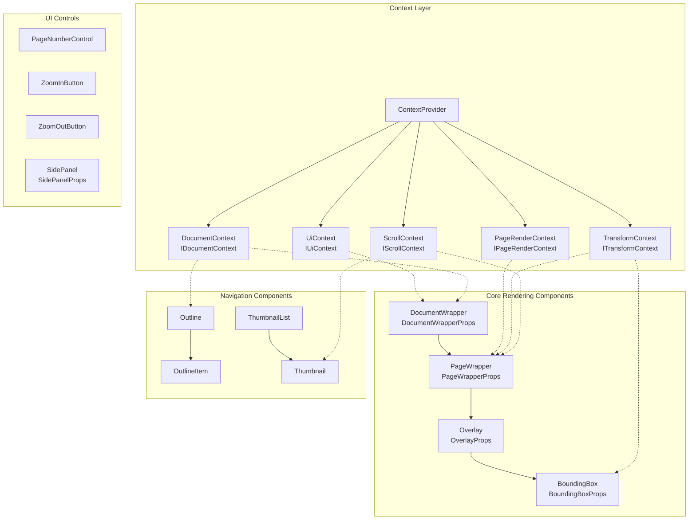
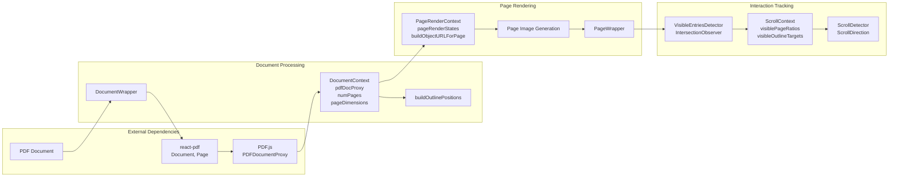
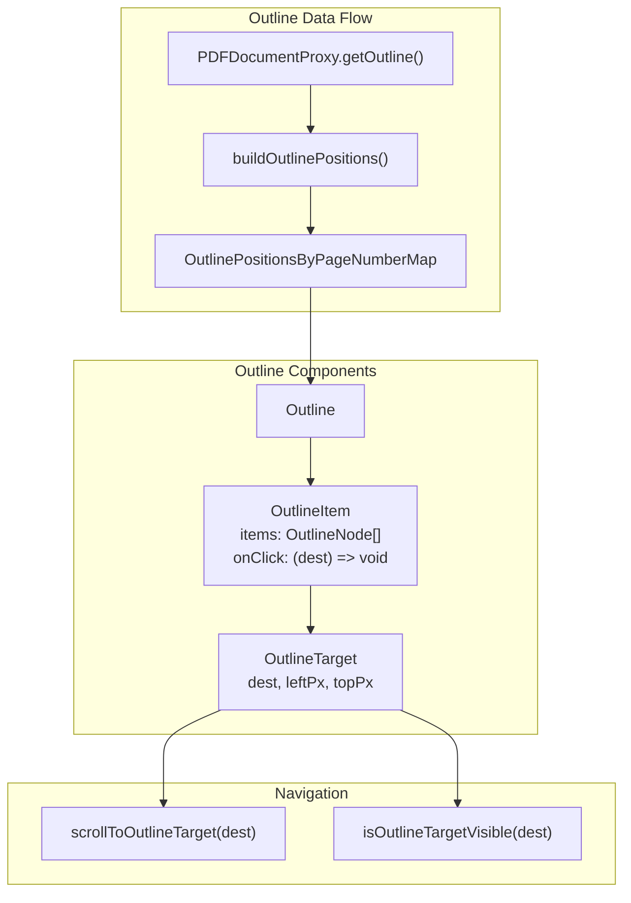

<!-- source: DeepWiki mcp.deepwiki.com · repo allenai/pdf-component-library · page 2 Core PDF Components Library · fetched 2026-10-26 -->

# Core PDF Components Library

<details>
<summary>Relevant source files</summary>

The following files were used as context for generating this wiki page:

- [ui/library/dist/index.d.ts](ui/library/dist/index.d.ts)
- [ui/library/dist/package.json](ui/library/dist/package.json)
- [ui/library/dist/pdf-components.css](ui/library/dist/pdf-components.css)
- [ui/library/dist/pdf-components.js](ui/library/dist/pdf-components.js)

</details>


This document covers the `@allenai/pdf-components` library, which provides React components for displaying PDF documents with interactive features such as navigation, highlighting, annotations, and thumbnail views. The library is built on top of `react-pdf` and PDF.js to handle PDF rendering, while adding a comprehensive React-based UI layer with context-driven state management.

For information about how this library is used in practice, see the [Demo Application](#4). For build and deployment details, see [Development and Build System](#5).

## Library Overview and Public API

The PDF Components Library exports a comprehensive set of React components, contexts, utilities, and TypeScript types through its main entry point. The library is packaged as `@allenai/pdf-components` version 1.0.1 and provides both JavaScript bundle and TypeScript definitions.

### Core Component Exports

| Component Category | Components | Purpose |
|-------------------|------------|---------|
| **Document Rendering** | `DocumentWrapper`, `PageWrapper` | PDF document loading and page rendering |
| **Interactive Overlays** | `BoundingBox`, `Overlay`, `HighlightOverlay` | Interactive regions and annotations |
| **Navigation** | `Outline`, `OutlineItem`, `Thumbnail`, `ThumbnailList` | Document navigation and structure |
| **UI Controls** | `PageNumberControl`, `ZoomInButton`, `ZoomOutButton`, `SidePanel` | User interface controls |
| **Utility Components** | `DownloadButton`, `PrintButton`, `ArrowFlag`, `IconFlag` | Additional functionality |

### Context System Exports

| Context | Interface | Purpose |
|---------|-----------|---------|
| `ContextProvider` | `ContextProviderProps` | Top-level context orchestrator |
| `DocumentContext` | `IDocumentContext` | PDF document metadata and outline |
| `ScrollContext` | `IScrollContext` | Scroll position and visibility tracking |
| `TransformContext` | `ITransformContext` | Scale, rotation, and transformations |
| `UiContext` | `IUiContext` | UI state and loading indicators |
| `PageRenderContext` | `IPageRenderContext` | Page image rendering and caching |

### Utility Functions

The library exports utility functions for coordinate calculations (`computeBoundingBoxStyle`, `computePageStyle`), scroll management (`scrollToId`, `scrollToPdfPageIndex`), rotation handling (`rotateClockwise`, `rotateCounterClockwise`), and page dimension calculations (`getPageHeight`, `getPageWidth`).

**Sources:** [ui/library/dist/index.d.ts:7-43](), [ui/library/dist/package.json:1-8]()

## Core Architecture

The PDF Components Library follows a hierarchical component architecture with React Context for state management. The system is designed around a central `ContextProvider` that orchestrates multiple specialized contexts, feeding data to rendering components and interactive elements.

### Component and Context Architecture



The architecture separates concerns into three layers: context management for state, core rendering for PDF display, and specialized components for navigation and UI controls. Data flows from the context layer down to components through React Context APIs.

**Sources:** [ui/library/dist/index.d.ts:31-36](), [ui/library/dist/index.d.ts:416-447]()

### PDF Rendering and State Management Flow



The system processes PDF documents through `react-pdf`, extracts metadata into `DocumentContext`, manages page rendering through `PageRenderContext`, and tracks user interactions via scroll and visibility detection systems.

**Sources:** [ui/library/dist/index.d.ts:130-138](), [ui/library/dist/index.d.ts:424-447](), [ui/library/dist/index.d.ts:450-476]()

## Context System Details

The library's state management relies on five specialized React contexts that handle different aspects of PDF viewing functionality. Each context provides both state and methods for updating that state.

### DocumentContext Interface

The `DocumentContext` manages PDF document metadata and outline information:

```typescript
interface IDocumentContext {
  numPages: number;
  numPagesLoaded: number;
  outline: Nullable<Array<OutlineNode>>;
  outlinePositions: Nullable<OutlinePositionsByPageNumberMap>;
  pageDimensions: Dimensions;
  pdfDocProxy?: pdfjs.PDFDocumentProxy;
  getOutlineTargets: (opts: OutlineTargetArgs) => OutlineTarget[];
  // ... setter methods
}
```

The context provides access to the PDF document proxy, page count, document outline structure, and methods for calculating outline target positions on pages.

### ScrollContext Interface

The `ScrollContext` handles scroll-based interactions and visibility tracking:

```typescript
interface IScrollContext {
  scrollDirection: Nullable<ScrollDirection>;
  visiblePageRatios: Map<number, VisibleEntryDetailType>;
  visibleOutlineTargets: Map<NodeDestination, VisibleEntryDetailType>;
  isPageVisible: (pageNumber: PageNumber) => boolean;
  scrollToPage: (pageNumber: PageNumber) => void;
  scrollToOutlineTarget: (dest: NodeDestination) => void;
  // ... other methods
}
```

This context uses `IntersectionObserver` through `VisibleEntriesDetector` to track which pages and outline targets are currently visible, providing methods for programmatic navigation.

### TransformContext Interface

The `TransformContext` manages document transformations:

```typescript
interface ITransformContext {
  pixelRatio: number;
  rotation: PageRotation;
  scale: number;
  zoomIncrementValue: number;
  // ... setter methods
}
```

It handles zoom levels (with `DEFAULT_ZOOM_SCALE = 1`), page rotation (using `PageRotation` enum), and device pixel ratio for high-DPI displays.

**Sources:** [ui/library/dist/index.d.ts:424-447](), [ui/library/dist/index.d.ts:479-507](), [ui/library/dist/index.d.ts:510-525]()

## Core Rendering Components

The library's rendering system is built around three primary components that handle PDF document loading, individual page rendering, and interactive overlays.

### DocumentWrapper Component

The `DocumentWrapper` serves as the root component for PDF rendering, accepting `DocumentWrapperProps` that extend `react-pdf`'s `DocumentProps`:

```typescript
type Props = {
  children?: React.ReactNode;
  renderType: RenderType; // MULTI_CANVAS | SINGLE_CANVAS
} & DocumentProps;
```

The component initializes the PDF worker, manages document loading lifecycle, handles loading and error states through `UiContext`, and triggers scroll observer resets when the document changes.

### PageWrapper Component

The `PageWrapper` renders individual PDF pages and manages their interactive overlays:

```typescript
type Props = {
  className?: string;
  loadingContentForBuildingImage?: React.ReactElement;
  children?: React.ReactElement<typeof HighlightOverlay | typeof Overlay>;
  renderType: RenderType;
} & PageProps;
```

The component accepts `pageIndex` (0-based), integrates with `PageRenderContext` for image generation, supports both multi-canvas and single-canvas rendering modes via `RENDER_TYPE`, and manages page loading states with custom loading indicators.

### BoundingBox Component

The `BoundingBox` component renders interactive rectangular regions on PDF pages:

```typescript
type Props = {
  className?: string;
  underlineClassName?: string;
  id?: string;
  isHighlighted?: boolean;
  onClick?: () => void;
  voiceOverLabel?: string;
} & BoundingBoxType; // includes top, left, height, width, page
```

The component uses `computeBoundingBoxStyle` to calculate positions accounting for page rotation and scale, applies different visual styles based on `isHighlighted` state, and supports custom click handlers and accessibility labels.

**Sources:** [ui/library/dist/index.d.ts:130-138](), [ui/library/dist/index.d.ts:242-263](), [ui/library/dist/index.d.ts:116-127]()

## Navigation and Interactive Components

The library provides comprehensive navigation capabilities through outline/table-of-contents functionality and thumbnail-based page navigation.

### Outline System

The outline system consists of `Outline` and `OutlineItem` components that render the PDF's table of contents:



The `OutlineNode` type defines the structure with `title`, `dest` (destination), and nested `items`. The `buildOutlinePositions` function processes PDF destinations into pixel coordinates for navigation.

### Thumbnail System

The thumbnail system provides visual page navigation through `Thumbnail` and `ThumbnailList` components:

- `Thumbnail` component accepts `pageNumber: number` and renders a clickable page preview
- `ThumbnailList` manages collections of thumbnails with scroll synchronization
- Integration with `PageRenderContext` for generating thumbnail images
- Visual state management through CSS classes like `pdf-reader__thumbnail--is-visible`

### Interactive Overlays

The overlay system supports interactive annotations and highlights:

- `Overlay` component accepts `BoundingBox` elements as children
- `HighlightOverlay` specifically designed for text highlighting with `pageIndex: number`
- `ArrowFlag` and `IconFlag` components for annotation markers
- CSS-based visual states including hover effects and selection highlighting

**Sources:** [ui/library/dist/index.d.ts:209-222](), [ui/library/dist/index.d.ts:298-312](), [ui/library/dist/index.d.ts:155-163]()

## Utility Systems

The library includes several utility systems that support coordinate calculations, scroll management, and page transformations.

### Style and Coordinate Utilities

The style calculation system handles PDF coordinate transformations:

```typescript
// Core calculation functions
computeBoundingBoxStyle(boundingBoxSize: Size, pageDimensions: Dimensions, 
                      rotation: PageRotation, scale: number): Size;
computePageStyle(pageDimensions: Dimensions, rotation: PageRotation, scale: number): Size;
getPageHeight(pageDimensions: Dimensions, rotation: PageRotation): number;
getPageWidth(pageDimensions: Dimensions, rotation: PageRotation): number;
```

These functions account for page rotation using the `PageRotation` enum (0°, 90°, 180°, 270°) and apply scaling transformations for zoom functionality.

### Scroll Management Utilities

The scroll utilities provide programmatic navigation:

```typescript
// Navigation functions
generatePageIdFromIndex(pageIndex: number | string): string; // Returns "reader_pg_N"
scrollToId(id: string): void;
scrollToPdfPageIndex(pageIndex: number | string): void;
scrollToPosition(pageIndex: number, leftPoints: number, bottomPoints: number, 
                rotation?: PageRotation): void;
```

The `PAGE_NAV_TARGET_ID_ROOT = "reader_pg_"` constant defines the ID pattern for page elements, enabling smooth scrolling navigation.

### Rotation and Transformation Utilities

The rotation system provides page orientation management:

```typescript
// Rotation functions
rotateClockwise(rotation: PageRotation): PageRotation;
rotateCounterClockwise(rotation: PageRotation): PageRotation;
isSideways(rotation: PageRotation): boolean; // Tests for 90° or 270°
```

The `PageRotation` enum defines four rotation states, and utility functions handle rotation transformations while accounting for coordinate system changes.

### Visibility Detection

The library uses `VisibleEntriesDetector` class with `IntersectionObserver` to track element visibility:

- Monitors pages using `PAGE_NUMBER_SELECTOR` pattern
- Tracks outline targets using `OUTLINE_SELECTOR` pattern  
- Provides `VisibleEntryDetailType` with ratio and timestamp data
- Integrates with `ScrollContext` for real-time visibility updates

**Sources:** [ui/library/dist/index.d.ts:622-629](), [ui/library/dist/index.d.ts:580-620](), [ui/library/dist/index.d.ts:564-577](), [ui/library/dist/index.d.ts:631-656]()

---

