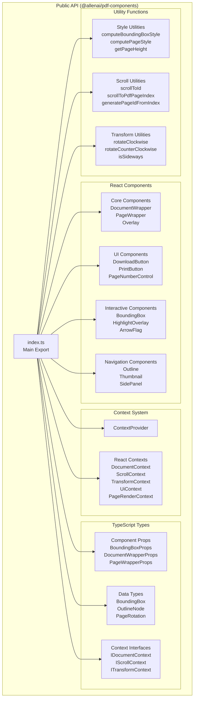
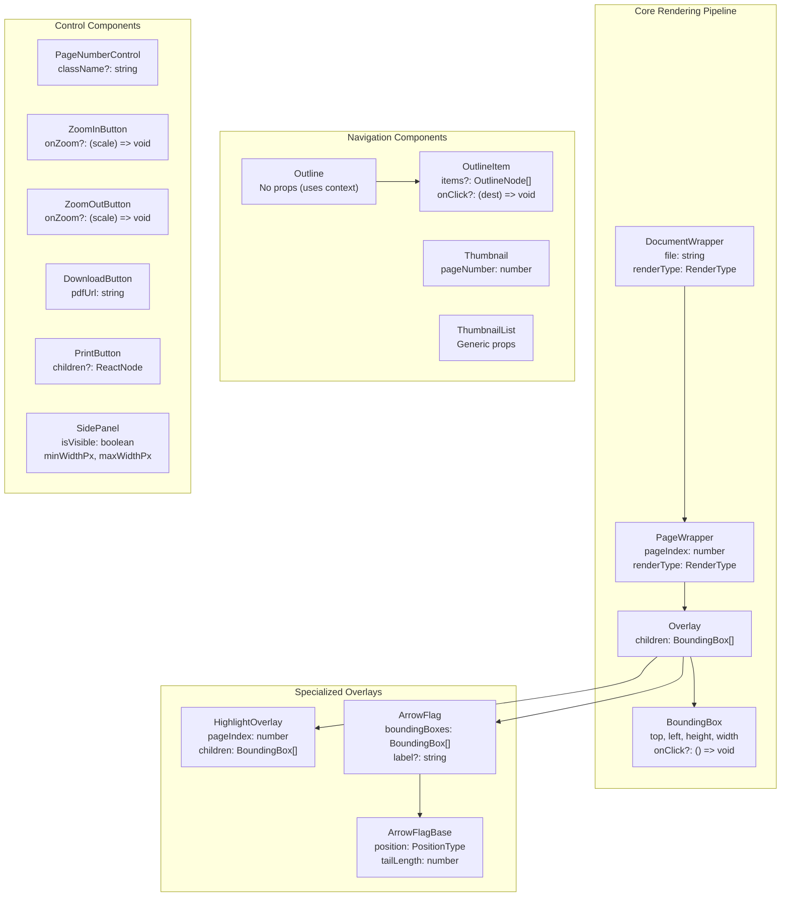
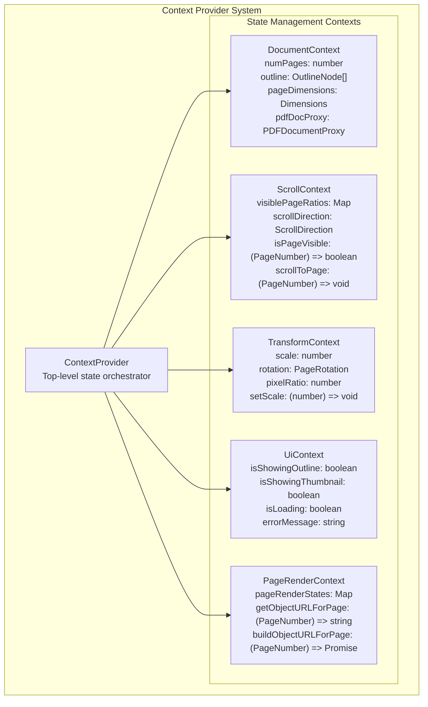
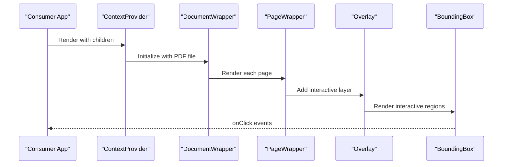

<!-- source: DeepWiki mcp.deepwiki.com · repo allenai/pdf-component-library · page 2.1 Library API and Public Interface · fetched 2026-10-26 -->

# Library API and Public Interface

<details>
<summary>Relevant source files</summary>

The following files were used as context for generating this wiki page:

- [ui/demo/components/Header.tsx](ui/demo/components/Header.tsx)
- [ui/demo/components/Reader.tsx](ui/demo/components/Reader.tsx)
- [ui/library/dist/index.d.ts](ui/library/dist/index.d.ts)
- [ui/library/dist/package.json](ui/library/dist/package.json)
- [ui/library/dist/pdf-components.css](ui/library/dist/pdf-components.css)
- [ui/library/dist/pdf-components.js](ui/library/dist/pdf-components.js)
- [ui/library/index.ts](ui/library/index.ts)

</details>


This document covers the public API exported by the `@allenai/pdf-components` library, including all components, contexts, types, and utilities available to consuming applications. This is the primary interface that developers use to integrate PDF viewing capabilities into their React applications.

For information about the internal component architecture and how these public APIs are implemented, see [Component Architecture](#2.2). For details about the context system implementation, see [Context System](#2.3).

## API Overview

The library exports its public interface through a single entry point that provides four main categories of functionality:



Sources: [ui/library/index.ts:1-179](), [ui/library/dist/index.d.ts:7-114]()

## Package Structure

The library is distributed as an NPM package with the following structure:

| File | Purpose |
|------|---------|
| `pdf-components.js` | Compiled JavaScript bundle |
| `pdf-components.css` | Compiled CSS styles |
| `index.d.ts` | TypeScript type definitions |
| `package.json` | Package metadata |

Sources: [ui/library/dist/package.json:1-9]()

## Core Component API

The library provides a hierarchical set of React components for PDF rendering and interaction:



### Core Component Props

| Component | Key Props | Purpose |
|-----------|-----------|---------|
| `DocumentWrapper` | `file: string`, `renderType: RenderType` | PDF document container |
| `PageWrapper` | `pageIndex: number`, `renderType: RenderType` | Individual page renderer |
| `Overlay` | `children: ReactElement<BoundingBox>[]` | Interactive overlay container |
| `BoundingBox` | `top, left, height, width: number`, `onClick?: () => void` | Rectangular interactive region |

Sources: [ui/library/index.ts:7-25](), [ui/library/dist/index.d.ts:116-264]()

## Context System API

The library uses React Context to manage state across components. All contexts are accessed through the `ContextProvider`:



### Context Interface Types

| Context | Interface | Key Methods/Properties |
|---------|-----------|----------------------|
| DocumentContext | `IDocumentContext` | `numPages`, `outline`, `pageDimensions`, `getOutlineTargets()` |
| ScrollContext | `IScrollContext` | `visiblePageRatios`, `isPageVisible()`, `scrollToPage()` |
| TransformContext | `ITransformContext` | `scale`, `rotation`, `setScale()`, `setRotation()` |
| UiContext | `IUiContext` | `isShowingOutline`, `isLoading`, `errorMessage` |
| PageRenderContext | `IPageRenderContext` | `getObjectURLForPage()`, `buildObjectURLForPage()` |

Sources: [ui/library/index.ts:39-48](), [ui/library/dist/index.d.ts:416-547]()

## Type System

The library exports comprehensive TypeScript types for all public interfaces:

### Component Prop Types

```typescript
// Core component props
type DocumentWrapperProps = {
  children?: React.ReactNode;
  renderType: RenderType;
} & DocumentProps;

type PageWrapperProps = {
  className?: string;
  renderType: RenderType;
} & PageProps;

type BoundingBoxProps = {
  className?: string;
  isHighlighted?: boolean;
  onClick?: () => void;
} & BoundingBox;
```

### Data Types

| Type | Purpose | Key Properties |
|------|---------|----------------|
| `BoundingBox` | Rectangular region | `page: number`, `top, left, height, width: number` |
| `OutlineNode` | Document outline item | `title: string`, `dest: NodeDestination`, `items: OutlineNode[]` |
| `PageRotation` | Page rotation enum | `Rotate0`, `Rotate90`, `Rotate180`, `Rotate270` |
| `Dimensions` | Size measurements | `height: number`, `width: number` |
| `RenderType` | Rendering mode | `"single-canvas"` \| `"multi-canvas"` |

Sources: [ui/library/index.ts:65-93](), [ui/library/dist/index.d.ts:314-394]()

## Utility Functions API

The library provides utility functions for common PDF manipulation tasks:

### Style Computation Functions

| Function | Parameters | Return Type | Purpose |
|----------|------------|-------------|---------|
| `computeBoundingBoxStyle` | `boundingBoxSize, pageDimensions, rotation, scale` | `Size` | Calculate CSS styles for bounding boxes |
| `computePageStyle` | `pageDimensions, rotation, scale` | `Size` | Calculate CSS styles for pages |
| `getPageHeight` | `pageDimensions, rotation` | `number` | Get effective page height |
| `getPageWidth` | `pageDimensions, rotation` | `number` | Get effective page width |

### Scroll Navigation Functions

| Function | Parameters | Return Type | Purpose |
|----------|------------|-------------|---------|
| `scrollToId` | `id: string` | `void` | Scroll to element by ID |
| `scrollToPdfPageIndex` | `pageIndex: number` | `void` | Scroll to specific page |
| `generatePageIdFromIndex` | `pageIndex: number` | `string` | Generate page element ID |

### Transform Functions

| Function | Parameters | Return Type | Purpose |
|----------|------------|-------------|---------|
| `rotateClockwise` | `rotation: PageRotation` | `PageRotation` | Rotate 90° clockwise |
| `rotateCounterClockwise` | `rotation: PageRotation` | `PageRotation` | Rotate 90° counter-clockwise |
| `isSideways` | `rotation: PageRotation` | `boolean` | Check if rotated sideways |

Sources: [ui/library/index.ts:50-63](), [ui/library/dist/index.d.ts:549-629]()

## Constants and Enums

The library exports several important constants:

| Constant | Type | Values | Purpose |
|----------|------|--------|---------|
| `RENDER_TYPE` | Object | `SINGLE_CANVAS`, `MULTI_CANVAS` | PDF rendering modes |
| `POSITION` | Object | `LEFT`, `RIGHT` | Arrow flag positions |
| `DEFAULT_ZOOM_SCALE` | Number | `1.0` | Default zoom level |
| `PageRotation` | Enum | `Rotate0`, `Rotate90`, `Rotate180`, `Rotate270` | Page rotation angles |

Sources: [ui/library/index.ts:16, 44, 50-56]()

## Usage Pattern Example

Here's how the library is typically used in a consuming application:



The typical integration pattern involves:

1. Wrapping the application with `ContextProvider`
2. Using `DocumentWrapper` to load a PDF file
3. Rendering pages with `PageWrapper`
4. Adding interactive overlays with `Overlay` and `BoundingBox`
5. Consuming context data through React hooks

Sources: [ui/demo/components/Reader.tsx:76-99](), [ui/demo/components/Header.tsx:1-84]()

---

