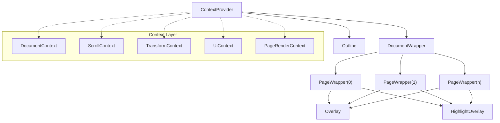
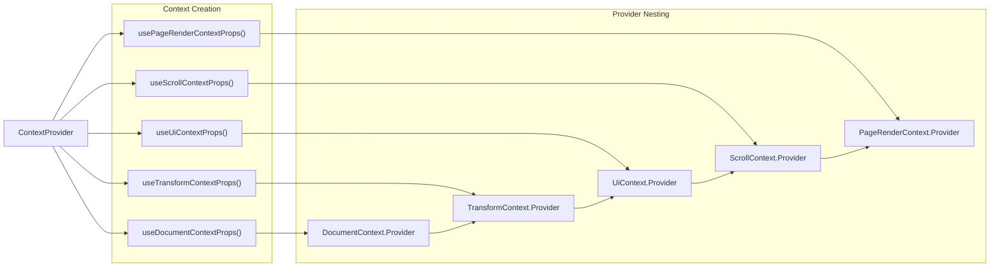
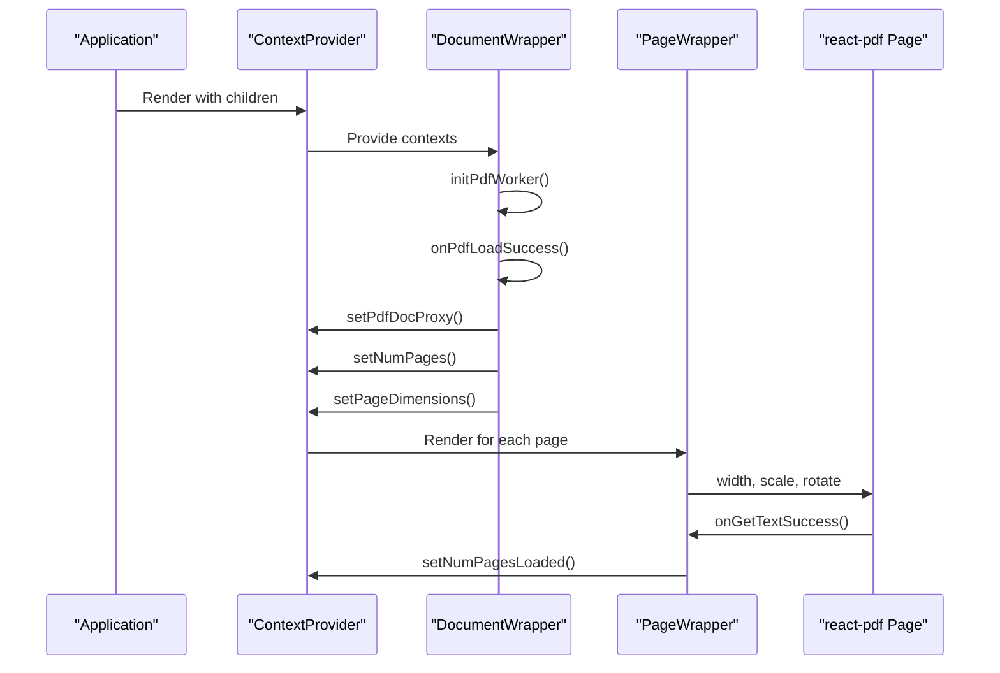
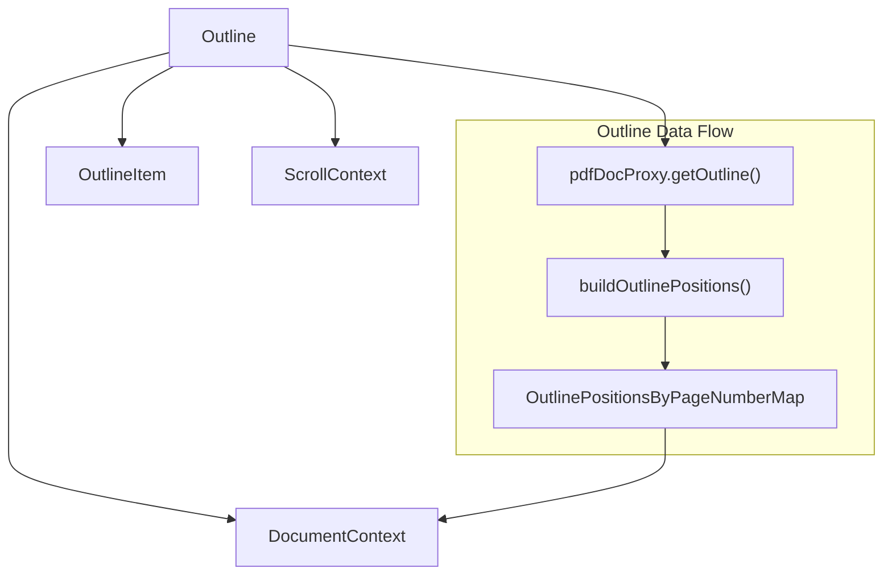
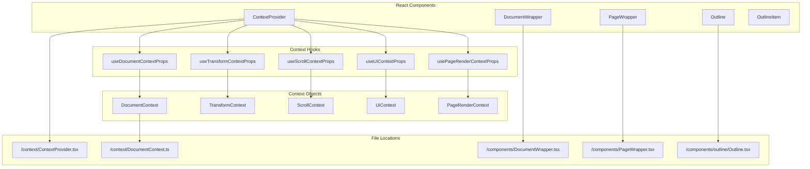

<!-- source: DeepWiki mcp.deepwiki.com · repo allenai/pdf-component-library · page 2.2 Component Architecture · fetched 2026-10-26 -->

# Component Architecture

<details>
<summary>Relevant source files</summary>

The following files were used as context for generating this wiki page:

- [ui/library/src/components/DocumentWrapper.tsx](ui/library/src/components/DocumentWrapper.tsx)
- [ui/library/src/components/PageWrapper.tsx](ui/library/src/components/PageWrapper.tsx)
- [ui/library/src/components/outline/Outline.tsx](ui/library/src/components/outline/Outline.tsx)
- [ui/library/src/components/outline/OutlineItem.tsx](ui/library/src/components/outline/OutlineItem.tsx)
- [ui/library/src/context/ContextProvider.tsx](ui/library/src/context/ContextProvider.tsx)
- [ui/library/src/context/DocumentContext.ts](ui/library/src/context/DocumentContext.ts)

</details>


This document explains the component hierarchy and architectural patterns of the PDF Components Library. It covers how the `ContextProvider` orchestrates multiple React contexts, the relationship between core rendering components like `DocumentWrapper` and `PageWrapper`, and how supporting components integrate into the system.

For information about the individual context implementations and their state management responsibilities, see [Context System](#2.3). For details about specific rendering component implementations, see [Core Rendering Components](#2.4).

## Architecture Overview

The PDF Components Library uses a hierarchical component architecture built around React Context for state management. The system is designed with clear separation of concerns, where different contexts handle specific aspects of PDF rendering and interaction.

### Component Hierarchy Diagram



Sources: [ui/library/src/context/ContextProvider.tsx:13-38](), [ui/library/src/components/DocumentWrapper.tsx:20-117](), [ui/library/src/components/PageWrapper.tsx:33-130]()

## Context Orchestration

The `ContextProvider` component serves as the root orchestrator for all React contexts in the system. It creates and manages the lifecycle of five distinct contexts, each responsible for different aspects of the PDF viewing experience.

### Context Provider Implementation



The `ContextProvider` creates context props using custom hooks and establishes dependencies between contexts. Notably, `PageRenderContext` depends on values from `DocumentContext`, `TransformContext`, and `ScrollContext`:

| Context | Dependencies | Purpose |
|---------|-------------|---------|
| `DocumentContext` | None | PDF document metadata, outline data |
| `TransformContext` | None | Scale, rotation, pixel ratio |
| `UiContext` | None | UI state, loading states |
| `ScrollContext` | None | Scroll position, page visibility |
| `PageRenderContext` | Document, Transform, Scroll | Page image rendering coordination |

Sources: [ui/library/src/context/ContextProvider.tsx:13-38](), [ui/library/src/context/ContextProvider.tsx:18-23]()

## Core Component Flow

The main component hierarchy follows a predictable pattern from document loading through individual page rendering.

### Document to Page Flow



### DocumentWrapper Responsibilities

The `DocumentWrapper` component wraps react-pdf's `Document` component and handles:

- **PDF Worker Initialization**: Calls `initPdfWorker()` to set up PDF.js worker
- **Document Loading**: Manages `onPdfLoadSuccess`, `onPdfLoadError`, and `onSourceError` callbacks
- **Scale Synchronization**: Updates scroll position when scale changes to maintain user's view
- **Context Updates**: Sets document proxy, page count, and page dimensions in `DocumentContext`

Key implementation details:

```typescript
// Scale change handling
React.useEffect(() => {
  if (scale === lastScale) return;
  const zoomMultiplier = scale / lastScale;
  updateScrollPosition(zoomMultiplier);
  setLastScale(scale);
}, [scale, updateScrollPosition]);
```

Sources: [ui/library/src/components/DocumentWrapper.tsx:25-26](), [ui/library/src/components/DocumentWrapper.tsx:44-51](), [ui/library/src/components/DocumentWrapper.tsx:53-71]()

### PageWrapper Responsibilities

The `PageWrapper` component wraps react-pdf's `Page` component for individual pages and handles:

- **Page Styling**: Computes page dimensions, rotation, and background images
- **Outline Targets**: Renders clickable outline destination markers
- **Image Overlays**: Manages background images from `PageRenderContext`
- **Child Components**: Renders `HighlightOverlay` and `Overlay` children

The component uses multiple contexts to compute its display properties:

| Context Used | Data Retrieved | Usage |
|-------------|----------------|-------|
| `TransformContext` | `rotation`, `scale` | Page dimensions and styling |
| `DocumentContext` | `pageDimensions`, `getOutlineTargets` | Base dimensions and outline markers |
| `PageRenderContext` | `getObjectURLForPage`, `isBuildingObjectURLForPage` | Background image management |
| `UiContext` | `isLoading` | Loading state display |

Sources: [ui/library/src/components/PageWrapper.tsx:43-47](), [ui/library/src/components/PageWrapper.tsx:58-64](), [ui/library/src/components/PageWrapper.tsx:70-76]()

## Supporting Components

### Outline Component

The `Outline` component provides table of contents functionality by fetching outline data from the PDF and rendering navigable items.



The outline fetching process:

1. **Check for existing outline**: Returns early if outline already loaded
2. **Fetch outline array**: Calls `pdfDocProxy.getOutline()`
3. **Build positions**: Calls `buildOutlinePositions()` to map outline items to page coordinates
4. **Update contexts**: Sets outline data and positions in `DocumentContext`
5. **Reset observers**: Calls `resetScrollObservers()` in `ScrollContext`

Sources: [ui/library/src/components/outline/Outline.tsx:13-34](), [ui/library/src/context/DocumentContext.ts:126-184]()

### OutlineItem Component

The `OutlineItem` component renders individual outline entries with visibility tracking and click handling:

- **Recursive Rendering**: Renders nested outline items recursively
- **Visibility Tracking**: Uses `ScrollContext.isOutlineTargetVisible()` for highlighting
- **Click Navigation**: Triggers scroll navigation through callback props

Sources: [ui/library/src/components/outline/OutlineItem.tsx:12-43]()

## Component-to-Code Entity Mapping



This mapping shows the relationship between React components, their corresponding files, and the context system they use. Each component is implemented in its own TypeScript file and consumes one or more contexts for state management.

Sources: [ui/library/src/context/ContextProvider.tsx:1-39](), [ui/library/src/components/DocumentWrapper.tsx:1-118](), [ui/library/src/components/PageWrapper.tsx:1-131](), [ui/library/src/components/outline/Outline.tsx:1-54](), [ui/library/src/context/DocumentContext.ts:1-201]()

---

