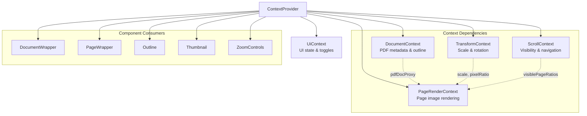
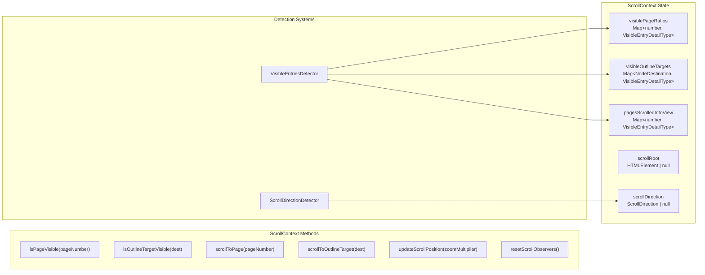
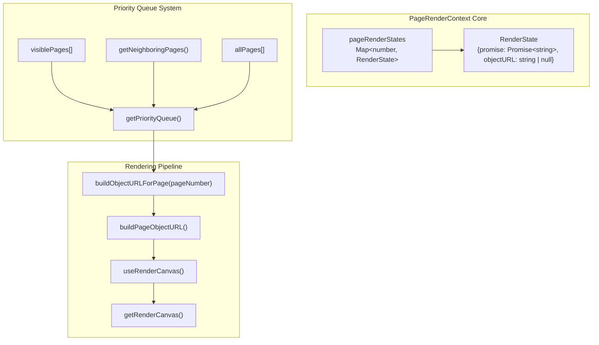
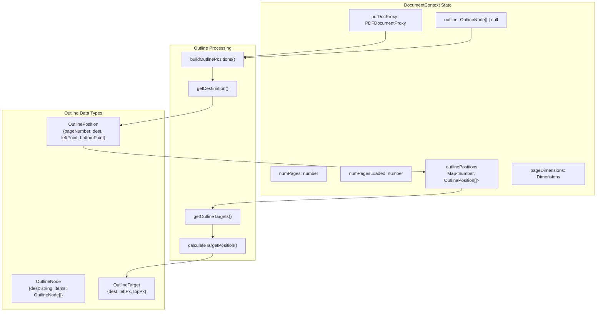
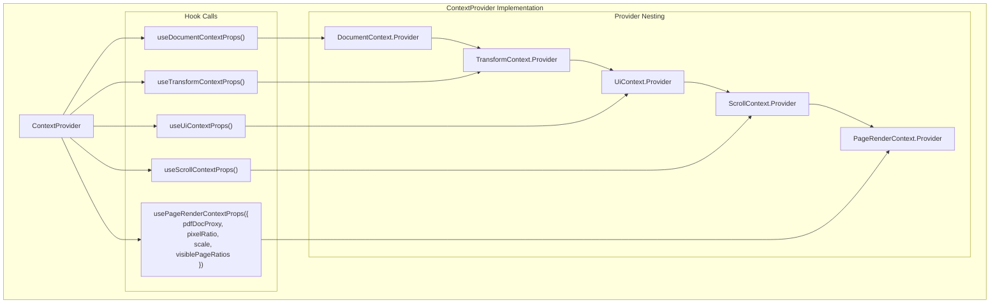
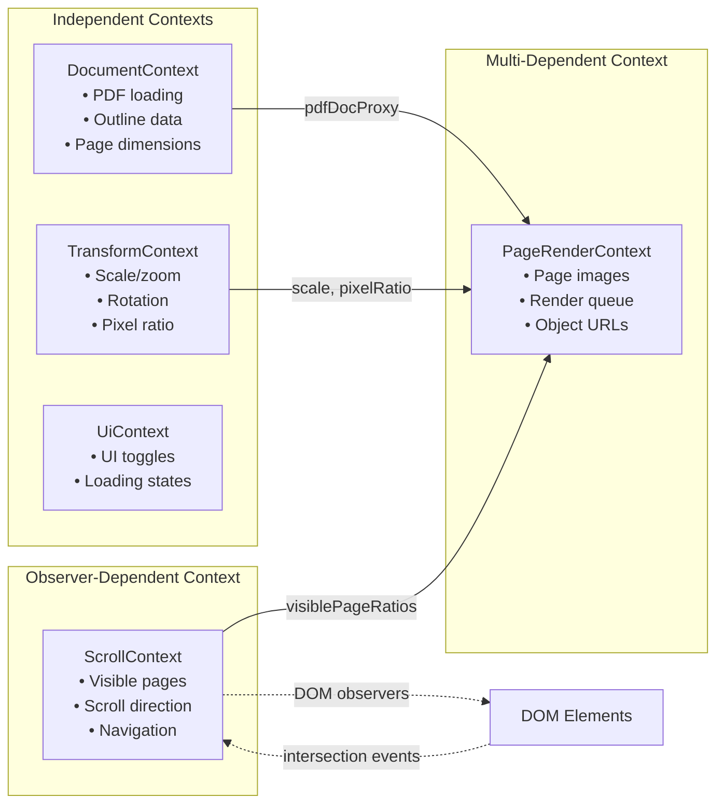

<!-- source: DeepWiki mcp.deepwiki.com · repo allenai/pdf-component-library · page 2.3 Context System · fetched 2026-10-26 -->

# Context System

Relevant source files

The following files were used as context for generating this wiki page:

- [ui/library/src/components/ZoomInButton.tsx](ui/library/src/components/ZoomInButton.tsx)
- [ui/library/src/components/ZoomOutButton.tsx](ui/library/src/components/ZoomOutButton.tsx)
- [ui/library/src/components/types/page.ts](ui/library/src/components/types/page.ts)
- [ui/library/src/context/ContextProvider.tsx](ui/library/src/context/ContextProvider.tsx)
- [ui/library/src/context/DocumentContext.ts](ui/library/src/context/DocumentContext.ts)
- [ui/library/src/context/PageRenderContext.ts](ui/library/src/context/PageRenderContext.ts)
- [ui/library/src/context/ScrollContext.ts](ui/library/src/context/ScrollContext.ts)
- [ui/library/src/context/TransformContext.ts](ui/library/src/context/TransformContext.ts)
- [ui/library/src/utils/format.ts](ui/library/src/utils/format.ts)
- [ui/library/test/context/ContextProvider.test.tsx](ui/library/test/context/ContextProvider.test.tsx)
- [ui/library/test/context/PageRenderContext.test.tsx](ui/library/test/context/PageRenderContext.test.tsx)
- [ui/library/test/context/ScrollContext.test.tsx](ui/library/test/context/ScrollContext.test.tsx)

## Purpose and Scope

The Context System provides a comprehensive React Context architecture that manages all state across the PDF Component Library. It consists of five specialized contexts that handle different aspects of PDF viewing functionality: scroll tracking, page rendering, document metadata, transformations, and UI state. This system enables components throughout the library to access and modify shared state without prop drilling.

For information about the components that consume these contexts, see [Core Rendering Components](#2.4). For details about the public API and how external applications use these contexts, see [Library API and Public Interface](#2.1).

## Context Architecture Overview

The context system is organized around five specialized contexts that are orchestrated by a central `ContextProvider`. Each context manages a specific domain of functionality while maintaining dependencies with other contexts.

**Sources:** [ui/library/src/context/ContextProvider.tsx:1-38](), [ui/library/test/context/ContextProvider.test.tsx:1-87]()

## ScrollContext

The `ScrollContext` manages scroll-related state and provides navigation functionality throughout the PDF viewer. It tracks visible pages, outline targets, scroll direction, and provides methods for programmatic navigation.

### ScrollContext Interface and State

The `ScrollContext` uses two key detection systems:
- `VisibleEntriesDetector` with `IntersectionObserver` API to track element visibility
- `ScrollDirectionDetector` to monitor scroll events and direction changes

Key constants and selectors used:
- `PAGE_NUMBER_SELECTOR`: `.pdf-reader__page[data-page-number]`
- `OUTLINE_SELECTOR`: `.pdf-reader__page__outline-target`
- `DEFAULT_PAGE_SCROLLED_INTO_VIEW_THRESHOLD`: `0.1`

**Sources:** [ui/library/src/context/ScrollContext.ts:1-322](), [ui/library/test/context/ScrollContext.test.tsx:1-123]()

## PageRenderContext

The `PageRenderContext` manages the asynchronous rendering of PDF pages into image objects. It coordinates page rendering priority based on visibility and maintains a cache of rendered page images.

### Page Rendering State Management

The rendering system implements several key optimizations:
- **Shared Canvas Rendering**: Uses a single `HTMLCanvasElement` with promise queuing
- **Priority-Based Rendering**: Visible pages → neighboring pages → all pages
- **Memory Management**: Revokes old `objectURL`s when scale changes
- **Scale Boost**: Renders at `2x` scale for better quality (`SCALE_BOOST = 2`)

**Sources:** [ui/library/src/context/PageRenderContext.ts:1-304](), [ui/library/test/context/PageRenderContext.test.tsx:1-81]()

## DocumentContext

The `DocumentContext` manages PDF document metadata, structure, and outline information. It provides access to the PDF document proxy and handles outline target positioning calculations.

### Document State and Outline Processing

The outline processing system performs depth-first search through outline items and converts PDF coordinate destinations into pixel positions for rendering overlay targets.

**Sources:** [ui/library/src/context/DocumentContext.ts:1-201]()

## TransformContext

The `TransformContext` manages coordinate transformations including scale (zoom), rotation, and pixel ratio adjustments. It provides the foundation for responsive PDF rendering across different devices and zoom levels.

### Transform State and Properties

| Property | Type | Default | Purpose |
|----------|------|---------|---------|
| `scale` | `number` | `1.0` | Current zoom level |
| `rotation` | `PageRotation` | `Rotate0` | Page rotation state |
| `pixelRatio` | `number` | `window.devicePixelRatio` | Device pixel density |
| `zoomIncrementValue` | `number` | `0.2` | Zoom step size |

The context provides setter methods for each property and is consumed by zoom controls and page rendering components to maintain consistent transformations across the application.

**Sources:** [ui/library/src/context/TransformContext.ts:1-56](), [ui/library/src/components/ZoomInButton.tsx:1-49](), [ui/library/src/components/ZoomOutButton.tsx:1-47]()

## ContextProvider Orchestration

The `ContextProvider` component serves as the central orchestrator that instantiates all contexts and manages their interdependencies. It follows a specific nesting order to ensure proper data flow.

### Context Provider Structure

The `PageRenderContext` is the most dependent context, requiring properties from `DocumentContext`, `TransformContext`, and `ScrollContext`. This dependency is explicitly managed in the `ContextProvider` by passing these values to `usePageRenderContextProps`.

**Sources:** [ui/library/src/context/ContextProvider.tsx:1-38]()

## State Flow and Context Dependencies

The context system implements a unidirectional data flow with specific dependency relationships between contexts.

### Context Dependency Graph

This dependency structure ensures that:
1. **Independent contexts** can be used standalone
2. **ScrollContext** depends only on DOM observations
3. **PageRenderContext** aggregates data from multiple contexts for optimal rendering

**Sources:** [ui/library/src/context/ContextProvider.tsx:18-23](), [ui/library/src/context/PageRenderContext.ts:44-54]()

---

