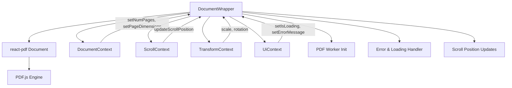
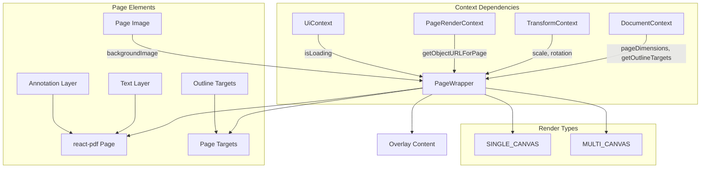
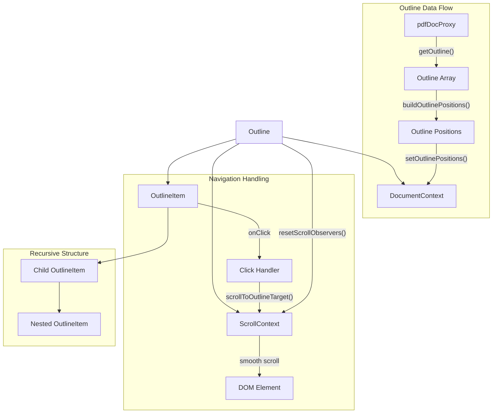
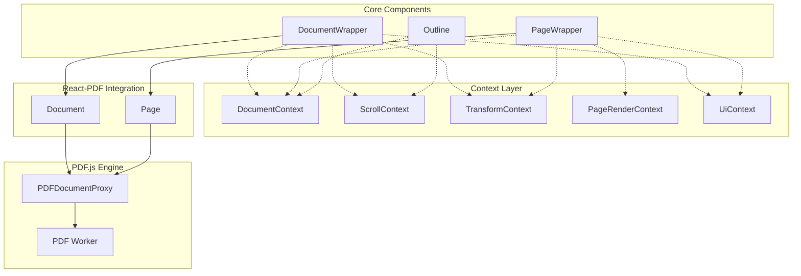

<!-- source: DeepWiki mcp.deepwiki.com · repo allenai/pdf-component-library · page 2.4 Core Rendering Components · fetched 2026-10-26 -->

# Core Rendering Components

Relevant source files

The following files were used as context for generating this wiki page:

- [ui/library/dist/index.d.ts](ui/library/dist/index.d.ts)
- [ui/library/dist/package.json](ui/library/dist/package.json)
- [ui/library/dist/pdf-components.css](ui/library/dist/pdf-components.css)
- [ui/library/dist/pdf-components.js](ui/library/dist/pdf-components.js)
- [ui/library/src/components/DocumentWrapper.tsx](ui/library/src/components/DocumentWrapper.tsx)
- [ui/library/src/components/PageWrapper.tsx](ui/library/src/components/PageWrapper.tsx)
- [ui/library/src/components/outline/Outline.tsx](ui/library/src/components/outline/Outline.tsx)
- [ui/library/src/components/outline/OutlineItem.tsx](ui/library/src/components/outline/OutlineItem.tsx)

This document covers the primary components responsible for PDF document rendering and display within the PDF Components Library. These components form the foundation of the PDF viewing experience, handling document loading, individual page rendering, and document structure navigation.

For information about interactive elements and navigation features, see [Interactive and Navigation Components](#2.5). For details about the context system that manages state across these components, see [Context System](#2.3).

## Purpose and Scope

The core rendering components include three main elements:

- **DocumentWrapper**: Manages PDF document loading, initialization, and high-level document operations
- **PageWrapper**: Handles individual page rendering with support for different render modes and overlay content
- **Outline**: Provides document structure navigation through table of contents functionality

These components work together to transform PDF documents into interactive React components, leveraging the react-pdf library while adding enhanced functionality for overlays, navigation, and responsive scaling.

## DocumentWrapper Component

The `DocumentWrapper` component serves as the primary interface for loading and managing PDF documents. It wraps react-pdf's `Document` component while providing additional functionality for state management and error handling.

**Key Responsibilities:**

- **PDF Worker Initialization**: Calls `initPdfWorker()` to set up the PDF.js worker thread
- **Document Loading**: Handles PDF document loading with comprehensive error handling
- **Page Dimensions**: Extracts and stores page dimensions from the first page for layout calculations
- **Scale Management**: Monitors scale changes and updates scroll position to maintain user's current view
- **Context Integration**: Updates multiple context providers with document-level state

**Core Methods:**

- `onPdfLoadSuccess`: Processes successful PDF loading by setting page count, dimensions, and PDF document proxy
- `onSourceError`/`onPdfLoadError`: Unified error handling for various failure scenarios
- `onItemClicked`: Handles navigation to internal PDF destinations

Sources: [ui/library/src/components/DocumentWrapper.tsx:1-118]()

## PageWrapper Component  

The `PageWrapper` component manages individual page rendering with support for multiple render types and overlay content. It provides a flexible foundation for displaying PDF pages with interactive elements.

**Render Type Support:**

The component supports two distinct render modes defined in `RENDER_TYPE`:

- **SINGLE_CANVAS**: Uses a single canvas element for page rendering
- **MULTI_CANVAS**: Uses multiple canvas elements with enhanced text layer handling

**Key Features:**

- **Dynamic Styling**: Calculates page dimensions accounting for rotation and scale using `computePageStyle()`
- **Image Overlay**: Supports background images via `getObjectURLForPage()` from PageRenderContext
- **Outline Targets**: Renders invisible positioning elements for document outline navigation
- **Loading States**: Shows building indicators when page images are being generated

**Style Management:**

The component uses several utility functions for layout calculations:
- `computePageStyle()`: Calculates page container dimensions
- `getPageWidth()`: Determines page width accounting for rotation
- `generatePageIdFromIndex()`: Creates unique page identifiers for navigation

Sources: [ui/library/src/components/PageWrapper.tsx:1-131]()

## Outline Component

The `Outline` component provides document structure navigation by rendering a hierarchical table of contents. It fetches outline data from the PDF document and manages outline positioning for smooth navigation.

**Outline Processing Pipeline:**

1. **Data Fetching**: Calls `pdfDocProxy.getOutline()` to retrieve outline structure
2. **Position Building**: Uses `buildOutlinePositions()` to calculate precise positioning data
3. **Observer Reset**: Triggers `resetScrollObservers()` to update intersection observers
4. **Navigation**: Provides click handlers that call `scrollToOutlineTarget()`

**OutlineItem Integration:**

The `Outline` component renders `OutlineItem` components recursively to handle nested document structures. Each outline item:

- Displays the outline title as a clickable link
- Maintains visibility state based on scroll position via `isOutlineTargetVisible()`
- Handles click events to navigate to the corresponding document section
- Recursively renders child outline items for hierarchical structures

Sources: [ui/library/src/components/outline/Outline.tsx:1-54](), [ui/library/src/components/outline/OutlineItem.tsx:1-44]()

## Component Integration and Data Flow

The core rendering components work together through the context system to provide a cohesive PDF viewing experience. The following diagram illustrates the primary data flows and component relationships:

**Key Integration Points:**

- **Document Loading**: `DocumentWrapper` initializes the PDF document and populates `DocumentContext` with essential data
- **Page Rendering**: `PageWrapper` consumes context data to render individual pages with proper scaling and positioning
- **Navigation**: `Outline` uses document data to build navigation structure and integrates with `ScrollContext` for smooth scrolling
- **State Synchronization**: All components share state through React contexts, ensuring consistent behavior across the application

The components leverage the context system extensively, avoiding direct prop passing and enabling flexible composition patterns for consuming applications.

Sources: [ui/library/src/components/DocumentWrapper.tsx:27-31](), [ui/library/src/components/PageWrapper.tsx:43-47](), [ui/library/src/components/outline/Outline.tsx:9-11]()

---

