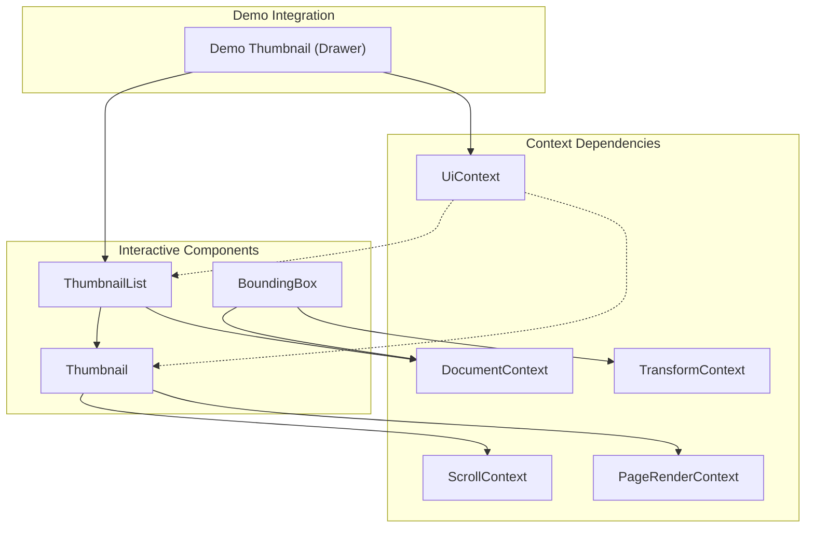
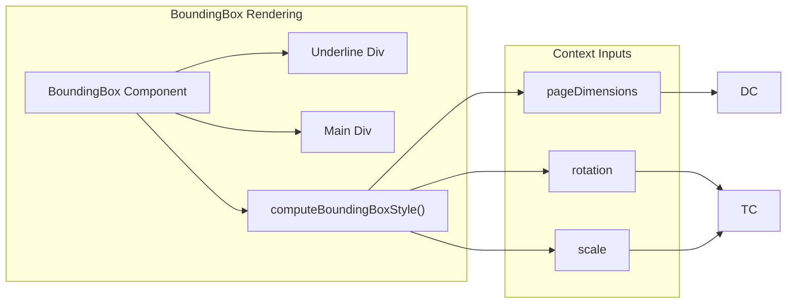
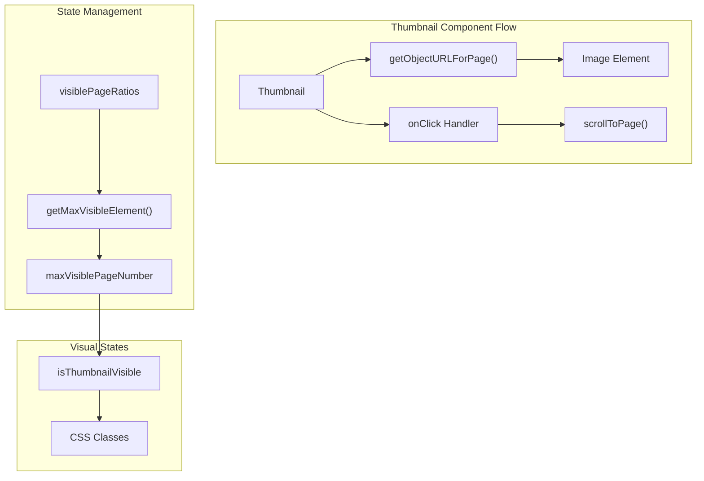
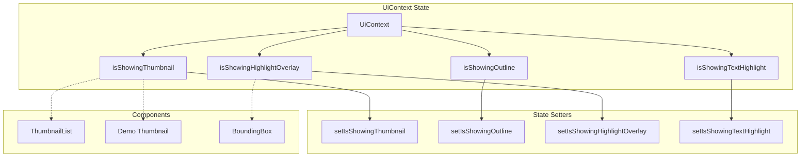
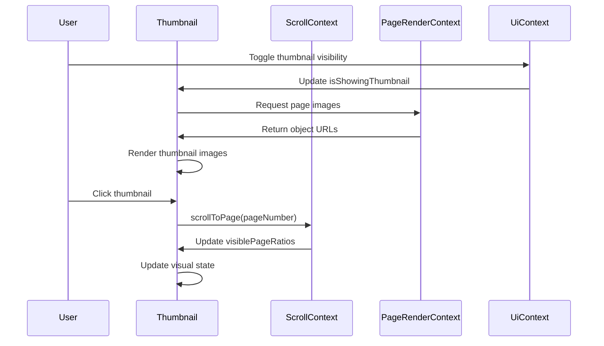

<!-- source: DeepWiki mcp.deepwiki.com · repo allenai/pdf-component-library · page 2.5 Interactive and Navigation Components · fetched 2026-10-26 -->

# Interactive and Navigation Components

<details>
<summary>Relevant source files</summary>

The following files were used as context for generating this wiki page:

- [ui/demo/components/Thumbnail.tsx](ui/demo/components/Thumbnail.tsx)
- [ui/library/src/components/BoundingBox.tsx](ui/library/src/components/BoundingBox.tsx)
- [ui/library/src/components/thumbnails/Thumbnail.tsx](ui/library/src/components/thumbnails/Thumbnail.tsx)
- [ui/library/src/components/thumbnails/ThumbnailList.tsx](ui/library/src/components/thumbnails/ThumbnailList.tsx)
- [ui/library/src/context/UiContext.ts](ui/library/src/context/UiContext.ts)
- [ui/library/test/components/BoundingBox.test.tsx](ui/library/test/components/BoundingBox.test.tsx)

</details>


This document covers the interactive overlay and navigation components within the PDF Component Library that enable user interaction with PDF documents. These components provide clickable regions, thumbnail navigation, and UI state management for enhanced document viewing experiences.

For information about the core document rendering components, see [Core Rendering Components](#2.4). For details about the context system that manages state for these components, see [Context System](#2.3).

## Overview

The interactive and navigation components consist of two main systems:

- **BoundingBox component** - Creates interactive rectangular regions overlaid on PDF pages for highlighting, clicking, and annotation features
- **Thumbnail navigation system** - Provides miniature page previews for quick document navigation and visual page identification

These components integrate closely with the context system to respond to user interactions, document transformations, and navigation state changes.

## Component Architecture



**Sources:** [ui/library/src/components/BoundingBox.tsx:1-69](), [ui/library/src/components/thumbnails/Thumbnail.tsx:1-57](), [ui/library/src/components/thumbnails/ThumbnailList.tsx:1-23](), [ui/library/src/context/UiContext.ts:1-71]()

## BoundingBox Component

The `BoundingBox` component creates interactive rectangular overlays positioned on PDF pages. It handles coordinate transformations based on page rotation and scaling, making it suitable for annotations, highlights, and clickable regions.

### Core Functionality

| Property | Type | Purpose |
|----------|------|---------|
| `top`, `left`, `height`, `width` | number | Defines the rectangular bounds |
| `onClick` | function | Handles click interactions |
| `isHighlighted` | boolean | Controls visual highlighting state |
| `className` | string | Custom styling classes |

The component renders two DOM elements: an underline div and the main interactive div, both positioned using the `computeBoundingBoxStyle` utility function.



**Sources:** [ui/library/src/components/BoundingBox.tsx:18-68](), [ui/library/test/components/BoundingBox.test.tsx:12-202]()

### Coordinate Transformation

The BoundingBox handles complex coordinate transformations for different page orientations:

- **Rotation support**: 0°, 90°, 180°, 270° rotations with automatic coordinate adjustment
- **Scaling support**: Proportional scaling of position and dimensions based on zoom level
- **Dynamic recalculation**: Responds to context changes via React hooks

The transformation logic is encapsulated in the `getBoundingBoxStyle` callback that recomputes positioning when `pageDimensions`, `rotation`, or `scale` change.

**Sources:** [ui/library/src/components/BoundingBox.tsx:40-46](), [ui/library/test/components/BoundingBox.test.tsx:37-189]()

## Thumbnail Navigation System

The thumbnail system provides visual navigation through page previews, allowing users to quickly jump to specific pages and see their current position within the document.

### Thumbnail Component

The `Thumbnail` component represents a single page thumbnail with navigation functionality:



**Sources:** [ui/library/src/components/thumbnails/Thumbnail.tsx:13-56]()

### Key Features

1. **Page Image Rendering**: Uses `PageRenderContext.getObjectURLForPage()` to obtain rendered page images
2. **Navigation**: Implements `ScrollContext.scrollToPage()` for programmatic navigation
3. **Visual State**: Highlights the currently most visible page using `getMaxVisibleElement` utility
4. **Accessibility**: Includes ARIA labels and semantic HTML structure

### ThumbnailList Component

The `ThumbnailList` component generates thumbnails for all pages in the document:

```javascript
// Simplified structure from ThumbnailList.tsx
Array.from({ length: numPages }).map((_, pageIndex) => (
  <li key={pageIndex + 1} className="pdf-reader__thumbnail-list__item">
    <Thumbnail pageNumber={pageIndex + 1} />
  </li>
))
```

**Sources:** [ui/library/src/components/thumbnails/ThumbnailList.tsx:8-22]()

## UI State Management

The `UiContext` manages visibility and interaction states for navigation components:

| State Property | Purpose |
|----------------|---------|
| `isShowingThumbnail` | Controls thumbnail panel visibility |
| `isShowingOutline` | Controls document outline visibility |
| `isShowingHighlightOverlay` | Controls highlight overlay display |
| `isShowingTextHighlight` | Controls text highlighting features |



**Sources:** [ui/library/src/context/UiContext.ts:6-70]()

## Integration Patterns

### Demo Application Integration

The demo application shows how to integrate thumbnails using Ant Design components:

```typescript
// From ui/demo/components/Thumbnail.tsx
export const Thumbnail: React.FunctionComponent<Props> = ({ parentRef }: Props) => {
  const { isShowingThumbnail, setIsShowingThumbnail } = React.useContext(UiContext);
  
  return (
    <Drawer
      title="Thumbnail"
      placement="left"
      visible={isShowingThumbnail}
      onClose={handleHideThumbnail}
      getContainer={parentRef.current}>
      <ThumbnailList />
    </Drawer>
  );
};
```

This pattern demonstrates:
- Context-driven visibility control
- Container-based mounting for layout control
- Clean separation between library and UI framework components

**Sources:** [ui/demo/components/Thumbnail.tsx:9-31]()

### Interaction Flow



**Sources:** [ui/library/src/components/thumbnails/Thumbnail.tsx:13-56](), [ui/library/src/context/UiContext.ts:6-70]()

## Testing and Validation

The BoundingBox component includes comprehensive tests for coordinate transformations:

- **Rotation testing**: Validates correct positioning for all four rotation states (0°, 90°, 180°, 270°)
- **Scale testing**: Ensures proper scaling of dimensions and positions
- **Interaction testing**: Verifies click handlers and event propagation

The test suite uses mock contexts to isolate component behavior and validate style calculations independently.

**Sources:** [ui/library/test/components/BoundingBox.test.tsx:12-202]()

---

