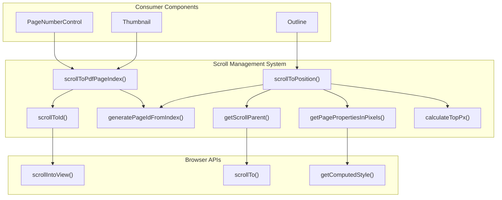
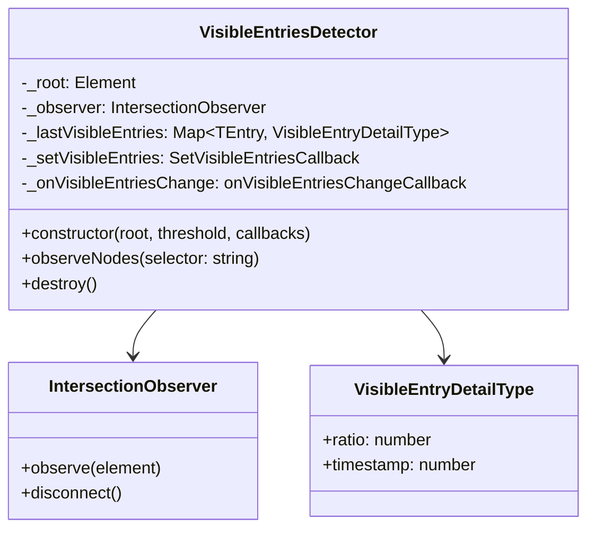
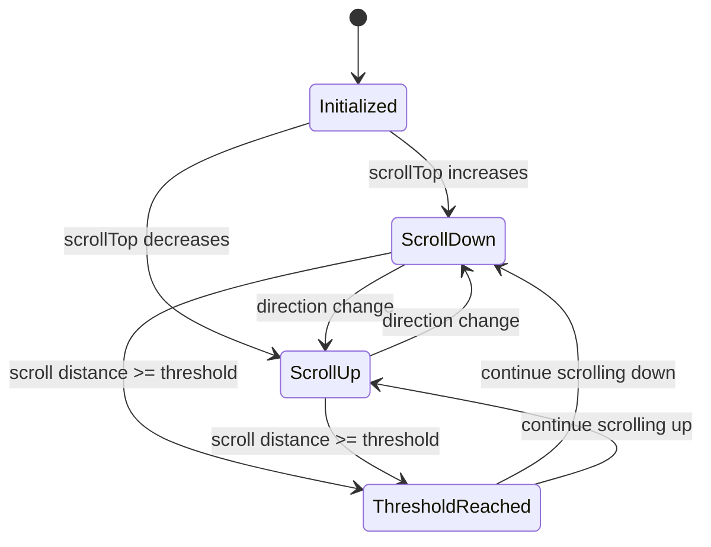
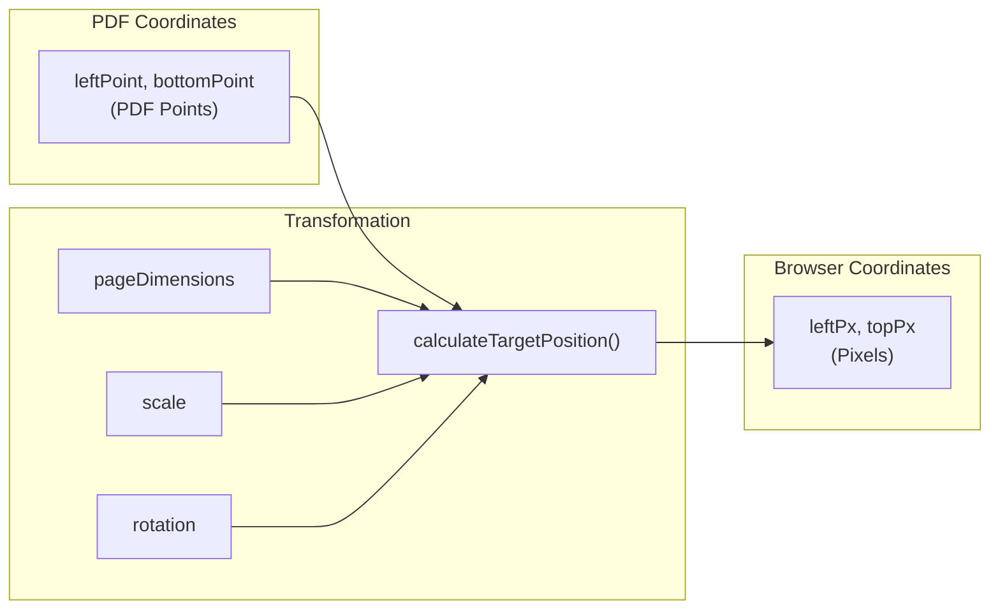
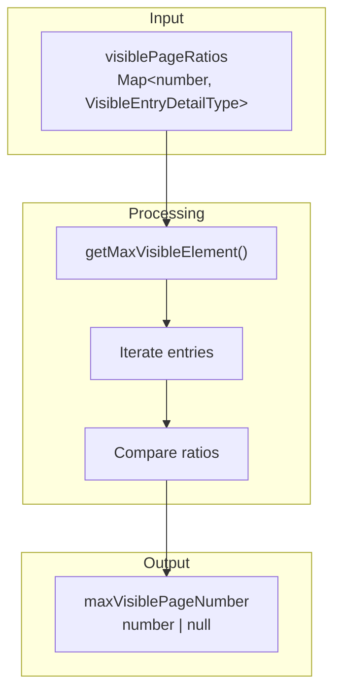

<!-- source: DeepWiki mcp.deepwiki.com · repo allenai/pdf-component-library · page 2.6 Utility Systems · fetched 2026-10-26 -->

# Utility Systems

Relevant source files

The following files were used as context for generating this wiki page:

- [ui/library/src/components/PageNumberControl.tsx](ui/library/src/components/PageNumberControl.tsx)
- [ui/library/src/components/types/outline.ts](ui/library/src/components/types/outline.ts)
- [ui/library/src/utils/MaxVisibleElement.ts](ui/library/src/utils/MaxVisibleElement.ts)
- [ui/library/src/utils/ScrollDirectionDetector.ts](ui/library/src/utils/ScrollDirectionDetector.ts)
- [ui/library/src/utils/VisibleEntriesDetector.ts](ui/library/src/utils/VisibleEntriesDetector.ts)
- [ui/library/src/utils/scroll.ts](ui/library/src/utils/scroll.ts)
- [ui/library/test/utils/VisibleEntriesDetector.test.ts](ui/library/test/utils/VisibleEntriesDetector.test.ts)
- [ui/library/test/utils/scroll.test.ts](ui/library/test/utils/scroll.test.ts)
- [ui/library/test/utils/scrollDirectionDetector.test.ts](ui/library/test/utils/scrollDirectionDetector.test.ts)

The utility systems provide foundational infrastructure for scroll management, visibility tracking, and coordinate transformations within the PDF Component Library. These systems handle low-level operations that support user interactions such as navigation, page tracking, and position-based scrolling.

This document covers the core utility classes and functions that manage scroll behavior, detect element visibility, and perform coordinate calculations. For information about the components that consume these utilities, see [Interactive and Navigation Components](#2.5). For details about the context system that coordinates state management, see [Context System](#2.3).

## Scroll Management System

The scroll management system provides programmatic control over PDF document navigation through a collection of utilities in [ui/library/src/utils/scroll.ts](). These utilities handle scrolling to specific pages, positions within pages, and coordinate transformations between PDF coordinate space and browser pixels.

### Core Scroll Functions

The system provides several key functions for navigation:

| Function | Purpose | Parameters |
|----------|---------|------------|
| `scrollToPdfPageIndex` | Navigate to a specific page | `pageIndex: number \| string` |
| `scrollToPosition` | Navigate to coordinates within a page | `pageIndex`, `leftPoints`, `bottomPoints`, `rotation` |
| `scrollToId` | Scroll to DOM element by ID | `id: string` |

Sources: [ui/library/src/utils/scroll.ts:1-196](), [ui/library/src/components/PageNumberControl.tsx:1-100]()

### Page Identification and Navigation

The system uses a consistent naming scheme for page elements through `generatePageIdFromIndex()`, which creates DOM IDs following the pattern `reader_pg_{pageIndex}`. This enables reliable navigation and element lookup across the application.

The `scrollToPosition()` function handles complex coordinate transformations when navigating to specific positions within PDF pages. It accounts for:
- Page rotation states (0°, 90°, 180°, 270°)
- PDF point-to-pixel conversions using standard PDF dimensions (612×792 points)
- Page margins and layout offsets
- Scrollable parent container detection

Sources: [ui/library/src/utils/scroll.ts:13-28](), [ui/library/src/utils/scroll.ts:37-101]()

## Visibility Detection System

The visibility detection system uses the `VisibleEntriesDetector` class to track which PDF pages and elements are currently visible in the viewport. This system powers navigation components, page number displays, and thumbnail highlighting.

### VisibleEntriesDetector Architecture

The detector uses the IntersectionObserver API with configurable thresholds (default: 101 thresholds from 0% to 100% visibility) and a 50px root margin for optimal performance. When visibility changes occur, the system:

1. Filters entries into visible and hidden collections
2. Calls the `onVisibleEntriesChange` callback to process changes
3. Updates the internal state with new visibility ratios
4. Notifies consumers through the `setVisibleEntries` callback

Sources: [ui/library/src/utils/VisibleEntriesDetector.ts:1-78](), [ui/library/test/utils/VisibleEntriesDetector.test.ts:1-149]()

### Scroll Direction Detection

The `ScrollDirectionDetector` class tracks scroll direction changes and provides threshold-based detection for UI responsiveness. It monitors both direction changes and whether sufficient scroll distance has occurred in a given direction.

Key features of the scroll direction detector:
- Tracks current scroll direction (`ScrollDirection.UP` or `ScrollDirection.DOWN`)
- Monitors top position state (`isAtTop` boolean)
- Optional threshold detection for triggering UI changes after significant scroll
- Handles both window and element scroll events

Sources: [ui/library/src/utils/ScrollDirectionDetector.ts:1-95](), [ui/library/test/utils/scrollDirectionDetector.test.ts:1-404]()

## Coordinate Transformation Utilities

The system provides utilities for converting between PDF coordinate space and browser pixel coordinates, accounting for scaling, rotation, and viewport positioning.

### Coordinate Systems

The PDF component library works with multiple coordinate systems:

| System | Origin | Units | Usage |
|--------|--------|-------|-------|
| PDF Points | Bottom-left | Points (1/72 inch) | PDF.js native coordinates |
| Browser Pixels | Top-left | Pixels | DOM positioning and scrolling |
| Page Layout | Variable | Pixels | Rendered page with margins |

The `calculateTargetPosition()` function converts PDF point coordinates to pixel coordinates for a given page:

The transformation accounts for:
- Standard PDF page dimensions (612×792 points)
- Current zoom scale factor
- Page rotation state
- Coordinate system origin differences (bottom-left vs top-left)

Sources: [ui/library/src/utils/scroll.ts:174-195](), [ui/library/src/components/types/outline.ts:19-41]()

## Navigation Support Utilities

### Maximum Visible Element Detection

The `getMaxVisibleElement()` utility identifies which page has the highest visibility ratio, enabling accurate current page detection for navigation controls.

This utility is used by `PageNumberControl` to update the current page display as users scroll through the document. The algorithm iterates through all visible pages and returns the page number with the highest visibility ratio.

Sources: [ui/library/src/utils/MaxVisibleElement.ts:1-19](), [ui/library/src/components/PageNumberControl.tsx:34-39]()

### Scrollable Parent Detection

The `getScrollParent()` function traverses the DOM hierarchy to find the nearest scrollable ancestor element. This is essential for applying scroll operations to the correct container, especially in complex layouts with nested scrollable regions.

The function checks for:
- Sufficient scroll height (minimum 50px to avoid Firefox inline container bugs)
- Non-hidden overflow styles (`overflow`, `overflowX`, `overflowY`)
- Document element fallback for top-level scrolling

Sources: [ui/library/src/utils/scroll.ts:103-124](), [ui/library/test/utils/scroll.test.ts:194-203]()

---

