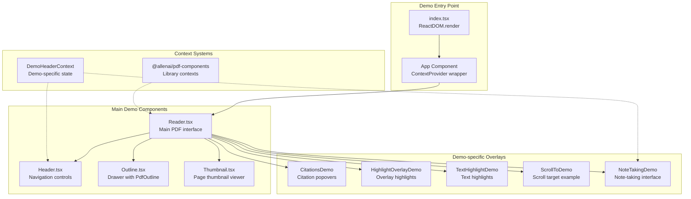
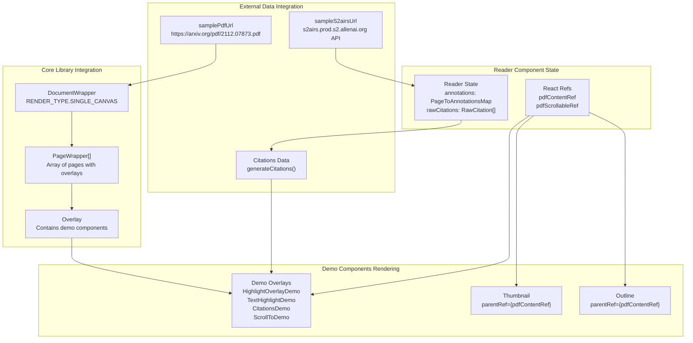
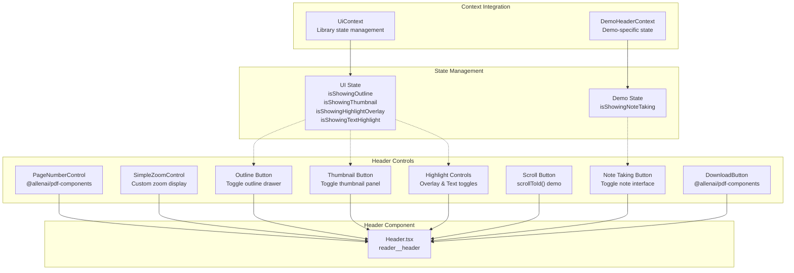
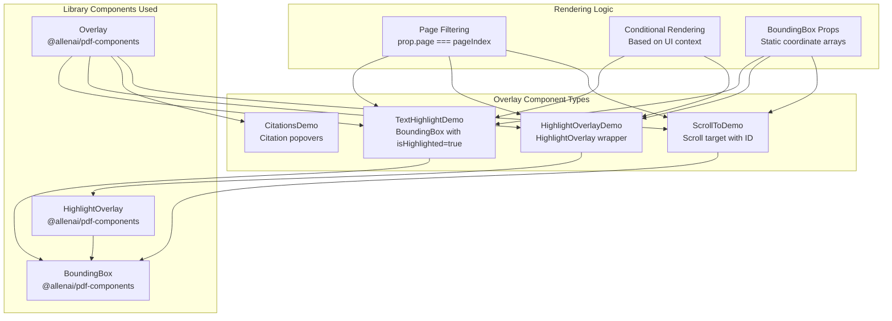
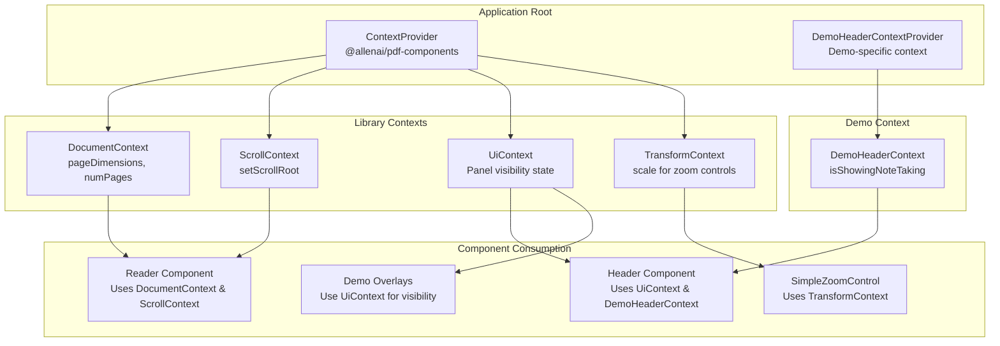
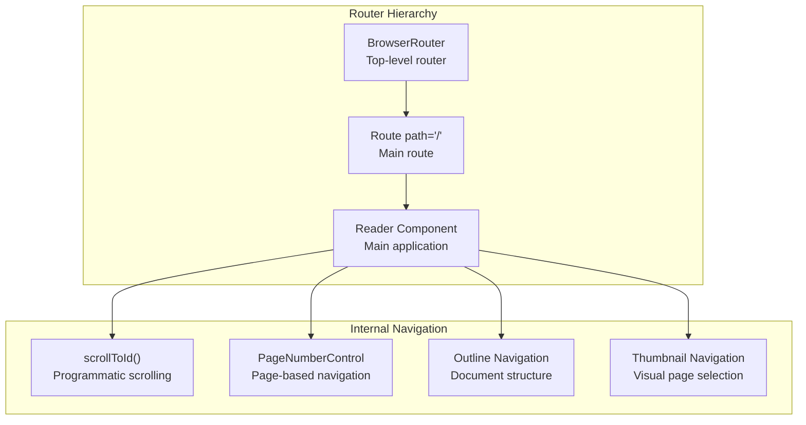

<!-- source: DeepWiki mcp.deepwiki.com · repo allenai/pdf-component-library · page 4.1 Demo Architecture and Components · fetched 2026-10-26 -->

# Demo Architecture and Components

Relevant source files

The following files were used as context for generating this wiki page:

- [ui/demo/components/Header.tsx](ui/demo/components/Header.tsx)
- [ui/demo/components/HighlightOverlayDemo.tsx](ui/demo/components/HighlightOverlayDemo.tsx)
- [ui/demo/components/Outline.tsx](ui/demo/components/Outline.tsx)
- [ui/demo/components/Reader.tsx](ui/demo/components/Reader.tsx)
- [ui/demo/components/ScrollToDemo.tsx](ui/demo/components/ScrollToDemo.tsx)
- [ui/demo/components/SimpleZoomControl.tsx](ui/demo/components/SimpleZoomControl.tsx)
- [ui/demo/components/TextHighlightDemo.tsx](ui/demo/components/TextHighlightDemo.tsx)
- [ui/demo/index.tsx](ui/demo/index.tsx)
- [ui/library/index.ts](ui/library/index.ts)

This document covers the architecture and implementation of the demonstration application that showcases the PDF Component Library's capabilities. The demo serves as both a functional example and a testing environment for the library components.

For information about the core library components themselves, see [Core PDF Components Library](#2). For details about the build and deployment system, see [Development and Build System](#5).

## Demo Application Overview

The demo application is a React-based PDF reader that demonstrates key features of the PDF Component Library. It loads a sample academic paper and provides interactive capabilities including outline navigation, thumbnail previews, text highlighting, citation popovers, and annotation tools.

### Demo Application Structure

Sources: [ui/demo/index.tsx:1-22](), [ui/demo/components/Reader.tsx:1-107]()

## Main Reader Component Architecture

The `Reader` component serves as the primary orchestrator for the demo application, integrating the PDF Component Library with demo-specific features and external data sources.

### Reader Component Structure

The `Reader` component implements several key responsibilities:

| Responsibility | Implementation |
|---|---|
| PDF Loading | Uses `DocumentWrapper` with `RENDER_TYPE.SINGLE_CANVAS` |
| External Data | Fetches citation data from Semantic Scholar API |
| Page Rendering | Maps over `numPages` to create `PageWrapper` instances |
| Overlay Management | Embeds demo components within `Overlay` components |
| Reference Management | Maintains refs for scrollable regions and content containers |

Sources: [ui/demo/components/Reader.tsx:25-106]()

### Data Flow and Effects

```mermaid
graph LR
    subgraph "Initialization Effects"
        MOUNT["Component Mount<br/>setScrollRoot(null)"]
        PDF_LOAD["PDF Load<br/>pageDimensions available"]
        API_FETCH["API Fetch<br/>fetch(sampleS2airsUrl)"]
    end
    
    subgraph "Data Processing"
        RAW_CITATIONS["rawCitations<br/>RawCitation[]"]
        GENERATE["generateCitations()<br/>annotations.ts"]
        ANNOTATIONS["annotations<br/>PageToAnnotationsMap"]
    end
    
    subgraph "Component Updates"
        STATE_UPDATE["State Updates<br/>setAnnotations()"]
        RENDER_TRIGGER["Re-render<br/>Demo components"]
    end
    
    MOUNT --> PDF_LOAD
    PDF_LOAD --> API_FETCH
    API_FETCH --> RAW_CITATIONS
    RAW_CITATIONS --> GENERATE
    GENERATE --> ANNOTATIONS
    ANNOTATIONS --> STATE_UPDATE
    STATE_UPDATE --> RENDER_TRIGGER
```

Sources: [ui/demo/components/Reader.tsx:43-68]()

## Demo-specific Components

The demo application includes several custom components that extend the library's functionality and demonstrate advanced usage patterns.

### Header Component Architecture

The `Header` component demonstrates integration patterns between library components and custom controls:

| Control Type | Implementation | Context Used |
|---|---|---|
| Page Navigation | `PageNumberControl` from library | `UiContext` |
| Zoom Control | Custom `SimpleZoomControl` | `TransformContext` |
| Panel Toggles | Custom buttons with state management | `UiContext` |
| Demo Features | Custom demo-specific buttons | `DemoHeaderContext` |

Sources: [ui/demo/components/Header.tsx:1-84]()

### Demo Overlay Components

The demo includes several overlay components that showcase different ways to use the library's `BoundingBox` and `Overlay` systems:

Each demo overlay component follows a similar pattern:

1. **Context Integration**: Uses `UiContext` for conditional rendering
2. **Page Filtering**: Only renders elements for the appropriate page
3. **Static Data**: Uses hardcoded bounding box coordinates for demonstration
4. **Library Integration**: Wraps library components with demo-specific styling

Sources: [ui/demo/components/TextHighlightDemo.tsx:1-85](), [ui/demo/components/HighlightOverlayDemo.tsx:1-94](), [ui/demo/components/ScrollToDemo.tsx:1-32]()

## Context Integration

The demo application integrates both library contexts and demo-specific contexts to manage state across the application.

### Context Usage Pattern

### Context State Management

| Context | State Variables | Used By |
|---|---|---|
| `DocumentContext` | `pageDimensions`, `numPages` | `Reader` for page rendering |
| `ScrollContext` | `setScrollRoot` | `Reader` for scroll management |
| `UiContext` | `isShowingOutline`, `isShowingThumbnail`, etc. | `Header`, demo overlays |
| `TransformContext` | `scale` | `SimpleZoomControl` |
| `DemoHeaderContext` | `isShowingNoteTaking` | `Header`, `NoteTakingDemo` |

Sources: [ui/demo/index.tsx:13-18](), [ui/demo/components/Reader.tsx:26-27](), [ui/demo/components/Header.tsx:13-23](), [ui/demo/components/SimpleZoomControl.tsx:6-7]()

## Router and Navigation Structure

The demo application uses React Router to handle navigation, though the current implementation primarily uses a single route structure.

### Router Configuration

The demo uses a simple routing structure with internal navigation handled by the PDF Component Library's built-in navigation utilities rather than complex route-based navigation.

Sources: [ui/demo/index.tsx:13-18](), [ui/demo/components/Reader.tsx:71-104]()

---

