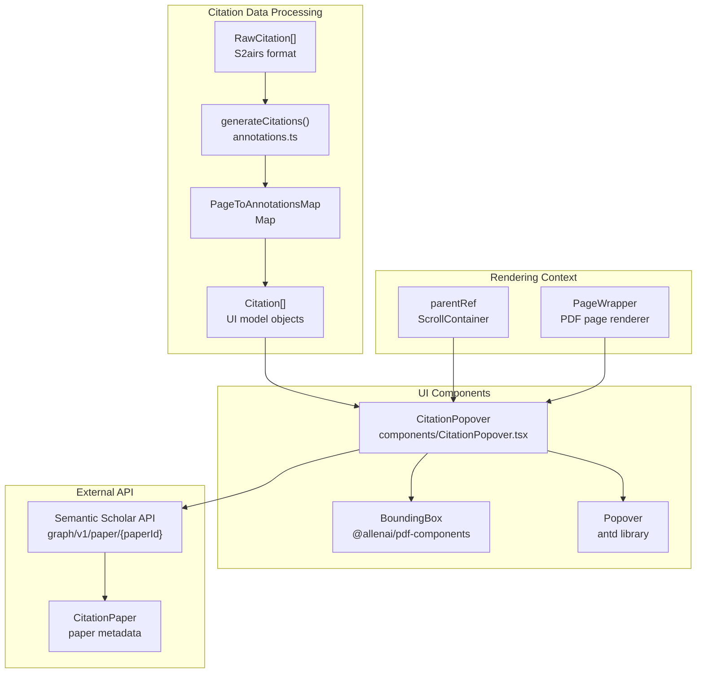
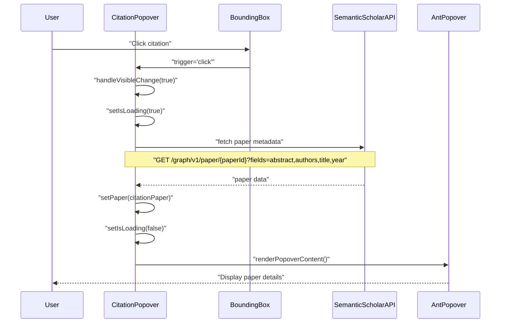
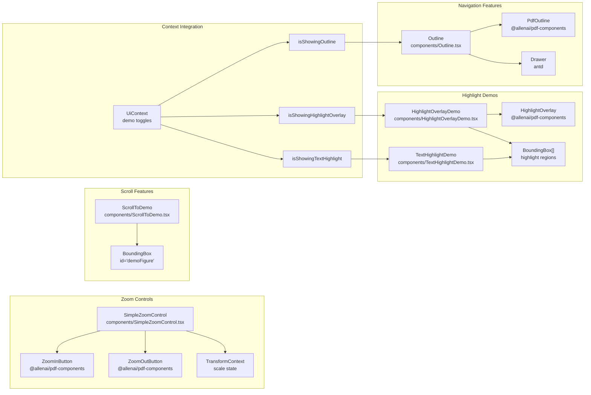

<!-- source: DeepWiki mcp.deepwiki.com · repo allenai/pdf-component-library · page 4.2 Citation and Interactive Features · fetched 2026-10-26 -->

# Citation and Interactive Features

<details>
<summary>Relevant source files</summary>

The following files were used as context for generating this wiki page:

- [ui/demo/components/CitationPopover.tsx](ui/demo/components/CitationPopover.tsx)
- [ui/demo/components/HighlightOverlayDemo.tsx](ui/demo/components/HighlightOverlayDemo.tsx)
- [ui/demo/components/Outline.tsx](ui/demo/components/Outline.tsx)
- [ui/demo/components/ScrollToDemo.tsx](ui/demo/components/ScrollToDemo.tsx)
- [ui/demo/components/SimpleZoomControl.tsx](ui/demo/components/SimpleZoomControl.tsx)
- [ui/demo/components/TextHighlightDemo.tsx](ui/demo/components/TextHighlightDemo.tsx)
- [ui/demo/index.tsx](ui/demo/index.tsx)
- [ui/demo/types/annotations.ts](ui/demo/types/annotations.ts)
- [ui/demo/types/citations.ts](ui/demo/types/citations.ts)

</details>


This document covers the interactive demonstration features implemented in the demo application, with a primary focus on the citation popover system that integrates with the Semantic Scholar API. It also documents other interactive demo components that showcase advanced usage patterns of the PDF Component Library.

For information about the core PDF components and rendering system, see [Core PDF Components Library](#2). For details about the demo application architecture, see [Demo Architecture and Components](#4.1).

## Citation System Architecture

The citation system demonstrates how to create interactive overlays that provide contextual information about references in academic papers. The system processes raw citation data and renders clickable bounding boxes that display detailed paper metadata when activated.



**Citation System Component Flow**

The citation system transforms raw S2airs format data into interactive UI elements that provide rich contextual information about referenced papers.

Sources: [ui/demo/components/CitationPopover.tsx:1-129](), [ui/demo/types/citations.ts:1-66](), [ui/demo/types/annotations.ts:1-50]()

## Citation Data Flow and API Integration

The citation popover implements a lazy-loading pattern that fetches paper metadata only when users interact with citation elements. This approach optimizes performance while providing comprehensive citation details.



**Citation Interaction Flow**

The system fetches paper metadata on-demand when users click citation bounding boxes, providing immediate visual feedback through loading states.

Sources: [ui/demo/components/CitationPopover.tsx:20-45](), [ui/demo/components/CitationPopover.tsx:97-104]()

## Citation Data Models and Processing

The citation system defines a clear data transformation pipeline from raw S2airs format to UI-ready models:

| Type | Purpose | Key Fields |
|------|---------|------------|
| `RawCitation` | S2airs format input | `citedPaperId`, `mentions[]` |
| `RawMention` | Raw mention data | `boundingBoxes[]` |
| `Citation` | UI model | `id`, `boundingBox`, `paperId`, `paper` |
| `CitationPaper` | API response model | `abstract`, `authors`, `title`, `url`, `year` |
| `Author` | Author metadata | `id`, `name`, `url` |

The `generateCitations` function processes raw citation data by:
1. Iterating through raw citations and mentions
2. Scaling bounding boxes using `scaleRawBoundingBox` 
3. Creating `Citation` objects with unique identifiers
4. Organizing citations by page index in `PageToAnnotationsMap`

Sources: [ui/demo/types/citations.ts:3-36](), [ui/demo/types/annotations.ts:14-39]()

## Interactive Demo Features Architecture

Beyond citations, the demo application includes several interactive components that demonstrate different usage patterns of the PDF Component Library:



**Interactive Demo Components Architecture**

Each demo component integrates with the PDF Component Library's context system to provide toggleable interactive features.

Sources: [ui/demo/components/Outline.tsx:1-32](), [ui/demo/components/SimpleZoomControl.tsx:1-21](), [ui/demo/components/TextHighlightDemo.tsx:1-84](), [ui/demo/components/HighlightOverlayDemo.tsx:1-94](), [ui/demo/components/ScrollToDemo.tsx:1-32]()

## Highlight and Overlay System Implementation

The demo includes two distinct highlighting approaches that demonstrate different visual patterns:

### Text Highlighting Demo
- Uses `BoundingBox` components with `isHighlighted={true}`
- Renders individual highlighted regions across multiple pages
- Controlled by `UiContext.isShowingTextHighlight`
- Applies styling via `reader__sample-text-highlight__bbox` class

### Highlight Overlay Demo  
- Uses `HighlightOverlay` wrapper component
- Groups multiple `BoundingBox` elements for coordinated highlighting
- Controlled by `UiContext.isShowingHighlightOverlay`
- Demonstrates paragraph-level highlighting patterns

Both approaches use hardcoded bounding box coordinates for demonstration purposes, showing how real applications might position highlights based on text analysis or user selections.

Sources: [ui/demo/components/TextHighlightDemo.tsx:17-81](), [ui/demo/components/HighlightOverlayDemo.tsx:17-93]()

## Popover Container Management

The citation popover and outline drawer both use container reference patterns to ensure proper positioning within the scrollable PDF content area:

```typescript
// CitationPopover container mounting
getPopupContainer={() => parentRef.current}

// Outline drawer container mounting  
getContainer={parentRef.current}
```

This approach prevents popovers from being clipped by scroll containers and ensures they appear within the correct coordinate space relative to the PDF content.

Sources: [ui/demo/components/CitationPopover.tsx:114](), [ui/demo/components/Outline.tsx:26]()

## URL Generation and External Links

The citation system generates Semantic Scholar URLs for papers and authors using utility functions:

- `makePaperUrl(paperId)` - Creates paper detail URLs
- `makeAuthors(rawAuthors)` - Transforms author data with profile URLs
- Links open in new tabs with `target="_blank" rel="noreferrer"`

This demonstrates how to integrate external academic resources into PDF viewing experiences.

Sources: [ui/demo/types/citations.ts:52-65](), [ui/demo/components/CitationPopover.tsx:47-56]()

---

