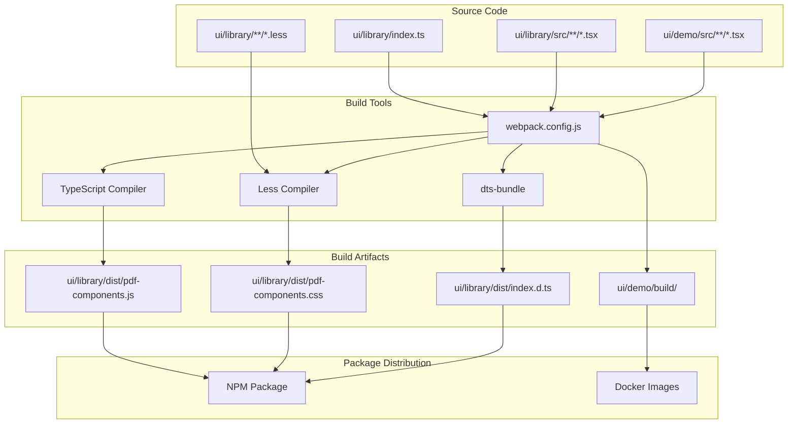
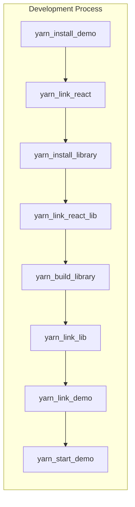
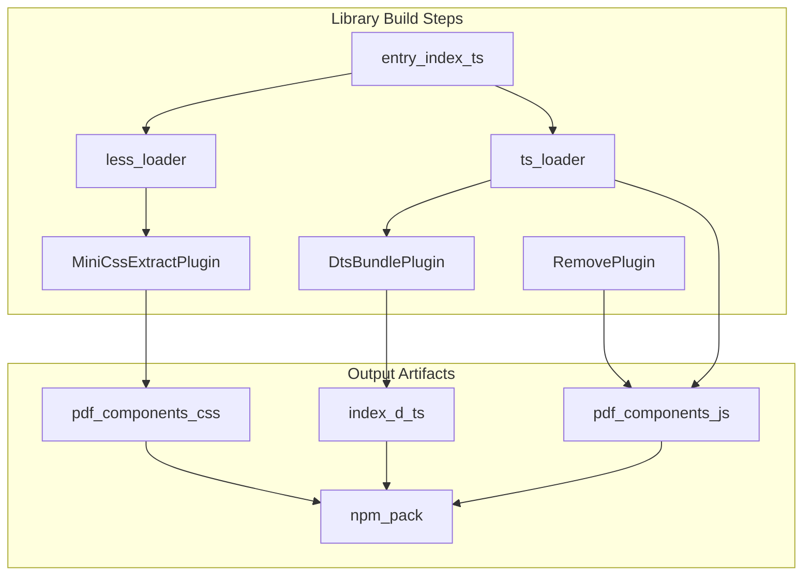
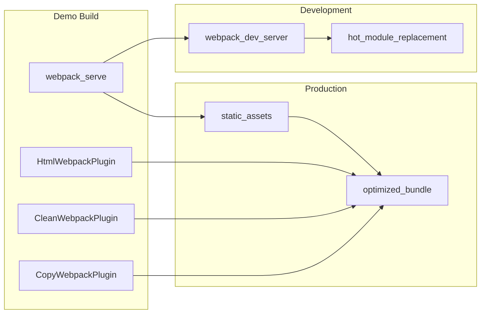
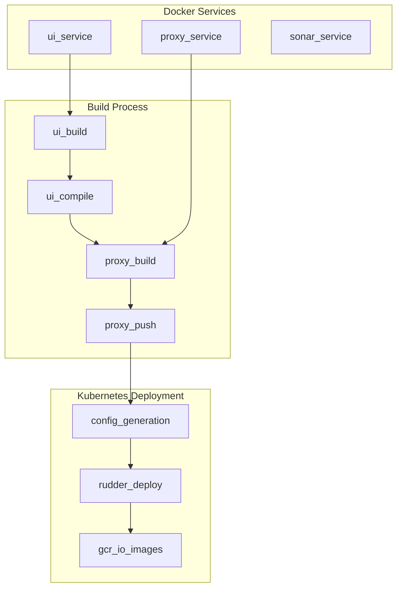
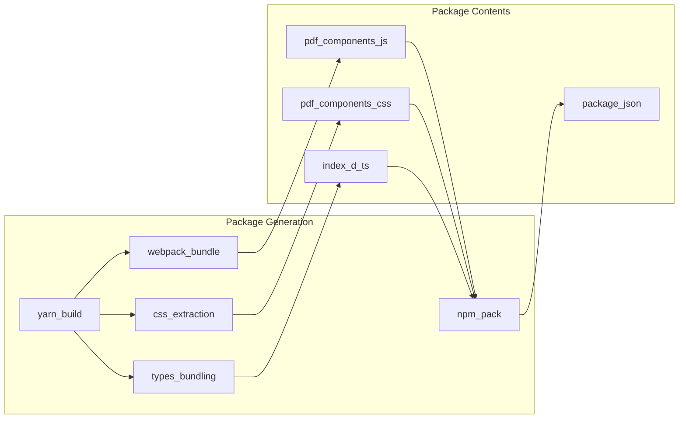

<!-- source: DeepWiki mcp.deepwiki.com · repo allenai/pdf-component-library · page 5 Development and Build System · fetched 2026-10-26 -->

# Development and Build System

Relevant source files

The following files were used as context for generating this wiki page:

- [.github/workflows/ci.yml](.github/workflows/ci.yml)
- [.skiff/cloudbuild-deploy.yaml](.skiff/cloudbuild-deploy.yaml)
- [.skiff/util.libsonnet](.skiff/util.libsonnet)
- [README.md](README.md)
- [docker-compose.yaml](docker-compose.yaml)
- [ui/demo/package.json](ui/demo/package.json)
- [ui/demo/yarn.lock](ui/demo/yarn.lock)
- [ui/library/package.json](ui/library/package.json)
- [ui/library/webpack.config.js](ui/library/webpack.config.js)
- [ui/library/yarn.lock](ui/library/yarn.lock)

This document covers the build system, development workflow, CI/CD pipeline, and deployment infrastructure for the PDF Component Library. The system manages two main artifacts: the `@allenai/pdf-components` library package and its demonstration application.

For information about the library's components and architecture, see [Core PDF Components Library](#2). For styling and UI concerns, see [Styling System](#3).

## Build System Architecture

The project uses a multi-package build system with Webpack as the primary bundler for both the library and demo application.

### Build System Overview

**Sources:** [ui/library/webpack.config.js](), [ui/library/package.json:6-13](), [ui/demo/package.json:6-13]()

### Library Build Configuration

The library uses a specialized Webpack configuration that produces UMP (Universal Module Definition) bundles for distribution:

| Configuration | Purpose | Output |
|---------------|---------|---------|
| Entry Point | [ui/library/index.ts]() | Main library export |
| Output Format | UMD with externals | `pdf-components.js` |
| CSS Extraction | MiniCssExtractPlugin | `pdf-components.css` |
| Type Definitions | dts-bundle | `index.d.ts` |

The build process implements external dependencies for `react`, `react-dom`, and `react-pdf` to avoid bundling peer dependencies [ui/library/webpack.config.js:65-79]().

**Sources:** [ui/library/webpack.config.js](), [ui/library/package.json:66-70]()

## Development Workflow

### Local Development Setup

The development workflow uses yarn linking to connect the library and demo application during development:

**Sources:** [.github/workflows/ci.yml:16-39](), [ui/library/package.json:8-9](), [ui/demo/package.json:8-9]()

### Development Scripts

| Script | Location | Purpose |
|--------|----------|---------|
| `yarn start` | ui/demo | Webpack dev server with HMR |
| `yarn build` | ui/library | Build library for distribution |
| `yarn build` | ui/demo | Build demo application |
| `yarn link:lib` | ui/library | Create symlink for local development |
| `yarn link:react` | Both packages | Link React dependencies |

**Sources:** [ui/library/package.json:6-13](), [ui/demo/package.json:6-13]()

## Library Build Process

### Webpack Build Pipeline

The library build process executes several specialized plugins:

- **RemovePlugin**: Cleans `dist/` directory while preserving `package.json` and `LICENSE` [ui/library/webpack.config.js:36-47]()
- **MiniCssExtractPlugin**: Extracts CSS into separate `pdf-components.css` file [ui/library/webpack.config.js:48-50]()
- **DtsBundlePlugin**: Custom plugin that bundles TypeScript definitions using `dts-bundle` [ui/library/webpack.config.js:83-95]()

**Sources:** [ui/library/webpack.config.js](), [ui/library/package.json:7]()

### TypeScript Compilation

The library uses `ts-loader` for TypeScript compilation with the following configuration:
- Target: ES5 for browser compatibility
- Module: UMD for universal distribution  
- Declaration files generated to `tmp/` then bundled to `dist/index.d.ts`

**Sources:** [ui/library/webpack.config.js:24-28]()

## Demo Application Build

The demo application uses a standard React application build configuration:

**Sources:** [ui/demo/package.json:12](), [ui/demo/webpack.config.js]()

## CI/CD Pipeline

### GitHub Actions Workflow

The CI pipeline implements a comprehensive build and test process:

```mermaid
graph TD
    subgraph "CI Pipeline Steps"
        A[checkout_repository]
        B[setup_node_12_22_6]
        C[install_demo_dependencies]
        D[create_react_links]
        E[install_library_dependencies]
        F[link_library_to_react]
        G[build_library]
        H[create_library_link]
        I[link_demo_to_library]
        J[build_demo]
        K[test_library]
        L[test_demo]
        M[lint_library]
        N[lint_demo]
    end
    
    A --> B
    B --> C
    C --> D
    D --> E
    E --> F
    F --> G
    G --> H
    H --> I
    I --> J
    J --> K
    K --> L
    L --> M
    M --> N
```

The workflow implements the following verification steps:
- **Dependency Installation**: Installs dependencies for both packages [.github/workflows/ci.yml:16-24]()
- **Yarn Linking**: Creates symlinks between packages for integration testing [.github/workflows/ci.yml:19-36]()
- **Build Verification**: Ensures both library and demo build successfully [.github/workflows/ci.yml:28-39]()
- **Test Execution**: Runs test suites for both packages [.github/workflows/ci.yml:40-45]()
- **Code Quality**: Executes ESLint on both codebases [.github/workflows/ci.yml:46-51]()

**Sources:** [.github/workflows/ci.yml]()

### Build Environment

The CI environment uses:
- Node.js version 12.22.6 [.github/workflows/ci.yml:14]()
- Yarn package manager
- 5-minute timeout for reliability [.github/workflows/ci.yml:6]()

**Sources:** [.github/workflows/ci.yml:6-14]()

## Deployment System

### Docker-Based Deployment

**Sources:** [docker-compose.yaml](), [.skiff/cloudbuild-deploy.yaml]()

### Google Cloud Build Pipeline

The deployment pipeline uses Google Cloud Build with the following stages:

| Stage | Purpose | Artifacts |
|-------|---------|-----------|
| `ui.build` | Build UI Docker image | `gcr.io/$PROJECT_ID/$REPO_NAME-ui` |
| `ui.compile` | Compile production assets | `/workspace/proxy/dist` |
| `proxy.build` | Build proxy Docker image | `gcr.io/$PROJECT_ID/$REPO_NAME-proxy` |
| `config` | Generate Kubernetes config | `webapp.yaml` |
| `deploy` | Deploy to Kubernetes | Live application |

**Sources:** [.skiff/cloudbuild-deploy.yaml:5-77]()

### Container Configuration

The Docker setup includes:
- **UI Service**: Node.js application with volume mounts for development [docker-compose.yaml:8-15]()
- **Proxy Service**: Nginx proxy for routing traffic [docker-compose.yaml:16-21]()
- **Volume Management**: Persistent node_modules volumes [docker-compose.yaml:22-24]()

**Sources:** [docker-compose.yaml]()

## Package Management

### NPM Package Distribution

The library generates an NPM package through the build process:

The build script creates a distributable package: `cd dist && npm pack` [ui/library/package.json:7]().

**Sources:** [ui/library/package.json:7](), [ui/library/webpack.config.js:54-64]()

### Dependency Management

The project uses peer dependencies to avoid version conflicts:

| Dependency | Version | Purpose |
|------------|----------|---------|
| `react` | ^16.8.0 | Core React library |
| `react-dom` | ^16.8.0 | React DOM rendering |
| `react-pdf` | 6.0.0-beta.2 | PDF rendering engine |

**Sources:** [ui/library/package.json:66-70](), [ui/demo/package.json:20-32]()