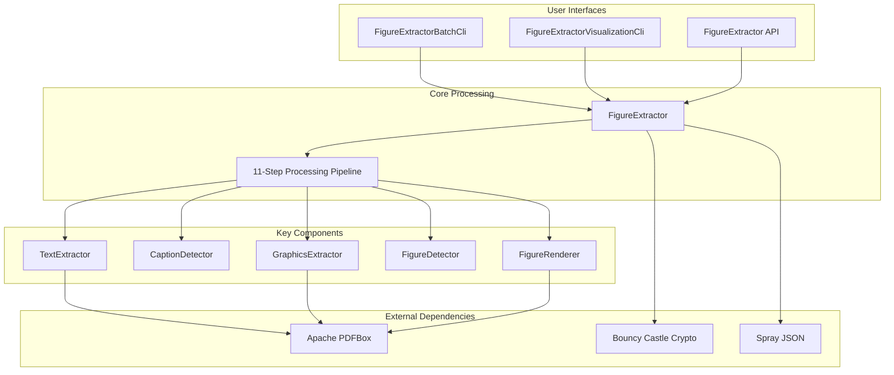
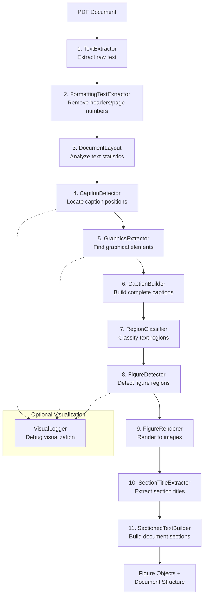

<!-- source: DeepWiki mcp.deepwiki.com · repo allenai/pdffigures2 · page 1 Overview · fetched 2026-10-26 -->

# Overview

<details>
<summary>Relevant source files</summary>

The following files were used as context for generating this wiki page:

- [README.md](README.md)
- [build.sbt](build.sbt)

</details>


This document introduces PDFFigures 2.0, a Scala-based system for extracting figures, tables, captions, and section titles from scholarly PDF documents. It provides a high-level system overview, core architecture, and entry points for users and developers.

For detailed installation instructions and quick start examples, see [Installation and Quick Start](#1.1). For deep technical details about the processing pipeline, see [Core Processing Pipeline](#3). For build system configuration, see [Build System and Configuration](#6).

## System Purpose and Capabilities

PDFFigures 2.0 is designed to extract structured information from scholarly PDF documents, with a focus on computer science domain papers. The system processes PDF files through an 11-step pipeline to identify and extract figures, tables, their captions, and associated metadata.

**Primary Capabilities:**
- Figure and table detection with bounding box coordinates
- Caption extraction and association with figures
- Text extraction and classification 
- Section title identification (experimental)
- Multi-format output including JSON and rasterized images
- Batch processing with parallel execution
- Debug visualization for development

**Core Output Information:**
- Page location (0-based indexing)
- Bounding box coordinates (72 DPI pixel coordinates)
- Caption text and bounding box
- Figure name derived from caption
- Classification as Figure or Table
- Text content within figures

Sources: [README.md:1-29](), [build.sbt:8-11]()

## High-Level System Architecture

The system follows a modular architecture with two primary user interfaces and a shared processing engine:



Sources: [README.md:44-89](), [build.sbt:63-65]()

## Processing Pipeline Overview

The system transforms PDF documents through an 11-step sequential pipeline, where each step produces intermediate representations that feed into subsequent processing stages:



**Key Processing Classes:**

| Step | Class | Purpose |
|------|-------|---------|
| 1 | `TextExtractor` | Extract text from PDF using PDFBox |
| 2 | `FormattingTextExtractor` | Remove page headers, numbers, abstracts |
| 3 | `DocumentLayout` | Gather text statistics for anomaly detection |
| 4 | `CaptionDetector` | Identify caption start positions |
| 5 | `GraphicsExtractor` | Locate non-textual elements |
| 6 | `CaptionBuilder` | Complete caption text extraction |
| 7 | `RegionClassifier` | Classify text as BodyText or Other |
| 8 | `FigureDetector` | Propose and score figure regions |
| 9 | `FigureRenderer` | Render figures to image formats |
| 10-11 | Section processing | Extract section structure (experimental) |

Sources: [README.md:92-117]()

## Command-Line Interfaces

PDFFigures 2.0 provides two primary CLI tools with distinct use cases:

**Batch Processing CLI (`FigureExtractorBatchCli`)**
- Main entry point for production use
- Processes multiple PDFs with parallel execution
- Configurable output formats and locations
- Statistical reporting

**Visualization CLI (`FigureExtractorVisualizationCli`)**  
- Single PDF processing with debug output
- Visual step-by-step pipeline inspection
- Development and troubleshooting tool

```bash
# Basic figure extraction
sbt "runMain org.allenai.pdffigures2.FigureExtractorVisualizationCli /path/to/pdf"

# Batch processing with image output
sbt "runMain org.allenai.pdffigures2.FigureExtractorBatchCli /pdf/directory/ -s stats.json -m /images/prefix -d /data/prefix"

# Standalone JAR compilation
sbt assembly  # Creates pdffigures2.jar
```

Sources: [README.md:44-70](), [build.sbt:63-66]()

## Dependencies and Build System

The system is built using SBT with cross-compilation support for Scala 2.11 and 2.12:

**Core Dependencies:**

| Library | Version | Purpose |
|---------|---------|---------|
| `apache.pdfbox` | 2.0.26 | PDF parsing and rendering |
| `bouncycastle` | 1.71 | PDF security/encryption handling |
| `spray-json` | 1.3.6 | JSON serialization |
| `scopt` | 4.1.0 | Command-line argument parsing |
| `logback-classic` | 1.2.11 | Logging framework |
| `typesafe.config` | 1.4.2 | Configuration management |

**Build Configuration:**
- Organization: `org.allenai`
- Cross-compilation: Scala 2.11.12, 2.12.16
- Apache 2.0 license
- Maven-style publishing to Bintray

**Optional Image Format Dependencies:**
For extended image format support (disabled by default due to licensing):
- `jai-imageio-core` for additional image formats
- `jai-imageio-jpeg2000` for JPEG2000 support  
- `levigo-jbig2-imageio` for JBIG2 support

Sources: [build.sbt:1-48](), [README.md:34-42]()

## Output Formats and Integration

The system supports multiple output formats for different integration scenarios:

**Figure Object Structure:**
- JSON serialization via Spray JSON protocols
- Programmatic access through Scala APIs
- Image export in BufferedImage-compatible formats (PNG, JPEG)
- Experimental vector graphics support via `pdftocairo`

**Document Structure Output:**
- Page-based figure listings
- Section-based document organization
- Text classification and region analysis
- Statistical metadata about processing

The `FigureExtractor` class provides the primary programmatic interface, with methods for both single-document and batch processing scenarios.

Sources: [README.md:6-29](), [README.md:84-89](), [build.sbt:28]()

---

