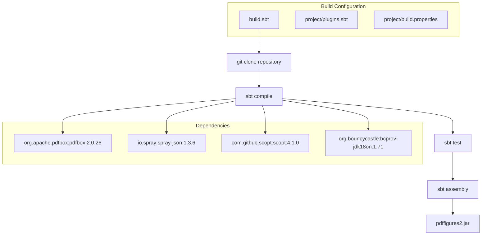
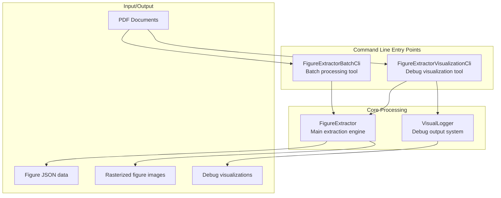
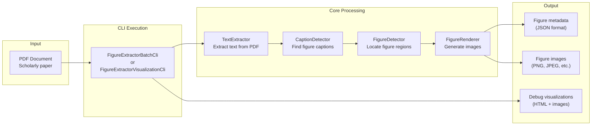

<!-- source: DeepWiki mcp.deepwiki.com · repo allenai/pdffigures2 · page 1.1 Installation and Quick Start · fetched 2026-10-26 -->

# Installation and Quick Start

<details>
<summary>Relevant source files</summary>

The following files were used as context for generating this wiki page:

- [README.md](README.md)
- [build.sbt](build.sbt)

</details>


This document provides complete installation instructions and basic usage examples for PDFFigures2. It covers system prerequisites, building from source, and running the command-line tools to extract figures from scholarly documents.

For detailed information about the processing pipeline and architecture, see [System Architecture](#2). For advanced CLI usage and configuration options, see [Command Line Interface](#4).

## Prerequisites

PDFFigures2 requires the following system components:

| Component | Version | Purpose |
|-----------|---------|---------|
| Java | 8 or higher | Runtime environment |
| SBT | 1.7.1+ | Build tool for Scala projects |
| Scala | 2.11.12 or 2.12.16 | Programming language runtime |

### Optional Dependencies

For enhanced image format support, you may add these dependencies to your project (disabled by default due to licensing restrictions):

```scala
"com.github.jai-imageio" % "jai-imageio-core" % "1.4.0"
"com.github.jai-imageio" % "jai-imageio-jpeg2000" % "1.4.0"  // JPEG2000 images
"com.levigo.jbig2" % "levigo-jbig2-imageio" % "2.0"        // JBIG2 images
```

**Installation Flow**


Sources: [build.sbt:1-74](), [README.md:31-42]()

## Installation Steps

### 1. Clone Repository

```bash
git clone https://github.com/allenai/pdffigures2.git
cd pdffigures2
```

### 2. Build with SBT

Compile the project and run tests:

```bash
sbt compile
sbt test
```

### 3. Create Standalone JAR

Generate the executable JAR file:

```bash
sbt assembly
```

This creates `pdffigures2.jar` in the project root, as configured in [build.sbt:65](). The JAR contains all dependencies and uses `FigureExtractorBatchCli` as the main class ([build.sbt:64]()).

Sources: [build.sbt:63-66](), [README.md:68-70]()

## CLI Tools Overview

PDFFigures2 provides two main command-line interfaces:

**CLI Tools Architecture**


Sources: [README.md:44-47](), [build.sbt:63-64]()

## Quick Start Examples

### Single PDF Visualization

Preview extraction results for a single PDF:

```bash
sbt "runMain org.allenai.pdffigures2.FigureExtractorVisualizationCli /path/to/document.pdf"
```

### Debug Parsing Visualization  

View how the PDF structure was analyzed:

```bash
sbt "runMain org.allenai.pdffigures2.FigureExtractorVisualizationCli /path/to/document.pdf" -r
```

### Complete Debug Output

Generate visualizations for all processing steps:

```bash
sbt "runMain org.allenai.pdffigures2.FigureExtractorVisualizationCli /path/to/document.pdf" -s
```

### Batch Processing

Process multiple PDFs with output to files:

```bash
sbt "runMain org.allenai.pdffigures2.FigureExtractorBatchCli /path/to/pdf_directory/ -s stats.json -m /figures/images/ -d /figures/data/"
```

### Using Standalone JAR

After running `sbt assembly`:

```bash
java -Dsun.java2d.cmm=sun.java2d.cmm.kcms.KcmsServiceProvider -jar pdffigures2.jar /path/to/pdf_directory/ -s stats.json -m /figures/images/ -d /figures/data/
```

Sources: [README.md:49-70]()

## Quick Start Workflow

**Processing Workflow**


Sources: [README.md:6-29](), [README.md:92-118]()

## Performance Optimization

For optimal PDF parsing performance, use the recommended JVM flag:

```bash
java -Dsun.java2d.cmm=sun.java2d.cmm.kcms.KcmsServiceProvider -jar pdffigures2.jar [options]
```

This flag improves PDFBox performance as documented in the Apache PDFBox getting started guide.

Sources: [README.md:47]()

## Verification

To verify your installation works correctly:

1. **Test with sample PDF**: Run the visualization CLI on any scholarly PDF
2. **Check output**: Verify JSON output contains figure objects with bounding boxes, captions, and metadata  
3. **Validate images**: Confirm rasterized figure images are generated when using image output options

Expected output structure includes:
- Page numbers (0-based indexing)
- Bounding boxes in 72 DPI coordinates  
- Caption text and locations
- Figure names extracted from captions
- Figure/Table classification

Sources: [README.md:6-20]()

## Next Steps

After successful installation:

- **Understanding the Architecture**: See [System Architecture](#2) for the 11-step processing pipeline
- **Advanced CLI Usage**: See [Batch Processing CLI](#4.1) and [Visualization CLI](#4.2) for detailed options
- **Integration**: See [JSON Serialization](#5.3) for programmatic interface details
- **Configuration**: See [SBT Configuration](#6.1) for build customization

For troubleshooting common issues, see [Common Sources of Errors](#1) in the main overview.

Sources: [README.md:84-85](), [README.md:123-143]()

---

