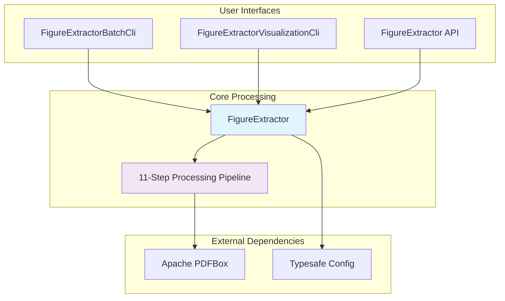
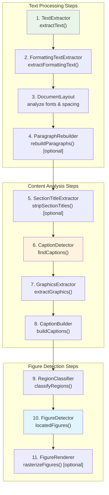
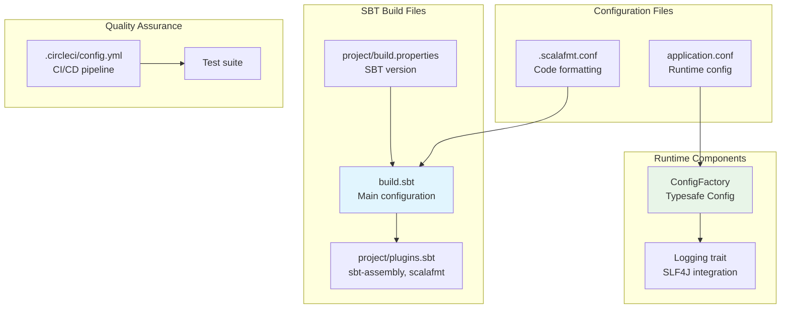

<!-- source: DeepWiki mcp.deepwiki.com · repo allenai/pdffigures2 · page 2 System Architecture · fetched 2026-10-26 -->

# System Architecture

Relevant source files

The following files were used as context for generating this wiki page:

- [README.md](README.md)
- [src/main/scala/org/allenai/pdffigures2/FigureExtractor.scala](src/main/scala/org/allenai/pdffigures2/FigureExtractor.scala)

This document explains the overall architecture of PDFFigures 2.0, including the main system components, processing pipeline, data flow, and how the various modules interact to extract figures and captions from scholarly PDF documents. For specific details about individual pipeline steps, see [Core Processing Pipeline](#3). For information about the command-line interfaces, see [Command Line Interface](#4).

## System Overview

PDFFigures 2.0 is designed as a modular pipeline-based system with multiple entry points and a clear separation between processing stages. The system provides both programmatic APIs and command-line interfaces for different use cases.

### Entry Points and Main Components

The system architecture centers around the `FigureExtractor` class, which serves as the main orchestrator. It provides several methods for different extraction scenarios:

- `getFigures()`: Basic figure extraction returning `Figure` objects
- `getRasterizedFigures()`: Extraction with image rendering to `RasterizedFigure` objects  
- `getFiguresWithText()`: Full document analysis returning `Document` with sections
- `getFiguresWithErrors()`: Extraction with error reporting via `FiguresInDocument`

**Sources:** [src/main/scala/org/allenai/pdffigures2/FigureExtractor.scala:15-300](), [README.md:44-90]()

### Processing Pipeline Architecture

The core of PDFFigures 2.0 is an 11-step processing pipeline that progressively transforms raw PDF data into structured figure extractions. Each step builds upon the previous one, creating increasingly sophisticated intermediate representations.

The pipeline is implemented in the `parseDocument()` method of `FigureExtractor`, which coordinates the execution of each step and handles intermediate data transformations.

**Sources:** [README.md:91-118](), [src/main/scala/org/allenai/pdffigures2/FigureExtractor.scala:130-198]()

## Data Flow and Transformations

The system transforms data through several key intermediate representations, each building upon the previous one with additional extracted information.

### Data Structure Evolution

```mermaid
graph LR
    subgraph "Input"
        PDDoc["PDDocument<br/>(PDFBox)"]
    end
    
    subgraph "Text Representations"
        PageText["PageWithText"]
        PageFormat["PageWithFormattingText"] 
        PageClass["PageWithClassifiedText"]
    end
    
    subgraph "Graphics Representations"
        PageGraphics["PageWithGraphics"]
        PageCaptions["PageWithCaptions"]
        PageRegions["PageWithBodyText"]
    end
    
    subgraph "Figure Representations"
        PageFigures["PageWithFigures"]
        DocContent["DocumentContent"]
        Document["Document"]
    end
    
    PDDoc --> PageText
    PageText --> PageFormat
    PageFormat --> PageClass
    PageClass --> PageGraphics
    PageGraphics --> PageCaptions
    PageCaptions --> PageRegions
    PageRegions --> PageFigures
    PageFigures --> DocContent
    DocContent --> Document
    
    style PDDoc fill:#ffebee
    style PageFigures fill:#e3f2fd
    style Document fill:#e8f5e8
```

Each transformation adds specific capabilities:

| Stage | Input Type | Output Type | Key Information Added |
|-------|------------|-------------|----------------------|
| Text Extraction | `PDDocument` | `PageWithText` | Raw text with positioning |
| Formatting Removal | `PageWithText` | `PageWithFormattingText` | Headers/footers removed |
| Layout Analysis | `PageWithFormattingText` | `DocumentLayout` | Font statistics, column detection |
| Graphics Extraction | `PageWithClassifiedText` | `PageWithGraphics` | Non-text elements identified |
| Caption Building | `PageWithGraphics` | `PageWithCaptions` | Complete caption text |
| Region Classification | `PageWithCaptions` | `PageWithBodyText` | Text regions classified |
| Figure Detection | `PageWithBodyText` | `PageWithFigures` | Figure bounding boxes |

**Sources:** [src/main/scala/org/allenai/pdffigures2/FigureExtractor.scala:207-226](), [src/main/scala/org/allenai/pdffigures2/FigureExtractor.scala:134-198]()

## Core Component Relationships

The system's modularity is achieved through clear separation of concerns among its core components. Each major component handles a specific aspect of the extraction pipeline.

### Component Dependency Graph

```mermaid
graph TB
    subgraph "Orchestration Layer"
        FigureExtractor["FigureExtractor<br/>Main orchestrator"]
        VisualLogger["VisualLogger<br/>Debug visualization"]
    end
    
    subgraph "Text Processing Components"
        TextExtractor["TextExtractor"]
        FormattingTextExtractor["FormattingTextExtractor"] 
        DocumentLayout["DocumentLayout"]
        ParagraphRebuilder["ParagraphRebuilder"]
        SectionTitleExtractor["SectionTitleExtractor"]
    end
    
    subgraph "Content Analysis Components"
        CaptionDetector["CaptionDetector"]
        CaptionBuilder["CaptionBuilder"]
        GraphicsExtractor["GraphicsExtractor"]
        RegionClassifier["RegionClassifier"]
    end
    
    subgraph "Figure Detection Components"
        FigureDetector["FigureDetector"]
        FigureRenderer["FigureRenderer"]
    end
    
    subgraph "Support Components"
        SectionedTextBuilder["SectionedTextBuilder"]
        JsonProtocol["JsonProtocol"]
        Logging["Logging trait"]
    end
    
    FigureExtractor --> TextExtractor
    FigureExtractor --> FormattingTextExtractor
    FigureExtractor --> DocumentLayout
    FigureExtractor --> ParagraphRebuilder
    FigureExtractor --> SectionTitleExtractor
    FigureExtractor --> CaptionDetector
    FigureExtractor --> CaptionBuilder
    FigureExtractor --> GraphicsExtractor
    FigureExtractor --> RegionClassifier
    FigureExtractor --> FigureDetector
    FigureExtractor --> FigureRenderer
    FigureExtractor --> SectionedTextBuilder
    FigureExtractor --> VisualLogger
    FigureExtractor --> Logging
    
    style FigureExtractor fill:#e1f5fe
    style VisualLogger fill:#fff3e0
```

The `FigureExtractor` class manages the coordination between components, handling configuration parameters and optional processing steps based on constructor parameters:

- `allowOcr`: Controls processing of OCR-generated PDFs
- `ignoreWhiteGraphics`: Skips colorless graphics for performance
- `detectSectionTitlesFirst`: Orders section title extraction
- `rebuildParagraphs`: Enables paragraph reconstruction
- `cleanRasterizedFigureRegions`: Applies post-processing cleanup

**Sources:** [src/main/scala/org/allenai/pdffigures2/FigureExtractor.scala:15-21](), [src/main/scala/org/allenai/pdffigures2/FigureExtractor.scala:290-298]()

## Configuration and Build Architecture

The system uses a layered configuration approach with SBT for build management and Typesafe Config for runtime configuration.

### Build System Structure

The build system supports:
- Cross-compilation for multiple Scala versions
- Fat JAR assembly via `sbt assembly`
- Automated code formatting with scalafmt
- Continuous integration through CircleCI
- Dependency management for PDF processing libraries

The `FigureExtractor` integrates with the configuration system through the `ConfigFactory` import and extends the `Logging` trait for structured logging throughout the pipeline.

**Sources:** [src/main/scala/org/allenai/pdffigures2/FigureExtractor.scala:10](), [README.md:68-70]()

---

