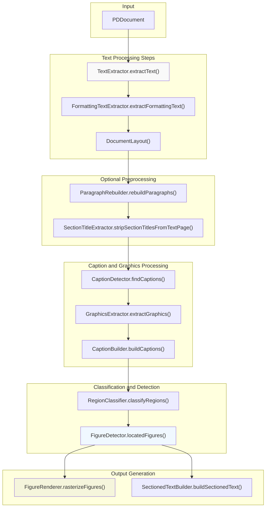
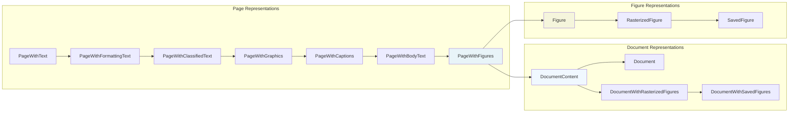
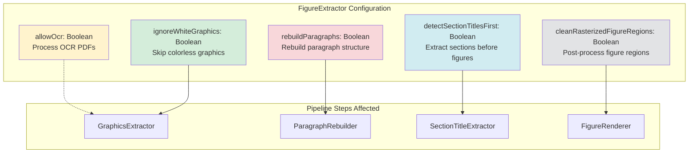
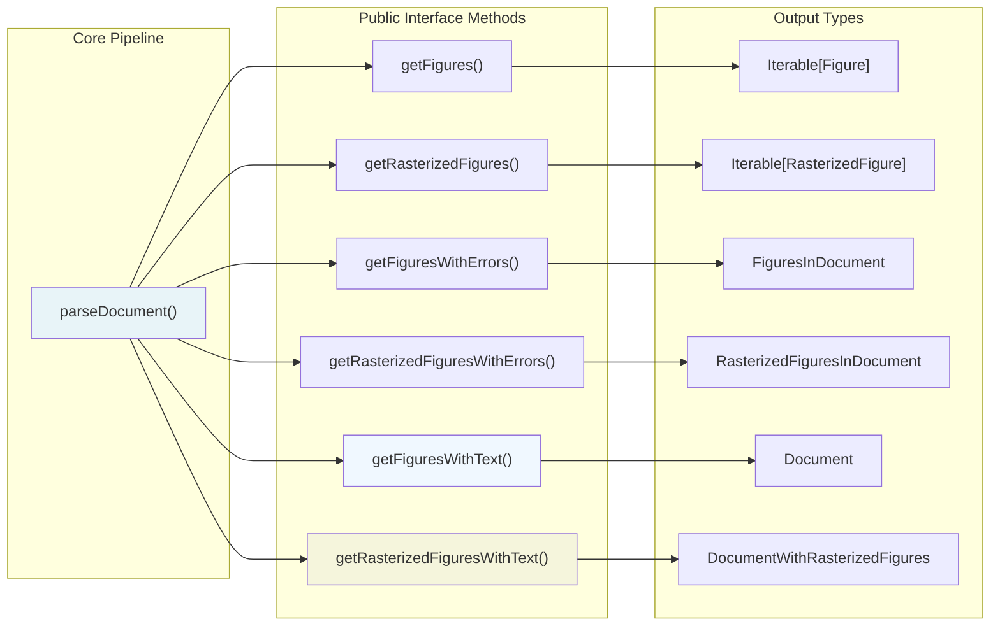
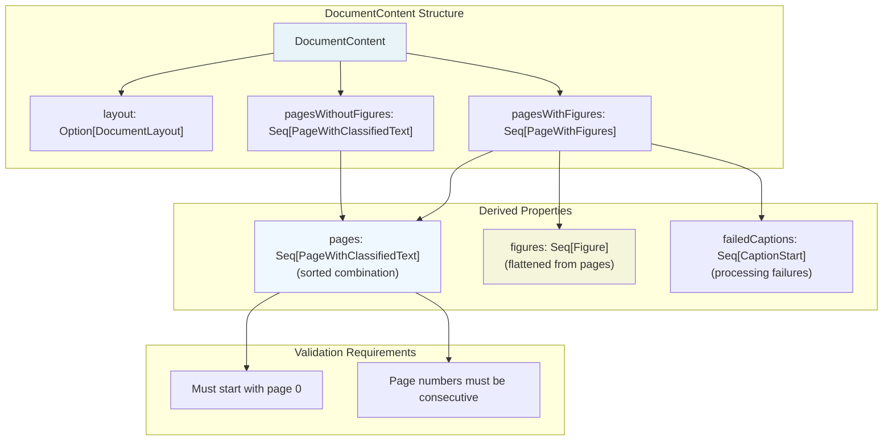
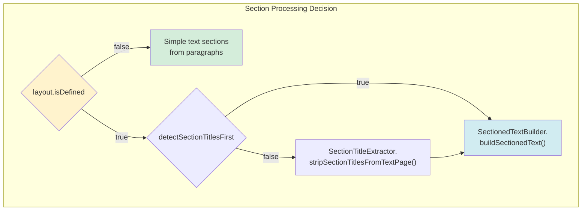

<!-- source: DeepWiki mcp.deepwiki.com · repo allenai/pdffigures2 · page 3 Core Processing Pipeline · fetched 2026-10-26 -->

# Core Processing Pipeline

Relevant source files

The following files were used as context for generating this wiki page:

- [README.md](README.md)
- [src/main/scala/org/allenai/pdffigures2/FigureExtractor.scala](src/main/scala/org/allenai/pdffigures2/FigureExtractor.scala)

This page covers the core processing pipeline that orchestrates figure extraction from PDF documents. The pipeline consists of 11 sequential steps that transform a raw PDF document into extracted figures with metadata. For information about specific processing components like text extraction and caption detection, see [Text Extraction and Processing](#3.1), [Caption Detection and Building](#3.3), and [Graphics and Figure Detection](#3.4).

The pipeline is orchestrated by the `FigureExtractor` class, which provides multiple output formats including basic figures, rasterized images, and documents with sectioned text. This page focuses on the overall architecture and data flow rather than the details of individual processing steps.

## Pipeline Architecture

The core pipeline transforms PDF documents through a series of intermediate representations, each adding more structured information about the document's content and layout.

### Processing Steps Overview

**Pipeline Data Flow and Component Responsibilities**

Sources: [README.md:92-118](), [src/main/scala/org/allenai/pdffigures2/FigureExtractor.scala:130-198]()

### Data Structure Evolution

The pipeline progressively enriches data structures as documents move through processing steps:

**Progressive Data Enrichment Through Pipeline Stages**

Sources: [src/main/scala/org/allenai/pdffigures2/FigureExtractor.scala:207-226](), [src/main/scala/org/allenai/pdffigures2/FigureExtractor.scala:232-260]()

## FigureExtractor Orchestration

The `FigureExtractor` class serves as the main orchestrator, providing multiple public interfaces while managing the internal processing pipeline.

### Core Processing Method

The `parseDocument` method implements the complete pipeline:

| Step | Component | Input Type | Output Type | Purpose |
|------|-----------|------------|-------------|---------|
| 1 | `TextExtractor` | `PDDocument` | `PageWithText` | Extract raw text from PDF |
| 2 | `FormattingTextExtractor` | `PageWithText` | `PageWithFormattingText` | Remove headers, page numbers |
| 3 | `DocumentLayout` | `PageWithFormattingText` | `DocumentLayout` | Analyze fonts, spacing, layout |
| 4 | `ParagraphRebuilder` | `PageWithFormattingText` | `PageWithFormattingText` | Rebuild paragraph structure (optional) |
| 5 | `SectionTitleExtractor` | `PageWithFormattingText` | `PageWithFormattingText` | Extract section titles (optional) |
| 6 | `CaptionDetector` | `PageWithFormattingText` | `CaptionStart` | Identify caption locations |
| 7 | `GraphicsExtractor` | `PageWithFormattingText` | `PageWithGraphics` | Extract graphical elements |
| 8 | `CaptionBuilder` | `PageWithGraphics` | `PageWithCaptions` | Build complete captions |
| 9 | `RegionClassifier` | `PageWithCaptions` | `PageWithBodyText` | Classify text regions |
| 10 | `FigureDetector` | `PageWithBodyText` | `PageWithFigures` | Locate figure regions |
| 11 | `FigureRenderer` | `PageWithFigures` | `RasterizedFigure` | Render figures to images (optional) |

Sources: [src/main/scala/org/allenai/pdffigures2/FigureExtractor.scala:130-198](), [README.md:92-118]()

### Configuration and Behavior Control

The `FigureExtractor` constructor accepts configuration parameters that control pipeline behavior:

**FigureExtractor Configuration Parameters and Their Effects**

Sources: [src/main/scala/org/allenai/pdffigures2/FigureExtractor.scala:15-21](), [src/main/scala/org/allenai/pdffigures2/FigureExtractor.scala:266-298]()

## Public Interface Methods

The `FigureExtractor` provides multiple methods for different use cases, all built on the same core pipeline:

### Output Format Methods

**Public Interface Methods and Their Output Types**

Sources: [src/main/scala/org/allenai/pdffigures2/FigureExtractor.scala:22-97]()

### Error Handling and Interruption

The pipeline includes robust error handling and supports interruption:

- **Thread Interruption**: The pipeline checks `Thread.interrupted()` at key points and can be safely cancelled
- **Failed Captions**: Captions that cannot be processed are tracked in `failedCaptions` collections
- **OCR Detection**: PDFs requiring OCR processing can be detected and optionally rejected
- **Layout Validation**: Documents without sufficient layout information skip figure detection

Sources: [src/main/scala/org/allenai/pdffigures2/FigureExtractor.scala:138-141](), [src/main/scala/org/allenai/pdffigures2/FigureExtractor.scala:161](), [README.md:88]()

## DocumentContent Structure

The `DocumentContent` case class represents the complete processing result:

**DocumentContent Structure and Validation Requirements**

Sources: [src/main/scala/org/allenai/pdffigures2/FigureExtractor.scala:207-226]()

## Section and Abstract Processing

The pipeline includes additional processing for document structure:

### Section Processing Logic

**Section Processing Decision Logic**

### Abstract Extraction

The `getAbstract` method locates abstract text by finding the first page with classified abstract text and wrapping it in a `PdfText` structure.

Sources: [src/main/scala/org/allenai/pdffigures2/FigureExtractor.scala:99-127](), [src/main/scala/org/allenai/pdffigures2/FigureExtractor.scala:115-127]()

---

