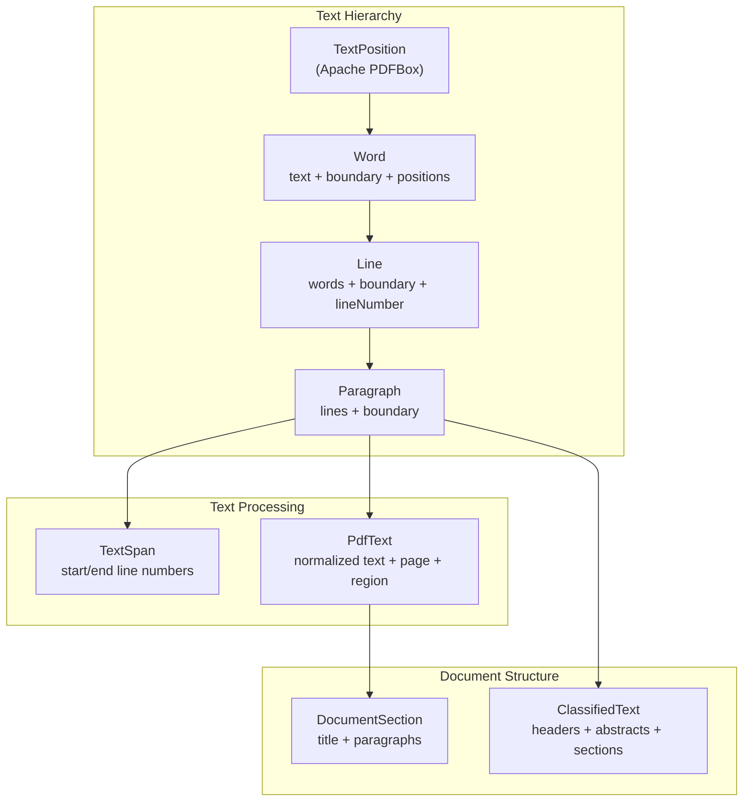
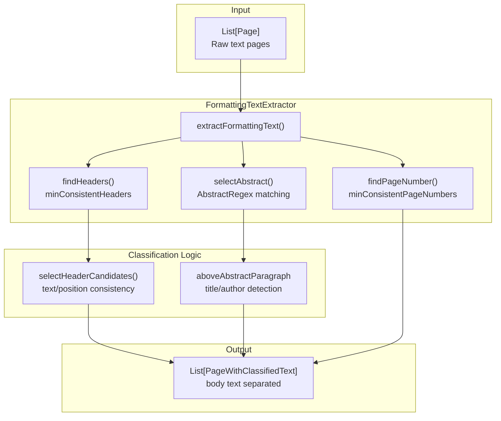
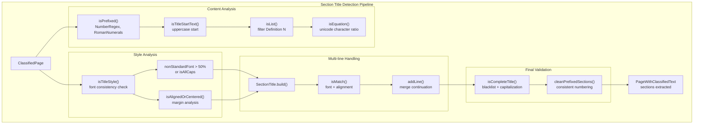
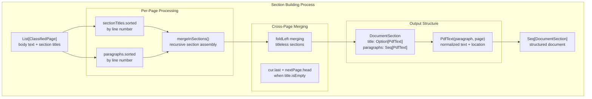

<!-- source: DeepWiki mcp.deepwiki.com · repo allenai/pdffigures2 · page 3.1 Text Extraction and Processing · fetched 2026-10-26 -->

# Text Extraction and Processing

Relevant source files

The following files were used as context for generating this wiki page:

- [src/main/scala/org/allenai/pdffigures2/FormattingTextExtractor.scala](src/main/scala/org/allenai/pdffigures2/FormattingTextExtractor.scala)
- [src/main/scala/org/allenai/pdffigures2/Paragraph.scala](src/main/scala/org/allenai/pdffigures2/Paragraph.scala)
- [src/main/scala/org/allenai/pdffigures2/SectionTitleExtractor.scala](src/main/scala/org/allenai/pdffigures2/SectionTitleExtractor.scala)
- [src/main/scala/org/allenai/pdffigures2/SectionedTextBuilder.scala](src/main/scala/org/allenai/pdffigures2/SectionedTextBuilder.scala)

This document covers the text extraction and processing components that form the early stages of the PDFFigures2 pipeline. These components take raw text extracted from PDF documents and transform it into structured, cleaned text ready for further analysis. The processing includes formatting text removal, text normalization, paragraph reconstruction, and section title identification.

For information about document layout analysis and font processing, see [Document Layout Analysis](#3.2). For caption detection that operates on the processed text output, see [Caption Detection and Building](#3.3).

## Core Text Data Structures

The text processing pipeline operates on a hierarchical structure of text elements, from individual character positions up to complete paragraphs.

**Sources:** [src/main/scala/org/allenai/pdffigures2/Paragraph.scala:150-164](), [src/main/scala/org/allenai/pdffigures2/SectionedTextBuilder.scala:10-46]()

The `Word` class contains the raw text, bounding box, and original `TextPosition` objects from PDFBox. `Line` objects group words that appear on the same horizontal line, while `Paragraph` objects group related lines together. The `TextSpan` class represents spans of text by line numbers for efficient text manipulation.

| Class | Key Properties | Purpose |
|-------|---------------|---------|
| `Word` | `text`, `boundary`, `positions` | Basic text unit with spatial information |
| `Line` | `words`, `boundary`, `lineNumber` | Horizontal grouping of words |
| `Paragraph` | `lines`, `boundary`, `span` | Logical text block |
| `TextSpan` | `start`, `end` | Line number range for text operations |

## Formatting Text Extraction

The `FormattingTextExtractor` identifies and removes non-content text elements like headers, page numbers, and abstracts that can interfere with figure detection algorithms.

**Sources:** [src/main/scala/org/allenai/pdffigures2/FormattingTextExtractor.scala:44-89](), [src/main/scala/org/allenai/pdffigures2/FormattingTextExtractor.scala:102-148](), [src/main/scala/org/allenai/pdffigures2/FormattingTextExtractor.scala:197-278]()

The extractor uses several heuristics:

- **Headers**: Identifies consistent text at the top of multiple pages, either by identical text content or consistent positioning
- **Page Numbers**: Detects numeric patterns at the bottom of pages using `PageNumberRegex`
- **Abstracts**: Uses `AbstractRegex` pattern `"^(Abstract|ABSTRACT)(((—|-)[a-zA-Z]*)|.)?$"` to find abstract sections
- **Cover Pages**: Marks pages before the abstract as formatting-only content

The minimum consistency threshold prevents false positives by requiring headers/page numbers to appear on most pages before classification.

## Section Title Detection

The `SectionTitleExtractor` identifies section headings in academic papers through a combination of formatting analysis and content heuristics.

**Sources:** [src/main/scala/org/allenai/pdffigures2/SectionTitleExtractor.scala:21-32](), [src/main/scala/org/allenai/pdffigures2/SectionTitleExtractor.scala:59-86](), [src/main/scala/org/allenai/pdffigures2/SectionTitleExtractor.scala:296-370]()

### Detection Heuristics

The section title detection uses multiple regex patterns and formatting rules:

| Pattern Type | Regex | Purpose |
|--------------|-------|---------|
| Numbers | `^[1-9][0-9]*(.[1-9][0-9]*)*.?$` | "1.", "2.3.1" style numbering |
| Roman Numerals | `^[IVX]+.?$` | "I.", "IV." style numbering |
| Letter Numbers | `^[A-Z](.|[1-9]*.?)$` | "A.", "B.1" style numbering |
| Appendix | `^(?i)appendix.?$` | Case-insensitive appendix detection |

The `isTitleStyle` function checks for formatting consistency within a line, requiring same font usage across ASCII characters and detecting non-standard fonts or all-caps formatting.

### Multi-line Title Handling

Section titles can span multiple lines. The `SectionTitle` case class tracks in-progress titles and uses `isMatch` to determine if subsequent lines continue the same section:

- Font and font size consistency
- Alignment patterns (left-aligned, centered, or second-word aligned)
- Hyphenation handling for word breaks

## Text Normalization and Processing

Text normalization handles Unicode characters, hyphenation, and text cleaning to produce consistent output.

```mermaid
graph TD
    subgraph "Text Normalization Pipeline"
        RawText["Raw Word Text"]
        
        subgraph "Unicode Processing"
            UnicodeNorm["normalizeWord()<br/>NFKC normalization"]
            SpecialChars["0xFB00-0xFDFF<br/>0xFE70-0xFEFF ranges"]
            UnprintableRegex["unprintableRegex<br/>\\p{Cc}\\p{Cf}\\p{Co}\\p{Cn}"]
        end
        
        subgraph "Paragraph Assembly"
            ParaConvert["convertToNormalizedString()<br/>hyphen removal"]
            HyphenCheck["lastWord.last == '-'<br/>+ isLetter check"]
            SpaceJoin["mkString with spaces"]
        end
        
        subgraph "Text Span Operations"
            RemoveSpans["removeSpans()<br/>TextSpan removal"]
            ParagraphSplit["split/truncate paragraphs"]
        end
        
        NormalizedText["Normalized Text Output"]
    end
    
    RawText --> UnicodeNorm
    UnicodeNorm --> SpecialChars
    SpecialChars --> UnprintableRegex
    UnprintableRegex --> ParaConvert
    ParaConvert --> HyphenCheck
    HyphenCheck --> SpaceJoin
    SpaceJoin --> RemoveSpans
    RemoveSpans --> ParagraphSplit
    ParagraphSplit --> NormalizedText
```

**Sources:** [src/main/scala/org/allenai/pdffigures2/Paragraph.scala:19-48](), [src/main/scala/org/allenai/pdffigures2/Paragraph.scala:50-73](), [src/main/scala/org/allenai/pdffigures2/Paragraph.scala:83-136]()

The normalization process includes:

1. **Unicode Normalization**: Uses Java's `Normalizer.Form.NFKC` for consistent character representation
2. **Hyphenation Handling**: Removes hyphens at line ends when they represent word breaks
3. **Unprintable Character Removal**: Filters control characters and formatting marks
4. **Text Span Removal**: Efficiently removes specific line ranges while preserving paragraph structure

The `removeSpans` method can split paragraphs when removing interior lines, creating multiple smaller paragraphs as needed.

## Document Section Building

The `SectionedTextBuilder` combines cleaned text with identified section titles to create a structured document representation.

**Sources:** [src/main/scala/org/allenai/pdffigures2/SectionedTextBuilder.scala:48-95](), [src/main/scala/org/allenai/pdffigures2/SectionedTextBuilder.scala:104-134]()

The section building algorithm:

1. **Per-page Assembly**: Uses `mergeInSections` to recursively assign paragraphs to section titles based on line number ordering
2. **Cross-page Continuation**: Sections without titles at page starts are merged with the previous page's final section
3. **PdfText Conversion**: Converts paragraphs to `PdfText` objects that include normalized text, page numbers, and spatial regions

This produces a sequence of `DocumentSection` objects where each section has an optional title and associated body paragraphs, maintaining spatial and page information for later processing stages.

---

