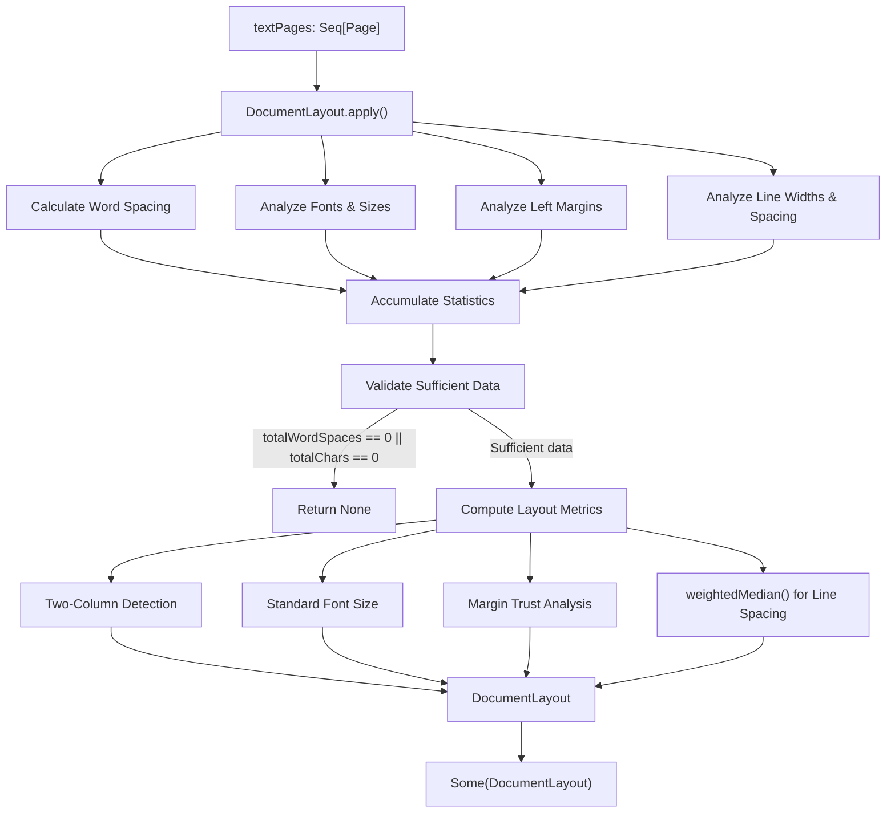
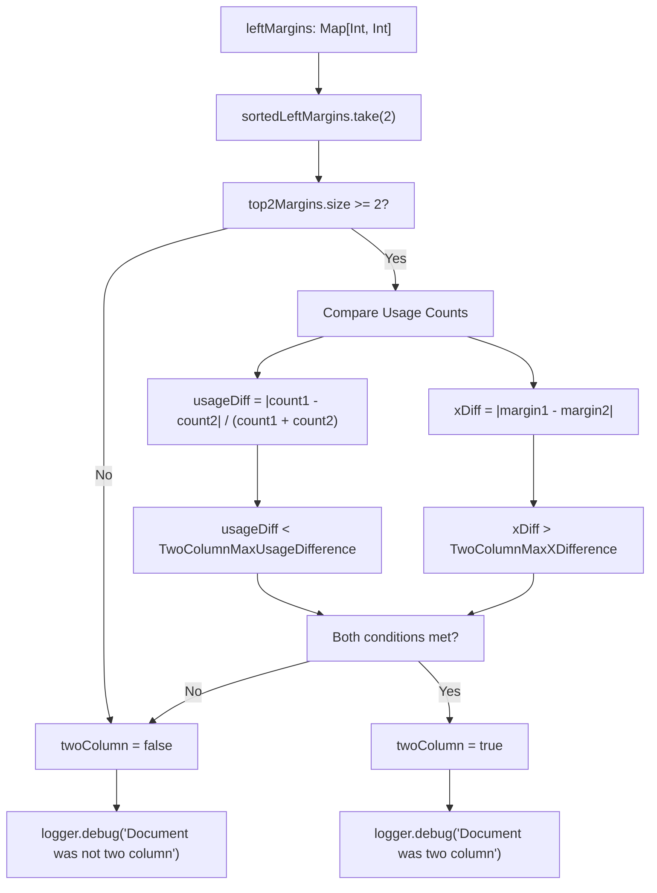
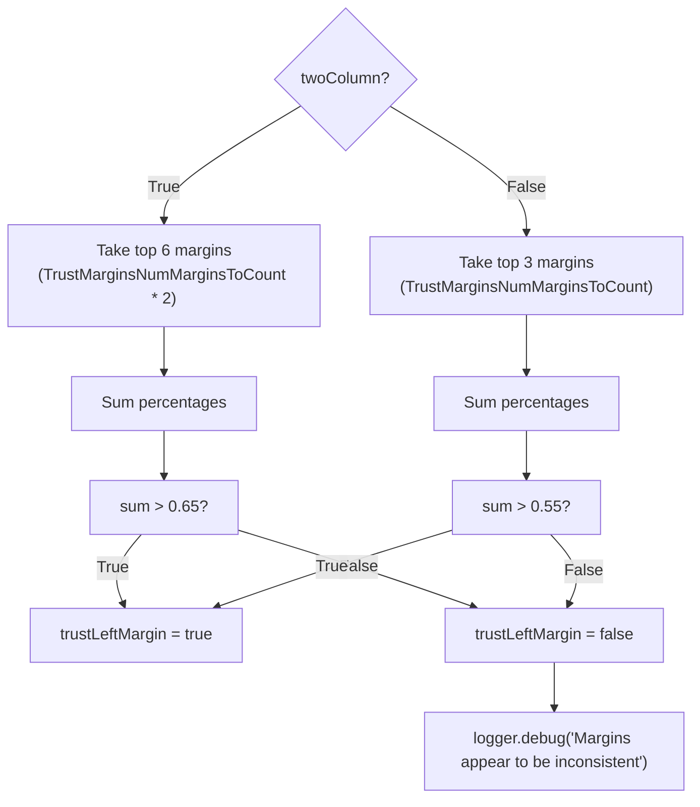

<!-- source: DeepWiki mcp.deepwiki.com · repo allenai/pdffigures2 · page 3.2 Document Layout Analysis · fetched 2026-10-26 -->

# Document Layout Analysis

Relevant source files

The following files were used as context for generating this wiki page:

- [src/main/scala/org/allenai/pdffigures2/DocumentLayout.scala](src/main/scala/org/allenai/pdffigures2/DocumentLayout.scala)

## Purpose and Scope

The Document Layout Analysis component analyzes the structural characteristics of PDF documents to understand their formatting patterns, column layouts, and text organization. This analysis produces a `DocumentLayout` object that captures essential document-level statistics used by downstream components for caption detection, figure region identification, and text classification.

This component operates on preprocessed text data from the text extraction phase (see [Text Extraction and Processing](#3.1)) and provides layout insights used by caption detection and graphics extraction (see [Caption Detection and Building](#3.3) and [Graphics and Figure Detection](#3.4)).

## DocumentLayout Data Structure

The `DocumentLayout` case class stores comprehensive document-level statistics that characterize the document's formatting patterns:

| Field | Type | Purpose |
|-------|------|---------|
| `twoColumns` | `Boolean` | Whether document uses two-column layout |
| `fontCounts` | `Map[PDFont, Double]` | Relative frequency of each font |
| `standardFontSize` | `Option[Double]` | Most common font size (if >50% usage) |
| `averageFontSize` | `Double` | Weighted average font size |
| `averageWordSpacing` | `Double` | Average horizontal spacing between words |
| `trustLeftMargin` | `Boolean` | Whether left margins are consistent enough to trust |
| `leftMargins` | `Map[Int, Double]` | Distribution of left margin positions |
| `medianLineSpacing` | `Double` | Median vertical spacing between lines |
| `standardWidthBucketed` | `Option[Double]` | Most common line width (if >40% usage) |

Sources: [src/main/scala/org/allenai/pdffigures2/DocumentLayout.scala:8-31]()

## Layout Analysis Process

The layout analysis process examines text across all pages to extract statistical patterns about document formatting:

The analysis iterates through all `Page` objects, examining each `Paragraph`, `Line`, and `Word` to collect statistics. The process accumulates data in mutable maps for efficiency: `leftMargins`, `fontCounts`, `lineWidths`, `fontSizeCounts`, and `lineSpacing`.

Sources: [src/main/scala/org/allenai/pdffigures2/DocumentLayout.scala:67-116]()

## Two-Column Detection Algorithm

The two-column detection algorithm analyzes left margin patterns to determine document layout:

**Key Constants:**
- `TwoColumnMaxUsageDifference = 0.40`: Maximum relative difference in margin usage
- `TwoColumnMaxXDifference = 0.40`: Minimum horizontal separation between columns

The algorithm identifies two-column layouts by finding two dominant left margin positions with similar usage counts but significant horizontal separation.

Sources: [src/main/scala/org/allenai/pdffigures2/DocumentLayout.scala:37-38, 143-160]()

## Font and Spacing Analysis

The system performs detailed analysis of typography and spacing patterns:

### Font Size Analysis
- **Standard Font Size**: Determined when a single font size accounts for >50% of all characters
- **Average Font Size**: Weighted average across all character positions
- Character positions from `PDFBox` provide accurate font and size information

### Spacing Measurements
- **Word Spacing**: Calculated from horizontal gaps between adjacent words in lines
- **Line Spacing**: Uses `weightedMedian()` function to find typical vertical spacing
- **Line Width Buckets**: Groups similar line widths using `LineWidthBucketSize = 2`

The `weightedMedian()` function implements a specialized algorithm for finding the median of weighted values, ensuring that outlier spacing doesn't skew the results.

Sources: [src/main/scala/org/allenai/pdffigures2/DocumentLayout.scala:35, 50-65, 125-141]()

## Margin Analysis and Trust Determination  

The system evaluates whether left margins are consistent enough to trust for downstream processing:

| Layout Type | Threshold | Margins Considered |
|-------------|-----------|-------------------|
| Two-column | `TrustMarginsTwoColumnThreshold = 0.65` | Top 6 margins |
| Single-column | `TrustMarginsOneColumnThreshold = 0.55` | Top 3 margins |

When margins are deemed untrustworthy, downstream components avoid margin-based heuristics for caption detection and figure region identification.

Sources: [src/main/scala/org/allenai/pdffigures2/DocumentLayout.scala:42-44, 168-179]()

## Integration with Processing Pipeline

The `DocumentLayout` analysis occurs early in the processing pipeline and its results influence multiple downstream components:

- **Caption Detection**: Uses `trustLeftMargin`, `twoColumns`, and spacing metrics
- **Figure Detection**: Leverages layout statistics for region proposals  
- **Text Classification**: Applies font and margin analysis for content categorization

The layout analysis can fail and return `None` when insufficient text is extracted, typically indicating a problematic PDF or extraction failure. This graceful degradation allows the pipeline to continue with reduced functionality.

Sources: [src/main/scala/org/allenai/pdffigures2/DocumentLayout.scala:120-124]()

---

