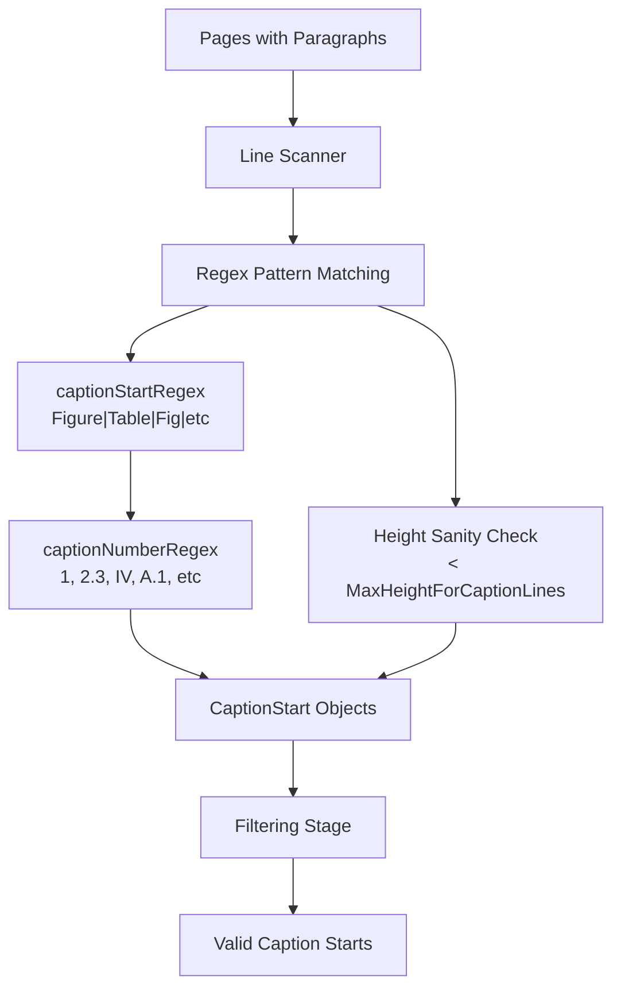
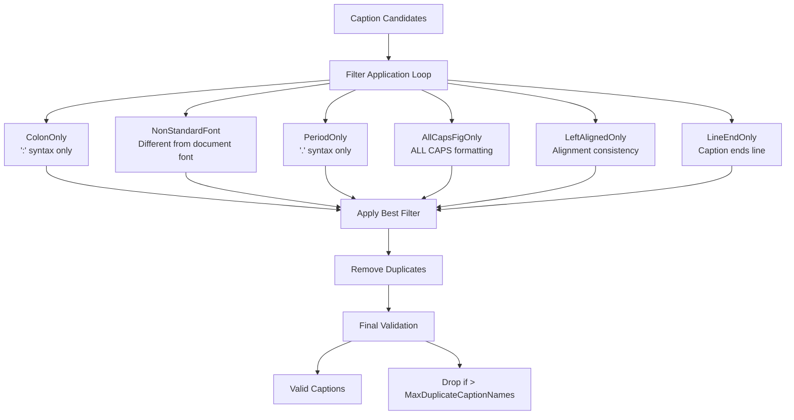
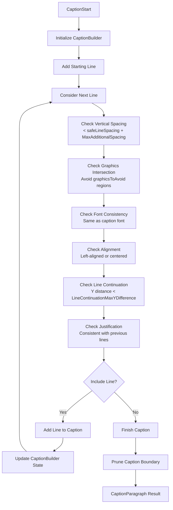
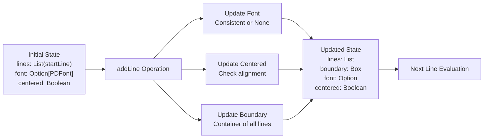
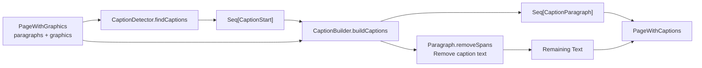

<!-- source: DeepWiki mcp.deepwiki.com · repo allenai/pdffigures2 · page 3.3 Caption Detection and Building · fetched 2026-10-26 -->

# Caption Detection and Building

Relevant source files

The following files were used as context for generating this wiki page:

- [src/main/scala/org/allenai/pdffigures2/CaptionBuilder.scala](src/main/scala/org/allenai/pdffigures2/CaptionBuilder.scala)
- [src/main/scala/org/allenai/pdffigures2/CaptionDetector.scala](src/main/scala/org/allenai/pdffigures2/CaptionDetector.scala)

This document covers the caption detection and building subsystem within the PDFFigures2 processing pipeline. The caption detection and building phase identifies potential figure and table captions in the document text and constructs complete caption paragraphs from them. This process occurs after document layout analysis (see [Document Layout Analysis](#3.2)) and before graphics extraction (see [Graphics and Figure Detection](#3.4)).

The system uses a two-stage approach: first detecting potential caption starts through pattern matching, then filtering false positives using formatting heuristics, and finally building complete caption paragraphs by determining which subsequent lines belong to each caption.

## Caption Detection Process

The caption detection process is implemented in `CaptionDetector` and follows a candidate-generate-then-filter approach to identify legitimate captions while avoiding false positives.

### Caption Candidate Generation

The system first identifies potential caption starts using regex pattern matching on document text. The `findCaptionCandidates` method scans each line looking for text that matches caption patterns.

**Caption Detection Flow**

The system uses two main regex patterns defined in [src/main/scala/org/allenai/pdffigures2/CaptionDetector.scala:107-111]():

- `captionStartRegex`: Matches caption headers like "Figure", "Table", "Fig.", etc.
- `captionNumberRegex`: Matches various numbering schemes including Arabic numerals, Roman numerals, and hierarchical numbers

Sources: [src/main/scala/org/allenai/pdffigures2/CaptionDetector.scala:150-212]()

### Caption Filtering System

The filtering system uses multiple `CandidateFilter` implementations to eliminate false positives based on formatting consistency. Each filter accepts or rejects caption candidates based on specific formatting characteristics.

**Filter Types and Strategy**

The filtering process iteratively applies filters until no duplicates remain for each figure/table ID. The system prefers filters that remove some but not all candidates for a given ID, avoiding over-aggressive filtering.

Sources: [src/main/scala/org/allenai/pdffigures2/CaptionDetector.scala:43-146](), [src/main/scala/org/allenai/pdffigures2/CaptionDetector.scala:214-277]()

### Key Data Structures

The `CaptionStart` case class represents a potential caption with rich metadata:

| Field | Type | Purpose |
|-------|------|---------|
| `header` | String | The caption header text (e.g., "Figure", "Table") |
| `name` | String | The caption number/identifier |
| `figType` | FigureType | Whether this is a Figure or Table caption |
| `line` | Line | The line containing the caption start |
| `numberSyntax` | String | The punctuation following the number (`:`, `.`) |
| `paragraphStart` | Boolean | Whether this starts a new paragraph |
| `lineEnd` | Boolean | Whether the caption header/number ends the line |

Sources: [src/main/scala/org/allenai/pdffigures2/CaptionDetector.scala:6-23]()

## Caption Building Process

Once valid caption starts are identified, the `CaptionBuilder` constructs complete caption paragraphs by determining which subsequent lines belong to each caption. This process handles complex cases like multi-line captions, varying spacing, and captions near graphics.

### Caption Construction Algorithm

The caption building algorithm uses spatial and formatting heuristics to extend captions line by line.

**Caption Building Process**

Sources: [src/main/scala/org/allenai/pdffigures2/CaptionBuilder.scala:128-221]()

### Spacing and Alignment Logic

The system uses several spatial heuristics to determine caption boundaries:

| Parameter | Value | Purpose |
|-----------|--------|---------|
| `AlignmentTolerance` | 2.0 | Maximum pixel difference for alignment |
| `MedianSpacingPadding` | 0.2 | Padding factor for line spacing |
| `MaxAdditionalSpacing` | 2.0 | Maximum extra spacing allowed |
| `LineContinuationMaxYDifference` | 3.0 | Max Y distance for line continuations |
| `MinYDistBetweenLines` | -40 | Minimum Y distance (negative due to PDFBox height issues) |

The algorithm handles several edge cases:
- **Line continuations**: Lines that continue to the right of the previous line
- **Graphics avoidance**: Lines that intersect with graphical elements
- **Font changes**: Lines that switch to different fonts
- **Justification breaks**: Lines that break consistent alignment patterns

Sources: [src/main/scala/org/allenai/pdffigures2/CaptionBuilder.scala:7-24](), [src/main/scala/org/allenai/pdffigures2/CaptionBuilder.scala:171-210]()

### Caption Builder State Management

The internal `CaptionBuilder` case class maintains caption state during construction:

**CaptionBuilder State Tracking**

Sources: [src/main/scala/org/allenai/pdffigures2/CaptionBuilder.scala:101-116]()

## Integration with Pipeline

The caption detection and building process transforms `PageWithGraphics` objects into `PageWithCaptions` objects, removing identified caption text from the general document text and storing it as structured caption data.

**Pipeline Integration**

The system ensures that text identified as captions is removed from the general document text to avoid double-processing in subsequent pipeline stages.

Sources: [src/main/scala/org/allenai/pdffigures2/CaptionBuilder.scala:55-96]()

## Error Handling and Edge Cases

The system includes several robustness measures:

- **Height sanity checking**: Rejects lines with excessive height (> `MaxHeightForCaptionLines`) to handle PDF parsing errors
- **Duplicate management**: Drops figure/table IDs with too many duplicates (`MaxDuplicateCaptionNames`)
- **Boundary pruning**: Corrects caption boundaries using first word height to handle PDFBox height estimation errors
- **Graphics intersection**: Avoids including lines that intersect with graphical elements unless the caption start is also in that region

Sources: [src/main/scala/org/allenai/pdffigures2/CaptionDetector.scala:33-36](), [src/main/scala/org/allenai/pdffigures2/CaptionBuilder.scala:118-125](), [src/main/scala/org/allenai/pdffigures2/CaptionBuilder.scala:152-157]()

---

