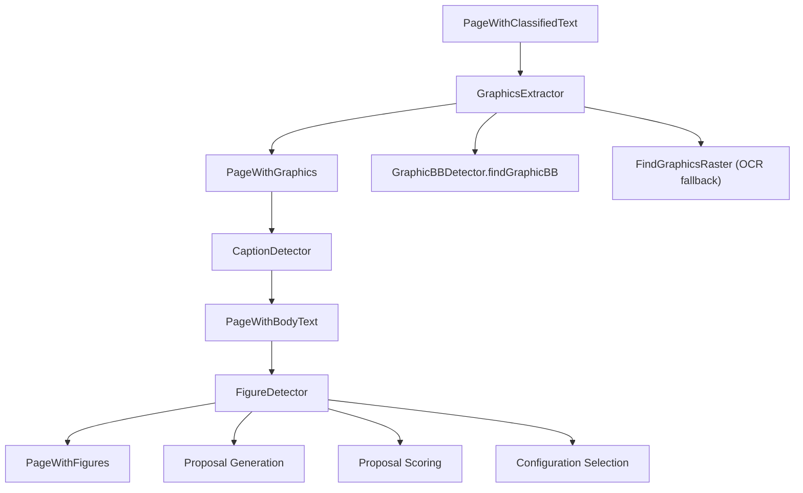
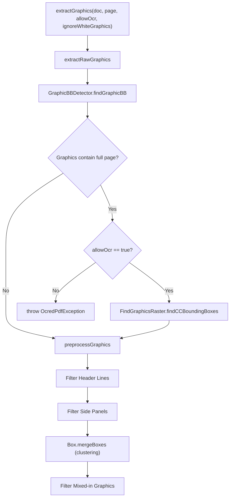
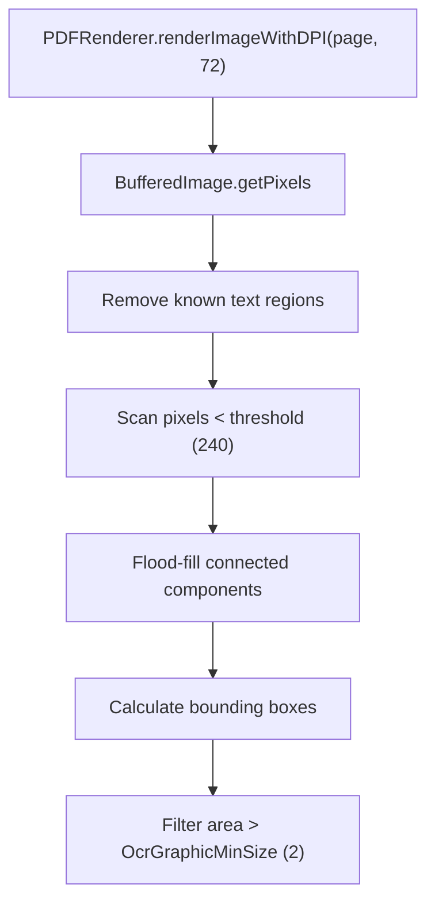
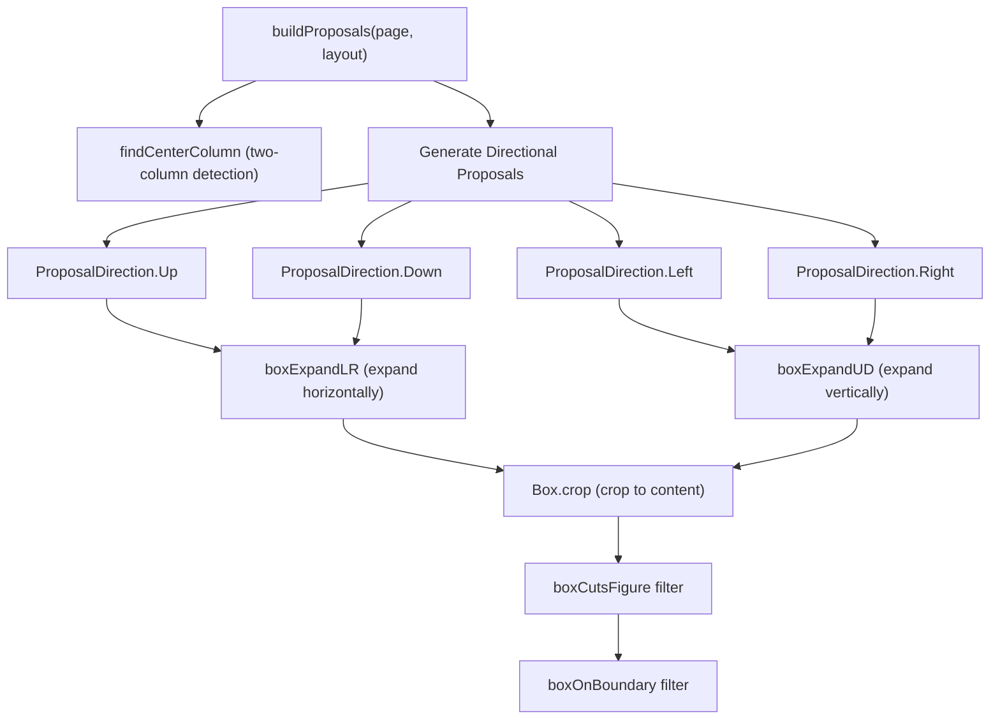
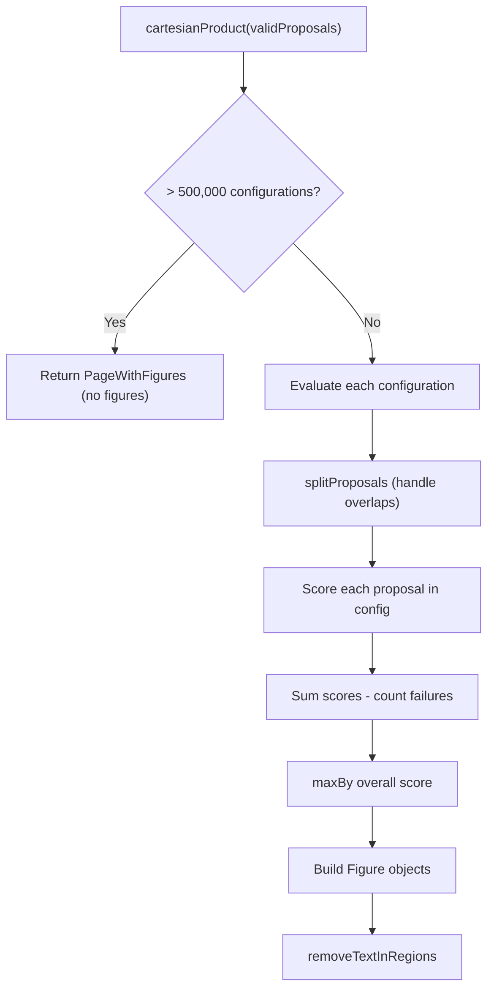
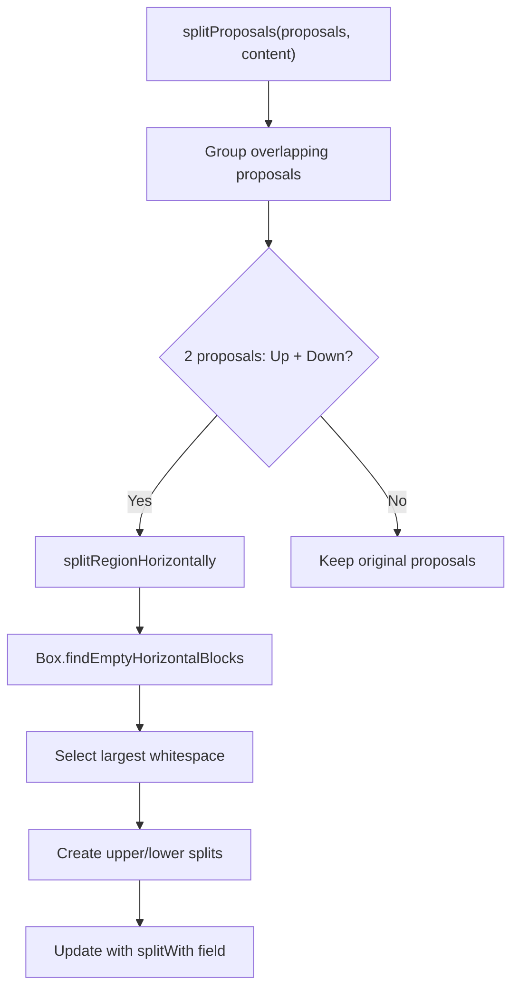
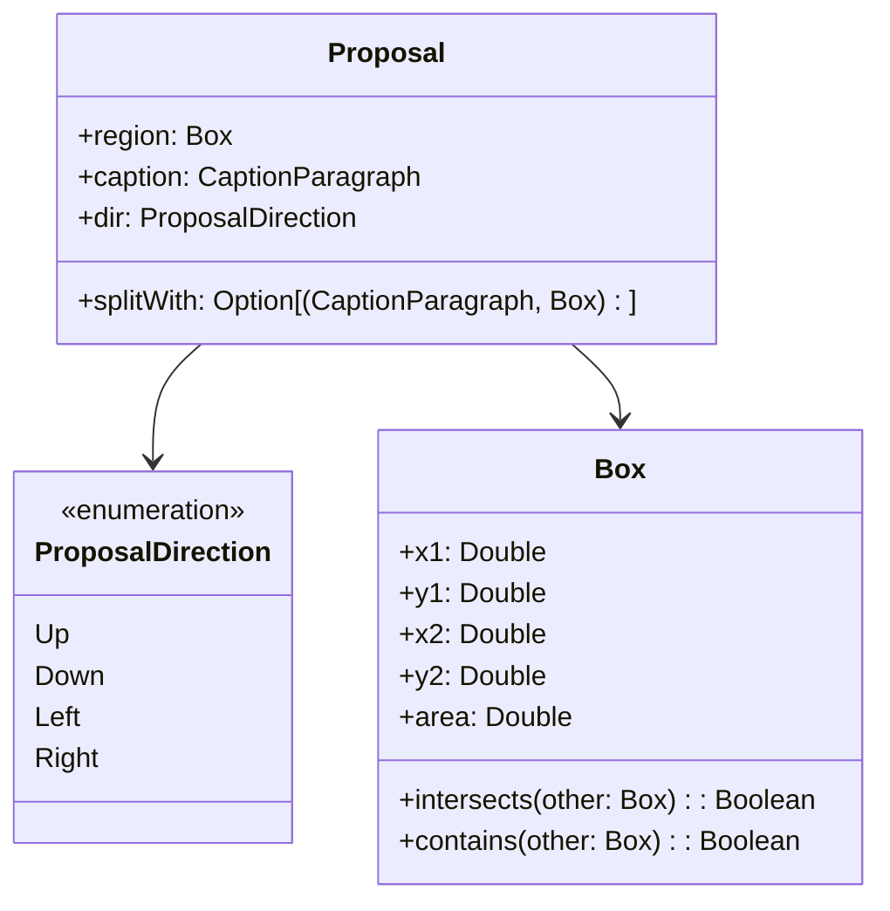

<!-- source: DeepWiki mcp.deepwiki.com · repo allenai/pdffigures2 · page 3.4 Graphics and Figure Detection · fetched 2026-10-26 -->

# Graphics and Figure Detection

Relevant source files

The following files were used as context for generating this wiki page:

- [src/main/scala/org/allenai/pdffigures2/Box.scala](src/main/scala/org/allenai/pdffigures2/Box.scala)
- [src/main/scala/org/allenai/pdffigures2/FigureDetector.scala](src/main/scala/org/allenai/pdffigures2/FigureDetector.scala)
- [src/main/scala/org/allenai/pdffigures2/FigureRenderer.scala](src/main/scala/org/allenai/pdffigures2/FigureRenderer.scala)
- [src/main/scala/org/allenai/pdffigures2/FindGraphicsRaster.scala](src/main/scala/org/allenai/pdffigures2/FindGraphicsRaster.scala)
- [src/main/scala/org/allenai/pdffigures2/GraphicsExtractor.scala](src/main/scala/org/allenai/pdffigures2/GraphicsExtractor.scala)

This section covers the extraction of graphical elements from PDF documents and the detection of figure regions within scholarly papers. The system uses a two-phase approach: first extracting all graphical content from the PDF, then using a proposal-based algorithm to identify which regions likely contain figures based on their proximity to detected captions.

For information about caption detection that feeds into this process, see [Caption Detection and Building](#3.3). For details about rendering the detected figures to image files, see [Figure and Caption Types](#5.1).

## Overview

The graphics and figure detection process transforms pages from containing classified text and captions into pages with identified figure regions. This involves two main components working together:

Sources: [src/main/scala/org/allenai/pdffigures2/GraphicsExtractor.scala:24-44](), [src/main/scala/org/allenai/pdffigures2/FigureDetector.scala:536-621]()

## Graphics Extraction Process

The `GraphicsExtractor` performs the initial identification of all graphical regions on a page, distinguishing between figure-related graphics and document formatting elements like header lines.

### Core Graphics Detection

The primary graphics detection uses `GraphicBBDetector.findGraphicBB` to extract bounding boxes of non-text elements from the PDF structure. When this fails (typically for OCR'd documents), the system falls back to a raster-based approach:

Sources: [src/main/scala/org/allenai/pdffigures2/GraphicsExtractor.scala:47-73](), [src/main/scala/org/allenai/pdffigures2/GraphicsExtractor.scala:80-143]()

### Graphics Preprocessing

The `preprocessGraphics` method filters out non-figure graphics using several heuristics:

| Filter Type | Purpose | Configuration Constants |
|-------------|---------|------------------------|
| Header Lines | Remove decorative lines near page headers | `HeaderLineMinWidthPercent = 0.70` |
| Side Panels | Remove colored borders/panels | Detects boxes hugging page edges |
| Mixed-in Graphics | Remove small graphics within text (equations, underlines) | `MixedInGraphicMaxSize = 70` |
| Clustering | Merge nearby graphics into larger regions | `GraphicClusteringTolerance = 2` |

Sources: [src/main/scala/org/allenai/pdffigures2/GraphicsExtractor.scala:9-21](), [src/main/scala/org/allenai/pdffigures2/GraphicsExtractor.scala:80-143]()

## OCR Fallback: Raster Graphics Detection

For OCR'd PDFs where vector graphics extraction fails, `FindGraphicsRaster` provides a pixel-based approach:

### Connected Components Algorithm

The algorithm renders each PDF page at 72 DPI, removes pixels corresponding to known text regions, then uses flood-fill to identify connected dark pixel regions that likely represent graphics.

Sources: [src/main/scala/org/allenai/pdffigures2/FindGraphicsRaster.scala:16-27](), [src/main/scala/org/allenai/pdffigures2/FindGraphicsRaster.scala:51-109]()

## Figure Detection Algorithm

The `FigureDetector` implements the core figure detection logic using a proposal-based approach. For each caption, it generates candidate figure regions in multiple directions, then selects the optimal configuration.

### Proposal Generation

For each `CaptionParagraph`, the system generates up to 4 directional proposals:

Each proposal expands from a caption boundary until it hits non-figure content, then gets cropped and filtered.

Sources: [src/main/scala/org/allenai/pdffigures2/FigureDetector.scala:373-518](), [src/main/scala/org/allenai/pdffigures2/FigureDetector.scala:335-368]()

### Proposal Scoring and Selection

The system evaluates all possible combinations of proposals using a sophisticated scoring function:

#### Scoring Components

| Score Component | Value | Purpose |
|----------------|-------|---------|
| `ContainsGraphicBonus` | 0.1 | Rewards regions containing graphics |
| `ContainsLargeGraphicBonus` | 0.15 | Extra reward for large graphics (>2000 area) |
| `LeftRightFigurePenalty` | 0.75 | Penalizes side-by-side figures |
| `SplitDifferentTypesPenalty` | 0.75 | Penalizes splitting different figure types |
| `SplitSameTypesPenalty` | 0.5 | Penalizes splitting same figure types |
| `SplitWhitespaceBonus` | 2 | Rewards splits with large whitespace gaps |

#### Configuration Selection Process

Sources: [src/main/scala/org/allenai/pdffigures2/FigureDetector.scala:15-24](), [src/main/scala/org/allenai/pdffigures2/FigureDetector.scala:561-584]()

### Proposal Splitting

When proposals overlap, the system attempts to split them horizontally using whitespace detection:

Sources: [src/main/scala/org/allenai/pdffigures2/FigureDetector.scala:147-195](), [src/main/scala/org/allenai/pdffigures2/FigureDetector.scala:117-142]()

## Integration with Document Processing

The graphics and figure detection components integrate into the broader processing pipeline through well-defined data transformations:

### Input Requirements

- `PageWithClassifiedText`: Page with text classified into headers, body text, etc.
- `DocumentLayout`: Information about column layout and document structure
- `PDDocument`: Original PDF document for graphics extraction

### Output Products

- `PageWithGraphics`: Adds `graphics` and `nonFigureGraphics` sequences
- `PageWithFigures`: Final page with detected `Figure` objects and remaining text

### Key Data Structures

The detection process works with several key data structures defined in the code:

Sources: [src/main/scala/org/allenai/pdffigures2/FigureDetector.scala:33-47](), [src/main/scala/org/allenai/pdffigures2/Box.scala:137-192]()

---

