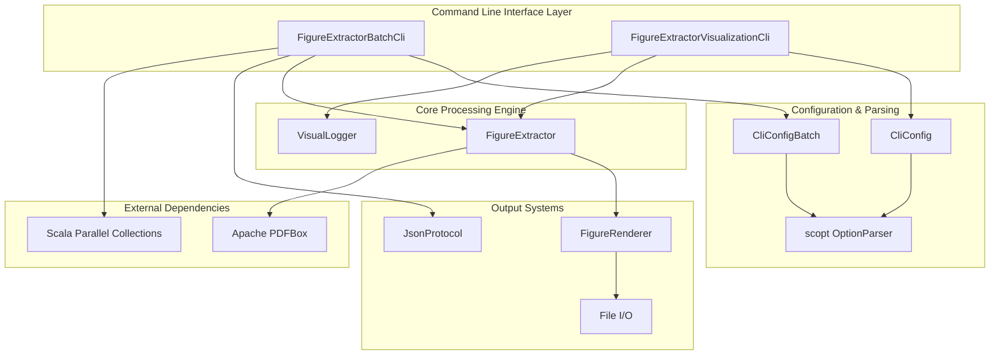
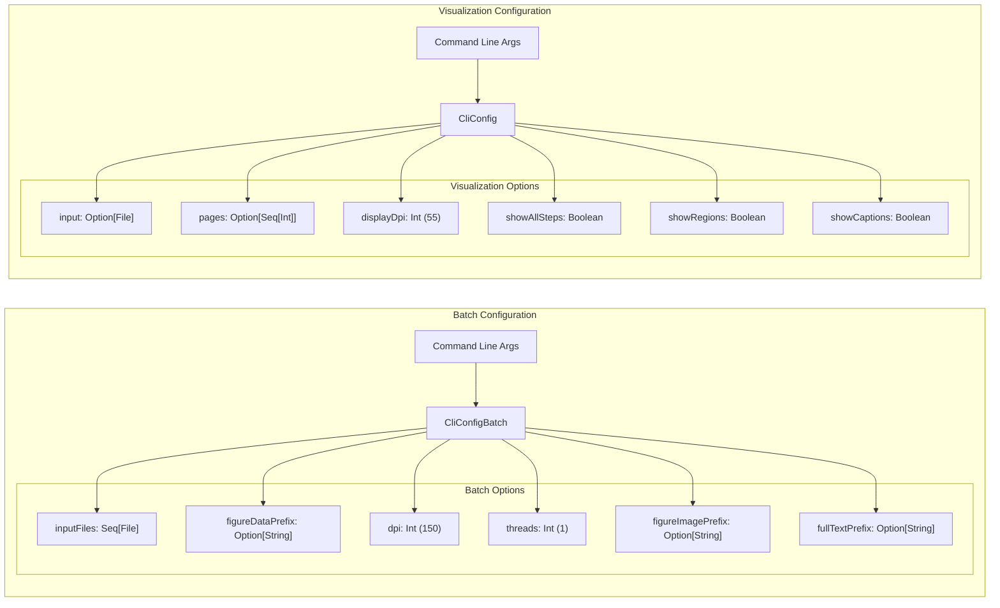

<!-- source: DeepWiki mcp.deepwiki.com · repo allenai/pdffigures2 · page 4 Command Line Interface · fetched 2026-10-26 -->

# Command Line Interface

Relevant source files

The following files were used as context for generating this wiki page:

- [src/main/scala/org/allenai/pdffigures2/FigureExtractorBatchCli.scala](src/main/scala/org/allenai/pdffigures2/FigureExtractorBatchCli.scala)
- [src/main/scala/org/allenai/pdffigures2/FigureExtractorVisualizationCli.scala](src/main/scala/org/allenai/pdffigures2/FigureExtractorVisualizationCli.scala)

The PDFFigures2 system provides two primary command-line interfaces for different use cases: batch processing of multiple PDF documents and interactive visualization/debugging of the extraction pipeline on individual documents. This page provides an overview of both CLI tools, their architecture, and when to use each one.

For detailed usage instructions and configuration options, see [Batch Processing CLI](#4.1) and [Visualization and Debugging CLI](#4.2).

## CLI Tools Overview

PDFFigures2 offers two main entry points for command-line usage:

| CLI Tool | Purpose | Use Case |
|----------|---------|----------|
| `FigureExtractorBatchCli` | Production batch processing | Extract figures from multiple PDFs with parallel processing, output JSON data and image files |
| `FigureExtractorVisualizationCli` | Interactive debugging | Visualize extraction pipeline steps for a single PDF to understand system behavior |

## System Architecture

The CLI tools serve as the primary interface layer to the core figure extraction system:

**Sources**: [src/main/scala/org/allenai/pdffigures2/FigureExtractorBatchCli.scala:17-124](), [src/main/scala/org/allenai/pdffigures2/FigureExtractorVisualizationCli.scala:10-69]()

## Processing Flow Comparison

The two CLI tools follow different processing patterns optimized for their respective use cases:

```mermaid
graph TD
    subgraph "Batch Processing Flow"
        InputFiles["Input PDF Files<br/>(Directory or List)"]
        BatchParser["Command Line Parsing<br/>CliConfigBatch"]
        ParallelProc["Parallel Processing<br/>ForkJoinTaskSupport"]
        ProcessFile["processFile()<br/>Per-document processing"]
        OutputGen["Output Generation<br/>JSON + Images"]
        StatsCollection["Statistics Collection<br/>ProcessingStatistics"]
    end
    
    subgraph "Visualization Flow"
        SinglePDF["Single PDF Input"]
        VisParser["Command Line Parsing<br/>CliConfig"]
        VisLogger["VisualLogger Setup<br/>Debug configuration"]
        ExtractWithVis["Figure Extraction<br/>with visualization"]
        DisplayVis["displayVisualLog()<br/>Interactive display"]
    end
    
    InputFiles --> BatchParser
    BatchParser --> ParallelProc
    ParallelProc --> ProcessFile
    ProcessFile --> OutputGen
    ProcessFile --> StatsCollection
    
    SinglePDF --> VisParser
    VisParser --> VisLogger
    VisLogger --> ExtractWithVis
    ExtractWithVis --> DisplayVis
```

**Sources**: [src/main/scala/org/allenai/pdffigures2/FigureExtractorBatchCli.scala:290-348](), [src/main/scala/org/allenai/pdffigures2/FigureExtractorVisualizationCli.scala:71-120]()

## Configuration Architecture

Both CLI tools use the `scopt` library for command-line argument parsing with different configuration structures:

**Sources**: [src/main/scala/org/allenai/pdffigures2/FigureExtractorBatchCli.scala:29-41](), [src/main/scala/org/allenai/pdffigures2/FigureExtractorVisualizationCli.scala:12-23]()

## Core Integration Points

Both CLI tools integrate with the core `FigureExtractor` system through well-defined interfaces:

| Integration Point | Batch CLI Usage | Visualization CLI Usage |
|-------------------|-----------------|-------------------------|
| `FigureExtractor()` | Creates new instance per file | Single instance for visualization |
| `getFigures()` | Basic figure extraction | With optional `VisualLogger` |
| `getRasterizedFigures()` | When image output needed | For cleaned region visualization |
| `getFiguresWithText()` | Full document structure | With section visualization |
| Error handling | `getFiguresWithErrors()` | Standard exception propagation |

## Output Formats and Options

The CLI tools support different output modes depending on the use case:

**Batch CLI Output Modes:**
- JSON figure data via `figureDataPrefix`
- Rasterized figure images via `figureImagePrefix` 
- Full document structure via `fullTextPrefix`
- Processing statistics via `saveStats`

**Visualization CLI Output:**
- Interactive visual display via `VisualLogger.displayVisualLog()`
- Real-time debugging visualization
- No persistent file output

**Sources**: [src/main/scala/org/allenai/pdffigures2/FigureExtractorBatchCli.scala:154-260](), [src/main/scala/org/allenai/pdffigures2/FigureExtractorVisualizationCli.scala:91-117]()

---

