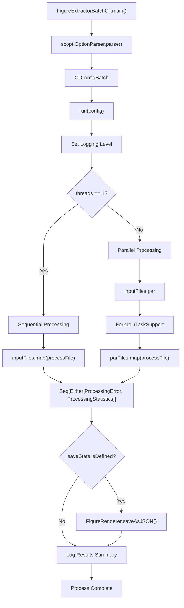
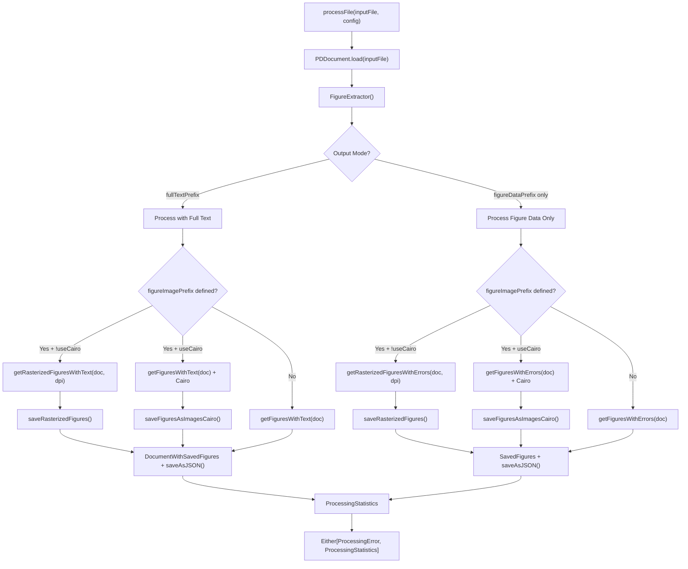
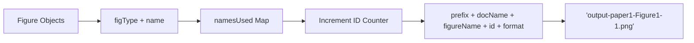
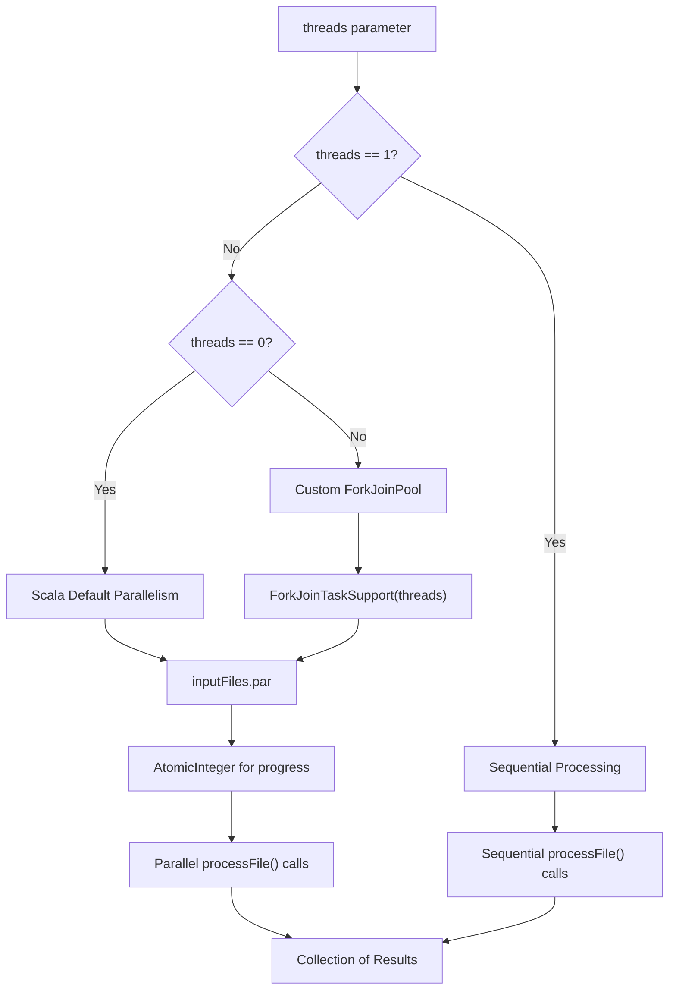
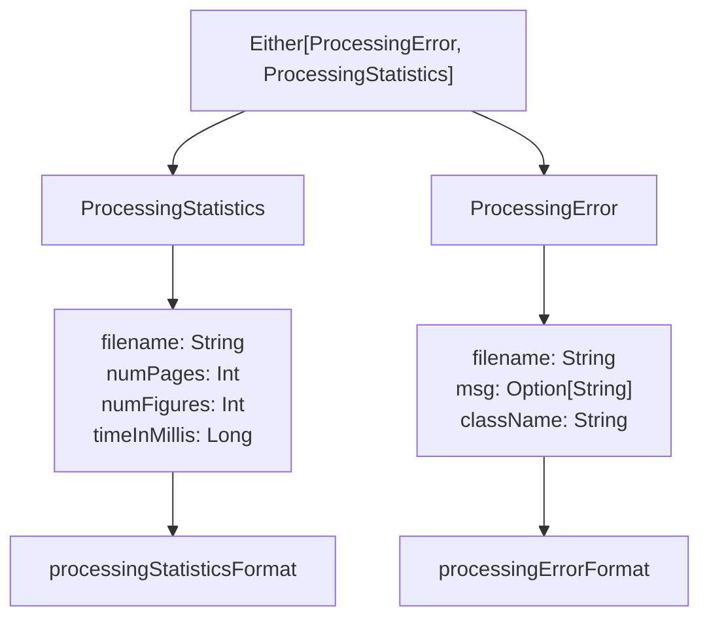

<!-- source: DeepWiki mcp.deepwiki.com · repo allenai/pdffigures2 · page 4.1 Batch Processing CLI · fetched 2026-10-26 -->

# Batch Processing CLI

Relevant source files

The following files were used as context for generating this wiki page:

- [src/main/scala/org/allenai/pdffigures2/FigureExtractorBatchCli.scala](src/main/scala/org/allenai/pdffigures2/FigureExtractorBatchCli.scala)

This page documents the batch processing command-line interface for pdffigures2, implemented in `FigureExtractorBatchCli`. This CLI tool processes multiple PDF files in parallel to extract figures, tables, and captions with configurable output formats and comprehensive error handling.

For interactive debugging and visualization of the extraction process, see [Visualization and Debugging CLI](#4.2). For details on the core extraction pipeline, see [Core Processing Pipeline](#3).

## Overview and Purpose

The `FigureExtractorBatchCli` object provides a production-ready interface for processing large collections of scholarly PDFs. It orchestrates the core `FigureExtractor` to process multiple documents with parallel execution, comprehensive error handling, and flexible output options including JSON metadata and rasterized figure images.

## Command-Line Interface

The CLI uses the `scopt` library for argument parsing and provides extensive configuration options through the `CliConfigBatch` case class.

### Configuration Parameters

| Parameter | Short | Type | Default | Description |
|-----------|--------|------|---------|-------------|
| `<input>` | - | Seq[String] | Required | Input PDF files or directory containing PDFs |
| `--dpi` | `-i` | Int | 150 | DPI resolution for saved figures |
| `--threads` | `-t` | Int | 1 | Number of parallel processing threads (0 = default) |
| `--ignore-error` | `-e` | Boolean | false | Continue processing on errors |
| `--quiet` | `-q` | Boolean | false | Switch to INFO logging level |
| `--figure-data-prefix` | `-d` | String | None | Save JSON figure data with filename prefix |
| `--full-text-prefix` | `-g` | String | None | Save complete document with figures as JSON |
| `--figure-prefix` | `-m` | String | None | Save figure images with filename prefix |
| `--figure-format` | `-f` | String | "png" | Image format for saved figures |
| `--save-regionless-captions` | `-c` | Boolean | false | Include captions without associated figure regions |
| `--save-stats` | `-s` | String | None | Save processing statistics to JSON file |

Sources: [src/main/scala/org/allenai/pdffigures2/FigureExtractorBatchCli.scala:29-41](), [src/main/scala/org/allenai/pdffigures2/FigureExtractorBatchCli.scala:43-124]()

## Processing Architecture

### CLI Processing Flow

Sources: [src/main/scala/org/allenai/pdffigures2/FigureExtractorBatchCli.scala:350-355](), [src/main/scala/org/allenai/pdffigures2/FigureExtractorBatchCli.scala:290-348]()

### Single File Processing Pipeline

Sources: [src/main/scala/org/allenai/pdffigures2/FigureExtractorBatchCli.scala:154-288]()

## Output Options and File Management

### Output Format Matrix

The CLI supports three primary output modes, each with different combinations of data and image outputs:

| Mode | JSON Data | Figure Images | Content |
|------|-----------|---------------|---------|
| Figure Data Only | `figureDataPrefix` | Optional `figureImagePrefix` | Figures and optional regionless captions |
| Full Text | `fullTextPrefix` | Optional `figureImagePrefix` | Complete document structure with figures |
| Images Only | None | `figureImagePrefix` | Figure images without JSON metadata |

### File Naming Convention

The `getFilenames()` method implements a collision-handling naming scheme:

This ensures unique filenames when multiple figures share the same name within a document.

Sources: [src/main/scala/org/allenai/pdffigures2/FigureExtractorBatchCli.scala:126-140]()

### Supported Figure Formats

The CLI supports multiple output formats through integration with `FigureRenderer`:

- **Raster formats**: PNG, JPEG (via Java BufferedImage)
- **Vector formats**: PDF, SVG (via Cairo/pdftocairo when available)

Format validation occurs during argument parsing against `FigureRenderer.AllowedFormats`.

Sources: [src/main/scala/org/allenai/pdffigures2/FigureExtractorBatchCli.scala:99-110]()

## Parallel Execution and Performance

### Thread Management

The parallel execution uses Scala's parallel collections with optional custom thread pool configuration via `ForkJoinTaskSupport`.

Sources: [src/main/scala/org/allenai/pdffigures2/FigureExtractorBatchCli.scala:296-321]()

### Progress Tracking

In parallel mode, an `AtomicInteger` tracks processing progress across threads, ensuring thread-safe logging of completion status.

Sources: [src/main/scala/org/allenai/pdffigures2/FigureExtractorBatchCli.scala:312-320]()

## Error Handling and Statistics

### Processing Results Data Model

### Error Handling Modes

The CLI supports two error handling approaches:

1. **Fail Fast** (default): Exceptions terminate processing immediately
2. **Continue on Error** (`--ignore-error`): Exceptions are captured as `ProcessingError` objects and logged

Sources: [src/main/scala/org/allenai/pdffigures2/FigureExtractorBatchCli.scala:19-27](), [src/main/scala/org/allenai/pdffigures2/FigureExtractorBatchCli.scala:271-284]()

### Statistics Output

When `--save-stats` is specified, the CLI outputs a JSON file containing all processing results, including timing information and error details. This enables batch analysis of extraction performance across document collections.

The statistics collection measures end-to-end processing time including PDF loading, figure extraction, and file I/O operations.

Sources: [src/main/scala/org/allenai/pdffigures2/FigureExtractorBatchCli.scala:326-347]()

## Integration with Core Components

The batch CLI serves as a thin orchestration layer over the core `FigureExtractor` API, primarily handling:

- Multi-file processing coordination
- Output file management and naming
- Parallel execution configuration
- Error aggregation and reporting
- Performance measurement and statistics

The actual figure extraction logic is delegated to methods in the `FigureExtractor` class, ensuring consistency with other interfaces to the system.

Sources: [src/main/scala/org/allenai/pdffigures2/FigureExtractorBatchCli.scala:160](), [src/main/scala/org/allenai/pdffigures2/FigureExtractorBatchCli.scala:166-241]()

---

