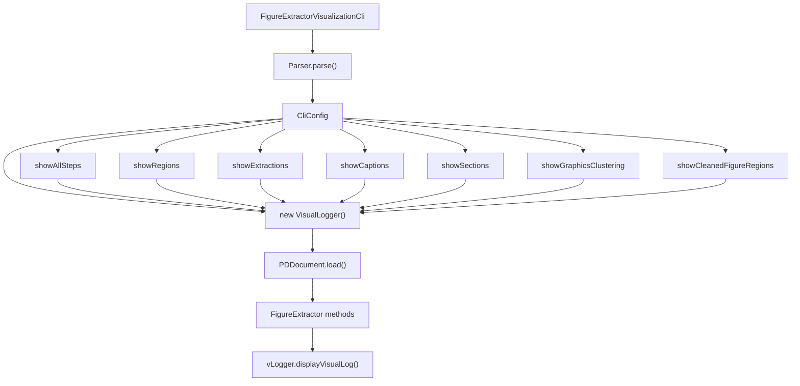
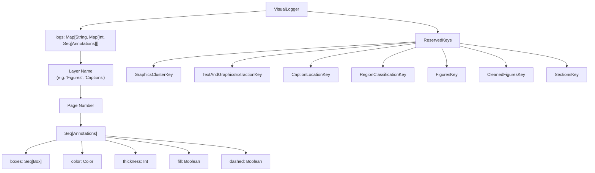
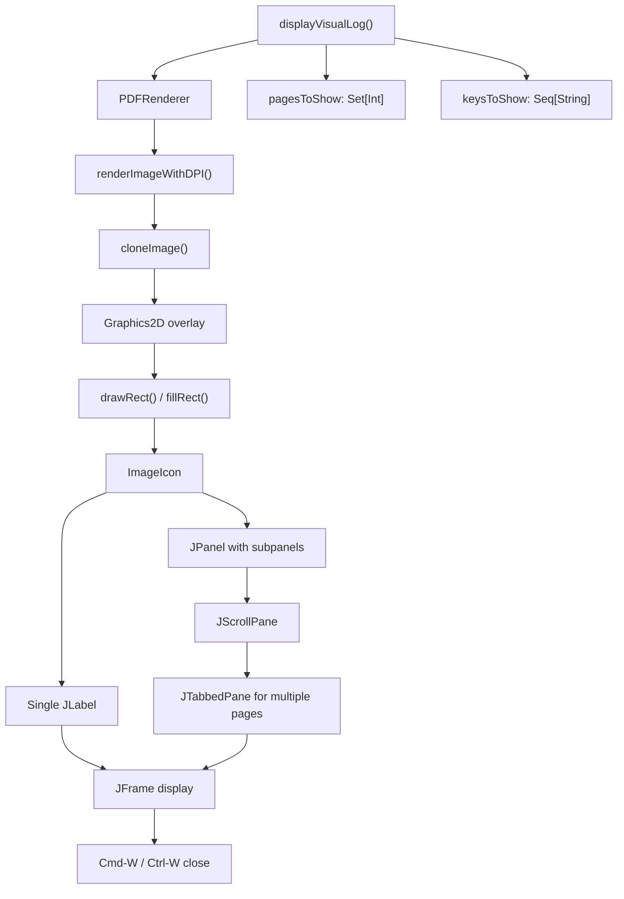

<!-- source: DeepWiki mcp.deepwiki.com · repo allenai/pdffigures2 · page 4.2 Visualization and Debugging CLI · fetched 2026-10-26 -->

# Visualization and Debugging CLI

Relevant source files

The following files were used as context for generating this wiki page:

- [src/main/scala/org/allenai/pdffigures2/FigureExtractorVisualizationCli.scala](src/main/scala/org/allenai/pdffigures2/FigureExtractorVisualizationCli.scala)
- [src/main/scala/org/allenai/pdffigures2/VisualLogger.scala](src/main/scala/org/allenai/pdffigures2/VisualLogger.scala)

This document covers the visualization and debugging command-line interface provided by `FigureExtractorVisualizationCli` and the underlying `VisualLogger` system. This CLI enables interactive visual debugging of the PDF figure extraction pipeline by overlaying annotations on rendered PDF pages to show intermediate processing results.

For information about batch processing of multiple PDFs, see [Batch Processing CLI](#4.1). For details about the core processing pipeline being visualized, see [Core Processing Pipeline](#3).

## Overview

The visualization CLI processes a single PDF document through the figure extraction pipeline while capturing visual annotations at each processing stage. These annotations are then displayed in an interactive GUI, allowing developers and researchers to understand how the system identifies figures, captions, text regions, and other document elements.

**CLI Command Flow**

Sources: [src/main/scala/org/allenai/pdffigures2/FigureExtractorVisualizationCli.scala:71-120]()

## Command Line Usage

The `FigureExtractorVisualizationCli` accepts a single PDF file and various flags to control which processing steps are visualized:

| Option | Short | Description |
|--------|-------|-------------|
| `<input>` | - | Input PDF file (required) |
| `--show-steps` | `-s` | Show all intermediate processing steps |
| `--show-graphic-clustering` | `-g` | Show graphical elements and clustering |
| `--show-cleaned-figure-regions` | `-x` | Show post-processed figure regions |
| `--show-extractions` | `-e` | Show extracted text and graphics bounding boxes |
| `--show-regions` | `-r` | Show classified document regions |
| `--show-captions` | `-c` | Show detected caption locations |
| `--show-sections` | `-t` | Show section titles and paragraphs |
| `--display-dpi` | `-d` | DPI for display rendering (default: 55) |
| `--pages` | `-p` | Specific pages to process (1-based indexing) |

The CLI creates a `VisualLogger` instance configured based on these flags and passes it to the appropriate `FigureExtractor` method. The `showAllSteps` flag enables all visualization types except sections and cleaned figure regions.

Sources: [src/main/scala/org/allenai/pdffigures2/FigureExtractorVisualizationCli.scala:12-69](), [src/main/scala/org/allenai/pdffigures2/FigureExtractorVisualizationCli.scala:77-85]()

## VisualLogger Architecture

The `VisualLogger` class captures visual annotations during PDF processing and displays them in an interactive GUI. It uses a mutable design to accumulate logs during document processing.

**VisualLogger Data Structure**

Sources: [src/main/scala/org/allenai/pdffigures2/VisualLogger.scala:13-19](), [src/main/scala/org/allenai/pdffigures2/VisualLogger.scala:50-70]()

## Annotation System

The `VisualLogger` provides specialized logging methods for different processing stages, each using predefined color schemes and visual styles:

### Processing Stage Methods

- **`logSections()`**: Visualizes document sections with paragraph boundaries in `ParagraphColor` and section titles in `SectionColor`
- **`logGraphicCluster()`**: Shows raw graphics as dashed lines and clustered graphics with thicker borders
- **`logExtractions()`**: Displays extracted graphics, paragraph boundaries, text lines, and non-figure elements
- **`logFigures()`**: Renders figure regions, caption boundaries, and their joint containers
- **`logRasterizedFigures()`**: Shows both original and cleaned figure regions after post-processing
- **`logPagesWithCaption()`**: Highlights detected captions alongside graphics and paragraphs
- **`logRegions()`**: Visualizes classified text regions with different colors and fill patterns

### Color Scheme

| Element Type | Color Constant | Usage |
|--------------|----------------|-------|
| Figure regions | `FigureRegionColor` (Green) | Figure boundaries |
| Graphical elements | `GraphicalElementColor` (Green) | Graphics bounding boxes |
| Captions | `CaptionColor` (Red) | Caption text regions |
| Paragraphs | `ParagraphColor` (Blue) | Paragraph boundaries |
| Sections | `SectionColor` (Red) | Section title regions |
| Non-figure text | `NonFigureColor` (Black) | Classified text regions |
| Other text | `OtherTextColor` (Red) | Unclassified text |
| Joint figure-caption | `JointCaptionFigureColor` (Blue) | Combined boundaries |

Sources: [src/main/scala/org/allenai/pdffigures2/VisualLogger.scala:21-33](), [src/main/scala/org/allenai/pdffigures2/VisualLogger.scala:197-309]()

## Display System

The `displayVisualLog()` method creates an interactive Swing GUI to present the accumulated annotations:

**Display Architecture**

The display system handles three scenarios:
1. **Single annotation layer**: Creates a simple `JLabel` with the annotated image
2. **Multiple annotation layers**: Creates a panel with labeled sub-panels for each annotation type
3. **Multiple pages**: Uses a `JTabbedPane` with tabs for each page

The GUI supports keyboard shortcuts for closing (Cmd-W on macOS, Ctrl-W on other platforms) and provides horizontal scrolling for wide annotation panels.

Sources: [src/main/scala/org/allenai/pdffigures2/VisualLogger.scala:83-195]()

## Custom Annotation Support

Beyond the predefined processing stages, `VisualLogger` provides methods for custom annotations:

- **`log()`**: Adds annotations for a custom layer name and page
- **`logGroup()`**: Adds multiple annotation sets for the same layer, automatically numbering them
- **`addToLog()`**: Internal method for adding annotations to the log structure

Both custom methods validate that layer names don't conflict with the reserved keys used by the standard processing stages.

Sources: [src/main/scala/org/allenai/pdffigures2/VisualLogger.scala:314-333]()

---

