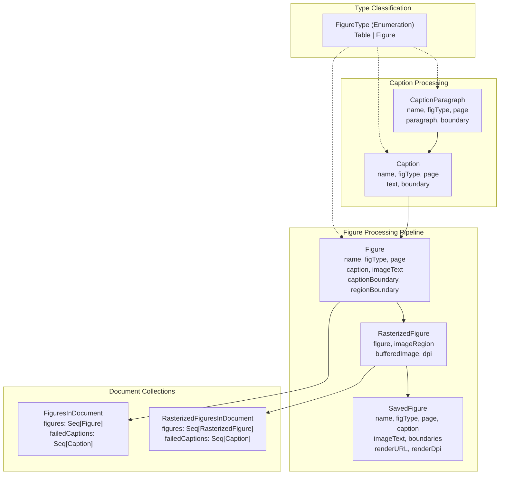
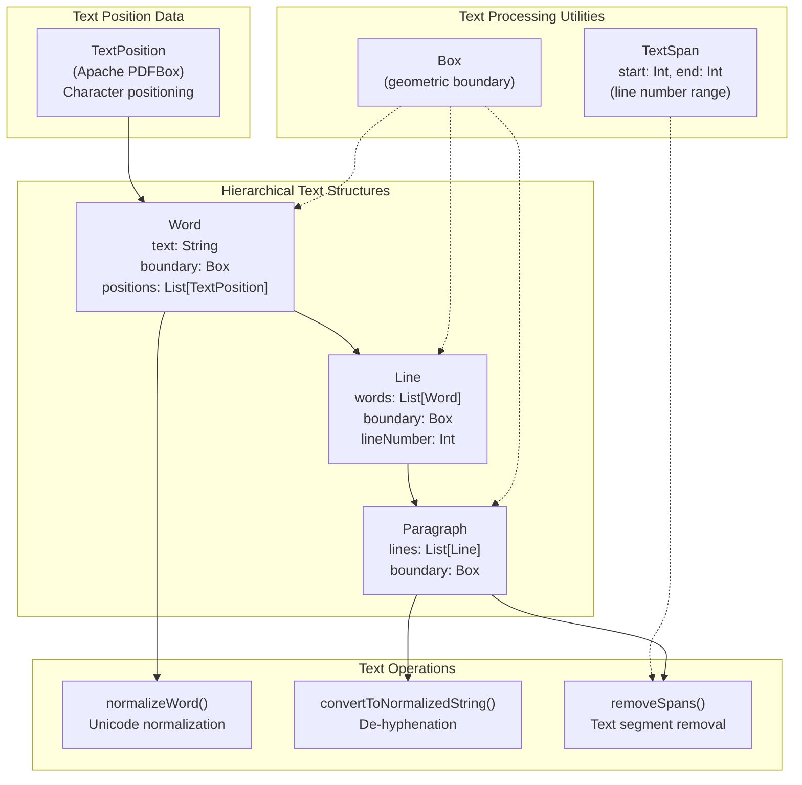

<!-- source: DeepWiki mcp.deepwiki.com · repo allenai/pdffigures2 · page 5 Data Structures · fetched 2026-10-26 -->

# Data Structures

Relevant source files

The following files were used as context for generating this wiki page:

- [src/main/scala/org/allenai/pdffigures2/Figure.scala](src/main/scala/org/allenai/pdffigures2/Figure.scala)
- [src/main/scala/org/allenai/pdffigures2/Paragraph.scala](src/main/scala/org/allenai/pdffigures2/Paragraph.scala)

This page provides an overview of the key data types used throughout the PDFFigures2 system for representing figures, text, and documents. These structures form the foundation for the processing pipeline, evolving from raw PDF content to structured figure extractions.

For detailed information about specific figure types and caption structures, see [Figure and Caption Types](#5.1). For comprehensive coverage of text processing structures, see [Text Structures](#5.2). For serialization formats, see [JSON Serialization](#5.3).

## Data Structure Categories

PDFFigures2 organizes its data structures into three main categories:

| Category | Purpose | Key Types |
|----------|---------|-----------|
| **Figure Structures** | Represent figures and captions at various processing stages | `Figure`, `RasterizedFigure`, `SavedFigure`, `Caption` |
| **Text Structures** | Hierarchical representation of document text content | `Word`, `Line`, `Paragraph`, `TextSpan` |
| **Document Collections** | Group related structures for document-level operations | `FiguresInDocument`, `RasterizedFiguresInDocument` |

## Figure Data Structure Evolution

The figure extraction process transforms basic figure information through multiple stages, each adding additional data and capabilities:

**Sources:** [src/main/scala/org/allenai/pdffigures2/Figure.scala:1-107]()

## Text Structure Hierarchy

PDFFigures2 represents document text using a hierarchical structure that preserves spatial and semantic relationships:

**Sources:** [src/main/scala/org/allenai/pdffigures2/Paragraph.scala:1-165]()

## Data Flow Through Processing Pipeline

The data structures work together as information flows through the extraction pipeline, with text structures providing content for figure detection and caption building:

```mermaid
graph LR
    subgraph "Input Stage"
        PDFContent["PDF Content<br/>(TextPosition data)"]
    end
    
    subgraph "Text Processing"
        WordLevel["Word Structures<br/>text + positioning"]
        LineLevel["Line Structures<br/>spatial grouping"]
        ParagraphLevel["Paragraph Structures<br/>semantic grouping"]
    end
    
    subgraph "Caption Detection"
        CaptionParagraphs["CaptionParagraph<br/>identified captions"]
        Captions["Caption<br/>normalized captions"]
    end
    
    subgraph "Figure Assembly"
        BasicFigures["Figure<br/>caption + region info"]
        RenderedFigures["RasterizedFigure<br/>+ pixel data"]
        OutputFigures["SavedFigure<br/>+ file references"]
    end
    
    PDFContent --> WordLevel
    WordLevel --> LineLevel
    LineLevel --> ParagraphLevel
    
    ParagraphLevel --> CaptionParagraphs
    CaptionParagraphs --> Captions
    
    Captions --> BasicFigures
    BasicFigures --> RenderedFigures
    RenderedFigures --> OutputFigures
```

**Sources:** [src/main/scala/org/allenai/pdffigures2/Figure.scala:1-107](), [src/main/scala/org/allenai/pdffigures2/Paragraph.scala:1-165]()

## Key Design Principles

The data structures in PDFFigures2 follow several important design principles:

### Immutability and Composition
All data structures are implemented as case classes, providing immutability and structural equality. Complex structures compose simpler ones rather than using inheritance hierarchies.

### Boundary Preservation
Most structures include a `boundary: Box` field that tracks the spatial coordinates of the content within the PDF page, enabling spatial reasoning throughout the pipeline.

### Progressive Enhancement
Rather than modifying existing structures, the system creates new structures that wrap or extend previous ones (e.g., `Figure` → `RasterizedFigure` → `SavedFigure`).

### Validation Requirements
Many structures include `require()` statements that enforce invariants, such as non-empty collections and proper ordering of line numbers.

**Sources:** [src/main/scala/org/allenai/pdffigures2/Figure.scala:54-58](), [src/main/scala/org/allenai/pdffigures2/Paragraph.scala:139-143]()

---

