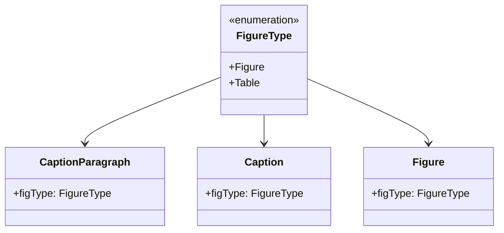
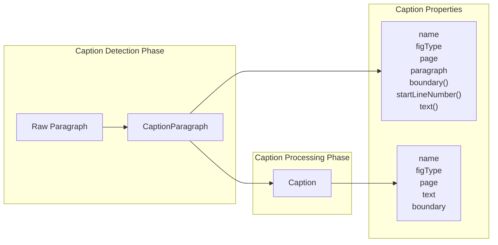
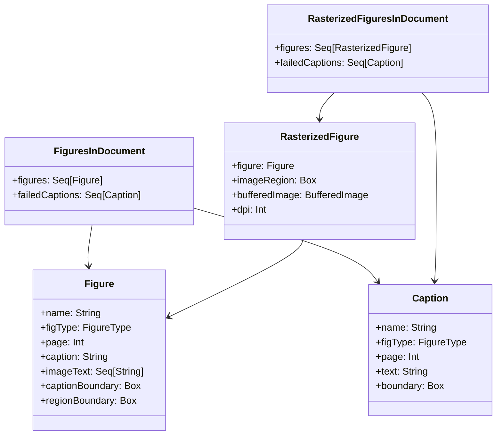

<!-- source: DeepWiki mcp.deepwiki.com · repo allenai/pdffigures2 · page 5.1 Figure and Caption Types · fetched 2026-10-26 -->

# Figure and Caption Types

<details>
<summary>Relevant source files</summary>

The following files were used as context for generating this wiki page:

- [src/main/scala/org/allenai/pdffigures2/Figure.scala](src/main/scala/org/allenai/pdffigures2/Figure.scala)

</details>


This page documents the core data structures used to represent figures, tables, and their captions throughout the PDFFigures2 extraction pipeline. These types form the fundamental output of the system and represent the progression from raw text captions to fully processed and rendered figures.

For information about text structures used in document processing, see [Text Structures](#5.2). For JSON serialization of these types, see [JSON Serialization](#5.3).

## Figure Type Classification

PDFFigures2 distinguishes between two primary types of visual content in scholarly documents through the `FigureType` enumeration:

| Type | Description |
|------|-------------|
| `Figure` | Graphical content including charts, diagrams, plots, and images |
| `Table` | Tabular data structures with rows and columns |

This classification is used consistently across all figure and caption data structures to maintain type safety and enable type-specific processing logic.

**Figure Type Enumeration**


Sources: [src/main/scala/org/allenai/pdffigures2/Figure.scala:6-10]()

## Caption Data Structures

The system uses two primary caption representations that correspond to different stages of the processing pipeline.

### CaptionParagraph

`CaptionParagraph` represents a caption as initially detected from the document's paragraph structure. It contains the raw paragraph data along with extracted metadata:

| Field | Type | Purpose |
|-------|------|---------|
| `name` | String | Figure identifier (e.g., "Figure 1", "Table 2") |
| `figType` | FigureType | Classification as Figure or Table |
| `page` | Int | Page number where caption appears |
| `paragraph` | Paragraph | Raw paragraph containing caption text |

The `CaptionParagraph` provides convenience methods:
- `boundary`: Returns the bounding box of the caption paragraph
- `startLineNumber`: Returns the line number where the caption begins
- `text`: Converts the paragraph to normalized string format

### Caption

`Caption` represents a processed caption with normalized text and simplified structure:

| Field | Type | Purpose |
|-------|------|---------|
| `name` | String | Figure identifier |
| `figType` | FigureType | Classification as Figure or Table |
| `page` | Int | Page number |
| `text` | String | Processed caption text |
| `boundary` | Box | Bounding box coordinates |

The companion object provides a factory method to convert from `CaptionParagraph` to `Caption`.

**Caption Processing Flow**


Sources: [src/main/scala/org/allenai/pdffigures2/Figure.scala:12-29]()

## Figure Hierarchy

The figure data structures form a progression from basic figure information to fully rendered and saved outputs.

### Figure

The base `Figure` class represents a detected figure with its associated caption and region information:

| Field | Type | Purpose |
|-------|------|---------|
| `name` | String | Figure identifier |
| `figType` | FigureType | Classification as Figure or Table |
| `page` | Int | Page number |
| `caption` | String | Caption text |
| `imageText` | Seq[String] | Text content found within the figure |
| `captionBoundary` | Box | Bounding box of the caption |
| `regionBoundary` | Box | Bounding box of the entire figure region |

### RasterizedFigure

`RasterizedFigure` extends the basic figure with rendered image data:

| Field | Type | Purpose |
|-------|------|---------|
| `figure` | Figure | Base figure information |
| `imageRegion` | Box | Exact pixel coordinates of rendered image |
| `bufferedImage` | BufferedImage | Rendered image data |
| `dpi` | Int | Rendering resolution |

The `imageRegion` coordinates are guaranteed to be integers and represent the precise pixel boundaries of the rendered figure within the page at the specified DPI.

### SavedFigure

`SavedFigure` represents a figure that has been saved to disk with a file URL:

| Field | Type | Purpose |
|-------|------|---------|
| `name` | String | Figure identifier |
| `figType` | FigureType | Classification |
| `page` | Int | Page number |
| `caption` | String | Caption text |
| `imageText` | Seq[String] | Figure text content |
| `captionBoundary` | Box | Caption bounding box |
| `regionBoundary` | Box | Figure region bounding box (scaled to 72 DPI) |
| `renderURL` | String | File path or URL to saved image |
| `renderDpi` | Int | Resolution of saved image |

The companion object provides factory methods to create `SavedFigure` instances from either `RasterizedFigure` or `Figure` objects.

**Figure Processing Pipeline**
```mermaid
graph TB
    subgraph "Figure Detection"
        Caption --> Figure["Figure<br/>(name, figType, page,<br/>caption, imageText,<br/>captionBoundary,<br/>regionBoundary)"]
    end
    
    subgraph "Figure Rendering"
        Figure --> RasterizedFigure["RasterizedFigure<br/>(figure, imageRegion,<br/>bufferedImage, dpi)"]
    end
    
    subgraph "Figure Saving"
        RasterizedFigure --> SavedFigure["SavedFigure<br/>(name, figType, page,<br/>caption, imageText,<br/>captionBoundary, regionBoundary,<br/>renderURL, renderDpi)"]
        Figure --> SavedFigure
    end
    
    subgraph "Validation"
        RasterizedFigure --> Validation["require(<br/>integer coordinates<br/>for imageRegion)"]
    end
```

Sources: [src/main/scala/org/allenai/pdffigures2/Figure.scala:31-102]()

## Document-Level Collections

The system provides container types for managing collections of figures at the document level:

### FiguresInDocument

Contains figures detected from a document along with captions that could not be matched to figures:

| Field | Type | Purpose |
|-------|------|---------|
| `figures` | Seq[Figure] | Successfully detected figures |
| `failedCaptions` | Seq[Caption] | Captions without corresponding figures |

### RasterizedFiguresInDocument

Contains rendered figures and failed captions:

| Field | Type | Purpose |
|-------|------|---------|
| `figures` | Seq[RasterizedFigure] | Rendered figures |
| `failedCaptions` | Seq[Caption] | Captions without corresponding figures |

**Document Collections Architecture**


Sources: [src/main/scala/org/allenai/pdffigures2/Figure.scala:104-106]()

## Type Relationships and Data Flow

The figure and caption types work together to represent the complete extraction and rendering pipeline:

1. **Caption Detection**: Raw paragraphs become `CaptionParagraph` objects
2. **Caption Processing**: `CaptionParagraph` objects are converted to `Caption` objects
3. **Figure Detection**: `Caption` objects are paired with figure regions to create `Figure` objects
4. **Figure Rendering**: `Figure` objects are rendered to create `RasterizedFigure` objects
5. **Figure Saving**: `RasterizedFigure` objects are saved to disk as `SavedFigure` objects
6. **Document Assembly**: Collections are wrapped in document-level container types

This progression ensures type safety while maintaining clear separation of concerns between detection, rendering, and persistence phases of the extraction pipeline.

Sources: [src/main/scala/org/allenai/pdffigures2/Figure.scala:1-107]()

---

