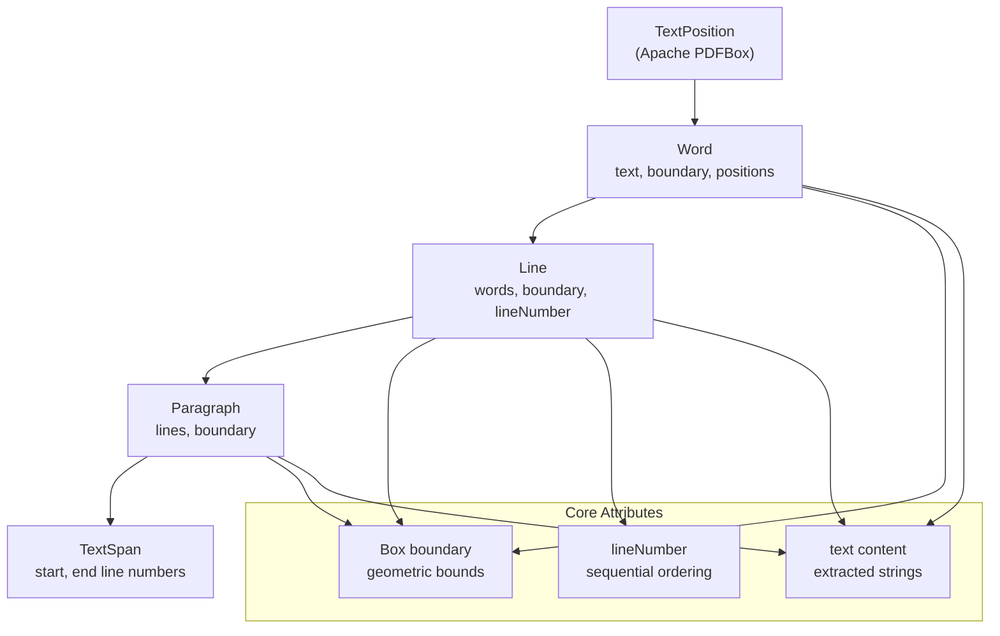
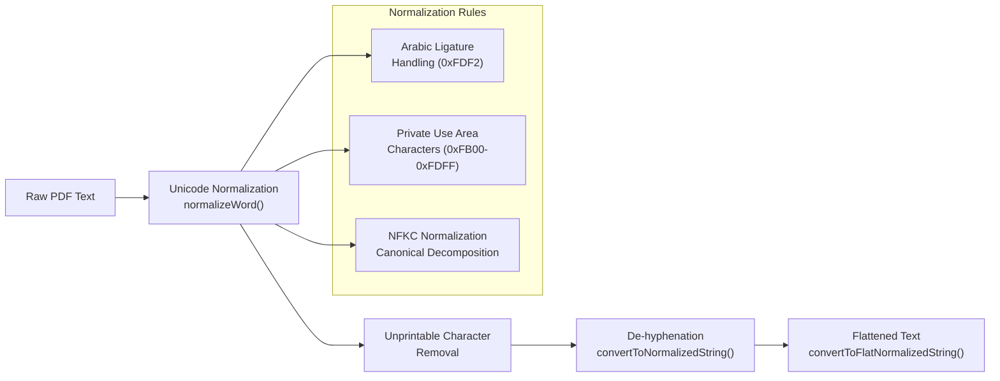
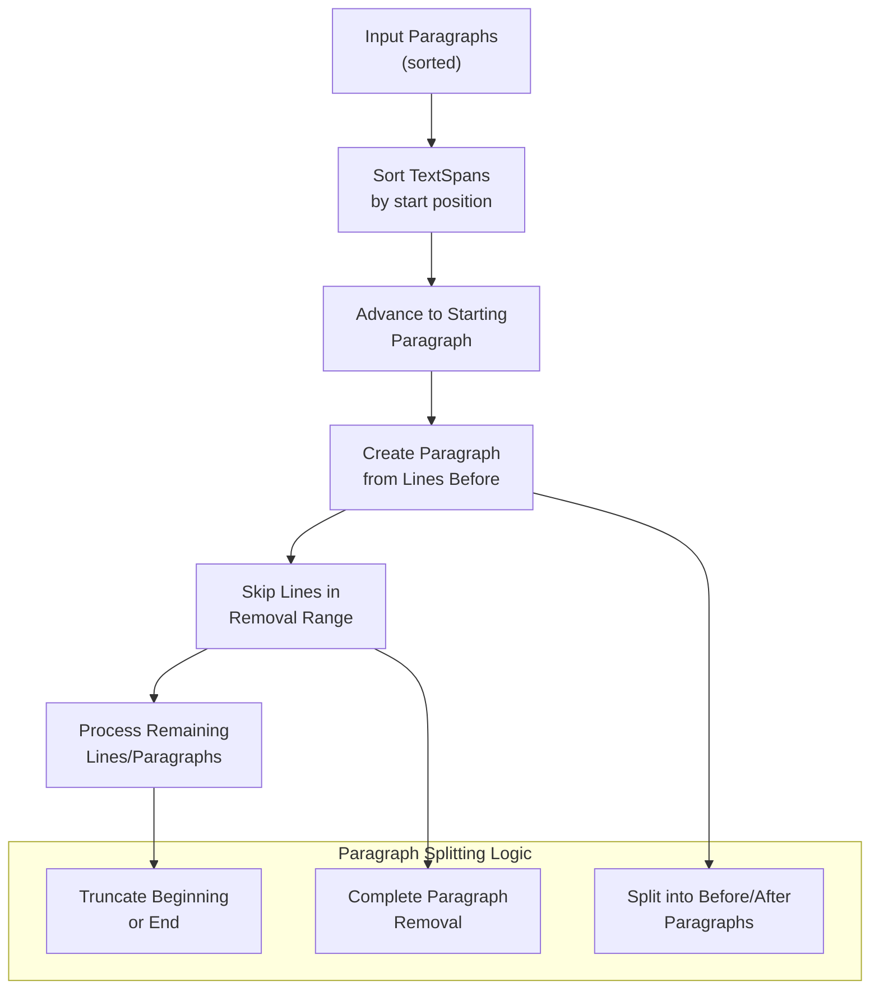
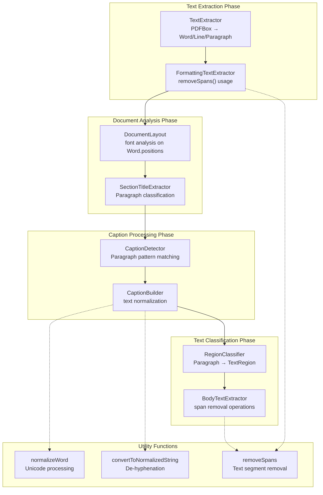

<!-- source: DeepWiki mcp.deepwiki.com · repo allenai/pdffigures2 · page 5.2 Text Structures · fetched 2026-10-26 -->

# Text Structures

Relevant source files

The following files were used as context for generating this wiki page:

- [src/main/scala/org/allenai/pdffigures2/Paragraph.scala](src/main/scala/org/allenai/pdffigures2/Paragraph.scala)

This page documents the hierarchical text representation system used throughout pdffigures2 for processing and manipulating textual content extracted from PDF documents. The system provides a three-tier hierarchy from individual words up to complete paragraphs, along with utilities for text normalization, span manipulation, and conversion operations.

For information about figure and caption data structures, see [Figure and Caption Types](#5.1). For serialization of these structures, see [JSON Serialization](#5.3).

## Hierarchical Text Representation

The text structure system implements a bottom-up hierarchy that mirrors the natural organization of text in documents:

### Text Hierarchy Overview

Sources: [src/main/scala/org/allenai/pdffigures2/Paragraph.scala:162-164](), [src/main/scala/org/allenai/pdffigures2/Paragraph.scala:155-160](), [src/main/scala/org/allenai/pdffigures2/Paragraph.scala:138-148]()

### Word Structure

The `Word` case class represents the fundamental text unit, containing the actual text content, geometric boundaries, and references to the underlying PDF text positions.

| Field | Type | Description |
|-------|------|-------------|
| `text` | `String` | The actual text content of the word |
| `boundary` | `Box` | Geometric bounding box of the word |
| `positions` | `List[TextPosition]` | Apache PDFBox TextPosition objects |

**Requirements:**
- Must contain at least one `TextPosition` object
- Positions provide font information, coordinates, and text direction

Sources: [src/main/scala/org/allenai/pdffigures2/Paragraph.scala:162-164]()

### Line Structure

The `Line` case class aggregates words that appear on the same text line, maintaining spatial relationships and line ordering.

| Field | Type | Description |
|-------|------|-------------|
| `words` | `List[Word]` | Words contained in this line |
| `boundary` | `Box` | Container bounding box for all words |
| `lineNumber` | `Int` | Sequential line number in document |

**Key Methods:**
- `text`: Concatenates word text with spaces
- `isHorizontal`: Checks if all text positions have direction 0

**Requirements:**
- Must contain at least one word
- Boundary is automatically computed as container of word boundaries

Sources: [src/main/scala/org/allenai/pdffigures2/Paragraph.scala:155-160](), [src/main/scala/org/allenai/pdffigures2/Paragraph.scala:150-154]()

### Paragraph Structure

The `Paragraph` case class represents coherent text blocks, typically corresponding to semantic paragraphs in the document.

| Field | Type | Description |
|-------|------|-------------|
| `lines` | `List[Line]` | Lines contained in this paragraph |
| `boundary` | `Box` | Container bounding box for all lines |

**Key Methods:**
- `text`: Concatenates line text with spaces
- `startLineNumber`: Returns the line number of the first line
- `span`: Returns `TextSpan` covering the paragraph's line range

**Requirements:**
- Must contain at least one line
- Lines must be in sequential order by line number
- Implements `Ordered[Paragraph]` for sorting by start line number

Sources: [src/main/scala/org/allenai/pdffigures2/Paragraph.scala:138-148]()

### TextSpan for Range Operations

The `TextSpan` case class defines ranges of text by line numbers, used for text manipulation and removal operations.

| Field | Type | Description |
|-------|------|-------------|
| `start` | `Int` | Starting line number (inclusive) |
| `end` | `Int` | Ending line number (inclusive) |

**Requirements:**
- Start line number must be non-negative
- Start must be less than or equal to end
- Implements `Ordered[TextSpan]` for sorting

Sources: [src/main/scala/org/allenai/pdffigures2/Paragraph.scala:7-12]()

## Text Processing Utilities

### Text Normalization Pipeline

Sources: [src/main/scala/org/allenai/pdffigures2/Paragraph.scala:19-48](), [src/main/scala/org/allenai/pdffigures2/Paragraph.scala:50-63]()

### Word Normalization

The `normalizeWord` function handles complex Unicode normalization including:

**Character Range Processing:**
- Private Use Area characters (0xFB00-0xFDFF, 0xFE70-0xFEFF)
- Arabic ligature handling for Allah symbol (0xFDF2)
- NFKC normalization for compatibility characters

**Implementation Details:**
- Uses lazy StringBuilder allocation for performance
- Applies regex-based unprintable character removal
- Handles edge cases for Arabic text processing

Sources: [src/main/scala/org/allenai/pdffigures2/Paragraph.scala:19-48](), [src/main/scala/org/allenai/pdffigures2/Paragraph.scala:15]()

### Paragraph Text Conversion

The system provides multiple text conversion strategies:

| Function | Purpose | De-hyphenation | Paragraph Boundaries |
|----------|---------|----------------|---------------------|
| `convertToNormalizedString` | Single paragraph to string | ✓ | Preserved |
| `convertToFlatNormalizedString` | Multiple paragraphs to string | ✓ | Ignored |

**De-hyphenation Logic:**
- Detects hyphens at end of lines that precede letters
- Removes hyphen and connects split words
- Preserves intentional hyphens in compound words

Sources: [src/main/scala/org/allenai/pdffigures2/Paragraph.scala:50-63](), [src/main/scala/org/allenai/pdffigures2/Paragraph.scala:65-72]()

## Text Span Manipulation

### Span Removal Algorithm

The `removeSpans` function provides sophisticated text segment removal while preserving paragraph structure:

Sources: [src/main/scala/org/allenai/pdffigures2/Paragraph.scala:83-136]()

**Algorithm Features:**
- Maintains paragraph integrity when possible
- Splits paragraphs when removal spans intersect the middle
- Handles multiple overlapping or adjacent spans
- Preserves line number ordering throughout

**Use Cases in Pipeline:**
- Removing headers and footers during document cleanup
- Extracting body text by removing figure captions
- Isolating specific document sections for analysis

## Integration with Processing Pipeline

### Text Structure Usage Across Components

Sources: [src/main/scala/org/allenai/pdffigures2/Paragraph.scala:19-48](), [src/main/scala/org/allenai/pdffigures2/Paragraph.scala:50-63](), [src/main/scala/org/allenai/pdffigures2/Paragraph.scala:83-136]()

The text structures serve as the foundation for all text-based operations in pdffigures2, from initial PDF parsing through final figure extraction. The hierarchical design enables both fine-grained word-level analysis and document-level text manipulation while maintaining spatial and semantic relationships essential for accurate figure and caption detection.

---

