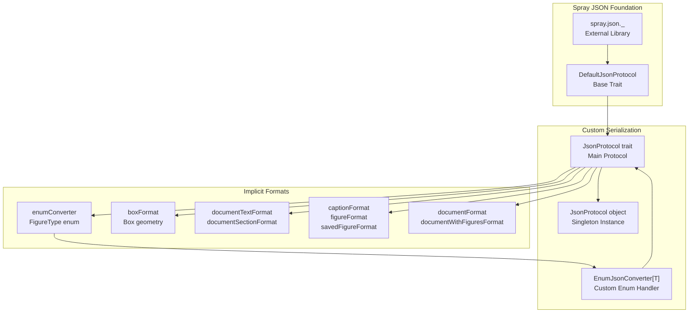
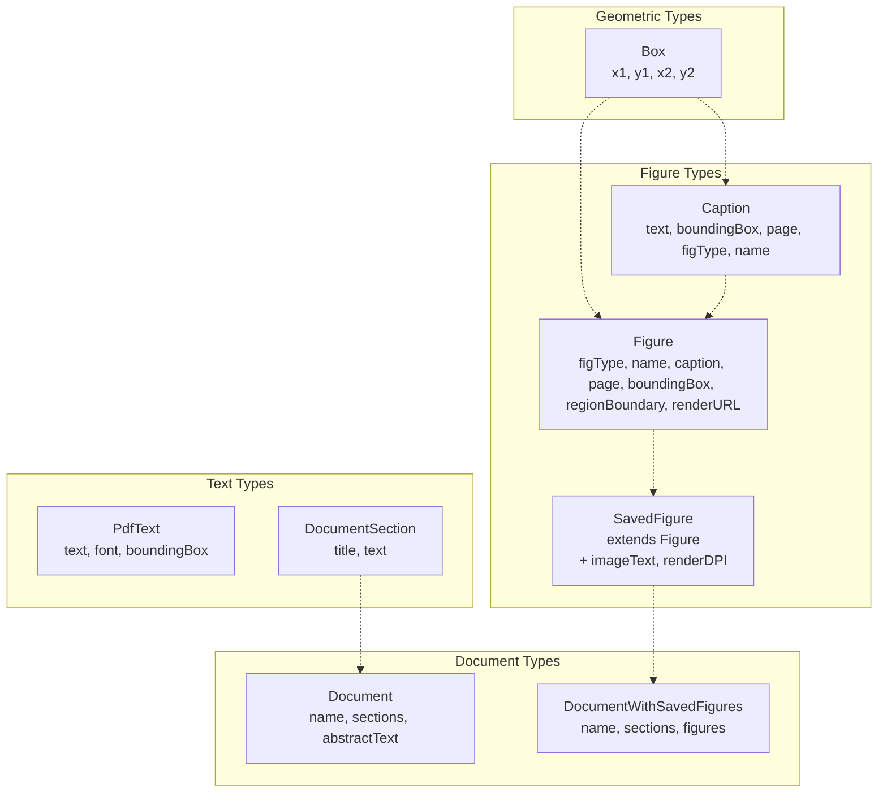
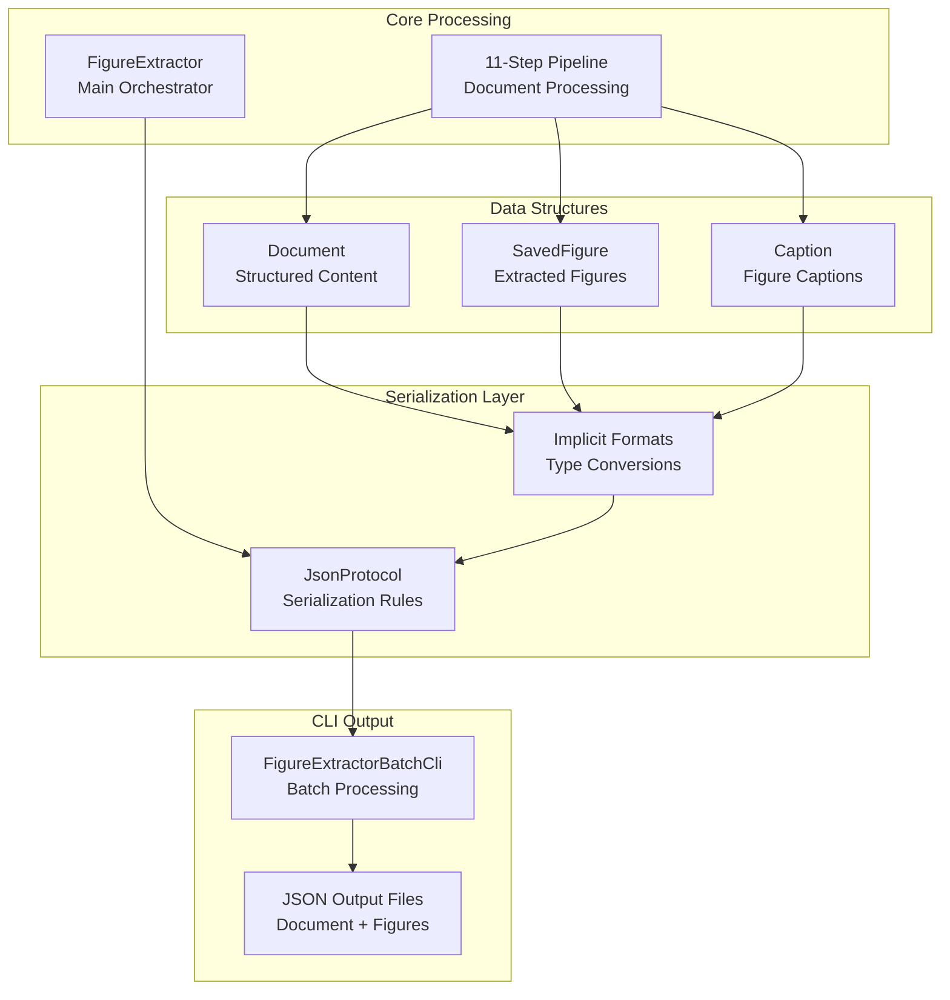

<!-- source: DeepWiki mcp.deepwiki.com · repo allenai/pdffigures2 · page 5.3 JSON Serialization · fetched 2026-10-26 -->

# JSON Serialization

<details>
<summary>Relevant source files</summary>

The following files were used as context for generating this wiki page:

- [src/main/scala/org/allenai/pdffigures2/JsonProtocol.scala](src/main/scala/org/allenai/pdffigures2/JsonProtocol.scala)

</details>


This document covers the JSON serialization infrastructure in PDFFigures 2.0, which enables the system to output extracted figures, captions, and document structure as JSON data. This serialization layer is essential for API responses, file output, and integration with external systems.

For information about the underlying data structures being serialized, see [Data Structures](#5). For details about command-line output formats, see [Batch Processing CLI](#4.1).

## Purpose and Architecture

The JSON serialization system in PDFFigures 2.0 is built on top of the Spray JSON library and provides a comprehensive protocol for converting Scala data structures into JSON format. The system handles complex nested objects, enumerations, and maintains type safety throughout the serialization process.

### JsonProtocol Structure



**Sources:** [src/main/scala/org/allenai/pdffigures2/JsonProtocol.scala:1-35]()

The `JsonProtocol` trait serves as the central hub for all JSON serialization formats. It extends Spray JSON's `DefaultJsonProtocol` and defines implicit format definitions for all major data structures in the system.

## Data Structure Serialization Mapping

The following table shows how Scala data structures map to JSON formats through implicit conversions:

| Scala Type | JSON Format | Purpose | Line Reference |
|-------------|-------------|---------|----------------|
| `FigureType` | Custom Enum | Figure classification | [JsonProtocol.scala:23]() |
| `Box` | Object (4 fields) | Geometric boundaries | [JsonProtocol.scala:24]() |
| `Caption` | Object (5 fields) | Caption text and location | [JsonProtocol.scala:25]() |
| `Figure` | Object (7 fields) | Basic figure information | [JsonProtocol.scala:26]() |
| `SavedFigure` | Object (9 fields) | Figure with file references | [JsonProtocol.scala:27]() |
| `PdfText` | Object (3 fields) | Document text content | [JsonProtocol.scala:28]() |
| `DocumentSection` | Object (2 fields) | Document section structure | [JsonProtocol.scala:29]() |
| `Document` | Object (3 fields) | Complete document structure | [JsonProtocol.scala:30]() |
| `DocumentWithSavedFigures` | Object (3 fields) | Document with saved figures | [JsonProtocol.scala:31]() |

### JSON Structure Hierarchy



**Sources:** [src/main/scala/org/allenai/pdffigures2/JsonProtocol.scala:24-31]()

## Enum Serialization

The system includes a custom `EnumJsonConverter` to handle Scala enumeration serialization, specifically for the `FigureType` enumeration used throughout the figure detection pipeline.

### EnumJsonConverter Implementation

The `EnumJsonConverter` class provides bidirectional conversion between Scala enumeration values and JSON strings:

```mermaid
graph LR
    subgraph "Scala Enumeration"
        EnumValue["T#Value<br/>(e.g., FigureType.Figure)"]
    end
    
    subgraph "JSON Representation"
        JSONString["JsString<br/>(e.g., \"Figure\")"]
    end
    
    subgraph "EnumJsonConverter[T]"
        WriteMethod["write(obj: T#Value)<br/>→ JsString(obj.toString)"]
        ReadMethod["read(json: JsValue)<br/>→ enu.withName(txt)"]
    end
    
    EnumValue -->|"write()"| WriteMethod
    WriteMethod --> JSONString
    JSONString -->|"read()"| ReadMethod  
    ReadMethod --> EnumValue
```

**Sources:** [src/main/scala/org/allenai/pdffigures2/JsonProtocol.scala:8-19]()

The converter handles the `FigureType` enumeration, which distinguishes between different types of figures (Figure, Table, etc.) found in academic papers. Error handling is implemented through `DeserializationException` for invalid enum values.

## Integration with System Components

The JSON serialization system integrates with multiple components across the PDFFigures 2.0 architecture:



**Sources:** [src/main/scala/org/allenai/pdffigures2/JsonProtocol.scala:1-35]()

The JSON serialization enables the system to output structured data that can be consumed by downstream applications, research tools, and web services. The serialized data preserves all essential information about extracted figures, including geometric boundaries, caption text, and document structure.

## Usage Patterns

The `JsonProtocol` object provides a singleton instance that can be imported wherever JSON serialization is needed. The implicit formats automatically handle conversion when using Spray JSON's `.toJson` and `.parseJson` methods, making serialization transparent to calling code.

The most common serialization targets are `DocumentWithSavedFigures` objects, which contain the complete results of the figure extraction process, including both document structure and saved figure files with their metadata.

**Sources:** [src/main/scala/org/allenai/pdffigures2/JsonProtocol.scala:34]()

---

