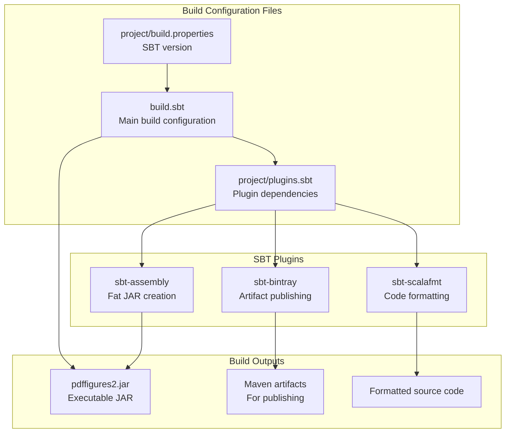
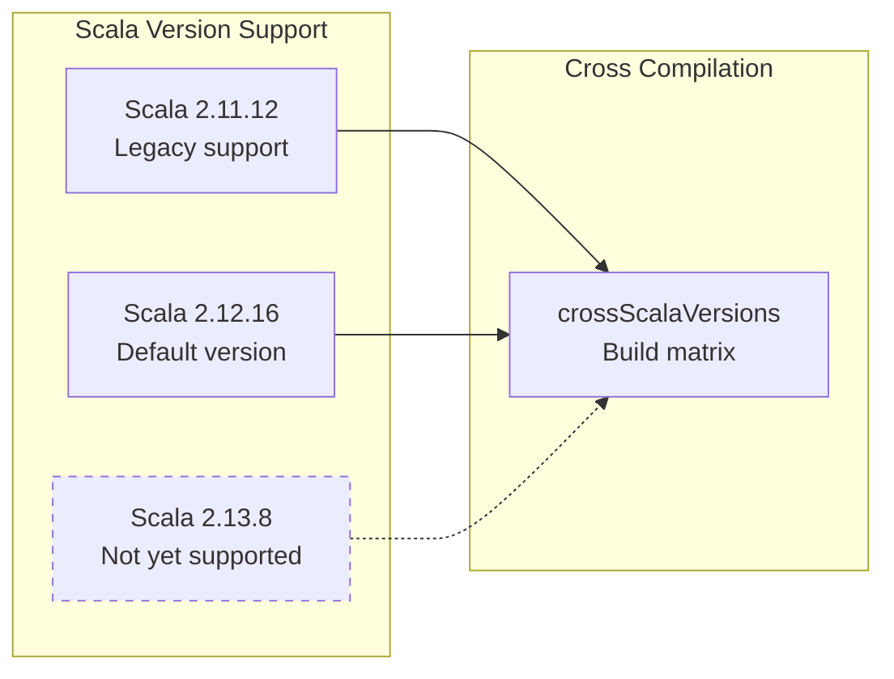
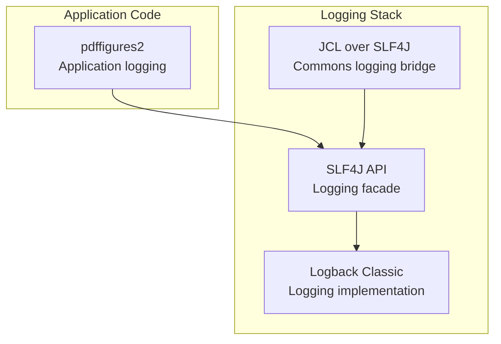
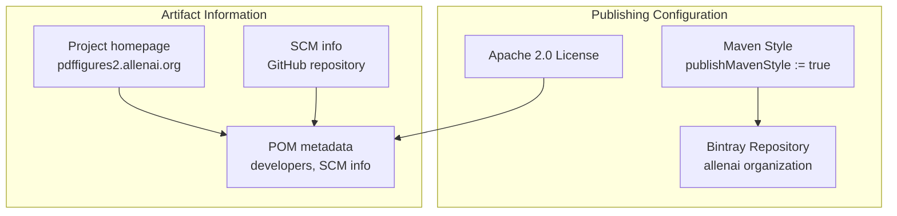

<!-- source: DeepWiki mcp.deepwiki.com · repo allenai/pdffigures2 · page 6 Build System and Configuration · fetched 2026-10-26 -->

# Build System and Configuration

<details>
<summary>Relevant source files</summary>

The following files were used as context for generating this wiki page:

- [build.sbt](build.sbt)
- [project/build.properties](project/build.properties)
- [project/plugins.sbt](project/plugins.sbt)

</details>


This page covers the build system configuration for pdffigures2, including SBT setup, dependency management, cross-compilation support, and packaging configuration. The system uses SBT (Simple Build Tool) as its primary build system with several plugins for enhanced functionality.

For detailed SBT configuration specifics, see [SBT Configuration](#6.1). For code quality tools and continuous integration setup, see [Code Quality and CI/CD](#6.2).

## Build System Overview

The pdffigures2 project uses SBT as its build system with a standard Scala project structure. The build supports cross-compilation across multiple Scala versions and creates deployable JAR artifacts through the sbt-assembly plugin.

### Build System Architecture



Sources: [build.sbt:1-74](), [project/plugins.sbt:1-6](), [project/build.properties:1-2]()

## Core Build Configuration

The main build configuration is defined in `build.sbt` and establishes the project metadata, Scala version support, and basic settings.

### Project Metadata

| Setting | Value | Purpose |
|---------|--------|---------|
| `organization` | `"org.allenai"` | Maven group ID |
| `name` | `"pdffigures2"` | Artifact name |
| `version` | `"0.1.0"` | Project version |
| `description` | Scala library for figure extraction | Project description |
| `scalaVersion` | `scala212` (2.12.16) | Default Scala version |
| `crossScalaVersions` | 2.11.12, 2.12.16 | Supported Scala versions |

Sources: [build.sbt:8-15]()

### Supported Scala Versions

The project supports cross-compilation across multiple Scala versions:



Sources: [build.sbt:1-4](), [build.sbt:15]()

## Dependency Management

The project manages several categories of dependencies for PDF processing, JSON handling, logging, and testing.

### Core Dependencies

| Dependency | Version | Purpose |
|------------|---------|---------|
| `spray-json` | 1.3.6 | JSON serialization/deserialization |
| `scopt` | 4.1.0 | Command-line argument parsing |
| `apache-pdfbox` | 2.0.26 | PDF document processing |
| `fontbox` | 2.0.26 | Font handling for PDFBox |
| `bouncycastle` | 1.71 | PDF security and cryptography |
| `typesafe-config` | 1.4.2 | Configuration management |

Sources: [build.sbt:27-45]()

### Logging Dependencies

The project uses SLF4J with Logback as the logging framework:



Sources: [build.sbt:30-31]()

### Security and Image Processing

The build includes Bouncy Castle libraries for handling security-enabled PDFs and has optional (commented) support for additional image formats:

```scala
// Optional image format support (disabled by default due to licensing)
// "com.github.jai-imageio" % "jai-imageio-core" % "1.4.0"
// "com.github.jai-imageio" % "jai-imageio-jpeg2000" % "1.4.0"  
// "com.levigo.jbig2" % "levigo-jbig2-imageio" % "2.0"
```

Sources: [build.sbt:36-45]()

## Assembly and Packaging

The project uses the sbt-assembly plugin to create executable "fat JARs" containing all dependencies.

### Assembly Configuration

| Setting | Value | Purpose |
|---------|--------|---------|
| `mainClass` | `FigureExtractorBatchCli` | Entry point for executable JAR |
| `assemblyOutputPath` | `pdffigures2.jar` | Output JAR filename |
| `assemblyMergeStrategy` | Custom strategy | Handles dependency conflicts |

The merge strategy handles conflicts in module files and Apache Commons classes:

```scala
assembly / assemblyMergeStrategy := {
  case x if x.endsWith("module-info.class") => MergeStrategy.discard
  case PathList("org", "apache", "commons", xs @ _*) => MergeStrategy.first
  case x => oldStrategy(x)
}
```

Sources: [build.sbt:63-73]()

## Publishing Configuration

The project is configured for publishing to Bintray with Maven-style artifacts.

### Publishing Settings



The publishing configuration includes:
- Apache 2.0 license
- Allen Institute developer information  
- GitHub repository links
- Bintray organization and repository settings

Sources: [build.sbt:16-26](), [build.sbt:50-58]()

## SBT Plugins

The project uses three main SBT plugins to extend build functionality:

| Plugin | Version | Purpose |
|--------|---------|---------|
| `sbt-assembly` | 1.2.0 | Creates executable fat JARs |
| `sbt-scalafmt` | 2.4.6 | Automatic code formatting |
| `sbt-bintray` | 0.6.1 | Publishing to Bintray repository |

These plugins are defined in `project/plugins.sbt` and provide essential functionality for packaging, code quality, and distribution.

Sources: [project/plugins.sbt:1-6]()

---

