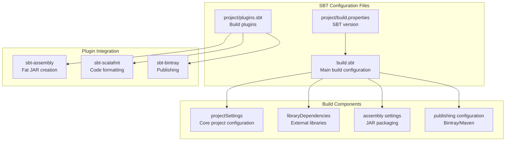
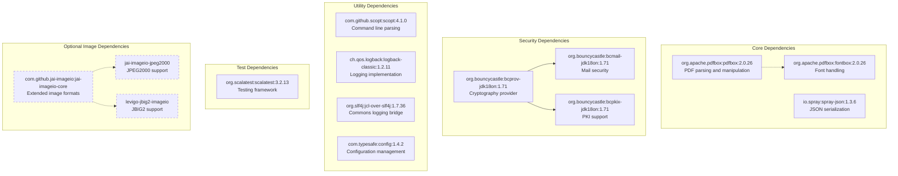
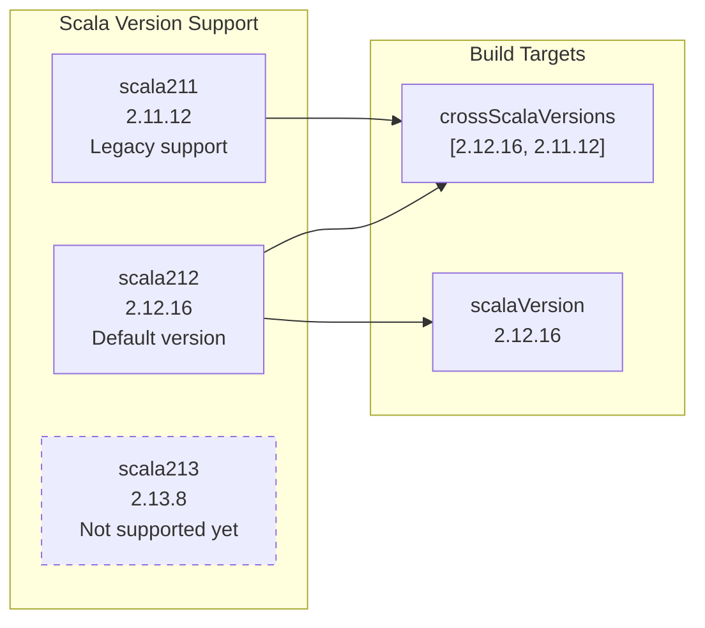
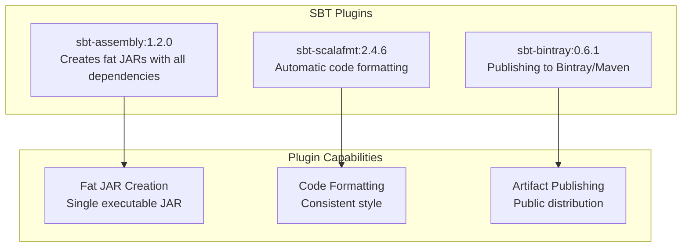
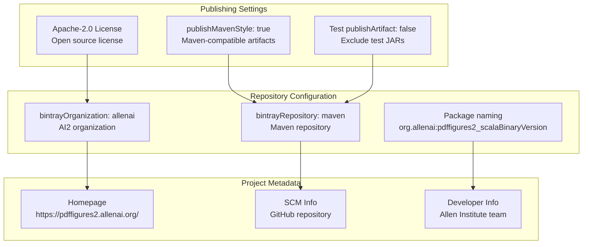

<!-- source: DeepWiki mcp.deepwiki.com · repo allenai/pdffigures2 · page 6.1 SBT Configuration · fetched 2026-10-26 -->

# SBT Configuration

Relevant source files

The following files were used as context for generating this wiki page:

- [build.sbt](build.sbt)
- [project/build.properties](project/build.properties)
- [project/plugins.sbt](project/plugins.sbt)

This document covers the SBT (Scala Build Tool) configuration for pdffigures2, including project settings, dependency management, cross-compilation setup, and build plugins. The configuration enables building a standalone JAR assembly and supports multiple Scala versions for compatibility.

For information about code quality tools and CI/CD pipeline configuration, see [Code Quality and CI/CD](#6.2).

## Build File Structure

The SBT configuration is organized across three key files that define the project structure and build behavior:

Sources: [build.sbt:1-74](), [project/plugins.sbt:1-6](), [project/build.properties:1-2]()

## Project Configuration

The root project configuration establishes the basic project identity and cross-compilation settings:

| Setting | Value | Purpose |
|---------|--------|---------|
| `organization` | `org.allenai` | Maven group identifier |
| `scalaVersion` | `2.12.16` | Default Scala version |
| `crossScalaVersions` | `[2.12.16, 2.11.12]` | Supported Scala versions |
| `version` | `0.1.0` | Project version |
| `name` | `pdffigures2` | Artifact name |

The project uses `ReloadOnSourceChanges` to automatically reload the build when source files change, improving development workflow.

Sources: [build.sbt:1-16]()

## Dependency Management

The build defines several categories of dependencies that support the core functionality:

The image format dependencies are commented out by default due to licensing restrictions but can be enabled for enhanced PDF image processing capabilities.

Sources: [build.sbt:27-48]()

## Cross-Compilation Setup

The build supports multiple Scala versions through the `crossScalaVersions` setting:

Scala 2.13 support is planned but not yet implemented due to required collections API changes.

Sources: [build.sbt:1-4](), [build.sbt:10](), [build.sbt:15]()

## Assembly Configuration

The build creates a fat JAR using the `sbt-assembly` plugin with specific configuration for the main class and merge strategies:

| Configuration | Value | Purpose |
|---------------|--------|---------|
| `mainClass` | `org.allenai.pdffigures2.FigureExtractorBatchCli` | Entry point for JAR execution |
| `assemblyOutputPath` | `pdffigures2.jar` | Output JAR filename |
| Merge Strategy | Custom rules | Handle conflicting files |

The assembly merge strategy handles common conflicts:
- Discards `module-info.class` files
- Uses first occurrence for Apache Commons conflicts
- Falls back to default strategy for other files

Sources: [build.sbt:63-73]()

## Plugin Configuration

Three essential plugins are configured to support the build process:

Sources: [project/plugins.sbt:1-6]()

## Publishing Configuration

The build includes comprehensive publishing settings for Maven Central compatibility:

The configuration includes proper SCM information, developer details, and licensing for public distribution through Bintray and Maven repositories.

Sources: [build.sbt:16-58]()

## SBT Version

The project uses SBT version `1.7.1` as specified in the build properties file. This version provides modern build features while maintaining compatibility with the plugin ecosystem.

Sources: [project/build.properties:1-2]()

---

