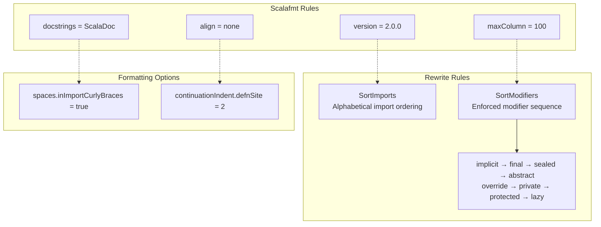
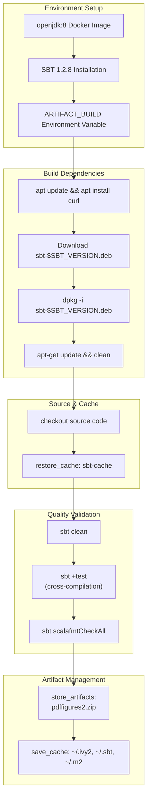
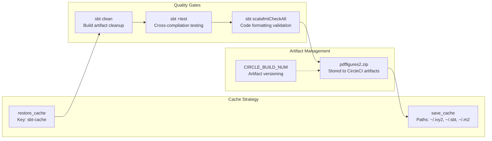

<!-- source: DeepWiki mcp.deepwiki.com · repo allenai/pdffigures2 · page 6.2 Code Quality and CI/CD · fetched 2026-10-26 -->

# Code Quality and CI/CD

Relevant source files

The following files were used as context for generating this wiki page:

- [.circleci/config.yml](.circleci/config.yml)
- [.scalafmt.conf](.scalafmt.conf)

This document covers the code quality standards and continuous integration/continuous deployment (CI/CD) pipeline for the pdffigures2 system. It details the automated formatting rules, testing workflows, and build validation processes that ensure consistent code quality across the project.

For information about the SBT build configuration and dependency management, see [SBT Configuration](#6.1). For details about the test suite implementation, see [Test Suite](#8.1).

## Code Formatting with Scalafmt

The project uses Scalafmt for consistent code formatting across all Scala source files. The configuration enforces strict formatting rules to maintain code readability and consistency.

### Scalafmt Configuration

The formatting rules are defined in [.scalafmt.conf:1-13]() with the following key settings:

| Setting | Value | Purpose |
|---------|--------|---------|
| `version` | 2.0.0 | Scalafmt engine version |
| `maxColumn` | 100 | Maximum line length |
| `docstrings` | ScalaDoc | Documentation format |
| `align` | none | Disable automatic alignment |
| `rewrite.rules` | SortImports, SortModifiers | Code transformation rules |

The modifier ordering is strictly enforced through [.scalafmt.conf:7-10]():
- `implicit`, `final`, `sealed`, `abstract`
- `override`, `private`, `protected`, `lazy`

**Scalafmt Configuration Details**

Sources: [.scalafmt.conf:1-13]()

## CircleCI Pipeline

The CI/CD pipeline runs on CircleCI using a Docker-based approach with comprehensive validation steps. The pipeline ensures all code changes meet quality standards before integration.

### Pipeline Configuration

The CircleCI configuration [.circleci/config.yml:1-41]() defines a single `build` job that runs in an OpenJDK 8 environment with SBT version 1.2.8.

**CI/CD Pipeline Flow**

Sources: [.circleci/config.yml:1-41]()

### Pipeline Steps Detail

The build process follows these sequential steps:

1. **Environment Setup** [.circleci/config.yml:4-8]()
   - Uses `openjdk:8` Docker image
   - Sets `SBT_VERSION` to 1.2.8
   - Configures artifact naming with build number

2. **SBT Installation** [.circleci/config.yml:12-18]()
   - Downloads SBT from Bintray repository
   - Installs via dpkg package manager
   - Performs system cleanup

3. **Source and Cache Management** [.circleci/config.yml:19-22]()
   - Checks out source code
   - Restores cached dependencies (`sbt-cache` key)

4. **Quality Validation Pipeline** [.circleci/config.yml:24-31]()
   - `sbt clean`: Removes build artifacts
   - `sbt +test`: Runs cross-compilation tests
   - `sbt scalafmtCheckAll`: Validates code formatting

5. **Artifact Storage** [.circleci/config.yml:32-40]()
   - Stores `pdffigures2.zip` as build artifact
   - Caches Ivy2, SBT, and Maven repositories

### Cross-Compilation Testing

The pipeline uses the `+test` command [.circleci/config.yml:28]() to run tests across multiple Scala versions, ensuring compatibility with different Scala compiler versions supported by the project.

**Quality Gates and Caching Strategy**

Sources: [.circleci/config.yml:20-40]()

## Development Workflow

The CI/CD pipeline enforces a development workflow where all code changes must pass three critical quality gates:

1. **Clean Build**: Ensures no build artifacts interfere with testing
2. **Cross-Platform Testing**: Validates functionality across Scala versions  
3. **Format Compliance**: Enforces consistent code style via Scalafmt

Any failure in these gates prevents code integration, maintaining code quality standards across the entire pdffigures2 codebase.

### Cache Optimization

The pipeline optimizes build times through strategic caching of:
- Ivy2 dependency cache (`~/.ivy2/cache`)
- SBT global settings (`~/.sbt`)
- Maven local repository (`~/.m2`)

This caching strategy significantly reduces build times for subsequent runs by avoiding repeated dependency downloads.

Sources: [.circleci/config.yml:35-40]()

---

