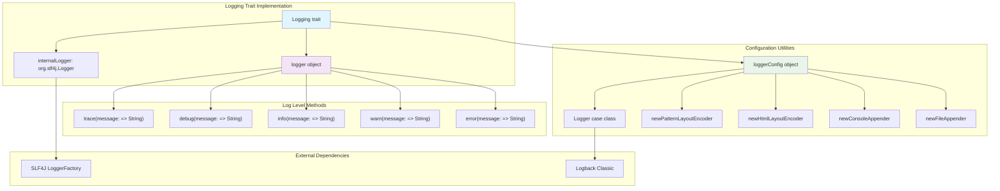
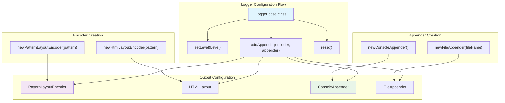
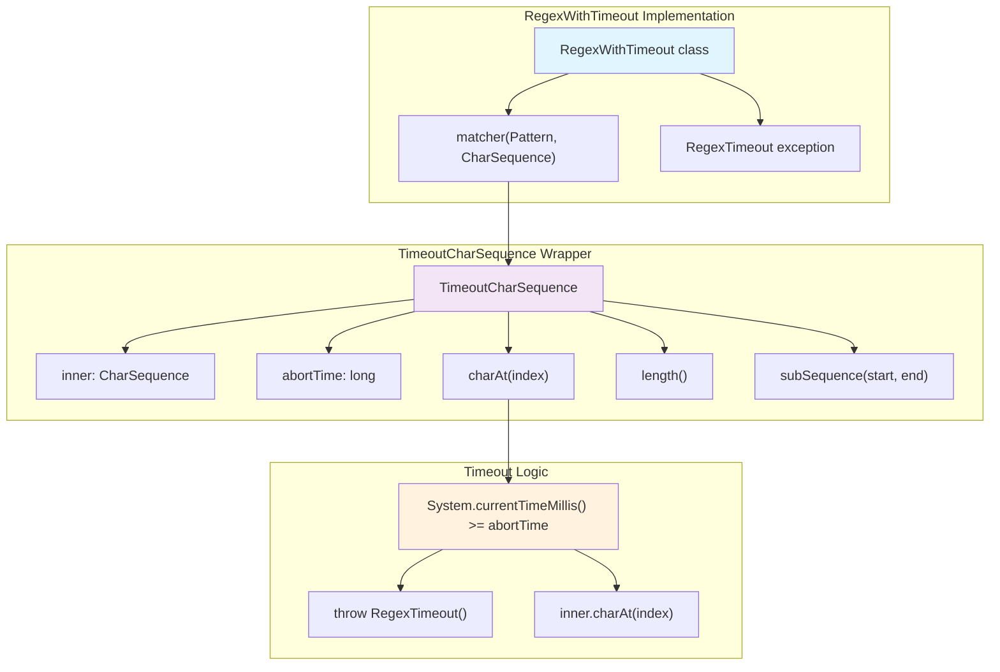
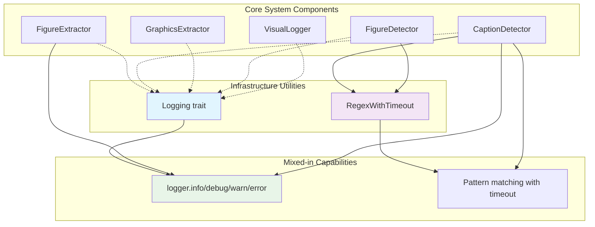

<!-- source: DeepWiki mcp.deepwiki.com · repo allenai/pdffigures2 · page 7 Utilities and Infrastructure · fetched 2026-10-26 -->

# Utilities and Infrastructure

Relevant source files

The following files were used as context for generating this wiki page:

- [src/main/java/org/allenai/pdffigures2/RegexWithTimeout.java](src/main/java/org/allenai/pdffigures2/RegexWithTimeout.java)
- [src/main/scala/org/allenai/pdffigures2/Logging.scala](src/main/scala/org/allenai/pdffigures2/Logging.scala)

This page covers the supporting utilities and infrastructure components that provide essential services across the pdffigures2 system. These include logging facilities, regex processing with timeout protection, and other cross-cutting infrastructure concerns that support the main extraction pipeline.

For information about the core extraction pipeline components, see [Core Processing Pipeline](#3). For build system configuration, see [Build System and Configuration](#6).

## Logging Infrastructure

The pdffigures2 system uses a comprehensive logging framework built around SLF4J and Logback, implemented through the `Logging` trait. This infrastructure provides structured logging capabilities with lazy evaluation for performance optimization.

### Logging Trait Architecture

**Sources:** [src/main/scala/org/allenai/pdffigures2/Logging.scala:1-161]()

### Lazy Message Evaluation

The logging system implements lazy evaluation for log messages using Scala's call-by-name parameters (`message: => String`). This optimization ensures that expensive string construction operations are only performed when the corresponding log level is actually enabled.

| Log Level | Method | Level Check | Exception Support |
|-----------|--------|-------------|-------------------|
| TRACE | `logger.trace()` | `isTraceEnabled` | No |
| DEBUG | `logger.debug()` | `isDebugEnabled` | No |
| INFO | `logger.info()` | `isInfoEnabled` | No |
| WARN | `logger.warn()` | `isWarnEnabled` | Yes |
| ERROR | `logger.error()` | `isErrorEnabled` | Yes |

**Sources:** [src/main/scala/org/allenai/pdffigures2/Logging.scala:24-57]()

### Logback Configuration API

The `loggerConfig` object provides a programmatic configuration API for Logback, allowing runtime configuration of loggers, appenders, and encoders:

**Sources:** [src/main/scala/org/allenai/pdffigures2/Logging.scala:75-160]()

## Regex Timeout Protection

The system includes specialized regex processing utilities that prevent infinite or long-running regular expression operations from blocking the extraction pipeline. This is implemented through the `RegexWithTimeout` Java class.

### Timeout Mechanism Architecture

**Sources:** [src/main/java/org/allenai/pdffigures2/RegexWithTimeout.java:1-45]()

### Timeout Implementation Details

The `RegexWithTimeout` class implements timeout protection by wrapping the input `CharSequence` with a proxy that checks the system time on each character access. Key implementation details:

| Component | Value | Purpose |
|-----------|-------|---------|
| Default Timeout | 1500ms | Prevents regex operations from hanging indefinitely |
| Time Check Location | `charAt()` method | Intercepts every character access during regex processing |
| Exception Type | `RegexTimeout` | Custom runtime exception for timeout conditions |
| Abort Time Calculation | `currentTimeMillis() + timeout` | Pre-computed absolute timeout timestamp |

The `TimeoutCharSequence` inner class wraps the original character sequence and delegates all operations while performing time checks:

- `charAt(index)`: Checks timeout before delegating to inner sequence
- `length()`: Direct delegation without timeout check
- `subSequence(start, end)`: Returns new `TimeoutCharSequence` with same abort time
- `toString()`: Direct delegation without timeout check

**Sources:** [src/main/java/org/allenai/pdffigures2/RegexWithTimeout.java:10-44]()

## Integration with Core System

The utilities and infrastructure components integrate with the core pdffigures2 system through trait mixins and direct usage patterns:

### Usage Patterns

The infrastructure components follow these integration patterns:

1. **Trait Mixing**: Core classes mix in the `Logging` trait to gain access to the `logger` object and its methods
2. **Defensive Programming**: Regex-intensive operations use `RegexWithTimeout.matcher()` instead of direct `Pattern.matcher()` calls
3. **Performance Optimization**: Lazy evaluation in logging prevents expensive string construction when logs are disabled
4. **Configuration Flexibility**: The `loggerConfig` API allows runtime reconfiguration of logging behavior for debugging

**Sources:** [src/main/scala/org/allenai/pdffigures2/Logging.scala:19-20](), [src/main/java/org/allenai/pdffigures2/RegexWithTimeout.java:10-43]()

---

