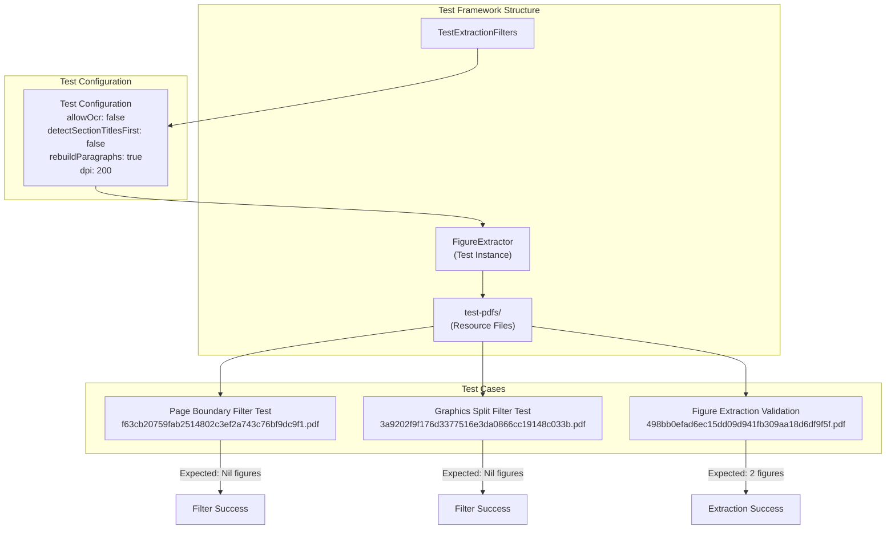
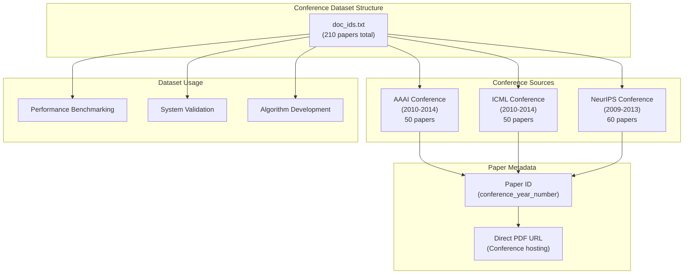
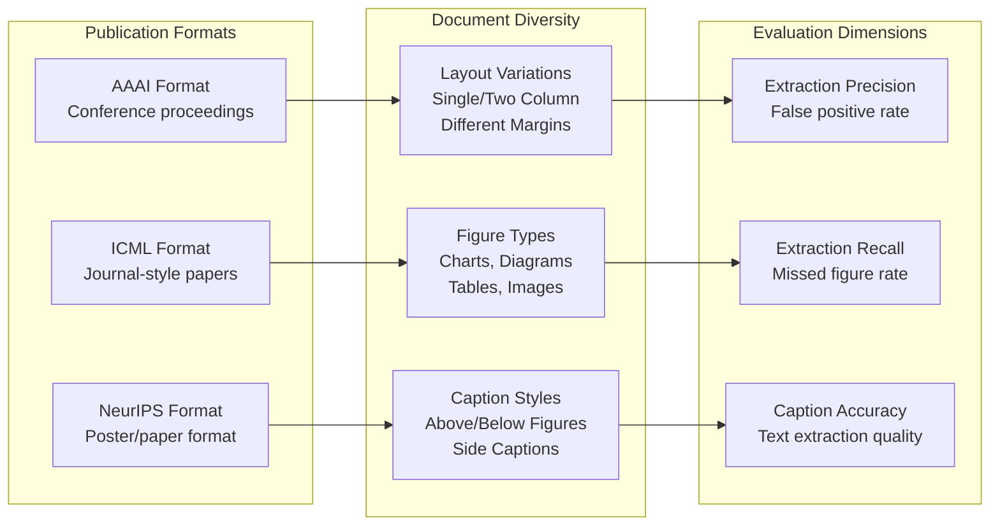
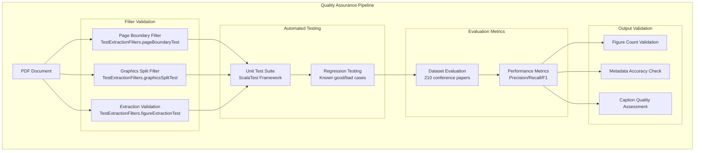

<!-- source: DeepWiki mcp.deepwiki.com · repo allenai/pdffigures2 · page 8 Testing and Evaluation · fetched 2026-10-26 -->

# Testing and Evaluation

Relevant source files

The following files were used as context for generating this wiki page:

- [evaluation/datasets/conference/doc_ids.txt](evaluation/datasets/conference/doc_ids.txt)
- [src/test/scala/org/allenai/pdffigures2/TestExtractionFilters.scala](src/test/scala/org/allenai/pdffigures2/TestExtractionFilters.scala)

This document covers the testing framework and evaluation datasets used to assess the quality and reliability of pdffigures2's figure extraction capabilities. The system employs both automated testing through unit tests and comprehensive evaluation using curated academic paper datasets.

For information about the build system configuration that supports testing, see [SBT Configuration](#6.1). For details about the core processing pipeline being tested, see [Core Processing Pipeline](#3).

## Test Suite Overview

The pdffigures2 test suite focuses on validating extraction filters that prevent false positive extractions. The primary test class `TestExtractionFilters` validates that figure extraction filters successfully catch and remove problematic extractions that would otherwise produce incorrect results.

**Sources:** [src/test/scala/org/allenai/pdffigures2/TestExtractionFilters.scala:1-78]()

### Test Case Categories

The test suite validates three critical aspects of figure extraction:

| Test Category | Purpose | Expected Outcome | Validation Method |
|---------------|---------|------------------|-------------------|
| Page Boundary Filter | Filters figures too close to page edges | Empty figure list | `assert(figures === Nil)` |
| Graphics Split Filter | Prevents splitting single figures | Empty figure list | `assert(figures === Nil)` |
| Successful Extraction | Validates correct figure detection | Specific figure count and metadata | Detailed assertions on figure properties |

**Test Configuration Parameters:**
- `allowOcr`: `false` - Disables OCR processing for consistent testing
- `detectSectionTitlesFirst`: `false` - Standard processing order
- `rebuildParagraphs`: `true` - Enables paragraph reconstruction
- `ignoreWhiteGraphics`: `true` - Filters out white/empty graphics
- `cleanRasterizedFigureRegions`: `true` - Enables figure region cleanup

Sources: [src/test/scala/org/allenai/pdffigures2/TestExtractionFilters.scala:10-21]()

### Specific Test Cases

#### Page Boundary Filter Test
Tests that figures violating spatial assumptions (side captions not spanning figure height) are properly filtered when they appear too close to page boundaries.

- **Test PDF:** `f63cb20759fab2514802c3ef2a743c76bf9dc9f1.pdf`
- **Paper:** "Ephaptic coupling of cortical neurons"
- **Issue:** Upward proposal identifies yellow header as figure
- **Expected Result:** No figures extracted due to boundary proximity

Sources: [src/test/scala/org/allenai/pdffigures2/TestExtractionFilters.scala:23-36]()

#### Graphics Split Filter Test
Validates that figures with non-standard caption formats (two-column captions) that cause figure splitting are properly filtered.

- **Test PDF:** `3a9202f9f176d3377516e3da0866cc19148c033b.pdf`
- **Paper:** "Intercellular calcium waves in glia"
- **Target:** Figure 3 on page 6
- **Issue:** Two-column caption causes figure to be split in half
- **Expected Result:** No figures extracted due to graphics splitting

Sources: [src/test/scala/org/allenai/pdffigures2/TestExtractionFilters.scala:38-51]()

#### Successful Extraction Validation Test
Ensures the extraction pipeline works correctly for well-formatted documents.

- **Test PDF:** `498bb0efad6ec15dd09d941fb309aa18d6df9f5f.pdf`
- **Paper:** "Open Information Extraction from the Web"
- **Expected Results:**
  - Total figures: 2
  - Figure 1: Type `FigureType.Figure`, Page 4, Name "1"
  - Table 1: Type `FigureType.Table`, Page 4, Name "1"

Sources: [src/test/scala/org/allenai/pdffigures2/TestExtractionFilters.scala:53-76]()

## Evaluation Datasets

The system includes a comprehensive evaluation dataset consisting of 210 academic papers from major AI/ML conferences. This dataset provides a diverse corpus for testing figure extraction across different document styles, layouts, and publication formats.

**Sources:** [evaluation/datasets/conference/doc_ids.txt:1-151]()

### Dataset Composition

The evaluation corpus spans multiple years and conferences to ensure comprehensive coverage of different document formats and figure types commonly found in academic publications.

| Conference | Years Covered | Papers per Year | Total Papers | URL Pattern |
|------------|---------------|-----------------|--------------|-------------|
| AAAI | 2010-2014 | 10 | 50 | `https://www.aaai.org/ocs/index.php/AAAI/...` |
| ICML | 2010-2014 | 10 | 50 | `http://icml.cc/` or `http://jmlr.org/proceedings/` |
| NeurIPS | 2009-2013 | 10-20 | 60 | `http://papers.nips.cc/paper/...` |

**Paper ID Format:** `{conference}{year}_{sequence_number}`
- Examples: `aaai10_1`, `icml12_5`, `nips13_7`

Sources: [evaluation/datasets/conference/doc_ids.txt:1-151]()

### Dataset Coverage Analysis

**Sources:** [evaluation/datasets/conference/doc_ids.txt:1-151]()

## Quality Assurance Framework

The testing and evaluation framework implements multiple layers of quality assurance to ensure reliable figure extraction across diverse document types.

**Sources:** [src/test/scala/org/allenai/pdffigures2/TestExtractionFilters.scala:1-78](), [evaluation/datasets/conference/doc_ids.txt:1-151]()

### Test Execution Environment

The testing framework uses specific configurations to ensure reproducible results:

- **Testing Framework:** ScalaTest `AnyFunSuite`
- **PDF Processing:** Apache PDFBox via `PDDocument.load()`
- **Resource Loading:** ClassLoader-based resource access for test PDFs
- **Assertion Strategy:** Exact matching for filtered results, detailed property validation for successful extractions

Sources: [src/test/scala/org/allenai/pdffigures2/TestExtractionFilters.scala:3-4](), [src/test/scala/org/allenai/pdffigures2/TestExtractionFilters.scala:15-21]()

---

