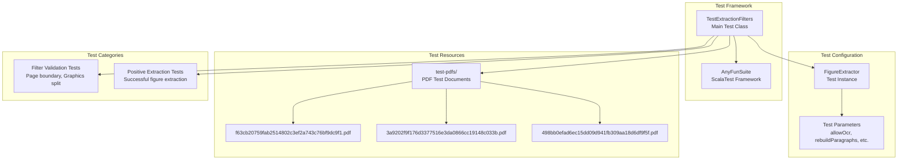
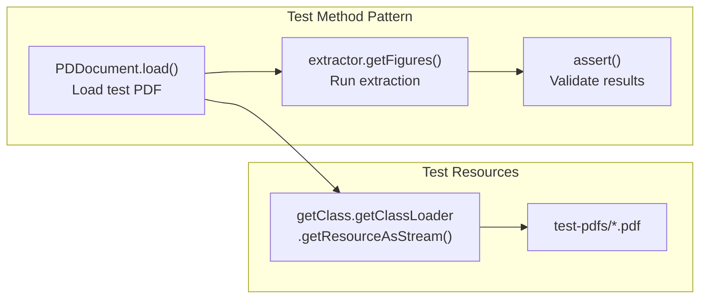
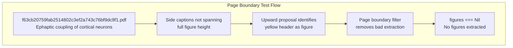
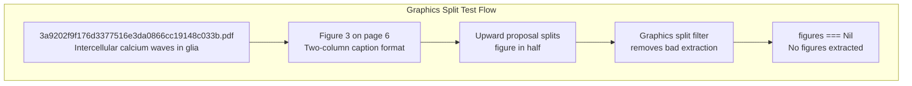
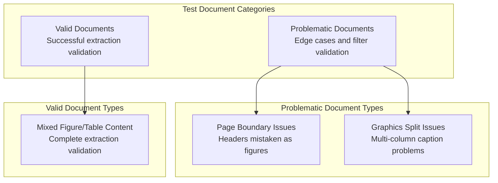

<!-- source: DeepWiki mcp.deepwiki.com · repo allenai/pdffigures2 · page 8.1 Test Suite · fetched 2026-10-26 -->

# Test Suite

Relevant source files

The following files were used as context for generating this wiki page:

- [src/test/scala/org/allenai/pdffigures2/TestExtractionFilters.scala](src/test/scala/org/allenai/pdffigures2/TestExtractionFilters.scala)

## Purpose and Scope

The test suite for pdffigures2 ensures the reliability and correctness of figure extraction filters and core functionality. This document covers the testing framework, test classes, and quality assurance mechanisms used to validate the system's behavior. For information about evaluation datasets used for performance benchmarking, see [Evaluation Datasets](#8.2). For details about the CI/CD pipeline configuration, see [Code Quality and CI/CD](#6.2).

## Test Framework Overview

The pdffigures2 test suite is built using ScalaTest's `AnyFunSuite` framework and focuses primarily on validating extraction filter behavior. The tests ensure that the system correctly identifies and filters out problematic figure extractions while preserving valid ones.

### Test Architecture

Sources: [src/test/scala/org/allenai/pdffigures2/TestExtractionFilters.scala:1-21]()

## TestExtractionFilters Class

The primary test class `TestExtractionFilters` validates that figure extraction filters successfully identify and remove problematic extractions. The class is configured with specific parameters to ensure consistent testing behavior.

### Test Configuration Parameters

| Parameter | Value | Purpose |
|-----------|--------|---------|
| `allowOcr` | `false` | Disables OCR processing for consistent results |
| `detectSectionTitlesFirst` | `false` | Uses standard section detection order |
| `rebuildParagraphs` | `true` | Enables paragraph reconstruction |
| `dpi` | `200` | Sets rendering resolution |
| `ignoreWhiteGraphics` | `true` | Filters out white/empty graphics |
| `cleanRasterizedFigureRegions` | `true` | Enables figure region cleanup |

### Test Method Structure

Sources: [src/test/scala/org/allenai/pdffigures2/TestExtractionFilters.scala:15-21]()

## Test Cases and Scenarios

The test suite includes three main test scenarios that validate different aspects of the extraction filter system.

### Page Boundary Filter Test

Tests that figures positioned too close to page boundaries are correctly filtered out. This addresses cases where the extraction algorithm incorrectly identifies page headers or margins as figure content.

**Test Implementation:** [src/test/scala/org/allenai/pdffigures2/TestExtractionFilters.scala:28-36]()

### Graphics Split Filter Test

Validates that figures incorrectly split by the extraction algorithm are filtered out. This test uses a paper with two-column caption formatting that confuses the upward proposal mechanism.

**Test Implementation:** [src/test/scala/org/allenai/pdffigures2/TestExtractionFilters.scala:43-51]()

### Positive Extraction Test

Ensures that valid figures are correctly extracted and not filtered out. This test validates both figure and table extraction with detailed assertion checking.

#### Extracted Figure Validation

| Property | Expected Value | Assertion |
|----------|----------------|-----------|
| Figure Type | `FigureType.Figure` | `figures(0).figType === FigureType.Figure` |
| Figure Name | `"1"` | `figures(0).name === "1"` |
| Page Number | `4` | `figures(0).page === 4` |
| Caption Content | Full caption text | String comparison |

#### Extracted Table Validation

| Property | Expected Value | Assertion |
|----------|----------------|-----------|
| Figure Type | `FigureType.Table` | `figures(1).figType === FigureType.Table` |
| Table Name | `"1"` | `figures(1).name === "1"` |
| Page Number | `4` | `figures(1).page === 4` |
| Caption Content | Table description | String comparison |

**Test Implementation:** [src/test/scala/org/allenai/pdffigures2/TestExtractionFilters.scala:56-76]()

## Test Data and Resources

The test suite relies on carefully selected PDF documents stored in the `test-pdfs/` resource directory. Each PDF is chosen to exercise specific edge cases or validation scenarios.

### Test PDF Selection Criteria

Sources: [src/test/scala/org/allenai/pdffigures2/TestExtractionFilters.scala:29-32](), [src/test/scala/org/allenai/pdffigures2/TestExtractionFilters.scala:44-47](), [src/test/scala/org/allenai/pdffigures2/TestExtractionFilters.scala:57-61]()

## Integration with Build System

The test suite integrates with the SBT build system and continuous integration pipeline to ensure code quality and regression prevention.

### Testing Commands

| Command | Purpose |
|---------|---------|
| `sbt test` | Run all tests |
| `sbt testOnly TestExtractionFilters` | Run specific test class |
| `sbt testQuick` | Run tests affected by recent changes |

### CI/CD Integration

The tests are automatically executed as part of the CircleCI pipeline, ensuring that all code changes are validated before merging. The test results contribute to the overall build success criteria.

Sources: [src/test/scala/org/allenai/pdffigures2/TestExtractionFilters.scala:1-78]()

---

