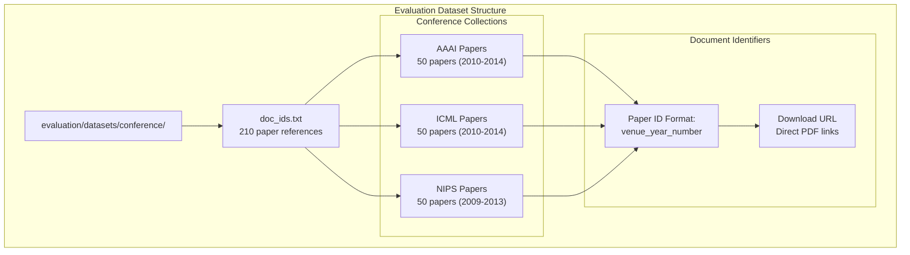
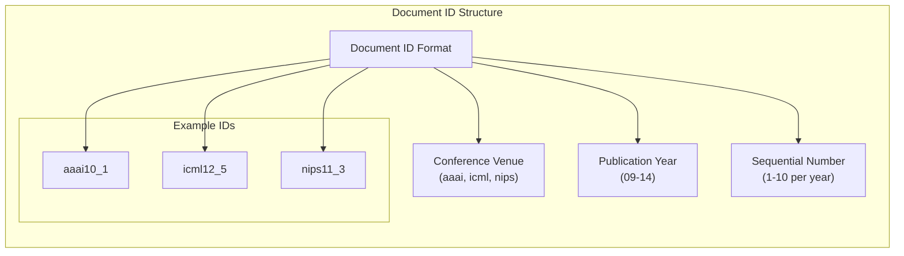
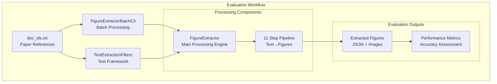
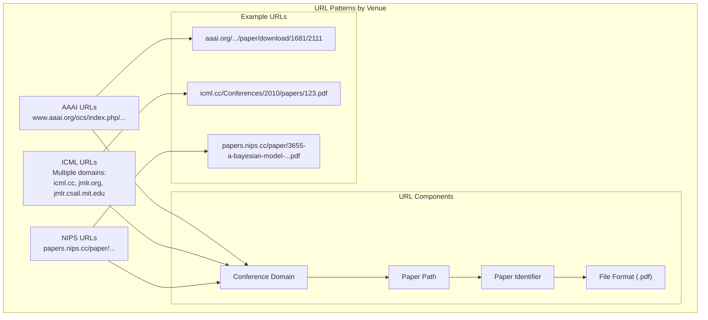

<!-- source: DeepWiki mcp.deepwiki.com · repo allenai/pdffigures2 · page 8.2 Evaluation Datasets · fetched 2026-10-26 -->

# Evaluation Datasets

Relevant source files

The following files were used as context for generating this wiki page:

- [evaluation/datasets/conference/doc_ids.txt](evaluation/datasets/conference/doc_ids.txt)

This page documents the standardized evaluation datasets used to assess the performance and accuracy of the PDFFigures2 figure extraction system. These datasets consist of curated collections of academic papers from major conferences, providing a consistent benchmark for evaluating extraction quality across different document types and formatting styles.

For information about the testing framework and test execution, see [Test Suite](#8.1).

## Dataset Structure and Organization

The evaluation datasets are organized in a hierarchical structure under the `evaluation/datasets/conference/` directory. The primary dataset consists of 210 academic papers from three major conferences, each representing different communities and document formatting conventions.

Sources: [evaluation/datasets/conference/doc_ids.txt:1-151]()

## Conference Paper Collections

The evaluation dataset encompasses papers from three premier venues in artificial intelligence and machine learning, providing diverse document styles and formatting approaches for comprehensive evaluation.

### Dataset Composition

| Conference | Years | Paper Count | Document ID Format | Source URLs |
|------------|-------|-------------|-------------------|-------------|
| AAAI | 2010-2014 | 50 papers | `aaai{year}_{number}` | aaai.org conference proceedings |
| ICML | 2010-2014 | 50 papers | `icml{year}_{number}` | icml.cc and jmlr.org proceedings |
| NIPS | 2009-2013 | 50 papers | `nips{year}_{number}` | papers.nips.cc proceedings |

### Document Identifier Schema

Each paper in the evaluation dataset follows a consistent naming convention that encodes venue, year, and sequence information:

Sources: [evaluation/datasets/conference/doc_ids.txt:1-50](), [evaluation/datasets/conference/doc_ids.txt:51-100](), [evaluation/datasets/conference/doc_ids.txt:101-150]()

## Dataset Integration with Processing Pipeline

The evaluation datasets integrate with the PDFFigures2 system through the batch processing infrastructure and testing framework, enabling automated evaluation and performance benchmarking.

Sources: [evaluation/datasets/conference/doc_ids.txt:1-151]()

## Academic Paper Characteristics

The evaluation dataset is specifically designed to test figure extraction across the diverse formatting conventions found in academic literature. Each conference collection presents unique challenges for the extraction system.

### Venue-Specific Document Properties

- **AAAI Papers**: Traditional AI conference format with consistent two-column layouts, standard figure placement conventions, and uniform caption styling
- **ICML Papers**: Machine learning papers featuring complex mathematical figures, algorithm diagrams, and experimental result visualizations
- **NIPS Papers**: Neural information processing papers with dense graphical content, including network architectures, performance plots, and theoretical diagrams

### Document Format Variations

The dataset captures important formatting variations that impact extraction accuracy:

- Single-column vs. two-column layouts
- Different caption positioning (above/below figures)
- Varied figure numbering schemes
- Mixed content types (tables, plots, diagrams, photographs)
- Different PDF generation methods and quality levels

Sources: [evaluation/datasets/conference/doc_ids.txt:1-151]()

## URL Structure and Access Patterns

The evaluation dataset maintains stable references to academic papers through conference-specific URL patterns, ensuring reproducible access to evaluation materials.

Sources: [evaluation/datasets/conference/doc_ids.txt:1-50](), [evaluation/datasets/conference/doc_ids.txt:51-100](), [evaluation/datasets/conference/doc_ids.txt:101-150]()

## Evaluation Methodology

The standardized evaluation dataset enables consistent performance assessment across different versions of the PDFFigures2 system and comparison with other figure extraction approaches.

### Dataset Usage Patterns

The evaluation dataset supports multiple assessment scenarios:

1. **Regression Testing**: Ensuring that system changes don't degrade extraction quality on known documents
2. **Performance Benchmarking**: Measuring extraction accuracy, precision, and recall across different document types  
3. **Comparative Evaluation**: Establishing baseline performance metrics for comparison with other extraction systems
4. **Error Analysis**: Identifying systematic extraction failures and areas for improvement

### Integration with Test Infrastructure

The evaluation datasets work in conjunction with the test suite infrastructure to provide automated quality assessment:

- Document processing through `FigureExtractorBatchCli` for bulk evaluation
- Integration with `TestExtractionFilters` for systematic testing
- Support for parallel processing of evaluation documents
- Standardized output formats for metrics collection and analysis

Sources: [evaluation/datasets/conference/doc_ids.txt:1-151]()