# Page: Overview

# Overview

<details>
<summary>Relevant source files</summary>

The following files were used as context for generating this wiki page:

- [README.md](README.md)
- [build.sbt](build.sbt)

</details>


This document introduces PDFFigures 2.0, a Scala-based system for extracting figures, tables, captions, and section titles from scholarly PDF documents. It provides a high-level system overview, core architecture, and entry points for users and developers.

For detailed installation instructions and quick start examples, see [Installation and Quick Start](#1.1). For deep technical details about the processing pipeline, see [Core Processing Pipeline](#3). For build system configuration, see [Build System and Configuration](#6).

## System Purpose and Capabilities

PDFFigures 2.0 is designed to extract structured information from scholarly PDF documents, with a focus on computer science domain papers. The system processes PDF files through an 11-step pipeline to identify and extract figures, tables, their captions, and associated metadata.

**Primary Capabilities:**
- Figure and table detection with bounding box coordinates
- Caption extraction and association with figures
- Text extraction and classification 
- Section title identification (experimental)
- Multi-format output including JSON and rasterized images
- Batch processing with parallel execution
- Debug visualization for development

**Core Output Information:**
- Page location (0-based indexing)
- Bounding box coordinates (72 DPI pixel coordinates)
- Caption text and bounding box
- Figure name derived from caption
- Classification as Figure or Table
- Text content within figures

Sources: [README.md:1-29](), [build.sbt:8-11]()

## High-Level System Architecture

The system follows a modular architecture with two primary user interfaces and a shared processing engine:

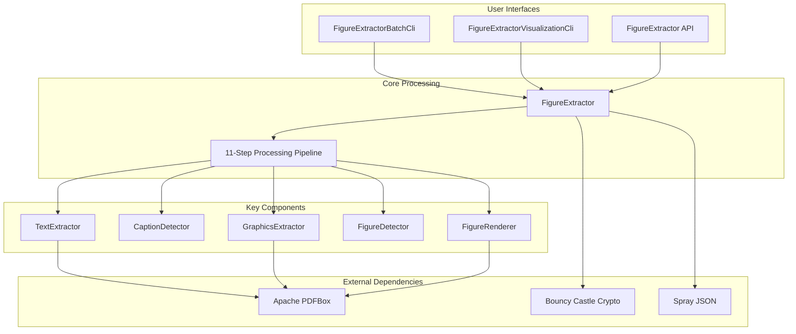

Sources: [README.md:44-89](), [build.sbt:63-65]()

## Processing Pipeline Overview

The system transforms PDF documents through an 11-step sequential pipeline, where each step produces intermediate representations that feed into subsequent processing stages:

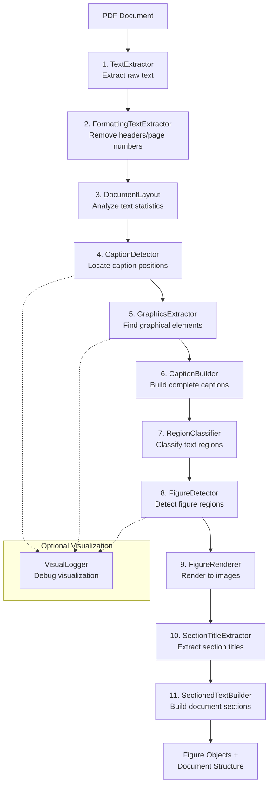

**Key Processing Classes:**

| Step | Class | Purpose |
|------|-------|---------|
| 1 | `TextExtractor` | Extract text from PDF using PDFBox |
| 2 | `FormattingTextExtractor` | Remove page headers, numbers, abstracts |
| 3 | `DocumentLayout` | Gather text statistics for anomaly detection |
| 4 | `CaptionDetector` | Identify caption start positions |
| 5 | `GraphicsExtractor` | Locate non-textual elements |
| 6 | `CaptionBuilder` | Complete caption text extraction |
| 7 | `RegionClassifier` | Classify text as BodyText or Other |
| 8 | `FigureDetector` | Propose and score figure regions |
| 9 | `FigureRenderer` | Render figures to image formats |
| 10-11 | Section processing | Extract section structure (experimental) |

Sources: [README.md:92-117]()

## Command-Line Interfaces

PDFFigures 2.0 provides two primary CLI tools with distinct use cases:

**Batch Processing CLI (`FigureExtractorBatchCli`)**
- Main entry point for production use
- Processes multiple PDFs with parallel execution
- Configurable output formats and locations
- Statistical reporting

**Visualization CLI (`FigureExtractorVisualizationCli`)**  
- Single PDF processing with debug output
- Visual step-by-step pipeline inspection
- Development and troubleshooting tool

```bash
# Basic figure extraction
sbt "runMain org.allenai.pdffigures2.FigureExtractorVisualizationCli /path/to/pdf"

# Batch processing with image output
sbt "runMain org.allenai.pdffigures2.FigureExtractorBatchCli /pdf/directory/ -s stats.json -m /images/prefix -d /data/prefix"

# Standalone JAR compilation
sbt assembly  # Creates pdffigures2.jar
```

Sources: [README.md:44-70](), [build.sbt:63-66]()

## Dependencies and Build System

The system is built using SBT with cross-compilation support for Scala 2.11 and 2.12:

**Core Dependencies:**

| Library | Version | Purpose |
|---------|---------|---------|
| `apache.pdfbox` | 2.0.26 | PDF parsing and rendering |
| `bouncycastle` | 1.71 | PDF security/encryption handling |
| `spray-json` | 1.3.6 | JSON serialization |
| `scopt` | 4.1.0 | Command-line argument parsing |
| `logback-classic` | 1.2.11 | Logging framework |
| `typesafe.config` | 1.4.2 | Configuration management |

**Build Configuration:**
- Organization: `org.allenai`
- Cross-compilation: Scala 2.11.12, 2.12.16
- Apache 2.0 license
- Maven-style publishing to Bintray

**Optional Image Format Dependencies:**
For extended image format support (disabled by default due to licensing):
- `jai-imageio-core` for additional image formats
- `jai-imageio-jpeg2000` for JPEG2000 support  
- `levigo-jbig2-imageio` for JBIG2 support

Sources: [build.sbt:1-48](), [README.md:34-42]()

## Output Formats and Integration

The system supports multiple output formats for different integration scenarios:

**Figure Object Structure:**
- JSON serialization via Spray JSON protocols
- Programmatic access through Scala APIs
- Image export in BufferedImage-compatible formats (PNG, JPEG)
- Experimental vector graphics support via `pdftocairo`

**Document Structure Output:**
- Page-based figure listings
- Section-based document organization
- Text classification and region analysis
- Statistical metadata about processing

The `FigureExtractor` class provides the primary programmatic interface, with methods for both single-document and batch processing scenarios.

Sources: [README.md:6-29](), [README.md:84-89](), [build.sbt:28]()

---

# Page: Installation and Quick Start

# Installation and Quick Start

<details>
<summary>Relevant source files</summary>

The following files were used as context for generating this wiki page:

- [README.md](README.md)
- [build.sbt](build.sbt)

</details>


This document provides complete installation instructions and basic usage examples for PDFFigures2. It covers system prerequisites, building from source, and running the command-line tools to extract figures from scholarly documents.

For detailed information about the processing pipeline and architecture, see [System Architecture](#2). For advanced CLI usage and configuration options, see [Command Line Interface](#4).

## Prerequisites

PDFFigures2 requires the following system components:

| Component | Version | Purpose |
|-----------|---------|---------|
| Java | 8 or higher | Runtime environment |
| SBT | 1.7.1+ | Build tool for Scala projects |
| Scala | 2.11.12 or 2.12.16 | Programming language runtime |

### Optional Dependencies

For enhanced image format support, you may add these dependencies to your project (disabled by default due to licensing restrictions):

```scala
"com.github.jai-imageio" % "jai-imageio-core" % "1.4.0"
"com.github.jai-imageio" % "jai-imageio-jpeg2000" % "1.4.0"  // JPEG2000 images
"com.levigo.jbig2" % "levigo-jbig2-imageio" % "2.0"        // JBIG2 images
```

**Installation Flow**
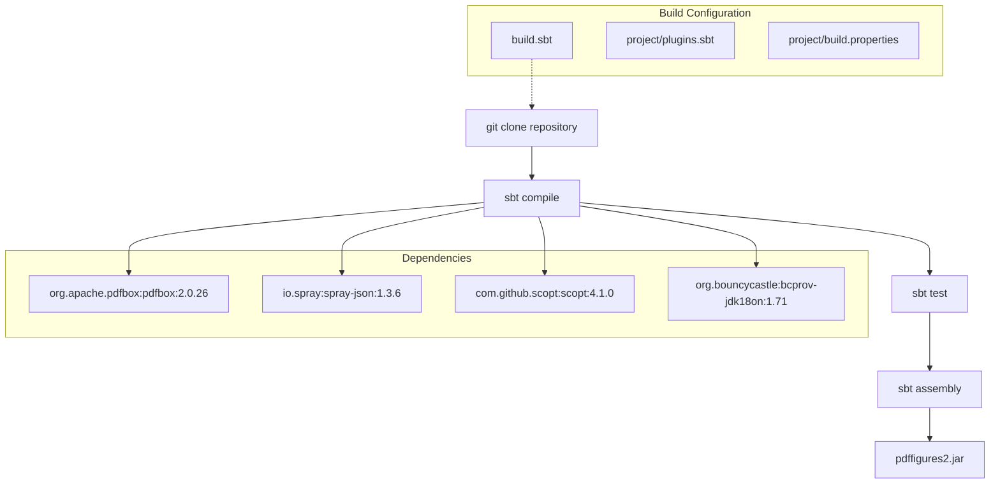

Sources: [build.sbt:1-74](), [README.md:31-42]()

## Installation Steps

### 1. Clone Repository

```bash
git clone https://github.com/allenai/pdffigures2.git
cd pdffigures2
```

### 2. Build with SBT

Compile the project and run tests:

```bash
sbt compile
sbt test
```

### 3. Create Standalone JAR

Generate the executable JAR file:

```bash
sbt assembly
```

This creates `pdffigures2.jar` in the project root, as configured in [build.sbt:65](). The JAR contains all dependencies and uses `FigureExtractorBatchCli` as the main class ([build.sbt:64]()).

Sources: [build.sbt:63-66](), [README.md:68-70]()

## CLI Tools Overview

PDFFigures2 provides two main command-line interfaces:

**CLI Tools Architecture**
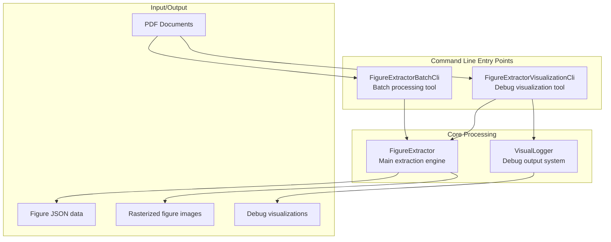

Sources: [README.md:44-47](), [build.sbt:63-64]()

## Quick Start Examples

### Single PDF Visualization

Preview extraction results for a single PDF:

```bash
sbt "runMain org.allenai.pdffigures2.FigureExtractorVisualizationCli /path/to/document.pdf"
```

### Debug Parsing Visualization  

View how the PDF structure was analyzed:

```bash
sbt "runMain org.allenai.pdffigures2.FigureExtractorVisualizationCli /path/to/document.pdf" -r
```

### Complete Debug Output

Generate visualizations for all processing steps:

```bash
sbt "runMain org.allenai.pdffigures2.FigureExtractorVisualizationCli /path/to/document.pdf" -s
```

### Batch Processing

Process multiple PDFs with output to files:

```bash
sbt "runMain org.allenai.pdffigures2.FigureExtractorBatchCli /path/to/pdf_directory/ -s stats.json -m /figures/images/ -d /figures/data/"
```

### Using Standalone JAR

After running `sbt assembly`:

```bash
java -Dsun.java2d.cmm=sun.java2d.cmm.kcms.KcmsServiceProvider -jar pdffigures2.jar /path/to/pdf_directory/ -s stats.json -m /figures/images/ -d /figures/data/
```

Sources: [README.md:49-70]()

## Quick Start Workflow

**Processing Workflow**
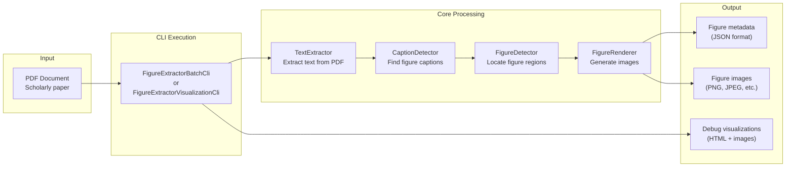

Sources: [README.md:6-29](), [README.md:92-118]()

## Performance Optimization

For optimal PDF parsing performance, use the recommended JVM flag:

```bash
java -Dsun.java2d.cmm=sun.java2d.cmm.kcms.KcmsServiceProvider -jar pdffigures2.jar [options]
```

This flag improves PDFBox performance as documented in the Apache PDFBox getting started guide.

Sources: [README.md:47]()

## Verification

To verify your installation works correctly:

1. **Test with sample PDF**: Run the visualization CLI on any scholarly PDF
2. **Check output**: Verify JSON output contains figure objects with bounding boxes, captions, and metadata  
3. **Validate images**: Confirm rasterized figure images are generated when using image output options

Expected output structure includes:
- Page numbers (0-based indexing)
- Bounding boxes in 72 DPI coordinates  
- Caption text and locations
- Figure names extracted from captions
- Figure/Table classification

Sources: [README.md:6-20]()

## Next Steps

After successful installation:

- **Understanding the Architecture**: See [System Architecture](#2) for the 11-step processing pipeline
- **Advanced CLI Usage**: See [Batch Processing CLI](#4.1) and [Visualization CLI](#4.2) for detailed options
- **Integration**: See [JSON Serialization](#5.3) for programmatic interface details
- **Configuration**: See [SBT Configuration](#6.1) for build customization

For troubleshooting common issues, see [Common Sources of Errors](#1) in the main overview.

Sources: [README.md:84-85](), [README.md:123-143]()

---

# Page: System Architecture

# System Architecture

<details>
<summary>Relevant source files</summary>

The following files were used as context for generating this wiki page:

- [README.md](README.md)
- [src/main/scala/org/allenai/pdffigures2/FigureExtractor.scala](src/main/scala/org/allenai/pdffigures2/FigureExtractor.scala)

</details>


This document explains the overall architecture of PDFFigures 2.0, including the main system components, processing pipeline, data flow, and how the various modules interact to extract figures and captions from scholarly PDF documents. For specific details about individual pipeline steps, see [Core Processing Pipeline](#3). For information about the command-line interfaces, see [Command Line Interface](#4).

## System Overview

PDFFigures 2.0 is designed as a modular pipeline-based system with multiple entry points and a clear separation between processing stages. The system provides both programmatic APIs and command-line interfaces for different use cases.

### Entry Points and Main Components

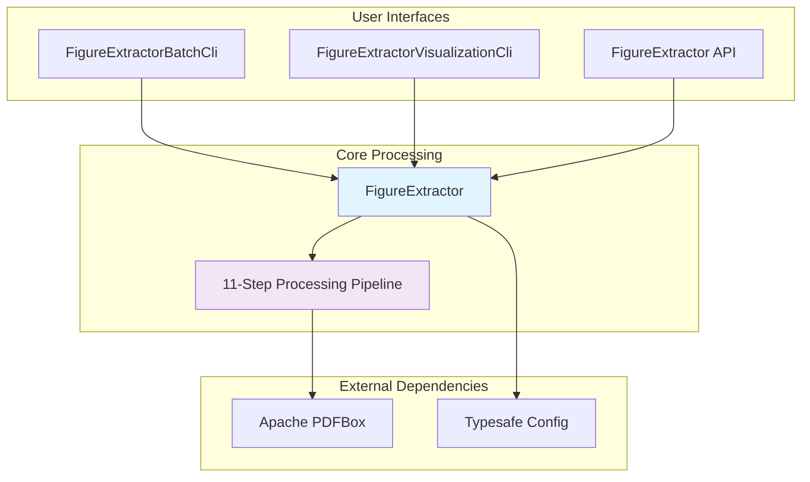

The system architecture centers around the `FigureExtractor` class, which serves as the main orchestrator. It provides several methods for different extraction scenarios:

- `getFigures()`: Basic figure extraction returning `Figure` objects
- `getRasterizedFigures()`: Extraction with image rendering to `RasterizedFigure` objects  
- `getFiguresWithText()`: Full document analysis returning `Document` with sections
- `getFiguresWithErrors()`: Extraction with error reporting via `FiguresInDocument`

**Sources:** [src/main/scala/org/allenai/pdffigures2/FigureExtractor.scala:15-300](), [README.md:44-90]()

### Processing Pipeline Architecture

The core of PDFFigures 2.0 is an 11-step processing pipeline that progressively transforms raw PDF data into structured figure extractions. Each step builds upon the previous one, creating increasingly sophisticated intermediate representations.

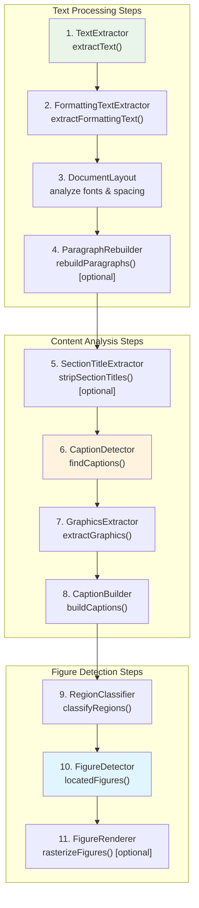

The pipeline is implemented in the `parseDocument()` method of `FigureExtractor`, which coordinates the execution of each step and handles intermediate data transformations.

**Sources:** [README.md:91-118](), [src/main/scala/org/allenai/pdffigures2/FigureExtractor.scala:130-198]()

## Data Flow and Transformations

The system transforms data through several key intermediate representations, each building upon the previous one with additional extracted information.

### Data Structure Evolution

```mermaid
graph LR
    subgraph "Input"
        PDDoc["PDDocument<br/>(PDFBox)"]
    end
    
    subgraph "Text Representations"
        PageText["PageWithText"]
        PageFormat["PageWithFormattingText"] 
        PageClass["PageWithClassifiedText"]
    end
    
    subgraph "Graphics Representations"
        PageGraphics["PageWithGraphics"]
        PageCaptions["PageWithCaptions"]
        PageRegions["PageWithBodyText"]
    end
    
    subgraph "Figure Representations"
        PageFigures["PageWithFigures"]
        DocContent["DocumentContent"]
        Document["Document"]
    end
    
    PDDoc --> PageText
    PageText --> PageFormat
    PageFormat --> PageClass
    PageClass --> PageGraphics
    PageGraphics --> PageCaptions
    PageCaptions --> PageRegions
    PageRegions --> PageFigures
    PageFigures --> DocContent
    DocContent --> Document
    
    style PDDoc fill:#ffebee
    style PageFigures fill:#e3f2fd
    style Document fill:#e8f5e8
```

Each transformation adds specific capabilities:

| Stage | Input Type | Output Type | Key Information Added |
|-------|------------|-------------|----------------------|
| Text Extraction | `PDDocument` | `PageWithText` | Raw text with positioning |
| Formatting Removal | `PageWithText` | `PageWithFormattingText` | Headers/footers removed |
| Layout Analysis | `PageWithFormattingText` | `DocumentLayout` | Font statistics, column detection |
| Graphics Extraction | `PageWithClassifiedText` | `PageWithGraphics` | Non-text elements identified |
| Caption Building | `PageWithGraphics` | `PageWithCaptions` | Complete caption text |
| Region Classification | `PageWithCaptions` | `PageWithBodyText` | Text regions classified |
| Figure Detection | `PageWithBodyText` | `PageWithFigures` | Figure bounding boxes |

**Sources:** [src/main/scala/org/allenai/pdffigures2/FigureExtractor.scala:207-226](), [src/main/scala/org/allenai/pdffigures2/FigureExtractor.scala:134-198]()

## Core Component Relationships

The system's modularity is achieved through clear separation of concerns among its core components. Each major component handles a specific aspect of the extraction pipeline.

### Component Dependency Graph

```mermaid
graph TB
    subgraph "Orchestration Layer"
        FigureExtractor["FigureExtractor<br/>Main orchestrator"]
        VisualLogger["VisualLogger<br/>Debug visualization"]
    end
    
    subgraph "Text Processing Components"
        TextExtractor["TextExtractor"]
        FormattingTextExtractor["FormattingTextExtractor"] 
        DocumentLayout["DocumentLayout"]
        ParagraphRebuilder["ParagraphRebuilder"]
        SectionTitleExtractor["SectionTitleExtractor"]
    end
    
    subgraph "Content Analysis Components"
        CaptionDetector["CaptionDetector"]
        CaptionBuilder["CaptionBuilder"]
        GraphicsExtractor["GraphicsExtractor"]
        RegionClassifier["RegionClassifier"]
    end
    
    subgraph "Figure Detection Components"
        FigureDetector["FigureDetector"]
        FigureRenderer["FigureRenderer"]
    end
    
    subgraph "Support Components"
        SectionedTextBuilder["SectionedTextBuilder"]
        JsonProtocol["JsonProtocol"]
        Logging["Logging trait"]
    end
    
    FigureExtractor --> TextExtractor
    FigureExtractor --> FormattingTextExtractor
    FigureExtractor --> DocumentLayout
    FigureExtractor --> ParagraphRebuilder
    FigureExtractor --> SectionTitleExtractor
    FigureExtractor --> CaptionDetector
    FigureExtractor --> CaptionBuilder
    FigureExtractor --> GraphicsExtractor
    FigureExtractor --> RegionClassifier
    FigureExtractor --> FigureDetector
    FigureExtractor --> FigureRenderer
    FigureExtractor --> SectionedTextBuilder
    FigureExtractor --> VisualLogger
    FigureExtractor --> Logging
    
    style FigureExtractor fill:#e1f5fe
    style VisualLogger fill:#fff3e0
```

The `FigureExtractor` class manages the coordination between components, handling configuration parameters and optional processing steps based on constructor parameters:

- `allowOcr`: Controls processing of OCR-generated PDFs
- `ignoreWhiteGraphics`: Skips colorless graphics for performance
- `detectSectionTitlesFirst`: Orders section title extraction
- `rebuildParagraphs`: Enables paragraph reconstruction
- `cleanRasterizedFigureRegions`: Applies post-processing cleanup

**Sources:** [src/main/scala/org/allenai/pdffigures2/FigureExtractor.scala:15-21](), [src/main/scala/org/allenai/pdffigures2/FigureExtractor.scala:290-298]()

## Configuration and Build Architecture

The system uses a layered configuration approach with SBT for build management and Typesafe Config for runtime configuration.

### Build System Structure

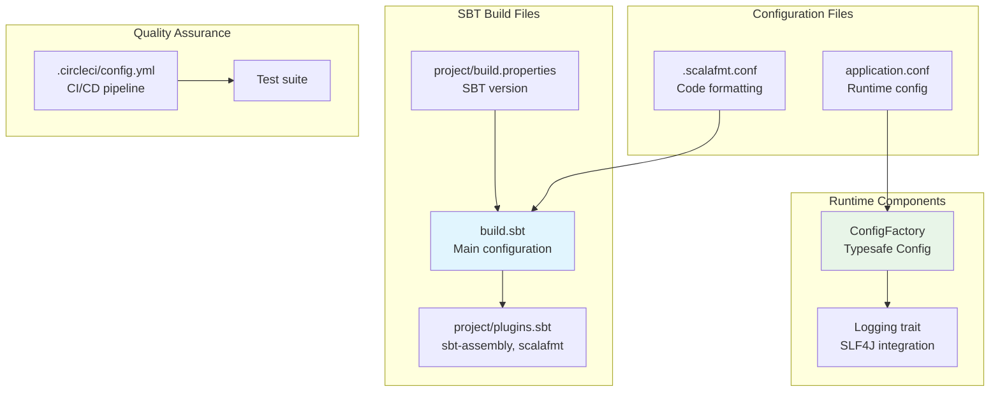

The build system supports:
- Cross-compilation for multiple Scala versions
- Fat JAR assembly via `sbt assembly`
- Automated code formatting with scalafmt
- Continuous integration through CircleCI
- Dependency management for PDF processing libraries

The `FigureExtractor` integrates with the configuration system through the `ConfigFactory` import and extends the `Logging` trait for structured logging throughout the pipeline.

**Sources:** [src/main/scala/org/allenai/pdffigures2/FigureExtractor.scala:10](), [README.md:68-70]()

---

# Page: Core Processing Pipeline

# Core Processing Pipeline

<details>
<summary>Relevant source files</summary>

The following files were used as context for generating this wiki page:

- [README.md](README.md)
- [src/main/scala/org/allenai/pdffigures2/FigureExtractor.scala](src/main/scala/org/allenai/pdffigures2/FigureExtractor.scala)

</details>


This page covers the core processing pipeline that orchestrates figure extraction from PDF documents. The pipeline consists of 11 sequential steps that transform a raw PDF document into extracted figures with metadata. For information about specific processing components like text extraction and caption detection, see [Text Extraction and Processing](#3.1), [Caption Detection and Building](#3.3), and [Graphics and Figure Detection](#3.4).

The pipeline is orchestrated by the `FigureExtractor` class, which provides multiple output formats including basic figures, rasterized images, and documents with sectioned text. This page focuses on the overall architecture and data flow rather than the details of individual processing steps.

## Pipeline Architecture

The core pipeline transforms PDF documents through a series of intermediate representations, each adding more structured information about the document's content and layout.

### Processing Steps Overview

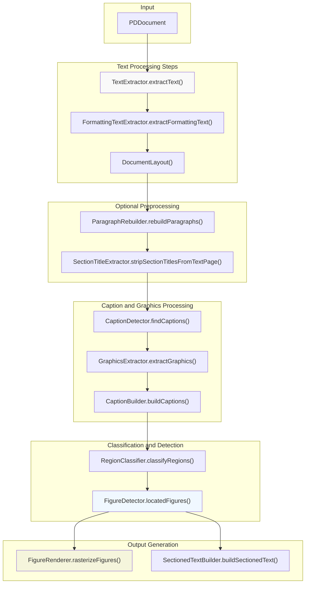

**Pipeline Data Flow and Component Responsibilities**

Sources: [README.md:92-118](), [src/main/scala/org/allenai/pdffigures2/FigureExtractor.scala:130-198]()

### Data Structure Evolution

The pipeline progressively enriches data structures as documents move through processing steps:

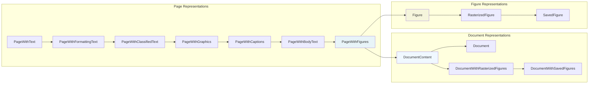

**Progressive Data Enrichment Through Pipeline Stages**

Sources: [src/main/scala/org/allenai/pdffigures2/FigureExtractor.scala:207-226](), [src/main/scala/org/allenai/pdffigures2/FigureExtractor.scala:232-260]()

## FigureExtractor Orchestration

The `FigureExtractor` class serves as the main orchestrator, providing multiple public interfaces while managing the internal processing pipeline.

### Core Processing Method

The `parseDocument` method implements the complete pipeline:

| Step | Component | Input Type | Output Type | Purpose |
|------|-----------|------------|-------------|---------|
| 1 | `TextExtractor` | `PDDocument` | `PageWithText` | Extract raw text from PDF |
| 2 | `FormattingTextExtractor` | `PageWithText` | `PageWithFormattingText` | Remove headers, page numbers |
| 3 | `DocumentLayout` | `PageWithFormattingText` | `DocumentLayout` | Analyze fonts, spacing, layout |
| 4 | `ParagraphRebuilder` | `PageWithFormattingText` | `PageWithFormattingText` | Rebuild paragraph structure (optional) |
| 5 | `SectionTitleExtractor` | `PageWithFormattingText` | `PageWithFormattingText` | Extract section titles (optional) |
| 6 | `CaptionDetector` | `PageWithFormattingText` | `CaptionStart` | Identify caption locations |
| 7 | `GraphicsExtractor` | `PageWithFormattingText` | `PageWithGraphics` | Extract graphical elements |
| 8 | `CaptionBuilder` | `PageWithGraphics` | `PageWithCaptions` | Build complete captions |
| 9 | `RegionClassifier` | `PageWithCaptions` | `PageWithBodyText` | Classify text regions |
| 10 | `FigureDetector` | `PageWithBodyText` | `PageWithFigures` | Locate figure regions |
| 11 | `FigureRenderer` | `PageWithFigures` | `RasterizedFigure` | Render figures to images (optional) |

Sources: [src/main/scala/org/allenai/pdffigures2/FigureExtractor.scala:130-198](), [README.md:92-118]()

### Configuration and Behavior Control

The `FigureExtractor` constructor accepts configuration parameters that control pipeline behavior:

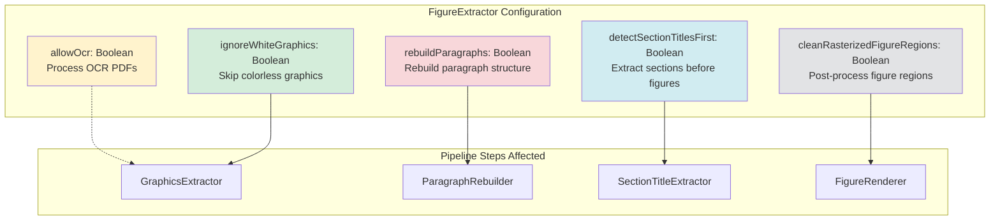

**FigureExtractor Configuration Parameters and Their Effects**

Sources: [src/main/scala/org/allenai/pdffigures2/FigureExtractor.scala:15-21](), [src/main/scala/org/allenai/pdffigures2/FigureExtractor.scala:266-298]()

## Public Interface Methods

The `FigureExtractor` provides multiple methods for different use cases, all built on the same core pipeline:

### Output Format Methods

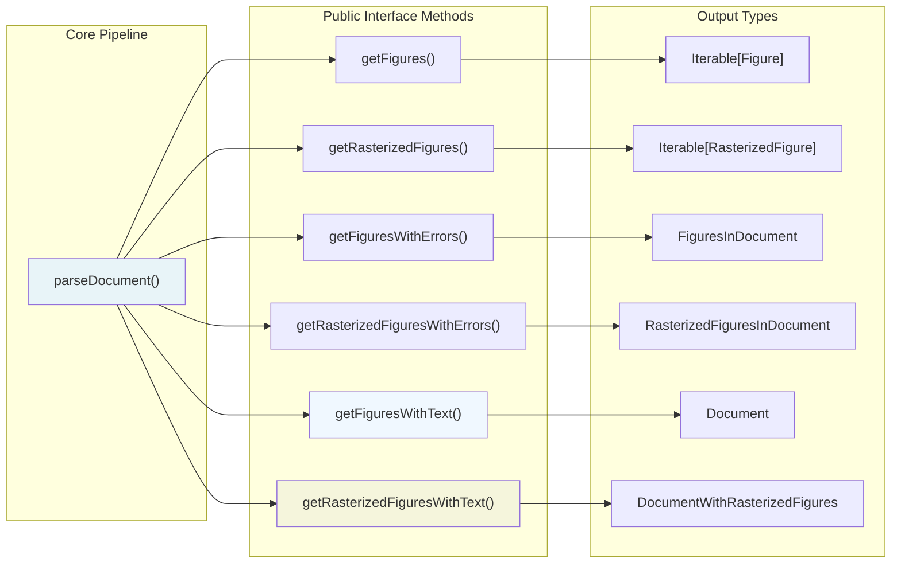

**Public Interface Methods and Their Output Types**

Sources: [src/main/scala/org/allenai/pdffigures2/FigureExtractor.scala:22-97]()

### Error Handling and Interruption

The pipeline includes robust error handling and supports interruption:

- **Thread Interruption**: The pipeline checks `Thread.interrupted()` at key points and can be safely cancelled
- **Failed Captions**: Captions that cannot be processed are tracked in `failedCaptions` collections
- **OCR Detection**: PDFs requiring OCR processing can be detected and optionally rejected
- **Layout Validation**: Documents without sufficient layout information skip figure detection

Sources: [src/main/scala/org/allenai/pdffigures2/FigureExtractor.scala:138-141](), [src/main/scala/org/allenai/pdffigures2/FigureExtractor.scala:161](), [README.md:88]()

## DocumentContent Structure

The `DocumentContent` case class represents the complete processing result:

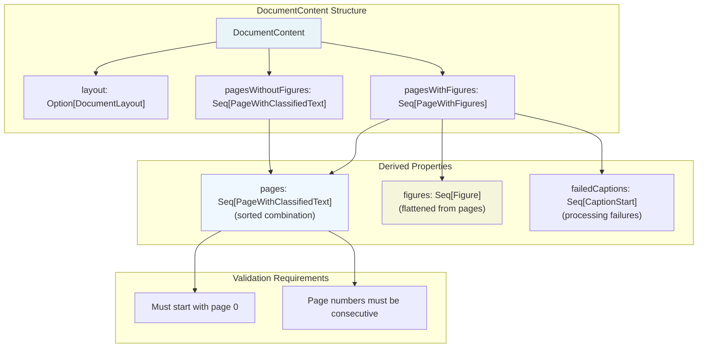

**DocumentContent Structure and Validation Requirements**

Sources: [src/main/scala/org/allenai/pdffigures2/FigureExtractor.scala:207-226]()

## Section and Abstract Processing

The pipeline includes additional processing for document structure:

### Section Processing Logic

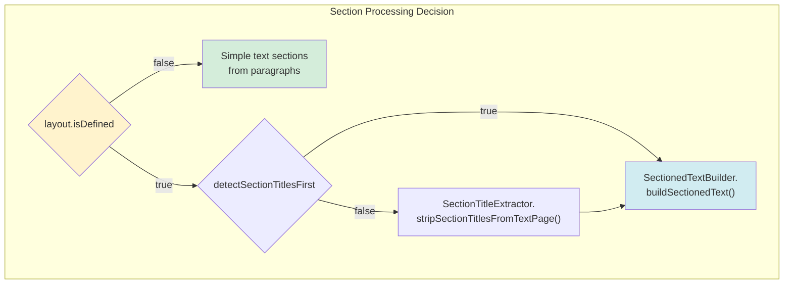

**Section Processing Decision Logic**

### Abstract Extraction

The `getAbstract` method locates abstract text by finding the first page with classified abstract text and wrapping it in a `PdfText` structure.

Sources: [src/main/scala/org/allenai/pdffigures2/FigureExtractor.scala:99-127](), [src/main/scala/org/allenai/pdffigures2/FigureExtractor.scala:115-127]()

---

# Page: Text Extraction and Processing

# Text Extraction and Processing

<details>
<summary>Relevant source files</summary>

The following files were used as context for generating this wiki page:

- [src/main/scala/org/allenai/pdffigures2/FormattingTextExtractor.scala](src/main/scala/org/allenai/pdffigures2/FormattingTextExtractor.scala)
- [src/main/scala/org/allenai/pdffigures2/Paragraph.scala](src/main/scala/org/allenai/pdffigures2/Paragraph.scala)
- [src/main/scala/org/allenai/pdffigures2/SectionTitleExtractor.scala](src/main/scala/org/allenai/pdffigures2/SectionTitleExtractor.scala)
- [src/main/scala/org/allenai/pdffigures2/SectionedTextBuilder.scala](src/main/scala/org/allenai/pdffigures2/SectionedTextBuilder.scala)

</details>


This document covers the text extraction and processing components that form the early stages of the PDFFigures2 pipeline. These components take raw text extracted from PDF documents and transform it into structured, cleaned text ready for further analysis. The processing includes formatting text removal, text normalization, paragraph reconstruction, and section title identification.

For information about document layout analysis and font processing, see [Document Layout Analysis](#3.2). For caption detection that operates on the processed text output, see [Caption Detection and Building](#3.3).

## Core Text Data Structures

The text processing pipeline operates on a hierarchical structure of text elements, from individual character positions up to complete paragraphs.

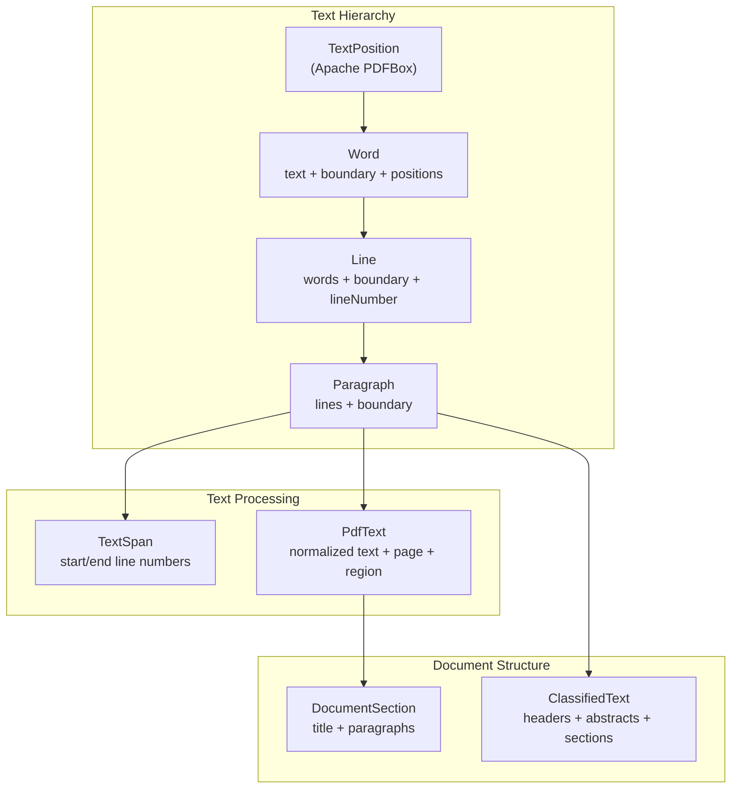

**Sources:** [src/main/scala/org/allenai/pdffigures2/Paragraph.scala:150-164](), [src/main/scala/org/allenai/pdffigures2/SectionedTextBuilder.scala:10-46]()

The `Word` class contains the raw text, bounding box, and original `TextPosition` objects from PDFBox. `Line` objects group words that appear on the same horizontal line, while `Paragraph` objects group related lines together. The `TextSpan` class represents spans of text by line numbers for efficient text manipulation.

| Class | Key Properties | Purpose |
|-------|---------------|---------|
| `Word` | `text`, `boundary`, `positions` | Basic text unit with spatial information |
| `Line` | `words`, `boundary`, `lineNumber` | Horizontal grouping of words |
| `Paragraph` | `lines`, `boundary`, `span` | Logical text block |
| `TextSpan` | `start`, `end` | Line number range for text operations |

## Formatting Text Extraction

The `FormattingTextExtractor` identifies and removes non-content text elements like headers, page numbers, and abstracts that can interfere with figure detection algorithms.

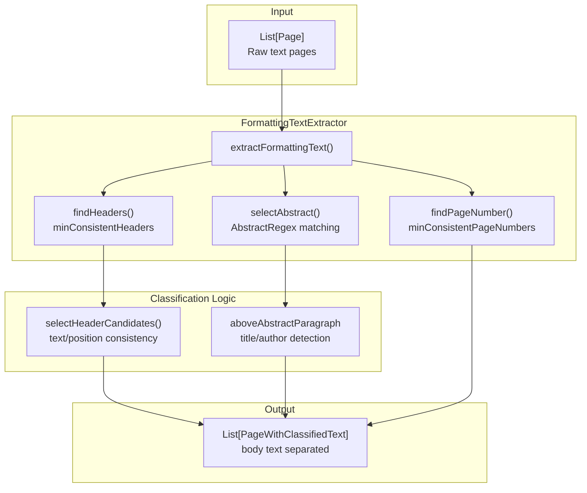

**Sources:** [src/main/scala/org/allenai/pdffigures2/FormattingTextExtractor.scala:44-89](), [src/main/scala/org/allenai/pdffigures2/FormattingTextExtractor.scala:102-148](), [src/main/scala/org/allenai/pdffigures2/FormattingTextExtractor.scala:197-278]()

The extractor uses several heuristics:

- **Headers**: Identifies consistent text at the top of multiple pages, either by identical text content or consistent positioning
- **Page Numbers**: Detects numeric patterns at the bottom of pages using `PageNumberRegex`
- **Abstracts**: Uses `AbstractRegex` pattern `"^(Abstract|ABSTRACT)(((—|-)[a-zA-Z]*)|.)?$"` to find abstract sections
- **Cover Pages**: Marks pages before the abstract as formatting-only content

The minimum consistency threshold prevents false positives by requiring headers/page numbers to appear on most pages before classification.

## Section Title Detection

The `SectionTitleExtractor` identifies section headings in academic papers through a combination of formatting analysis and content heuristics.

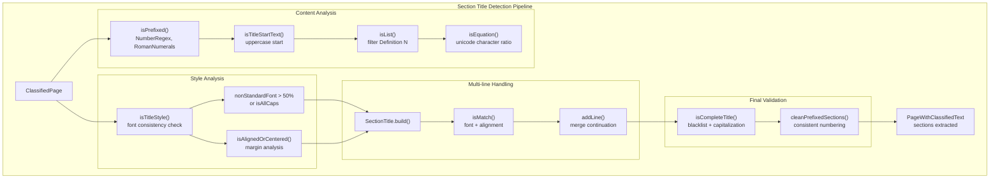

**Sources:** [src/main/scala/org/allenai/pdffigures2/SectionTitleExtractor.scala:21-32](), [src/main/scala/org/allenai/pdffigures2/SectionTitleExtractor.scala:59-86](), [src/main/scala/org/allenai/pdffigures2/SectionTitleExtractor.scala:296-370]()

### Detection Heuristics

The section title detection uses multiple regex patterns and formatting rules:

| Pattern Type | Regex | Purpose |
|--------------|-------|---------|
| Numbers | `^[1-9][0-9]*(.[1-9][0-9]*)*.?$` | "1.", "2.3.1" style numbering |
| Roman Numerals | `^[IVX]+.?$` | "I.", "IV." style numbering |
| Letter Numbers | `^[A-Z](.|[1-9]*.?)$` | "A.", "B.1" style numbering |
| Appendix | `^(?i)appendix.?$` | Case-insensitive appendix detection |

The `isTitleStyle` function checks for formatting consistency within a line, requiring same font usage across ASCII characters and detecting non-standard fonts or all-caps formatting.

### Multi-line Title Handling

Section titles can span multiple lines. The `SectionTitle` case class tracks in-progress titles and uses `isMatch` to determine if subsequent lines continue the same section:

- Font and font size consistency
- Alignment patterns (left-aligned, centered, or second-word aligned)
- Hyphenation handling for word breaks

## Text Normalization and Processing

Text normalization handles Unicode characters, hyphenation, and text cleaning to produce consistent output.

```mermaid
graph TD
    subgraph "Text Normalization Pipeline"
        RawText["Raw Word Text"]
        
        subgraph "Unicode Processing"
            UnicodeNorm["normalizeWord()<br/>NFKC normalization"]
            SpecialChars["0xFB00-0xFDFF<br/>0xFE70-0xFEFF ranges"]
            UnprintableRegex["unprintableRegex<br/>\\p{Cc}\\p{Cf}\\p{Co}\\p{Cn}"]
        end
        
        subgraph "Paragraph Assembly"
            ParaConvert["convertToNormalizedString()<br/>hyphen removal"]
            HyphenCheck["lastWord.last == '-'<br/>+ isLetter check"]
            SpaceJoin["mkString with spaces"]
        end
        
        subgraph "Text Span Operations"
            RemoveSpans["removeSpans()<br/>TextSpan removal"]
            ParagraphSplit["split/truncate paragraphs"]
        end
        
        NormalizedText["Normalized Text Output"]
    end
    
    RawText --> UnicodeNorm
    UnicodeNorm --> SpecialChars
    SpecialChars --> UnprintableRegex
    UnprintableRegex --> ParaConvert
    ParaConvert --> HyphenCheck
    HyphenCheck --> SpaceJoin
    SpaceJoin --> RemoveSpans
    RemoveSpans --> ParagraphSplit
    ParagraphSplit --> NormalizedText
```

**Sources:** [src/main/scala/org/allenai/pdffigures2/Paragraph.scala:19-48](), [src/main/scala/org/allenai/pdffigures2/Paragraph.scala:50-73](), [src/main/scala/org/allenai/pdffigures2/Paragraph.scala:83-136]()

The normalization process includes:

1. **Unicode Normalization**: Uses Java's `Normalizer.Form.NFKC` for consistent character representation
2. **Hyphenation Handling**: Removes hyphens at line ends when they represent word breaks
3. **Unprintable Character Removal**: Filters control characters and formatting marks
4. **Text Span Removal**: Efficiently removes specific line ranges while preserving paragraph structure

The `removeSpans` method can split paragraphs when removing interior lines, creating multiple smaller paragraphs as needed.

## Document Section Building

The `SectionedTextBuilder` combines cleaned text with identified section titles to create a structured document representation.

```mermaid
graph TD
    subgraph "Section Building Process"
        ClassifiedPages["List[ClassifiedPage]<br/>body text + section titles"]
        
        subgraph "Per-Page Processing"
            MergeInSections["mergeInSections()<br/>recursive section assembly"]
            HeaderSort["sectionTitles.sorted<br/>by line number"]
            ParagraphSort["paragraphs.sorted<br/>by line number"]
        end
        
        subgraph "Cross-Page Merging"
            CrossPageMerge["foldLeft merging<br/>titleless sections"]
            SectionContinue["cur.last + nextPage.head<br/>when title.isEmpty"]
        end
        
        subgraph "Output Structure"
            DocumentSection["DocumentSection<br/>title: Option[PdfText]<br/>paragraphs: Seq[PdfText]"]
            PdfTextConvert["PdfText(paragraph, page)<br/>normalized text + location"]
        end
        
        FinalSections["Seq[DocumentSection]<br/>structured document"]
    end
    
    ClassifiedPages --> HeaderSort
    ClassifiedPages --> ParagraphSort
    HeaderSort --> MergeInSections
    ParagraphSort --> MergeInSections
    MergeInSections --> CrossPageMerge
    CrossPageMerge --> DocumentSection
    DocumentSection --> PdfTextConvert
    PdfTextConvert --> FinalSections
```

**Sources:** [src/main/scala/org/allenai/pdffigures2/SectionedTextBuilder.scala:48-95](), [src/main/scala/org/allenai/pdffigures2/SectionedTextBuilder.scala:104-134]()

The section building algorithm:

1. **Per-page Assembly**: Uses `mergeInSections` to recursively assign paragraphs to section titles based on line number ordering
2. **Cross-page Continuation**: Sections without titles at page starts are merged with the previous page's final section
3. **PdfText Conversion**: Converts paragraphs to `PdfText` objects that include normalized text, page numbers, and spatial regions

This produces a sequence of `DocumentSection` objects where each section has an optional title and associated body paragraphs, maintaining spatial and page information for later processing stages.

---

# Page: Document Layout Analysis

# Document Layout Analysis

<details>
<summary>Relevant source files</summary>

The following files were used as context for generating this wiki page:

- [src/main/scala/org/allenai/pdffigures2/DocumentLayout.scala](src/main/scala/org/allenai/pdffigures2/DocumentLayout.scala)

</details>


## Purpose and Scope

The Document Layout Analysis component analyzes the structural characteristics of PDF documents to understand their formatting patterns, column layouts, and text organization. This analysis produces a `DocumentLayout` object that captures essential document-level statistics used by downstream components for caption detection, figure region identification, and text classification.

This component operates on preprocessed text data from the text extraction phase (see [Text Extraction and Processing](#3.1)) and provides layout insights used by caption detection and graphics extraction (see [Caption Detection and Building](#3.3) and [Graphics and Figure Detection](#3.4)).

## DocumentLayout Data Structure

The `DocumentLayout` case class stores comprehensive document-level statistics that characterize the document's formatting patterns:

| Field | Type | Purpose |
|-------|------|---------|
| `twoColumns` | `Boolean` | Whether document uses two-column layout |
| `fontCounts` | `Map[PDFont, Double]` | Relative frequency of each font |
| `standardFontSize` | `Option[Double]` | Most common font size (if >50% usage) |
| `averageFontSize` | `Double` | Weighted average font size |
| `averageWordSpacing` | `Double` | Average horizontal spacing between words |
| `trustLeftMargin` | `Boolean` | Whether left margins are consistent enough to trust |
| `leftMargins` | `Map[Int, Double]` | Distribution of left margin positions |
| `medianLineSpacing` | `Double` | Median vertical spacing between lines |
| `standardWidthBucketed` | `Option[Double]` | Most common line width (if >40% usage) |

Sources: [src/main/scala/org/allenai/pdffigures2/DocumentLayout.scala:8-31]()

## Layout Analysis Process

The layout analysis process examines text across all pages to extract statistical patterns about document formatting:

```mermaid
flowchart TD
    Pages["textPages: Seq[Page]"] --> Process["DocumentLayout.apply()"]
    
    Process --> WordSpacing["Calculate Word Spacing"]
    Process --> FontAnalysis["Analyze Fonts & Sizes"] 
    Process --> MarginAnalysis["Analyze Left Margins"]
    Process --> LineAnalysis["Analyze Line Widths & Spacing"]
    
    WordSpacing --> Stats["Accumulate Statistics"]
    FontAnalysis --> Stats
    MarginAnalysis --> Stats
    LineAnalysis --> Stats
    
    Stats --> Validate["Validate Sufficient Data"]
    Validate -->|"totalWordSpaces == 0 || totalChars == 0"| None["Return None"]
    Validate -->|"Sufficient data"| Compute["Compute Layout Metrics"]
    
    Compute --> TwoColumnCheck["Two-Column Detection"]
    Compute --> FontMetrics["Standard Font Size"]
    Compute --> TrustMargins["Margin Trust Analysis"]
    Compute --> WeightedMedian["weightedMedian() for Line Spacing"]
    
    TwoColumnCheck --> Layout["DocumentLayout"]
    FontMetrics --> Layout
    TrustMargins --> Layout
    WeightedMedian --> Layout
    
    Layout --> Some["Some(DocumentLayout)"]
```

The analysis iterates through all `Page` objects, examining each `Paragraph`, `Line`, and `Word` to collect statistics. The process accumulates data in mutable maps for efficiency: `leftMargins`, `fontCounts`, `lineWidths`, `fontSizeCounts`, and `lineSpacing`.

Sources: [src/main/scala/org/allenai/pdffigures2/DocumentLayout.scala:67-116]()

## Two-Column Detection Algorithm

The two-column detection algorithm analyzes left margin patterns to determine document layout:

```mermaid
flowchart TD
    LeftMargins["leftMargins: Map[Int, Int]"] --> Sort["sortedLeftMargins.take(2)"]
    Sort --> Check["top2Margins.size >= 2?"]
    
    Check -->|No| SingleColumn["twoColumn = false"]
    Check -->|Yes| CompareUsage["Compare Usage Counts"]
    
    CompareUsage --> UsageDiff["usageDiff = |count1 - count2| / (count1 + count2)"]
    CompareUsage --> XDiff["xDiff = |margin1 - margin2|"]
    
    UsageDiff --> ThresholdCheck["usageDiff < TwoColumnMaxUsageDifference"]
    XDiff --> XThresholdCheck["xDiff > TwoColumnMaxXDifference"]
    
    ThresholdCheck --> And["Both conditions met?"]
    XThresholdCheck --> And
    
    And -->|Yes| TwoColumn["twoColumn = true"]
    And -->|No| SingleColumn
    
    TwoColumn --> LogDebug1["logger.debug('Document was two column')"]
    SingleColumn --> LogDebug2["logger.debug('Document was not two column')"]
```

**Key Constants:**
- `TwoColumnMaxUsageDifference = 0.40`: Maximum relative difference in margin usage
- `TwoColumnMaxXDifference = 0.40`: Minimum horizontal separation between columns

The algorithm identifies two-column layouts by finding two dominant left margin positions with similar usage counts but significant horizontal separation.

Sources: [src/main/scala/org/allenai/pdffigures2/DocumentLayout.scala:37-38, 143-160]()

## Font and Spacing Analysis

The system performs detailed analysis of typography and spacing patterns:

### Font Size Analysis
- **Standard Font Size**: Determined when a single font size accounts for >50% of all characters
- **Average Font Size**: Weighted average across all character positions
- Character positions from `PDFBox` provide accurate font and size information

### Spacing Measurements
- **Word Spacing**: Calculated from horizontal gaps between adjacent words in lines
- **Line Spacing**: Uses `weightedMedian()` function to find typical vertical spacing
- **Line Width Buckets**: Groups similar line widths using `LineWidthBucketSize = 2`

The `weightedMedian()` function implements a specialized algorithm for finding the median of weighted values, ensuring that outlier spacing doesn't skew the results.

Sources: [src/main/scala/org/allenai/pdffigures2/DocumentLayout.scala:35, 50-65, 125-141]()

## Margin Analysis and Trust Determination  

The system evaluates whether left margins are consistent enough to trust for downstream processing:

| Layout Type | Threshold | Margins Considered |
|-------------|-----------|-------------------|
| Two-column | `TrustMarginsTwoColumnThreshold = 0.65` | Top 6 margins |
| Single-column | `TrustMarginsOneColumnThreshold = 0.55` | Top 3 margins |

```mermaid
flowchart TD
    ColumnType{"twoColumn?"}
    
    ColumnType -->|True| TwoColMargins["Take top 6 margins<br/>(TrustMarginsNumMarginsToCount * 2)"]
    ColumnType -->|False| OneColMargins["Take top 3 margins<br/>(TrustMarginsNumMarginsToCount)"]
    
    TwoColMargins --> TwoColSum["Sum percentages"]
    OneColMargins --> OneColSum["Sum percentages"]
    
    TwoColSum --> TwoColCheck["sum > 0.65?"]
    OneColSum --> OneColCheck["sum > 0.55?"]
    
    TwoColCheck -->|True| Trust["trustLeftMargin = true"]
    TwoColCheck -->|False| NoTrust["trustLeftMargin = false"]
    OneColCheck -->|True| Trust
    OneColCheck -->|False| NoTrust
    
    NoTrust --> LogWarning["logger.debug('Margins appear to be inconsistent')"]
```

When margins are deemed untrustworthy, downstream components avoid margin-based heuristics for caption detection and figure region identification.

Sources: [src/main/scala/org/allenai/pdffigures2/DocumentLayout.scala:42-44, 168-179]()

## Integration with Processing Pipeline

The `DocumentLayout` analysis occurs early in the processing pipeline and its results influence multiple downstream components:

- **Caption Detection**: Uses `trustLeftMargin`, `twoColumns`, and spacing metrics
- **Figure Detection**: Leverages layout statistics for region proposals  
- **Text Classification**: Applies font and margin analysis for content categorization

The layout analysis can fail and return `None` when insufficient text is extracted, typically indicating a problematic PDF or extraction failure. This graceful degradation allows the pipeline to continue with reduced functionality.

Sources: [src/main/scala/org/allenai/pdffigures2/DocumentLayout.scala:120-124]()

---

# Page: Caption Detection and Building

# Caption Detection and Building

<details>
<summary>Relevant source files</summary>

The following files were used as context for generating this wiki page:

- [src/main/scala/org/allenai/pdffigures2/CaptionBuilder.scala](src/main/scala/org/allenai/pdffigures2/CaptionBuilder.scala)
- [src/main/scala/org/allenai/pdffigures2/CaptionDetector.scala](src/main/scala/org/allenai/pdffigures2/CaptionDetector.scala)

</details>


This document covers the caption detection and building subsystem within the PDFFigures2 processing pipeline. The caption detection and building phase identifies potential figure and table captions in the document text and constructs complete caption paragraphs from them. This process occurs after document layout analysis (see [Document Layout Analysis](#3.2)) and before graphics extraction (see [Graphics and Figure Detection](#3.4)).

The system uses a two-stage approach: first detecting potential caption starts through pattern matching, then filtering false positives using formatting heuristics, and finally building complete caption paragraphs by determining which subsequent lines belong to each caption.

## Caption Detection Process

The caption detection process is implemented in `CaptionDetector` and follows a candidate-generate-then-filter approach to identify legitimate captions while avoiding false positives.

### Caption Candidate Generation

The system first identifies potential caption starts using regex pattern matching on document text. The `findCaptionCandidates` method scans each line looking for text that matches caption patterns.

**Caption Detection Flow**
```mermaid
graph TD
    Pages["Pages with Paragraphs"] --> Scanner["Line Scanner"]
    Scanner --> RegexMatch["Regex Pattern Matching"]
    RegexMatch --> CaptionWord["captionStartRegex<br/>Figure|Table|Fig|etc"]
    CaptionWord --> NumberMatch["captionNumberRegex<br/>1, 2.3, IV, A.1, etc"]
    NumberMatch --> CaptionStart["CaptionStart Objects"]
    
    RegexMatch --> HeightCheck["Height Sanity Check<br/>< MaxHeightForCaptionLines"]
    HeightCheck --> CaptionStart
    
    CaptionStart --> FilterStage["Filtering Stage"]
    FilterStage --> ValidCaptions["Valid Caption Starts"]
```

The system uses two main regex patterns defined in [src/main/scala/org/allenai/pdffigures2/CaptionDetector.scala:107-111]():

- `captionStartRegex`: Matches caption headers like "Figure", "Table", "Fig.", etc.
- `captionNumberRegex`: Matches various numbering schemes including Arabic numerals, Roman numerals, and hierarchical numbers

Sources: [src/main/scala/org/allenai/pdffigures2/CaptionDetector.scala:150-212]()

### Caption Filtering System

The filtering system uses multiple `CandidateFilter` implementations to eliminate false positives based on formatting consistency. Each filter accepts or rejects caption candidates based on specific formatting characteristics.

**Filter Types and Strategy**
```mermaid
graph TD
    Candidates["Caption Candidates"] --> FilterLoop["Filter Application Loop"]
    
    FilterLoop --> ColonFilter["ColonOnly<br/>':' syntax only"]
    FilterLoop --> FontFilter["NonStandardFont<br/>Different from document font"]
    FilterLoop --> PeriodFilter["PeriodOnly<br/>'.' syntax only"]
    FilterLoop --> CapsFilter["AllCapsFigOnly<br/>ALL CAPS formatting"]
    FilterLoop --> AlignFilter["LeftAlignedOnly<br/>Alignment consistency"]
    FilterLoop --> LineEndFilter["LineEndOnly<br/>Caption ends line"]
    
    ColonFilter --> Apply["Apply Best Filter"]
    FontFilter --> Apply
    PeriodFilter --> Apply
    CapsFilter --> Apply
    AlignFilter --> Apply
    LineEndFilter --> Apply
    
    Apply --> RemoveDuplicates["Remove Duplicates"]
    RemoveDuplicates --> FinalCheck["Final Validation"]
    FinalCheck --> ValidCaptions["Valid Captions"]
    
    FinalCheck --> Drop["Drop if > MaxDuplicateCaptionNames"]
```

The filtering process iteratively applies filters until no duplicates remain for each figure/table ID. The system prefers filters that remove some but not all candidates for a given ID, avoiding over-aggressive filtering.

Sources: [src/main/scala/org/allenai/pdffigures2/CaptionDetector.scala:43-146](), [src/main/scala/org/allenai/pdffigures2/CaptionDetector.scala:214-277]()

### Key Data Structures

The `CaptionStart` case class represents a potential caption with rich metadata:

| Field | Type | Purpose |
|-------|------|---------|
| `header` | String | The caption header text (e.g., "Figure", "Table") |
| `name` | String | The caption number/identifier |
| `figType` | FigureType | Whether this is a Figure or Table caption |
| `line` | Line | The line containing the caption start |
| `numberSyntax` | String | The punctuation following the number (`:`, `.`) |
| `paragraphStart` | Boolean | Whether this starts a new paragraph |
| `lineEnd` | Boolean | Whether the caption header/number ends the line |

Sources: [src/main/scala/org/allenai/pdffigures2/CaptionDetector.scala:6-23]()

## Caption Building Process

Once valid caption starts are identified, the `CaptionBuilder` constructs complete caption paragraphs by determining which subsequent lines belong to each caption. This process handles complex cases like multi-line captions, varying spacing, and captions near graphics.

### Caption Construction Algorithm

The caption building algorithm uses spatial and formatting heuristics to extend captions line by line.

**Caption Building Process**
```mermaid
graph TD
    CaptionStart["CaptionStart"] --> InitBuilder["Initialize CaptionBuilder"]
    InitBuilder --> StartLine["Add Starting Line"]
    
    StartLine --> NextLine["Consider Next Line"]
    NextLine --> SpacingCheck["Check Vertical Spacing<br/>< safeLineSpacing + MaxAdditionalSpacing"]
    
    SpacingCheck --> GraphicsCheck["Check Graphics Intersection<br/>Avoid graphicsToAvoid regions"]
    GraphicsCheck --> FontCheck["Check Font Consistency<br/>Same as caption font"]
    FontCheck --> AlignmentCheck["Check Alignment<br/>Left-aligned or centered"]
    
    AlignmentCheck --> ContinuationCheck["Check Line Continuation<br/>Y distance < LineContinuationMaxYDifference"]
    ContinuationCheck --> JustificationCheck["Check Justification<br/>Consistent with previous lines"]
    
    JustificationCheck --> Decision{"Include Line?"}
    Decision -->|Yes| AddLine["Add Line to Caption"]
    Decision -->|No| FinishCaption["Finish Caption"]
    
    AddLine --> UpdateBuilder["Update CaptionBuilder State"]
    UpdateBuilder --> NextLine
    FinishCaption --> PruneBoundary["Prune Caption Boundary"]
    PruneBoundary --> CaptionParagraph["CaptionParagraph Result"]
```

Sources: [src/main/scala/org/allenai/pdffigures2/CaptionBuilder.scala:128-221]()

### Spacing and Alignment Logic

The system uses several spatial heuristics to determine caption boundaries:

| Parameter | Value | Purpose |
|-----------|--------|---------|
| `AlignmentTolerance` | 2.0 | Maximum pixel difference for alignment |
| `MedianSpacingPadding` | 0.2 | Padding factor for line spacing |
| `MaxAdditionalSpacing` | 2.0 | Maximum extra spacing allowed |
| `LineContinuationMaxYDifference` | 3.0 | Max Y distance for line continuations |
| `MinYDistBetweenLines` | -40 | Minimum Y distance (negative due to PDFBox height issues) |

The algorithm handles several edge cases:
- **Line continuations**: Lines that continue to the right of the previous line
- **Graphics avoidance**: Lines that intersect with graphical elements
- **Font changes**: Lines that switch to different fonts
- **Justification breaks**: Lines that break consistent alignment patterns

Sources: [src/main/scala/org/allenai/pdffigures2/CaptionBuilder.scala:7-24](), [src/main/scala/org/allenai/pdffigures2/CaptionBuilder.scala:171-210]()

### Caption Builder State Management

The internal `CaptionBuilder` case class maintains caption state during construction:

**CaptionBuilder State Tracking**
```mermaid
graph LR
    StartState["Initial State<br/>lines: List(startLine)<br/>font: Option[PDFont]<br/>centered: Boolean"] 
    
    AddLineOp["addLine Operation"]
    StartState --> AddLineOp
    
    AddLineOp --> FontUpdate["Update Font<br/>Consistent or None"]
    AddLineOp --> CenterUpdate["Update Centered<br/>Check alignment"]
    AddLineOp --> BoundaryUpdate["Update Boundary<br/>Container of all lines"]
    
    FontUpdate --> NewState["Updated State<br/>lines: List<br/>boundary: Box<br/>font: Option<br/>centered: Boolean"]
    CenterUpdate --> NewState
    BoundaryUpdate --> NewState
    
    NewState --> NextIteration["Next Line Evaluation"]
```

Sources: [src/main/scala/org/allenai/pdffigures2/CaptionBuilder.scala:101-116]()

## Integration with Pipeline

The caption detection and building process transforms `PageWithGraphics` objects into `PageWithCaptions` objects, removing identified caption text from the general document text and storing it as structured caption data.

**Pipeline Integration**
```mermaid
graph LR
    PageWithGraphics["PageWithGraphics<br/>paragraphs + graphics"] --> CaptionDetector["CaptionDetector.findCaptions"]
    CaptionDetector --> CaptionStarts["Seq[CaptionStart]"]
    
    CaptionStarts --> CaptionBuilder["CaptionBuilder.buildCaptions"]
    PageWithGraphics --> CaptionBuilder
    
    CaptionBuilder --> RemoveSpans["Paragraph.removeSpans<br/>Remove caption text"]
    CaptionBuilder --> CaptionParagraphs["Seq[CaptionParagraph]"]
    
    RemoveSpans --> CleanText["Remaining Text"]
    CaptionParagraphs --> PageWithCaptions["PageWithCaptions"]
    CleanText --> PageWithCaptions
```

The system ensures that text identified as captions is removed from the general document text to avoid double-processing in subsequent pipeline stages.

Sources: [src/main/scala/org/allenai/pdffigures2/CaptionBuilder.scala:55-96]()

## Error Handling and Edge Cases

The system includes several robustness measures:

- **Height sanity checking**: Rejects lines with excessive height (> `MaxHeightForCaptionLines`) to handle PDF parsing errors
- **Duplicate management**: Drops figure/table IDs with too many duplicates (`MaxDuplicateCaptionNames`)
- **Boundary pruning**: Corrects caption boundaries using first word height to handle PDFBox height estimation errors
- **Graphics intersection**: Avoids including lines that intersect with graphical elements unless the caption start is also in that region

Sources: [src/main/scala/org/allenai/pdffigures2/CaptionDetector.scala:33-36](), [src/main/scala/org/allenai/pdffigures2/CaptionBuilder.scala:118-125](), [src/main/scala/org/allenai/pdffigures2/CaptionBuilder.scala:152-157]()

---

# Page: Graphics and Figure Detection

# Graphics and Figure Detection

<details>
<summary>Relevant source files</summary>

The following files were used as context for generating this wiki page:

- [src/main/scala/org/allenai/pdffigures2/Box.scala](src/main/scala/org/allenai/pdffigures2/Box.scala)
- [src/main/scala/org/allenai/pdffigures2/FigureDetector.scala](src/main/scala/org/allenai/pdffigures2/FigureDetector.scala)
- [src/main/scala/org/allenai/pdffigures2/FigureRenderer.scala](src/main/scala/org/allenai/pdffigures2/FigureRenderer.scala)
- [src/main/scala/org/allenai/pdffigures2/FindGraphicsRaster.scala](src/main/scala/org/allenai/pdffigures2/FindGraphicsRaster.scala)
- [src/main/scala/org/allenai/pdffigures2/GraphicsExtractor.scala](src/main/scala/org/allenai/pdffigures2/GraphicsExtractor.scala)

</details>


This section covers the extraction of graphical elements from PDF documents and the detection of figure regions within scholarly papers. The system uses a two-phase approach: first extracting all graphical content from the PDF, then using a proposal-based algorithm to identify which regions likely contain figures based on their proximity to detected captions.

For information about caption detection that feeds into this process, see [Caption Detection and Building](#3.3). For details about rendering the detected figures to image files, see [Figure and Caption Types](#5.1).

## Overview

The graphics and figure detection process transforms pages from containing classified text and captions into pages with identified figure regions. This involves two main components working together:

```mermaid
graph TD
    PageWithClassifiedText --> GraphicsExtractor
    GraphicsExtractor --> PageWithGraphics
    PageWithGraphics --> CaptionDetector
    CaptionDetector --> PageWithBodyText
    PageWithBodyText --> FigureDetector
    FigureDetector --> PageWithFigures
    
    GraphicsExtractor --> GraphicBBDetector["GraphicBBDetector.findGraphicBB"]
    GraphicsExtractor --> FindGraphicsRaster["FindGraphicsRaster (OCR fallback)"]
    FigureDetector --> ProposalGeneration["Proposal Generation"]
    FigureDetector --> ProposalScoring["Proposal Scoring"]
    FigureDetector --> ConfigurationSelection["Configuration Selection"]
```

Sources: [src/main/scala/org/allenai/pdffigures2/GraphicsExtractor.scala:24-44](), [src/main/scala/org/allenai/pdffigures2/FigureDetector.scala:536-621]()

## Graphics Extraction Process

The `GraphicsExtractor` performs the initial identification of all graphical regions on a page, distinguishing between figure-related graphics and document formatting elements like header lines.

### Core Graphics Detection

The primary graphics detection uses `GraphicBBDetector.findGraphicBB` to extract bounding boxes of non-text elements from the PDF structure. When this fails (typically for OCR'd documents), the system falls back to a raster-based approach:

```mermaid
flowchart TD
    extractGraphics["`extractGraphics(doc, page, allowOcr, ignoreWhiteGraphics)`"] --> extractRawGraphics["`extractRawGraphics`"]
    extractRawGraphics --> findGraphicBB["`GraphicBBDetector.findGraphicBB`"]
    findGraphicBB --> checkOCR{"`Graphics contain full page?`"}
    checkOCR -->|Yes| ocrCheck{"`allowOcr == true?`"}
    ocrCheck -->|Yes| findCCBoundingBoxes["`FindGraphicsRaster.findCCBoundingBoxes`"]
    ocrCheck -->|No| throwException["`throw OcredPdfException`"]
    checkOCR -->|No| preprocessGraphics["`preprocessGraphics`"]
    findCCBoundingBoxes --> preprocessGraphics
    preprocessGraphics --> filterHeaderLines["`Filter Header Lines`"]
    filterHeaderLines --> filterSidePanels["`Filter Side Panels`"]
    filterSidePanels --> mergeBoxes["`Box.mergeBoxes (clustering)`"]
    mergeBoxes --> filterMixedInGraphics["`Filter Mixed-in Graphics`"]
```

Sources: [src/main/scala/org/allenai/pdffigures2/GraphicsExtractor.scala:47-73](), [src/main/scala/org/allenai/pdffigures2/GraphicsExtractor.scala:80-143]()

### Graphics Preprocessing

The `preprocessGraphics` method filters out non-figure graphics using several heuristics:

| Filter Type | Purpose | Configuration Constants |
|-------------|---------|------------------------|
| Header Lines | Remove decorative lines near page headers | `HeaderLineMinWidthPercent = 0.70` |
| Side Panels | Remove colored borders/panels | Detects boxes hugging page edges |
| Mixed-in Graphics | Remove small graphics within text (equations, underlines) | `MixedInGraphicMaxSize = 70` |
| Clustering | Merge nearby graphics into larger regions | `GraphicClusteringTolerance = 2` |

Sources: [src/main/scala/org/allenai/pdffigures2/GraphicsExtractor.scala:9-21](), [src/main/scala/org/allenai/pdffigures2/GraphicsExtractor.scala:80-143]()

## OCR Fallback: Raster Graphics Detection

For OCR'd PDFs where vector graphics extraction fails, `FindGraphicsRaster` provides a pixel-based approach:

### Connected Components Algorithm

```mermaid
flowchart TD
    renderPage["`PDFRenderer.renderImageWithDPI(page, 72)`"] --> getPixels["`BufferedImage.getPixels`"]
    getPixels --> removeTextRegions["`Remove known text regions`"]
    removeTextRegions --> scanPixels["`Scan pixels < threshold (240)`"]
    scanPixels --> floodFill["`Flood-fill connected components`"]
    floodFill --> calculateBounds["`Calculate bounding boxes`"]
    calculateBounds --> filterNoise["`Filter area > OcrGraphicMinSize (2)`"]
```

The algorithm renders each PDF page at 72 DPI, removes pixels corresponding to known text regions, then uses flood-fill to identify connected dark pixel regions that likely represent graphics.

Sources: [src/main/scala/org/allenai/pdffigures2/FindGraphicsRaster.scala:16-27](), [src/main/scala/org/allenai/pdffigures2/FindGraphicsRaster.scala:51-109]()

## Figure Detection Algorithm

The `FigureDetector` implements the core figure detection logic using a proposal-based approach. For each caption, it generates candidate figure regions in multiple directions, then selects the optimal configuration.

### Proposal Generation

For each `CaptionParagraph`, the system generates up to 4 directional proposals:

```mermaid
graph TB
    buildProposals["`buildProposals(page, layout)`"] --> findCenterColumn["`findCenterColumn (two-column detection)`"]
    buildProposals --> generateDirectional["`Generate Directional Proposals`"]
    
    generateDirectional --> propUp["`ProposalDirection.Up`"]
    generateDirectional --> propDown["`ProposalDirection.Down`"] 
    generateDirectional --> propLeft["`ProposalDirection.Left`"]
    generateDirectional --> propRight["`ProposalDirection.Right`"]
    
    propUp --> expandLR["`boxExpandLR (expand horizontally)`"]
    propDown --> expandLR
    propLeft --> expandUD["`boxExpandUD (expand vertically)`"]
    propRight --> expandUD
    
    expandLR --> cropProposal["`Box.crop (crop to content)`"]
    expandUD --> cropProposal
    cropProposal --> filterCuts["`boxCutsFigure filter`"]
    filterCuts --> filterBoundary["`boxOnBoundary filter`"]
```

Each proposal expands from a caption boundary until it hits non-figure content, then gets cropped and filtered.

Sources: [src/main/scala/org/allenai/pdffigures2/FigureDetector.scala:373-518](), [src/main/scala/org/allenai/pdffigures2/FigureDetector.scala:335-368]()

### Proposal Scoring and Selection

The system evaluates all possible combinations of proposals using a sophisticated scoring function:

#### Scoring Components

| Score Component | Value | Purpose |
|----------------|-------|---------|
| `ContainsGraphicBonus` | 0.1 | Rewards regions containing graphics |
| `ContainsLargeGraphicBonus` | 0.15 | Extra reward for large graphics (>2000 area) |
| `LeftRightFigurePenalty` | 0.75 | Penalizes side-by-side figures |
| `SplitDifferentTypesPenalty` | 0.75 | Penalizes splitting different figure types |
| `SplitSameTypesPenalty` | 0.5 | Penalizes splitting same figure types |
| `SplitWhitespaceBonus` | 2 | Rewards splits with large whitespace gaps |

#### Configuration Selection Process

```mermaid
flowchart TD
    cartesianProduct["`cartesianProduct(validProposals)`"] --> limitConfigs{"`> 500,000 configurations?`"}
    limitConfigs -->|Yes| giveUp["`Return PageWithFigures (no figures)`"]
    limitConfigs -->|No| evaluateConfigs["`Evaluate each configuration`"]
    
    evaluateConfigs --> splitProposals["`splitProposals (handle overlaps)`"]
    splitProposals --> scoreEach["`Score each proposal in config`"]
    scoreEach --> sumScores["`Sum scores - count failures`"]
    sumScores --> selectMax["`maxBy overall score`"]
    
    selectMax --> buildFigures["`Build Figure objects`"]
    buildFigures --> removeTextInRegions["`removeTextInRegions`"]
```

Sources: [src/main/scala/org/allenai/pdffigures2/FigureDetector.scala:15-24](), [src/main/scala/org/allenai/pdffigures2/FigureDetector.scala:561-584]()

### Proposal Splitting

When proposals overlap, the system attempts to split them horizontally using whitespace detection:

```mermaid
graph TD
    splitProposals["`splitProposals(proposals, content)`"] --> groupCollisions["`Group overlapping proposals`"]
    groupCollisions --> checkSplit{"`2 proposals: Up + Down?`"}
    checkSplit -->|Yes| splitRegionHorizontally["`splitRegionHorizontally`"]
    checkSplit -->|No| keepOriginal["`Keep original proposals`"]
    
    splitRegionHorizontally --> findEmptyBlocks["`Box.findEmptyHorizontalBlocks`"]
    findEmptyBlocks --> selectLargest["`Select largest whitespace`"]
    selectLargest --> createSplits["`Create upper/lower splits`"]
    createSplits --> updateProposals["`Update with splitWith field`"]
```

Sources: [src/main/scala/org/allenai/pdffigures2/FigureDetector.scala:147-195](), [src/main/scala/org/allenai/pdffigures2/FigureDetector.scala:117-142]()

## Integration with Document Processing

The graphics and figure detection components integrate into the broader processing pipeline through well-defined data transformations:

### Input Requirements

- `PageWithClassifiedText`: Page with text classified into headers, body text, etc.
- `DocumentLayout`: Information about column layout and document structure
- `PDDocument`: Original PDF document for graphics extraction

### Output Products

- `PageWithGraphics`: Adds `graphics` and `nonFigureGraphics` sequences
- `PageWithFigures`: Final page with detected `Figure` objects and remaining text

### Key Data Structures

The detection process works with several key data structures defined in the code:

```mermaid
classDiagram
    class Proposal {
        +region: Box
        +caption: CaptionParagraph  
        +dir: ProposalDirection
        +splitWith: Option[(CaptionParagraph, Box)]
    }
    
    class ProposalDirection {
        <<enumeration>>
        Up
        Down  
        Left
        Right
    }
    
    class Box {
        +x1: Double
        +y1: Double
        +x2: Double
        +y2: Double
        +intersects(other: Box): Boolean
        +contains(other: Box): Boolean
        +area: Double
    }
    
    Proposal --> ProposalDirection
    Proposal --> Box
```

Sources: [src/main/scala/org/allenai/pdffigures2/FigureDetector.scala:33-47](), [src/main/scala/org/allenai/pdffigures2/Box.scala:137-192]()

---

# Page: Command Line Interface

# Command Line Interface

<details>
<summary>Relevant source files</summary>

The following files were used as context for generating this wiki page:

- [src/main/scala/org/allenai/pdffigures2/FigureExtractorBatchCli.scala](src/main/scala/org/allenai/pdffigures2/FigureExtractorBatchCli.scala)
- [src/main/scala/org/allenai/pdffigures2/FigureExtractorVisualizationCli.scala](src/main/scala/org/allenai/pdffigures2/FigureExtractorVisualizationCli.scala)

</details>


The PDFFigures2 system provides two primary command-line interfaces for different use cases: batch processing of multiple PDF documents and interactive visualization/debugging of the extraction pipeline on individual documents. This page provides an overview of both CLI tools, their architecture, and when to use each one.

For detailed usage instructions and configuration options, see [Batch Processing CLI](#4.1) and [Visualization and Debugging CLI](#4.2).

## CLI Tools Overview

PDFFigures2 offers two main entry points for command-line usage:

| CLI Tool | Purpose | Use Case |
|----------|---------|----------|
| `FigureExtractorBatchCli` | Production batch processing | Extract figures from multiple PDFs with parallel processing, output JSON data and image files |
| `FigureExtractorVisualizationCli` | Interactive debugging | Visualize extraction pipeline steps for a single PDF to understand system behavior |

## System Architecture

The CLI tools serve as the primary interface layer to the core figure extraction system:

```mermaid
graph TB
    subgraph "Command Line Interface Layer"
        BatchCLI["FigureExtractorBatchCli"]
        VisCLI["FigureExtractorVisualizationCli"]
    end
    
    subgraph "Configuration & Parsing"
        BatchConfig["CliConfigBatch"]
        VisConfig["CliConfig"]
        SCOPTParser["scopt OptionParser"]
    end
    
    subgraph "Core Processing Engine"
        FigExtractor["FigureExtractor"]
        VisualLogger["VisualLogger"]
    end
    
    subgraph "Output Systems"
        FigRenderer["FigureRenderer"]
        JSONProtocol["JsonProtocol"]
        FileSystem["File I/O"]
    end
    
    subgraph "External Dependencies"
        PDFBox["Apache PDFBox"]
        ParallelCollections["Scala Parallel Collections"]
    end
    
    BatchCLI --> BatchConfig
    VisCLI --> VisConfig
    BatchConfig --> SCOPTParser
    VisConfig --> SCOPTParser
    
    BatchCLI --> FigExtractor
    VisCLI --> FigExtractor
    VisCLI --> VisualLogger
    
    FigExtractor --> FigRenderer
    BatchCLI --> JSONProtocol
    FigRenderer --> FileSystem
    
    BatchCLI --> ParallelCollections
    FigExtractor --> PDFBox
```

**Sources**: [src/main/scala/org/allenai/pdffigures2/FigureExtractorBatchCli.scala:17-124](), [src/main/scala/org/allenai/pdffigures2/FigureExtractorVisualizationCli.scala:10-69]()

## Processing Flow Comparison

The two CLI tools follow different processing patterns optimized for their respective use cases:

```mermaid
graph TD
    subgraph "Batch Processing Flow"
        InputFiles["Input PDF Files<br/>(Directory or List)"]
        BatchParser["Command Line Parsing<br/>CliConfigBatch"]
        ParallelProc["Parallel Processing<br/>ForkJoinTaskSupport"]
        ProcessFile["processFile()<br/>Per-document processing"]
        OutputGen["Output Generation<br/>JSON + Images"]
        StatsCollection["Statistics Collection<br/>ProcessingStatistics"]
    end
    
    subgraph "Visualization Flow"
        SinglePDF["Single PDF Input"]
        VisParser["Command Line Parsing<br/>CliConfig"]
        VisLogger["VisualLogger Setup<br/>Debug configuration"]
        ExtractWithVis["Figure Extraction<br/>with visualization"]
        DisplayVis["displayVisualLog()<br/>Interactive display"]
    end
    
    InputFiles --> BatchParser
    BatchParser --> ParallelProc
    ParallelProc --> ProcessFile
    ProcessFile --> OutputGen
    ProcessFile --> StatsCollection
    
    SinglePDF --> VisParser
    VisParser --> VisLogger
    VisLogger --> ExtractWithVis
    ExtractWithVis --> DisplayVis
```

**Sources**: [src/main/scala/org/allenai/pdffigures2/FigureExtractorBatchCli.scala:290-348](), [src/main/scala/org/allenai/pdffigures2/FigureExtractorVisualizationCli.scala:71-120]()

## Configuration Architecture

Both CLI tools use the `scopt` library for command-line argument parsing with different configuration structures:

```mermaid
graph LR
    subgraph "Batch Configuration"
        BatchArgs["Command Line Args"]
        BatchConfigObj["CliConfigBatch"]
        
        subgraph "Batch Options"
            InputFiles["inputFiles: Seq[File]"]
            FigDataPrefix["figureDataPrefix: Option[String]"]
            DPI["dpi: Int (150)"]
            Threads["threads: Int (1)"]
            FigImagePrefix["figureImagePrefix: Option[String]"]
            FullTextPrefix["fullTextPrefix: Option[String]"]
        end
    end
    
    subgraph "Visualization Configuration"
        VisArgs["Command Line Args"]
        VisConfigObj["CliConfig"]
        
        subgraph "Visualization Options"
            SingleInput["input: Option[File]"]
            Pages["pages: Option[Seq[Int]]"]
            DisplayDPI["displayDpi: Int (55)"]
            ShowSteps["showAllSteps: Boolean"]
            ShowRegions["showRegions: Boolean"]
            ShowCaptions["showCaptions: Boolean"]
        end
    end
    
    BatchArgs --> BatchConfigObj
    BatchConfigObj --> InputFiles
    BatchConfigObj --> FigDataPrefix
    BatchConfigObj --> DPI
    BatchConfigObj --> Threads
    BatchConfigObj --> FigImagePrefix
    BatchConfigObj --> FullTextPrefix
    
    VisArgs --> VisConfigObj
    VisConfigObj --> SingleInput
    VisConfigObj --> Pages
    VisConfigObj --> DisplayDPI
    VisConfigObj --> ShowSteps
    VisConfigObj --> ShowRegions
    VisConfigObj --> ShowCaptions
```

**Sources**: [src/main/scala/org/allenai/pdffigures2/FigureExtractorBatchCli.scala:29-41](), [src/main/scala/org/allenai/pdffigures2/FigureExtractorVisualizationCli.scala:12-23]()

## Core Integration Points

Both CLI tools integrate with the core `FigureExtractor` system through well-defined interfaces:

| Integration Point | Batch CLI Usage | Visualization CLI Usage |
|-------------------|-----------------|-------------------------|
| `FigureExtractor()` | Creates new instance per file | Single instance for visualization |
| `getFigures()` | Basic figure extraction | With optional `VisualLogger` |
| `getRasterizedFigures()` | When image output needed | For cleaned region visualization |
| `getFiguresWithText()` | Full document structure | With section visualization |
| Error handling | `getFiguresWithErrors()` | Standard exception propagation |

## Output Formats and Options

The CLI tools support different output modes depending on the use case:

**Batch CLI Output Modes:**
- JSON figure data via `figureDataPrefix`
- Rasterized figure images via `figureImagePrefix` 
- Full document structure via `fullTextPrefix`
- Processing statistics via `saveStats`

**Visualization CLI Output:**
- Interactive visual display via `VisualLogger.displayVisualLog()`
- Real-time debugging visualization
- No persistent file output

**Sources**: [src/main/scala/org/allenai/pdffigures2/FigureExtractorBatchCli.scala:154-260](), [src/main/scala/org/allenai/pdffigures2/FigureExtractorVisualizationCli.scala:91-117]()

---

# Page: Batch Processing CLI

# Batch Processing CLI

<details>
<summary>Relevant source files</summary>

The following files were used as context for generating this wiki page:

- [src/main/scala/org/allenai/pdffigures2/FigureExtractorBatchCli.scala](src/main/scala/org/allenai/pdffigures2/FigureExtractorBatchCli.scala)

</details>


This page documents the batch processing command-line interface for pdffigures2, implemented in `FigureExtractorBatchCli`. This CLI tool processes multiple PDF files in parallel to extract figures, tables, and captions with configurable output formats and comprehensive error handling.

For interactive debugging and visualization of the extraction process, see [Visualization and Debugging CLI](#4.2). For details on the core extraction pipeline, see [Core Processing Pipeline](#3).

## Overview and Purpose

The `FigureExtractorBatchCli` object provides a production-ready interface for processing large collections of scholarly PDFs. It orchestrates the core `FigureExtractor` to process multiple documents with parallel execution, comprehensive error handling, and flexible output options including JSON metadata and rasterized figure images.

## Command-Line Interface

The CLI uses the `scopt` library for argument parsing and provides extensive configuration options through the `CliConfigBatch` case class.

### Configuration Parameters

| Parameter | Short | Type | Default | Description |
|-----------|--------|------|---------|-------------|
| `<input>` | - | Seq[String] | Required | Input PDF files or directory containing PDFs |
| `--dpi` | `-i` | Int | 150 | DPI resolution for saved figures |
| `--threads` | `-t` | Int | 1 | Number of parallel processing threads (0 = default) |
| `--ignore-error` | `-e` | Boolean | false | Continue processing on errors |
| `--quiet` | `-q` | Boolean | false | Switch to INFO logging level |
| `--figure-data-prefix` | `-d` | String | None | Save JSON figure data with filename prefix |
| `--full-text-prefix` | `-g` | String | None | Save complete document with figures as JSON |
| `--figure-prefix` | `-m` | String | None | Save figure images with filename prefix |
| `--figure-format` | `-f` | String | "png" | Image format for saved figures |
| `--save-regionless-captions` | `-c` | Boolean | false | Include captions without associated figure regions |
| `--save-stats` | `-s` | String | None | Save processing statistics to JSON file |

Sources: [src/main/scala/org/allenai/pdffigures2/FigureExtractorBatchCli.scala:29-41](), [src/main/scala/org/allenai/pdffigures2/FigureExtractorBatchCli.scala:43-124]()

## Processing Architecture

### CLI Processing Flow

```mermaid
graph TD
    CLI["FigureExtractorBatchCli.main()"] --> Parse["scopt.OptionParser.parse()"]
    Parse --> Config["CliConfigBatch"]
    Config --> Run["run(config)"]
    
    Run --> LogLevel["Set Logging Level"]
    LogLevel --> ThreadCheck{"threads == 1?"}
    
    ThreadCheck -->|Yes| Sequential["Sequential Processing"]
    ThreadCheck -->|No| Parallel["Parallel Processing"]
    
    Sequential --> ProcessSeq["inputFiles.map(processFile)"]
    Parallel --> ParCollection["inputFiles.par"]
    ParCollection --> ForkJoin["ForkJoinTaskSupport"]
    ForkJoin --> ProcessPar["parFiles.map(processFile)"]
    
    ProcessSeq --> Results["Seq[Either[ProcessingError, ProcessingStatistics]]"]
    ProcessPar --> Results
    
    Results --> SaveStats{"saveStats.isDefined?"}
    SaveStats -->|Yes| WriteStats["FigureRenderer.saveAsJSON()"]
    SaveStats -->|No| LogResults["Log Results Summary"]
    WriteStats --> LogResults
    
    LogResults --> End["Process Complete"]
```

Sources: [src/main/scala/org/allenai/pdffigures2/FigureExtractorBatchCli.scala:350-355](), [src/main/scala/org/allenai/pdffigures2/FigureExtractorBatchCli.scala:290-348]()

### Single File Processing Pipeline

```mermaid
graph TD
    ProcessFile["processFile(inputFile, config)"] --> LoadPDF["PDDocument.load(inputFile)"]
    LoadPDF --> CreateExtractor["FigureExtractor()"]
    CreateExtractor --> OutputMode{"Output Mode?"}
    
    OutputMode -->|fullTextPrefix| FullText["Process with Full Text"]
    OutputMode -->|figureDataPrefix only| FigureData["Process Figure Data Only"]
    
    FullText --> ImageMode1{"figureImagePrefix defined?"}
    ImageMode1 -->|Yes + !useCairo| RasterWithText["getRasterizedFiguresWithText(doc, dpi)"]
    ImageMode1 -->|Yes + useCairo| FiguresWithTextCairo["getFiguresWithText(doc) + Cairo"]
    ImageMode1 -->|No| FiguresWithText["getFiguresWithText(doc)"]
    
    FigureData --> ImageMode2{"figureImagePrefix defined?"}
    ImageMode2 -->|Yes + !useCairo| RasterWithErrors["getRasterizedFiguresWithErrors(doc, dpi)"]
    ImageMode2 -->|Yes + useCairo| FiguresWithErrorsCairo["getFiguresWithErrors(doc) + Cairo"]
    ImageMode2 -->|No| FiguresWithErrors["getFiguresWithErrors(doc)"]
    
    RasterWithText --> SaveRaster1["saveRasterizedFigures()"]
    RasterWithErrors --> SaveRaster2["saveRasterizedFigures()"]
    FiguresWithTextCairo --> SaveCairo1["saveFiguresAsImagesCairo()"]
    FiguresWithErrorsCairo --> SaveCairo2["saveFiguresAsImagesCairo()"]
    
    SaveRaster1 --> SaveJSON1["DocumentWithSavedFigures + saveAsJSON()"]
    SaveRaster2 --> SaveJSON2["SavedFigures + saveAsJSON()"]
    SaveCairo1 --> SaveJSON1
    SaveCairo2 --> SaveJSON2
    FiguresWithText --> SaveJSON1
    FiguresWithErrors --> SaveJSON2
    
    SaveJSON1 --> Stats["ProcessingStatistics"]
    SaveJSON2 --> Stats
    Stats --> Result["Either[ProcessingError, ProcessingStatistics]"]
```

Sources: [src/main/scala/org/allenai/pdffigures2/FigureExtractorBatchCli.scala:154-288]()

## Output Options and File Management

### Output Format Matrix

The CLI supports three primary output modes, each with different combinations of data and image outputs:

| Mode | JSON Data | Figure Images | Content |
|------|-----------|---------------|---------|
| Figure Data Only | `figureDataPrefix` | Optional `figureImagePrefix` | Figures and optional regionless captions |
| Full Text | `fullTextPrefix` | Optional `figureImagePrefix` | Complete document structure with figures |
| Images Only | None | `figureImagePrefix` | Figure images without JSON metadata |

### File Naming Convention

The `getFilenames()` method implements a collision-handling naming scheme:

```mermaid
graph LR
    Input["Figure Objects"] --> ExtractName["figType + name"]
    ExtractName --> CheckCollision["namesUsed Map"]
    CheckCollision --> IncrementId["Increment ID Counter"]
    IncrementId --> BuildFilename["prefix + docName + figureName + id + format"]
    
    BuildFilename --> Example["'output-paper1-Figure1-1.png'"]
```

This ensures unique filenames when multiple figures share the same name within a document.

Sources: [src/main/scala/org/allenai/pdffigures2/FigureExtractorBatchCli.scala:126-140]()

### Supported Figure Formats

The CLI supports multiple output formats through integration with `FigureRenderer`:

- **Raster formats**: PNG, JPEG (via Java BufferedImage)
- **Vector formats**: PDF, SVG (via Cairo/pdftocairo when available)

Format validation occurs during argument parsing against `FigureRenderer.AllowedFormats`.

Sources: [src/main/scala/org/allenai/pdffigures2/FigureExtractorBatchCli.scala:99-110]()

## Parallel Execution and Performance

### Thread Management

```mermaid
graph TD
    ThreadConfig["threads parameter"] --> SingleThread{"threads == 1?"}
    SingleThread -->|Yes| Sequential["Sequential Processing"]
    SingleThread -->|No| ParallelMode{"threads == 0?"}
    
    ParallelMode -->|Yes| DefaultPar["Scala Default Parallelism"]
    ParallelMode -->|No| CustomPar["Custom ForkJoinPool"]
    
    DefaultPar --> ParCollection["inputFiles.par"]
    CustomPar --> ForkJoinTaskSupport["ForkJoinTaskSupport(threads)"]
    ForkJoinTaskSupport --> ParCollection
    
    ParCollection --> AtomicCounter["AtomicInteger for progress"]
    AtomicCounter --> ParallelExecution["Parallel processFile() calls"]
    
    Sequential --> SequentialExecution["Sequential processFile() calls"]
    ParallelExecution --> Results["Collection of Results"]
    SequentialExecution --> Results
```

The parallel execution uses Scala's parallel collections with optional custom thread pool configuration via `ForkJoinTaskSupport`.

Sources: [src/main/scala/org/allenai/pdffigures2/FigureExtractorBatchCli.scala:296-321]()

### Progress Tracking

In parallel mode, an `AtomicInteger` tracks processing progress across threads, ensuring thread-safe logging of completion status.

Sources: [src/main/scala/org/allenai/pdffigures2/FigureExtractorBatchCli.scala:312-320]()

## Error Handling and Statistics

### Processing Results Data Model

```mermaid
graph TD
    ProcessingResult["Either[ProcessingError, ProcessingStatistics]"] --> Success["ProcessingStatistics"]
    ProcessingResult --> Failure["ProcessingError"]
    
    Success --> StatsFields["filename: String<br/>numPages: Int<br/>numFigures: Int<br/>timeInMillis: Long"]
    Failure --> ErrorFields["filename: String<br/>msg: Option[String]<br/>className: String"]
    
    StatsFields --> JSONSerialization["processingStatisticsFormat"]
    ErrorFields --> JSONSerialization2["processingErrorFormat"]
```

### Error Handling Modes

The CLI supports two error handling approaches:

1. **Fail Fast** (default): Exceptions terminate processing immediately
2. **Continue on Error** (`--ignore-error`): Exceptions are captured as `ProcessingError` objects and logged

Sources: [src/main/scala/org/allenai/pdffigures2/FigureExtractorBatchCli.scala:19-27](), [src/main/scala/org/allenai/pdffigures2/FigureExtractorBatchCli.scala:271-284]()

### Statistics Output

When `--save-stats` is specified, the CLI outputs a JSON file containing all processing results, including timing information and error details. This enables batch analysis of extraction performance across document collections.

The statistics collection measures end-to-end processing time including PDF loading, figure extraction, and file I/O operations.

Sources: [src/main/scala/org/allenai/pdffigures2/FigureExtractorBatchCli.scala:326-347]()

## Integration with Core Components

The batch CLI serves as a thin orchestration layer over the core `FigureExtractor` API, primarily handling:

- Multi-file processing coordination
- Output file management and naming
- Parallel execution configuration
- Error aggregation and reporting
- Performance measurement and statistics

The actual figure extraction logic is delegated to methods in the `FigureExtractor` class, ensuring consistency with other interfaces to the system.

Sources: [src/main/scala/org/allenai/pdffigures2/FigureExtractorBatchCli.scala:160](), [src/main/scala/org/allenai/pdffigures2/FigureExtractorBatchCli.scala:166-241]()

---

# Page: Visualization and Debugging CLI

# Visualization and Debugging CLI

<details>
<summary>Relevant source files</summary>

The following files were used as context for generating this wiki page:

- [src/main/scala/org/allenai/pdffigures2/FigureExtractorVisualizationCli.scala](src/main/scala/org/allenai/pdffigures2/FigureExtractorVisualizationCli.scala)
- [src/main/scala/org/allenai/pdffigures2/VisualLogger.scala](src/main/scala/org/allenai/pdffigures2/VisualLogger.scala)

</details>


This document covers the visualization and debugging command-line interface provided by `FigureExtractorVisualizationCli` and the underlying `VisualLogger` system. This CLI enables interactive visual debugging of the PDF figure extraction pipeline by overlaying annotations on rendered PDF pages to show intermediate processing results.

For information about batch processing of multiple PDFs, see [Batch Processing CLI](#4.1). For details about the core processing pipeline being visualized, see [Core Processing Pipeline](#3).

## Overview

The visualization CLI processes a single PDF document through the figure extraction pipeline while capturing visual annotations at each processing stage. These annotations are then displayed in an interactive GUI, allowing developers and researchers to understand how the system identifies figures, captions, text regions, and other document elements.

**CLI Command Flow**

```mermaid
graph TD
    CLI[FigureExtractorVisualizationCli] --> Parse["Parser.parse()"]
    Parse --> Config["CliConfig"]
    Config --> VLogger["new VisualLogger()"]
    VLogger --> Load["PDDocument.load()"]
    Load --> Extract["FigureExtractor methods"]
    Extract --> Display["vLogger.displayVisualLog()"]
    
    Config --> ShowSteps["showAllSteps"]
    Config --> ShowRegions["showRegions"]
    Config --> ShowExtractions["showExtractions"]
    Config --> ShowCaptions["showCaptions"]
    Config --> ShowSections["showSections"]
    Config --> ShowClustering["showGraphicsClustering"]
    Config --> ShowCleaned["showCleanedFigureRegions"]
    
    ShowSteps --> VLogger
    ShowRegions --> VLogger
    ShowExtractions --> VLogger
    ShowCaptions --> VLogger
    ShowSections --> VLogger
    ShowClustering --> VLogger
    ShowCleaned --> VLogger
```

Sources: [src/main/scala/org/allenai/pdffigures2/FigureExtractorVisualizationCli.scala:71-120]()

## Command Line Usage

The `FigureExtractorVisualizationCli` accepts a single PDF file and various flags to control which processing steps are visualized:

| Option | Short | Description |
|--------|-------|-------------|
| `<input>` | - | Input PDF file (required) |
| `--show-steps` | `-s` | Show all intermediate processing steps |
| `--show-graphic-clustering` | `-g` | Show graphical elements and clustering |
| `--show-cleaned-figure-regions` | `-x` | Show post-processed figure regions |
| `--show-extractions` | `-e` | Show extracted text and graphics bounding boxes |
| `--show-regions` | `-r` | Show classified document regions |
| `--show-captions` | `-c` | Show detected caption locations |
| `--show-sections` | `-t` | Show section titles and paragraphs |
| `--display-dpi` | `-d` | DPI for display rendering (default: 55) |
| `--pages` | `-p` | Specific pages to process (1-based indexing) |

The CLI creates a `VisualLogger` instance configured based on these flags and passes it to the appropriate `FigureExtractor` method. The `showAllSteps` flag enables all visualization types except sections and cleaned figure regions.

Sources: [src/main/scala/org/allenai/pdffigures2/FigureExtractorVisualizationCli.scala:12-69](), [src/main/scala/org/allenai/pdffigures2/FigureExtractorVisualizationCli.scala:77-85]()

## VisualLogger Architecture

The `VisualLogger` class captures visual annotations during PDF processing and displays them in an interactive GUI. It uses a mutable design to accumulate logs during document processing.

**VisualLogger Data Structure**

```mermaid
graph TB
    VLogger[VisualLogger] --> Logs["logs: Map[String, Map[Int, Seq[Annotations]]]"]
    Logs --> LayerName["Layer Name<br/>(e.g. 'Figures', 'Captions')"]
    LayerName --> PageNum["Page Number"]
    PageNum --> Annotations["Seq[Annotations]"]
    
    Annotations --> Boxes["boxes: Seq[Box]"]
    Annotations --> Color["color: Color"]
    Annotations --> Thickness["thickness: Int"]
    Annotations --> Fill["fill: Boolean"]
    Annotations --> Dashed["dashed: Boolean"]
    
    VLogger --> ReservedKeys["ReservedKeys"]
    ReservedKeys --> GraphicsCluster["GraphicsClusterKey"]
    ReservedKeys --> TextExtraction["TextAndGraphicsExtractionKey"]
    ReservedKeys --> CaptionLocation["CaptionLocationKey"]
    ReservedKeys --> RegionClassification["RegionClassificationKey"]
    ReservedKeys --> FiguresKey["FiguresKey"]
    ReservedKeys --> CleanedFigures["CleanedFiguresKey"]
    ReservedKeys --> SectionsKey["SectionsKey"]
```

Sources: [src/main/scala/org/allenai/pdffigures2/VisualLogger.scala:13-19](), [src/main/scala/org/allenai/pdffigures2/VisualLogger.scala:50-70]()

## Annotation System

The `VisualLogger` provides specialized logging methods for different processing stages, each using predefined color schemes and visual styles:

### Processing Stage Methods

- **`logSections()`**: Visualizes document sections with paragraph boundaries in `ParagraphColor` and section titles in `SectionColor`
- **`logGraphicCluster()`**: Shows raw graphics as dashed lines and clustered graphics with thicker borders
- **`logExtractions()`**: Displays extracted graphics, paragraph boundaries, text lines, and non-figure elements
- **`logFigures()`**: Renders figure regions, caption boundaries, and their joint containers
- **`logRasterizedFigures()`**: Shows both original and cleaned figure regions after post-processing
- **`logPagesWithCaption()`**: Highlights detected captions alongside graphics and paragraphs
- **`logRegions()`**: Visualizes classified text regions with different colors and fill patterns

### Color Scheme

| Element Type | Color Constant | Usage |
|--------------|----------------|-------|
| Figure regions | `FigureRegionColor` (Green) | Figure boundaries |
| Graphical elements | `GraphicalElementColor` (Green) | Graphics bounding boxes |
| Captions | `CaptionColor` (Red) | Caption text regions |
| Paragraphs | `ParagraphColor` (Blue) | Paragraph boundaries |
| Sections | `SectionColor` (Red) | Section title regions |
| Non-figure text | `NonFigureColor` (Black) | Classified text regions |
| Other text | `OtherTextColor` (Red) | Unclassified text |
| Joint figure-caption | `JointCaptionFigureColor` (Blue) | Combined boundaries |

Sources: [src/main/scala/org/allenai/pdffigures2/VisualLogger.scala:21-33](), [src/main/scala/org/allenai/pdffigures2/VisualLogger.scala:197-309]()

## Display System

The `displayVisualLog()` method creates an interactive Swing GUI to present the accumulated annotations:

**Display Architecture**

```mermaid
graph TD
    Display["displayVisualLog()"] --> Renderer["PDFRenderer"]
    Display --> Pages["pagesToShow: Set[Int]"]
    Display --> Keys["keysToShow: Seq[String]"]
    
    Renderer --> PageImg["renderImageWithDPI()"]
    PageImg --> CloneImg["cloneImage()"]
    CloneImg --> Graphics["Graphics2D overlay"]
    
    Graphics --> DrawRect["drawRect() / fillRect()"]
    DrawRect --> ImageIcon["ImageIcon"]
    
    ImageIcon --> SinglePage["Single JLabel"]
    ImageIcon --> MultiPage["JPanel with subpanels"]
    
    MultiPage --> ScrollPane["JScrollPane"]
    SinglePage --> Frame["JFrame display"]
    ScrollPane --> TabbedPane["JTabbedPane for multiple pages"]
    TabbedPane --> Frame
    
    Frame --> KeyBinding["Cmd-W / Ctrl-W close"]
```

The display system handles three scenarios:
1. **Single annotation layer**: Creates a simple `JLabel` with the annotated image
2. **Multiple annotation layers**: Creates a panel with labeled sub-panels for each annotation type
3. **Multiple pages**: Uses a `JTabbedPane` with tabs for each page

The GUI supports keyboard shortcuts for closing (Cmd-W on macOS, Ctrl-W on other platforms) and provides horizontal scrolling for wide annotation panels.

Sources: [src/main/scala/org/allenai/pdffigures2/VisualLogger.scala:83-195]()

## Custom Annotation Support

Beyond the predefined processing stages, `VisualLogger` provides methods for custom annotations:

- **`log()`**: Adds annotations for a custom layer name and page
- **`logGroup()`**: Adds multiple annotation sets for the same layer, automatically numbering them
- **`addToLog()`**: Internal method for adding annotations to the log structure

Both custom methods validate that layer names don't conflict with the reserved keys used by the standard processing stages.

Sources: [src/main/scala/org/allenai/pdffigures2/VisualLogger.scala:314-333]()

---

# Page: Data Structures

# Data Structures

<details>
<summary>Relevant source files</summary>

The following files were used as context for generating this wiki page:

- [src/main/scala/org/allenai/pdffigures2/Figure.scala](src/main/scala/org/allenai/pdffigures2/Figure.scala)
- [src/main/scala/org/allenai/pdffigures2/Paragraph.scala](src/main/scala/org/allenai/pdffigures2/Paragraph.scala)

</details>


This page provides an overview of the key data types used throughout the PDFFigures2 system for representing figures, text, and documents. These structures form the foundation for the processing pipeline, evolving from raw PDF content to structured figure extractions.

For detailed information about specific figure types and caption structures, see [Figure and Caption Types](#5.1). For comprehensive coverage of text processing structures, see [Text Structures](#5.2). For serialization formats, see [JSON Serialization](#5.3).

## Data Structure Categories

PDFFigures2 organizes its data structures into three main categories:

| Category | Purpose | Key Types |
|----------|---------|-----------|
| **Figure Structures** | Represent figures and captions at various processing stages | `Figure`, `RasterizedFigure`, `SavedFigure`, `Caption` |
| **Text Structures** | Hierarchical representation of document text content | `Word`, `Line`, `Paragraph`, `TextSpan` |
| **Document Collections** | Group related structures for document-level operations | `FiguresInDocument`, `RasterizedFiguresInDocument` |

## Figure Data Structure Evolution

The figure extraction process transforms basic figure information through multiple stages, each adding additional data and capabilities:

```mermaid
graph TD
    subgraph "Caption Processing"
        CaptionParagraph["CaptionParagraph<br/>name, figType, page<br/>paragraph, boundary"]
        Caption["Caption<br/>name, figType, page<br/>text, boundary"]
    end
    
    subgraph "Figure Processing Pipeline"
        Figure["Figure<br/>name, figType, page<br/>caption, imageText<br/>captionBoundary, regionBoundary"]
        RasterizedFigure["RasterizedFigure<br/>figure, imageRegion<br/>bufferedImage, dpi"]
        SavedFigure["SavedFigure<br/>name, figType, page, caption<br/>imageText, boundaries<br/>renderURL, renderDpi"]
    end
    
    subgraph "Document Collections"
        FiguresInDocument["FiguresInDocument<br/>figures: Seq[Figure]<br/>failedCaptions: Seq[Caption]"]
        RasterizedFiguresInDocument["RasterizedFiguresInDocument<br/>figures: Seq[RasterizedFigure]<br/>failedCaptions: Seq[Caption]"]
    end
    
    subgraph "Type Classification"
        FigureType["FigureType (Enumeration)<br/>Table | Figure"]
    end
    
    CaptionParagraph --> Caption
    Caption --> Figure
    Figure --> RasterizedFigure
    RasterizedFigure --> SavedFigure
    
    Figure --> FiguresInDocument
    RasterizedFigure --> RasterizedFiguresInDocument
    
    FigureType -.-> CaptionParagraph
    FigureType -.-> Caption
    FigureType -.-> Figure
```

**Sources:** [src/main/scala/org/allenai/pdffigures2/Figure.scala:1-107]()

## Text Structure Hierarchy

PDFFigures2 represents document text using a hierarchical structure that preserves spatial and semantic relationships:

```mermaid
graph TD
    subgraph "Text Position Data"
        TextPosition["TextPosition<br/>(Apache PDFBox)<br/>Character positioning"]
    end
    
    subgraph "Hierarchical Text Structures"
        Word["Word<br/>text: String<br/>boundary: Box<br/>positions: List[TextPosition]"]
        Line["Line<br/>words: List[Word]<br/>boundary: Box<br/>lineNumber: Int"]
        Paragraph["Paragraph<br/>lines: List[Line]<br/>boundary: Box"]
    end
    
    subgraph "Text Processing Utilities"
        TextSpan["TextSpan<br/>start: Int, end: Int<br/>(line number range)"]
        Box["Box<br/>(geometric boundary)"]
    end
    
    subgraph "Text Operations"
        NormalizeOp["normalizeWord()<br/>Unicode normalization"]
        ConvertOp["convertToNormalizedString()<br/>De-hyphenation"]
        RemoveOp["removeSpans()<br/>Text segment removal"]
    end
    
    TextPosition --> Word
    Word --> Line
    Line --> Paragraph
    
    Box -.-> Word
    Box -.-> Line  
    Box -.-> Paragraph
    
    TextSpan -.-> RemoveOp
    Word --> NormalizeOp
    Paragraph --> ConvertOp
    Paragraph --> RemoveOp
```

**Sources:** [src/main/scala/org/allenai/pdffigures2/Paragraph.scala:1-165]()

## Data Flow Through Processing Pipeline

The data structures work together as information flows through the extraction pipeline, with text structures providing content for figure detection and caption building:

```mermaid
graph LR
    subgraph "Input Stage"
        PDFContent["PDF Content<br/>(TextPosition data)"]
    end
    
    subgraph "Text Processing"
        WordLevel["Word Structures<br/>text + positioning"]
        LineLevel["Line Structures<br/>spatial grouping"]
        ParagraphLevel["Paragraph Structures<br/>semantic grouping"]
    end
    
    subgraph "Caption Detection"
        CaptionParagraphs["CaptionParagraph<br/>identified captions"]
        Captions["Caption<br/>normalized captions"]
    end
    
    subgraph "Figure Assembly"
        BasicFigures["Figure<br/>caption + region info"]
        RenderedFigures["RasterizedFigure<br/>+ pixel data"]
        OutputFigures["SavedFigure<br/>+ file references"]
    end
    
    PDFContent --> WordLevel
    WordLevel --> LineLevel
    LineLevel --> ParagraphLevel
    
    ParagraphLevel --> CaptionParagraphs
    CaptionParagraphs --> Captions
    
    Captions --> BasicFigures
    BasicFigures --> RenderedFigures
    RenderedFigures --> OutputFigures
```

**Sources:** [src/main/scala/org/allenai/pdffigures2/Figure.scala:1-107](), [src/main/scala/org/allenai/pdffigures2/Paragraph.scala:1-165]()

## Key Design Principles

The data structures in PDFFigures2 follow several important design principles:

### Immutability and Composition
All data structures are implemented as case classes, providing immutability and structural equality. Complex structures compose simpler ones rather than using inheritance hierarchies.

### Boundary Preservation
Most structures include a `boundary: Box` field that tracks the spatial coordinates of the content within the PDF page, enabling spatial reasoning throughout the pipeline.

### Progressive Enhancement
Rather than modifying existing structures, the system creates new structures that wrap or extend previous ones (e.g., `Figure` → `RasterizedFigure` → `SavedFigure`).

### Validation Requirements
Many structures include `require()` statements that enforce invariants, such as non-empty collections and proper ordering of line numbers.

**Sources:** [src/main/scala/org/allenai/pdffigures2/Figure.scala:54-58](), [src/main/scala/org/allenai/pdffigures2/Paragraph.scala:139-143]()

---

# Page: Figure and Caption Types

# Figure and Caption Types

<details>
<summary>Relevant source files</summary>

The following files were used as context for generating this wiki page:

- [src/main/scala/org/allenai/pdffigures2/Figure.scala](src/main/scala/org/allenai/pdffigures2/Figure.scala)

</details>


This page documents the core data structures used to represent figures, tables, and their captions throughout the PDFFigures2 extraction pipeline. These types form the fundamental output of the system and represent the progression from raw text captions to fully processed and rendered figures.

For information about text structures used in document processing, see [Text Structures](#5.2). For JSON serialization of these types, see [JSON Serialization](#5.3).

## Figure Type Classification

PDFFigures2 distinguishes between two primary types of visual content in scholarly documents through the `FigureType` enumeration:

| Type | Description |
|------|-------------|
| `Figure` | Graphical content including charts, diagrams, plots, and images |
| `Table` | Tabular data structures with rows and columns |

This classification is used consistently across all figure and caption data structures to maintain type safety and enable type-specific processing logic.

**Figure Type Enumeration**
```mermaid
classDiagram
    class FigureType {
        <<enumeration>>
        +Figure
        +Table
    }
    
    class CaptionParagraph {
        +figType: FigureType
    }
    
    class Caption {
        +figType: FigureType
    }
    
    class Figure {
        +figType: FigureType
    }
    
    FigureType --> CaptionParagraph
    FigureType --> Caption  
    FigureType --> Figure
```

Sources: [src/main/scala/org/allenai/pdffigures2/Figure.scala:6-10]()

## Caption Data Structures

The system uses two primary caption representations that correspond to different stages of the processing pipeline.

### CaptionParagraph

`CaptionParagraph` represents a caption as initially detected from the document's paragraph structure. It contains the raw paragraph data along with extracted metadata:

| Field | Type | Purpose |
|-------|------|---------|
| `name` | String | Figure identifier (e.g., "Figure 1", "Table 2") |
| `figType` | FigureType | Classification as Figure or Table |
| `page` | Int | Page number where caption appears |
| `paragraph` | Paragraph | Raw paragraph containing caption text |

The `CaptionParagraph` provides convenience methods:
- `boundary`: Returns the bounding box of the caption paragraph
- `startLineNumber`: Returns the line number where the caption begins
- `text`: Converts the paragraph to normalized string format

### Caption

`Caption` represents a processed caption with normalized text and simplified structure:

| Field | Type | Purpose |
|-------|------|---------|
| `name` | String | Figure identifier |
| `figType` | FigureType | Classification as Figure or Table |
| `page` | Int | Page number |
| `text` | String | Processed caption text |
| `boundary` | Box | Bounding box coordinates |

The companion object provides a factory method to convert from `CaptionParagraph` to `Caption`.

**Caption Processing Flow**
```mermaid
graph LR
    subgraph "Caption Detection Phase"
        RP["Raw Paragraph"] --> CP["CaptionParagraph"]
    end
    
    subgraph "Caption Processing Phase" 
        CP --> C["Caption"]
    end
    
    subgraph "Caption Properties"
        CP --> CPProps["name<br/>figType<br/>page<br/>paragraph<br/>boundary()<br/>startLineNumber()<br/>text()"]
        C --> CProps["name<br/>figType<br/>page<br/>text<br/>boundary"]
    end
```

Sources: [src/main/scala/org/allenai/pdffigures2/Figure.scala:12-29]()

## Figure Hierarchy

The figure data structures form a progression from basic figure information to fully rendered and saved outputs.

### Figure

The base `Figure` class represents a detected figure with its associated caption and region information:

| Field | Type | Purpose |
|-------|------|---------|
| `name` | String | Figure identifier |
| `figType` | FigureType | Classification as Figure or Table |
| `page` | Int | Page number |
| `caption` | String | Caption text |
| `imageText` | Seq[String] | Text content found within the figure |
| `captionBoundary` | Box | Bounding box of the caption |
| `regionBoundary` | Box | Bounding box of the entire figure region |

### RasterizedFigure

`RasterizedFigure` extends the basic figure with rendered image data:

| Field | Type | Purpose |
|-------|------|---------|
| `figure` | Figure | Base figure information |
| `imageRegion` | Box | Exact pixel coordinates of rendered image |
| `bufferedImage` | BufferedImage | Rendered image data |
| `dpi` | Int | Rendering resolution |

The `imageRegion` coordinates are guaranteed to be integers and represent the precise pixel boundaries of the rendered figure within the page at the specified DPI.

### SavedFigure

`SavedFigure` represents a figure that has been saved to disk with a file URL:

| Field | Type | Purpose |
|-------|------|---------|
| `name` | String | Figure identifier |
| `figType` | FigureType | Classification |
| `page` | Int | Page number |
| `caption` | String | Caption text |
| `imageText` | Seq[String] | Figure text content |
| `captionBoundary` | Box | Caption bounding box |
| `regionBoundary` | Box | Figure region bounding box (scaled to 72 DPI) |
| `renderURL` | String | File path or URL to saved image |
| `renderDpi` | Int | Resolution of saved image |

The companion object provides factory methods to create `SavedFigure` instances from either `RasterizedFigure` or `Figure` objects.

**Figure Processing Pipeline**
```mermaid
graph TB
    subgraph "Figure Detection"
        Caption --> Figure["Figure<br/>(name, figType, page,<br/>caption, imageText,<br/>captionBoundary,<br/>regionBoundary)"]
    end
    
    subgraph "Figure Rendering"
        Figure --> RasterizedFigure["RasterizedFigure<br/>(figure, imageRegion,<br/>bufferedImage, dpi)"]
    end
    
    subgraph "Figure Saving"
        RasterizedFigure --> SavedFigure["SavedFigure<br/>(name, figType, page,<br/>caption, imageText,<br/>captionBoundary, regionBoundary,<br/>renderURL, renderDpi)"]
        Figure --> SavedFigure
    end
    
    subgraph "Validation"
        RasterizedFigure --> Validation["require(<br/>integer coordinates<br/>for imageRegion)"]
    end
```

Sources: [src/main/scala/org/allenai/pdffigures2/Figure.scala:31-102]()

## Document-Level Collections

The system provides container types for managing collections of figures at the document level:

### FiguresInDocument

Contains figures detected from a document along with captions that could not be matched to figures:

| Field | Type | Purpose |
|-------|------|---------|
| `figures` | Seq[Figure] | Successfully detected figures |
| `failedCaptions` | Seq[Caption] | Captions without corresponding figures |

### RasterizedFiguresInDocument

Contains rendered figures and failed captions:

| Field | Type | Purpose |
|-------|------|---------|
| `figures` | Seq[RasterizedFigure] | Rendered figures |
| `failedCaptions` | Seq[Caption] | Captions without corresponding figures |

**Document Collections Architecture**
```mermaid
classDiagram
    class FiguresInDocument {
        +figures: Seq[Figure]
        +failedCaptions: Seq[Caption]
    }
    
    class RasterizedFiguresInDocument {
        +figures: Seq[RasterizedFigure] 
        +failedCaptions: Seq[Caption]
    }
    
    class Figure {
        +name: String
        +figType: FigureType
        +page: Int
        +caption: String
        +imageText: Seq[String]
        +captionBoundary: Box
        +regionBoundary: Box
    }
    
    class RasterizedFigure {
        +figure: Figure
        +imageRegion: Box
        +bufferedImage: BufferedImage
        +dpi: Int
    }
    
    class Caption {
        +name: String
        +figType: FigureType
        +page: Int
        +text: String
        +boundary: Box
    }
    
    FiguresInDocument --> Figure
    FiguresInDocument --> Caption
    RasterizedFiguresInDocument --> RasterizedFigure
    RasterizedFiguresInDocument --> Caption
    RasterizedFigure --> Figure
```

Sources: [src/main/scala/org/allenai/pdffigures2/Figure.scala:104-106]()

## Type Relationships and Data Flow

The figure and caption types work together to represent the complete extraction and rendering pipeline:

1. **Caption Detection**: Raw paragraphs become `CaptionParagraph` objects
2. **Caption Processing**: `CaptionParagraph` objects are converted to `Caption` objects
3. **Figure Detection**: `Caption` objects are paired with figure regions to create `Figure` objects
4. **Figure Rendering**: `Figure` objects are rendered to create `RasterizedFigure` objects
5. **Figure Saving**: `RasterizedFigure` objects are saved to disk as `SavedFigure` objects
6. **Document Assembly**: Collections are wrapped in document-level container types

This progression ensures type safety while maintaining clear separation of concerns between detection, rendering, and persistence phases of the extraction pipeline.

Sources: [src/main/scala/org/allenai/pdffigures2/Figure.scala:1-107]()

---

# Page: Text Structures

# Text Structures

<details>
<summary>Relevant source files</summary>

The following files were used as context for generating this wiki page:

- [src/main/scala/org/allenai/pdffigures2/Paragraph.scala](src/main/scala/org/allenai/pdffigures2/Paragraph.scala)

</details>


This page documents the hierarchical text representation system used throughout pdffigures2 for processing and manipulating textual content extracted from PDF documents. The system provides a three-tier hierarchy from individual words up to complete paragraphs, along with utilities for text normalization, span manipulation, and conversion operations.

For information about figure and caption data structures, see [Figure and Caption Types](#5.1). For serialization of these structures, see [JSON Serialization](#5.3).

## Hierarchical Text Representation

The text structure system implements a bottom-up hierarchy that mirrors the natural organization of text in documents:

### Text Hierarchy Overview

```mermaid
graph TD
    TextPosition["TextPosition<br/>(Apache PDFBox)"] --> Word["Word<br/>text, boundary, positions"]
    Word --> Line["Line<br/>words, boundary, lineNumber"]
    Line --> Paragraph["Paragraph<br/>lines, boundary"]
    Paragraph --> TextSpan["TextSpan<br/>start, end line numbers"]
    
    subgraph "Core Attributes"
        Boundary["Box boundary<br/>geometric bounds"]
        LineNum["lineNumber<br/>sequential ordering"]
        TextContent["text content<br/>extracted strings"]
    end
    
    Word --> Boundary
    Line --> Boundary
    Line --> LineNum
    Paragraph --> Boundary
    
    Word --> TextContent
    Line --> TextContent
    Paragraph --> TextContent
```

Sources: [src/main/scala/org/allenai/pdffigures2/Paragraph.scala:162-164](), [src/main/scala/org/allenai/pdffigures2/Paragraph.scala:155-160](), [src/main/scala/org/allenai/pdffigures2/Paragraph.scala:138-148]()

### Word Structure

The `Word` case class represents the fundamental text unit, containing the actual text content, geometric boundaries, and references to the underlying PDF text positions.

| Field | Type | Description |
|-------|------|-------------|
| `text` | `String` | The actual text content of the word |
| `boundary` | `Box` | Geometric bounding box of the word |
| `positions` | `List[TextPosition]` | Apache PDFBox TextPosition objects |

**Requirements:**
- Must contain at least one `TextPosition` object
- Positions provide font information, coordinates, and text direction

Sources: [src/main/scala/org/allenai/pdffigures2/Paragraph.scala:162-164]()

### Line Structure

The `Line` case class aggregates words that appear on the same text line, maintaining spatial relationships and line ordering.

| Field | Type | Description |
|-------|------|-------------|
| `words` | `List[Word]` | Words contained in this line |
| `boundary` | `Box` | Container bounding box for all words |
| `lineNumber` | `Int` | Sequential line number in document |

**Key Methods:**
- `text`: Concatenates word text with spaces
- `isHorizontal`: Checks if all text positions have direction 0

**Requirements:**
- Must contain at least one word
- Boundary is automatically computed as container of word boundaries

Sources: [src/main/scala/org/allenai/pdffigures2/Paragraph.scala:155-160](), [src/main/scala/org/allenai/pdffigures2/Paragraph.scala:150-154]()

### Paragraph Structure

The `Paragraph` case class represents coherent text blocks, typically corresponding to semantic paragraphs in the document.

| Field | Type | Description |
|-------|------|-------------|
| `lines` | `List[Line]` | Lines contained in this paragraph |
| `boundary` | `Box` | Container bounding box for all lines |

**Key Methods:**
- `text`: Concatenates line text with spaces
- `startLineNumber`: Returns the line number of the first line
- `span`: Returns `TextSpan` covering the paragraph's line range

**Requirements:**
- Must contain at least one line
- Lines must be in sequential order by line number
- Implements `Ordered[Paragraph]` for sorting by start line number

Sources: [src/main/scala/org/allenai/pdffigures2/Paragraph.scala:138-148]()

### TextSpan for Range Operations

The `TextSpan` case class defines ranges of text by line numbers, used for text manipulation and removal operations.

| Field | Type | Description |
|-------|------|-------------|
| `start` | `Int` | Starting line number (inclusive) |
| `end` | `Int` | Ending line number (inclusive) |

**Requirements:**
- Start line number must be non-negative
- Start must be less than or equal to end
- Implements `Ordered[TextSpan]` for sorting

Sources: [src/main/scala/org/allenai/pdffigures2/Paragraph.scala:7-12]()

## Text Processing Utilities

### Text Normalization Pipeline

```mermaid
graph LR
    RawText["Raw PDF Text"] --> UnicodeNorm["Unicode Normalization<br/>normalizeWord()"]
    UnicodeNorm --> UnprintableRemoval["Unprintable Character<br/>Removal"]
    UnprintableRemoval --> Dehyphenation["De-hyphenation<br/>convertToNormalizedString()"]
    Dehyphenation --> FlattenedText["Flattened Text<br/>convertToFlatNormalizedString()"]
    
    subgraph "Normalization Rules"
        ArabicLigatures["Arabic Ligature<br/>Handling (0xFDF2)"]
        PrivateUse["Private Use Area<br/>Characters (0xFB00-0xFDFF)"]
        NFKC["NFKC Normalization<br/>Canonical Decomposition"]
    end
    
    UnicodeNorm --> ArabicLigatures
    UnicodeNorm --> PrivateUse
    UnicodeNorm --> NFKC
```

Sources: [src/main/scala/org/allenai/pdffigures2/Paragraph.scala:19-48](), [src/main/scala/org/allenai/pdffigures2/Paragraph.scala:50-63]()

### Word Normalization

The `normalizeWord` function handles complex Unicode normalization including:

**Character Range Processing:**
- Private Use Area characters (0xFB00-0xFDFF, 0xFE70-0xFEFF)
- Arabic ligature handling for Allah symbol (0xFDF2)
- NFKC normalization for compatibility characters

**Implementation Details:**
- Uses lazy StringBuilder allocation for performance
- Applies regex-based unprintable character removal
- Handles edge cases for Arabic text processing

Sources: [src/main/scala/org/allenai/pdffigures2/Paragraph.scala:19-48](), [src/main/scala/org/allenai/pdffigures2/Paragraph.scala:15]()

### Paragraph Text Conversion

The system provides multiple text conversion strategies:

| Function | Purpose | De-hyphenation | Paragraph Boundaries |
|----------|---------|----------------|---------------------|
| `convertToNormalizedString` | Single paragraph to string | ✓ | Preserved |
| `convertToFlatNormalizedString` | Multiple paragraphs to string | ✓ | Ignored |

**De-hyphenation Logic:**
- Detects hyphens at end of lines that precede letters
- Removes hyphen and connects split words
- Preserves intentional hyphens in compound words

Sources: [src/main/scala/org/allenai/pdffigures2/Paragraph.scala:50-63](), [src/main/scala/org/allenai/pdffigures2/Paragraph.scala:65-72]()

## Text Span Manipulation

### Span Removal Algorithm

The `removeSpans` function provides sophisticated text segment removal while preserving paragraph structure:

```mermaid
graph TD
    InputParagraphs["Input Paragraphs<br/>(sorted)"] --> SortSpans["Sort TextSpans<br/>by start position"]
    SortSpans --> AdvanceToStart["Advance to Starting<br/>Paragraph"]
    AdvanceToStart --> CreateBefore["Create Paragraph<br/>from Lines Before"]
    CreateBefore --> SkipToEnd["Skip Lines in<br/>Removal Range"]
    SkipToEnd --> ProcessRemaining["Process Remaining<br/>Lines/Paragraphs"]
    
    subgraph "Paragraph Splitting Logic"
        FullRemoval["Complete Paragraph<br/>Removal"]
        PartialSplit["Split into Before/After<br/>Paragraphs"]
        Truncation["Truncate Beginning<br/>or End"]
    end
    
    CreateBefore --> PartialSplit
    SkipToEnd --> FullRemoval
    ProcessRemaining --> Truncation
```

Sources: [src/main/scala/org/allenai/pdffigures2/Paragraph.scala:83-136]()

**Algorithm Features:**
- Maintains paragraph integrity when possible
- Splits paragraphs when removal spans intersect the middle
- Handles multiple overlapping or adjacent spans
- Preserves line number ordering throughout

**Use Cases in Pipeline:**
- Removing headers and footers during document cleanup
- Extracting body text by removing figure captions
- Isolating specific document sections for analysis

## Integration with Processing Pipeline

### Text Structure Usage Across Components

```mermaid
graph TB
    subgraph "Text Extraction Phase"
        TextExtractor["TextExtractor<br/>PDFBox → Word/Line/Paragraph"]
        FormattingTextExtractor["FormattingTextExtractor<br/>removeSpans() usage"]
    end
    
    subgraph "Document Analysis Phase"
        DocumentLayout["DocumentLayout<br/>font analysis on Word.positions"]
        SectionTitleExtractor["SectionTitleExtractor<br/>Paragraph classification"]
    end
    
    subgraph "Caption Processing Phase"
        CaptionDetector["CaptionDetector<br/>Paragraph pattern matching"]
        CaptionBuilder["CaptionBuilder<br/>text normalization"]
    end
    
    subgraph "Text Classification Phase"
        RegionClassifier["RegionClassifier<br/>Paragraph → TextRegion"]
        BodyTextExtractor["BodyTextExtractor<br/>span removal operations"]
    end
    
    TextExtractor --> FormattingTextExtractor
    FormattingTextExtractor --> DocumentLayout
    DocumentLayout --> SectionTitleExtractor
    SectionTitleExtractor --> CaptionDetector
    CaptionDetector --> CaptionBuilder
    CaptionBuilder --> RegionClassifier
    RegionClassifier --> BodyTextExtractor
    
    subgraph "Utility Functions"
        normalizeWord["normalizeWord<br/>Unicode processing"]
        convertToNormalizedString["convertToNormalizedString<br/>De-hyphenation"]
        removeSpans["removeSpans<br/>Text segment removal"]
    end
    
    FormattingTextExtractor -.-> removeSpans
    CaptionBuilder -.-> normalizeWord
    CaptionBuilder -.-> convertToNormalizedString
    BodyTextExtractor -.-> removeSpans
```

Sources: [src/main/scala/org/allenai/pdffigures2/Paragraph.scala:19-48](), [src/main/scala/org/allenai/pdffigures2/Paragraph.scala:50-63](), [src/main/scala/org/allenai/pdffigures2/Paragraph.scala:83-136]()

The text structures serve as the foundation for all text-based operations in pdffigures2, from initial PDF parsing through final figure extraction. The hierarchical design enables both fine-grained word-level analysis and document-level text manipulation while maintaining spatial and semantic relationships essential for accurate figure and caption detection.

---

# Page: JSON Serialization

# JSON Serialization

<details>
<summary>Relevant source files</summary>

The following files were used as context for generating this wiki page:

- [src/main/scala/org/allenai/pdffigures2/JsonProtocol.scala](src/main/scala/org/allenai/pdffigures2/JsonProtocol.scala)

</details>


This document covers the JSON serialization infrastructure in PDFFigures 2.0, which enables the system to output extracted figures, captions, and document structure as JSON data. This serialization layer is essential for API responses, file output, and integration with external systems.

For information about the underlying data structures being serialized, see [Data Structures](#5). For details about command-line output formats, see [Batch Processing CLI](#4.1).

## Purpose and Architecture

The JSON serialization system in PDFFigures 2.0 is built on top of the Spray JSON library and provides a comprehensive protocol for converting Scala data structures into JSON format. The system handles complex nested objects, enumerations, and maintains type safety throughout the serialization process.

### JsonProtocol Structure

```mermaid
graph TD
    subgraph "Spray JSON Foundation"
        SprayJSON["spray.json._<br/>External Library"]
        DefaultJsonProtocol["DefaultJsonProtocol<br/>Base Trait"]
    end
    
    subgraph "Custom Serialization"
        EnumConverter["EnumJsonConverter[T]<br/>Custom Enum Handler"]
        JsonProtocol["JsonProtocol trait<br/>Main Protocol"]
        JsonProtocolObject["JsonProtocol object<br/>Singleton Instance"]
    end
    
    subgraph "Implicit Formats"
        EnumFormat["enumConverter<br/>FigureType enum"]
        GeometryFormat["boxFormat<br/>Box geometry"]
        TextFormats["documentTextFormat<br/>documentSectionFormat"]
        FigureFormats["captionFormat<br/>figureFormat<br/>savedFigureFormat"]
        DocumentFormats["documentFormat<br/>documentWithFiguresFormat"]
    end
    
    DefaultJsonProtocol --> JsonProtocol
    SprayJSON --> DefaultJsonProtocol
    EnumConverter --> JsonProtocol
    JsonProtocol --> JsonProtocolObject
    
    JsonProtocol --> EnumFormat
    JsonProtocol --> GeometryFormat
    JsonProtocol --> TextFormats
    JsonProtocol --> FigureFormats
    JsonProtocol --> DocumentFormats
    
    EnumFormat --> EnumConverter
```

**Sources:** [src/main/scala/org/allenai/pdffigures2/JsonProtocol.scala:1-35]()

The `JsonProtocol` trait serves as the central hub for all JSON serialization formats. It extends Spray JSON's `DefaultJsonProtocol` and defines implicit format definitions for all major data structures in the system.

## Data Structure Serialization Mapping

The following table shows how Scala data structures map to JSON formats through implicit conversions:

| Scala Type | JSON Format | Purpose | Line Reference |
|-------------|-------------|---------|----------------|
| `FigureType` | Custom Enum | Figure classification | [JsonProtocol.scala:23]() |
| `Box` | Object (4 fields) | Geometric boundaries | [JsonProtocol.scala:24]() |
| `Caption` | Object (5 fields) | Caption text and location | [JsonProtocol.scala:25]() |
| `Figure` | Object (7 fields) | Basic figure information | [JsonProtocol.scala:26]() |
| `SavedFigure` | Object (9 fields) | Figure with file references | [JsonProtocol.scala:27]() |
| `PdfText` | Object (3 fields) | Document text content | [JsonProtocol.scala:28]() |
| `DocumentSection` | Object (2 fields) | Document section structure | [JsonProtocol.scala:29]() |
| `Document` | Object (3 fields) | Complete document structure | [JsonProtocol.scala:30]() |
| `DocumentWithSavedFigures` | Object (3 fields) | Document with saved figures | [JsonProtocol.scala:31]() |

### JSON Structure Hierarchy

```mermaid
graph TD
    subgraph "Geometric Types"
        Box["Box<br/>x1, y1, x2, y2"]
    end
    
    subgraph "Text Types"
        PdfText["PdfText<br/>text, font, boundingBox"]
        DocumentSection["DocumentSection<br/>title, text"]
    end
    
    subgraph "Figure Types"
        Caption["Caption<br/>text, boundingBox, page, figType, name"]
        Figure["Figure<br/>figType, name, caption, page, boundingBox, regionBoundary, renderURL"]
        SavedFigure["SavedFigure<br/>extends Figure<br/>+ imageText, renderDPI"]
    end
    
    subgraph "Document Types"
        Document["Document<br/>name, sections, abstractText"]
        DocumentWithSavedFigures["DocumentWithSavedFigures<br/>name, sections, figures"]
    end
    
    Box -.-> Caption
    Box -.-> Figure
    Caption -.-> Figure
    Figure -.-> SavedFigure
    DocumentSection -.-> Document
    SavedFigure -.-> DocumentWithSavedFigures
```

**Sources:** [src/main/scala/org/allenai/pdffigures2/JsonProtocol.scala:24-31]()

## Enum Serialization

The system includes a custom `EnumJsonConverter` to handle Scala enumeration serialization, specifically for the `FigureType` enumeration used throughout the figure detection pipeline.

### EnumJsonConverter Implementation

The `EnumJsonConverter` class provides bidirectional conversion between Scala enumeration values and JSON strings:

```mermaid
graph LR
    subgraph "Scala Enumeration"
        EnumValue["T#Value<br/>(e.g., FigureType.Figure)"]
    end
    
    subgraph "JSON Representation"
        JSONString["JsString<br/>(e.g., \"Figure\")"]
    end
    
    subgraph "EnumJsonConverter[T]"
        WriteMethod["write(obj: T#Value)<br/>→ JsString(obj.toString)"]
        ReadMethod["read(json: JsValue)<br/>→ enu.withName(txt)"]
    end
    
    EnumValue -->|"write()"| WriteMethod
    WriteMethod --> JSONString
    JSONString -->|"read()"| ReadMethod  
    ReadMethod --> EnumValue
```

**Sources:** [src/main/scala/org/allenai/pdffigures2/JsonProtocol.scala:8-19]()

The converter handles the `FigureType` enumeration, which distinguishes between different types of figures (Figure, Table, etc.) found in academic papers. Error handling is implemented through `DeserializationException` for invalid enum values.

## Integration with System Components

The JSON serialization system integrates with multiple components across the PDFFigures 2.0 architecture:

```mermaid
graph TB
    subgraph "CLI Output"
        BatchCLI["FigureExtractorBatchCli<br/>Batch Processing"]
        OutputFiles["JSON Output Files<br/>Document + Figures"]
    end
    
    subgraph "Core Processing"
        FigureExtractor["FigureExtractor<br/>Main Orchestrator"]
        ProcessingPipeline["11-Step Pipeline<br/>Document Processing"]
    end
    
    subgraph "Serialization Layer"
        JsonProtocol_["JsonProtocol<br/>Serialization Rules"]
        ImplicitFormats["Implicit Formats<br/>Type Conversions"]
    end
    
    subgraph "Data Structures"
        Document_["Document<br/>Structured Content"]
        SavedFigures["SavedFigure<br/>Extracted Figures"]
        Captions["Caption<br/>Figure Captions"]
    end
    
    ProcessingPipeline --> Document_
    ProcessingPipeline --> SavedFigures
    ProcessingPipeline --> Captions
    
    FigureExtractor --> JsonProtocol_
    Document_ --> ImplicitFormats
    SavedFigures --> ImplicitFormats
    Captions --> ImplicitFormats
    
    ImplicitFormats --> JsonProtocol_
    JsonProtocol_ --> BatchCLI
    BatchCLI --> OutputFiles
```

**Sources:** [src/main/scala/org/allenai/pdffigures2/JsonProtocol.scala:1-35]()

The JSON serialization enables the system to output structured data that can be consumed by downstream applications, research tools, and web services. The serialized data preserves all essential information about extracted figures, including geometric boundaries, caption text, and document structure.

## Usage Patterns

The `JsonProtocol` object provides a singleton instance that can be imported wherever JSON serialization is needed. The implicit formats automatically handle conversion when using Spray JSON's `.toJson` and `.parseJson` methods, making serialization transparent to calling code.

The most common serialization targets are `DocumentWithSavedFigures` objects, which contain the complete results of the figure extraction process, including both document structure and saved figure files with their metadata.

**Sources:** [src/main/scala/org/allenai/pdffigures2/JsonProtocol.scala:34]()

---

# Page: Build System and Configuration

# Build System and Configuration

<details>
<summary>Relevant source files</summary>

The following files were used as context for generating this wiki page:

- [build.sbt](build.sbt)
- [project/build.properties](project/build.properties)
- [project/plugins.sbt](project/plugins.sbt)

</details>


This page covers the build system configuration for pdffigures2, including SBT setup, dependency management, cross-compilation support, and packaging configuration. The system uses SBT (Simple Build Tool) as its primary build system with several plugins for enhanced functionality.

For detailed SBT configuration specifics, see [SBT Configuration](#6.1). For code quality tools and continuous integration setup, see [Code Quality and CI/CD](#6.2).

## Build System Overview

The pdffigures2 project uses SBT as its build system with a standard Scala project structure. The build supports cross-compilation across multiple Scala versions and creates deployable JAR artifacts through the sbt-assembly plugin.

### Build System Architecture

```mermaid
graph TB
    subgraph "Build Configuration Files"
        buildSbt["build.sbt<br/>Main build configuration"]
        pluginsSbt["project/plugins.sbt<br/>Plugin dependencies"]
        buildProps["project/build.properties<br/>SBT version"]
    end
    
    subgraph "SBT Plugins"
        assembly["sbt-assembly<br/>Fat JAR creation"]
        scalafmt["sbt-scalafmt<br/>Code formatting"]
        bintray["sbt-bintray<br/>Artifact publishing"]
    end
    
    subgraph "Build Outputs"
        fatJar["pdffigures2.jar<br/>Executable JAR"]
        artifacts["Maven artifacts<br/>For publishing"]
        formatted["Formatted source code"]
    end
    
    buildSbt --> pluginsSbt
    buildProps --> buildSbt
    pluginsSbt --> assembly
    pluginsSbt --> scalafmt  
    pluginsSbt --> bintray
    
    buildSbt --> fatJar
    assembly --> fatJar
    scalafmt --> formatted
    bintray --> artifacts
```

Sources: [build.sbt:1-74](), [project/plugins.sbt:1-6](), [project/build.properties:1-2]()

## Core Build Configuration

The main build configuration is defined in `build.sbt` and establishes the project metadata, Scala version support, and basic settings.

### Project Metadata

| Setting | Value | Purpose |
|---------|--------|---------|
| `organization` | `"org.allenai"` | Maven group ID |
| `name` | `"pdffigures2"` | Artifact name |
| `version` | `"0.1.0"` | Project version |
| `description` | Scala library for figure extraction | Project description |
| `scalaVersion` | `scala212` (2.12.16) | Default Scala version |
| `crossScalaVersions` | 2.11.12, 2.12.16 | Supported Scala versions |

Sources: [build.sbt:8-15]()

### Supported Scala Versions

The project supports cross-compilation across multiple Scala versions:

```mermaid
graph LR
    subgraph "Scala Version Support"
        scala211["Scala 2.11.12<br/>Legacy support"]
        scala212["Scala 2.12.16<br/>Default version"]  
        scala213["Scala 2.13.8<br/>Not yet supported"]
    end
    
    subgraph "Cross Compilation"
        crossBuild["crossScalaVersions<br/>Build matrix"]
    end
    
    scala211 --> crossBuild
    scala212 --> crossBuild
    scala213 -.-> crossBuild
    
    style scala213 stroke-dasharray: 5 5
```

Sources: [build.sbt:1-4](), [build.sbt:15]()

## Dependency Management

The project manages several categories of dependencies for PDF processing, JSON handling, logging, and testing.

### Core Dependencies

| Dependency | Version | Purpose |
|------------|---------|---------|
| `spray-json` | 1.3.6 | JSON serialization/deserialization |
| `scopt` | 4.1.0 | Command-line argument parsing |
| `apache-pdfbox` | 2.0.26 | PDF document processing |
| `fontbox` | 2.0.26 | Font handling for PDFBox |
| `bouncycastle` | 1.71 | PDF security and cryptography |
| `typesafe-config` | 1.4.2 | Configuration management |

Sources: [build.sbt:27-45]()

### Logging Dependencies

The project uses SLF4J with Logback as the logging framework:

```mermaid
graph TD
    subgraph "Logging Stack"
        slf4j["SLF4J API<br/>Logging facade"]
        logback["Logback Classic<br/>Logging implementation"]
        jcl["JCL over SLF4J<br/>Commons logging bridge"]
    end
    
    subgraph "Application Code"
        app["pdffigures2<br/>Application logging"]
    end
    
    app --> slf4j
    slf4j --> logback
    jcl --> slf4j
```

Sources: [build.sbt:30-31]()

### Security and Image Processing

The build includes Bouncy Castle libraries for handling security-enabled PDFs and has optional (commented) support for additional image formats:

```scala
// Optional image format support (disabled by default due to licensing)
// "com.github.jai-imageio" % "jai-imageio-core" % "1.4.0"
// "com.github.jai-imageio" % "jai-imageio-jpeg2000" % "1.4.0"  
// "com.levigo.jbig2" % "levigo-jbig2-imageio" % "2.0"
```

Sources: [build.sbt:36-45]()

## Assembly and Packaging

The project uses the sbt-assembly plugin to create executable "fat JARs" containing all dependencies.

### Assembly Configuration

| Setting | Value | Purpose |
|---------|--------|---------|
| `mainClass` | `FigureExtractorBatchCli` | Entry point for executable JAR |
| `assemblyOutputPath` | `pdffigures2.jar` | Output JAR filename |
| `assemblyMergeStrategy` | Custom strategy | Handles dependency conflicts |

The merge strategy handles conflicts in module files and Apache Commons classes:

```scala
assembly / assemblyMergeStrategy := {
  case x if x.endsWith("module-info.class") => MergeStrategy.discard
  case PathList("org", "apache", "commons", xs @ _*) => MergeStrategy.first
  case x => oldStrategy(x)
}
```

Sources: [build.sbt:63-73]()

## Publishing Configuration

The project is configured for publishing to Bintray with Maven-style artifacts.

### Publishing Settings

```mermaid
graph TD
    subgraph "Publishing Configuration"
        maven["Maven Style<br/>publishMavenStyle := true"]
        bintray["Bintray Repository<br/>allenai organization"]
        license["Apache 2.0 License"]
    end
    
    subgraph "Artifact Information"
        pom["POM metadata<br/>developers, SCM info"]
        homepage["Project homepage<br/>pdffigures2.allenai.org"]
        scm["SCM info<br/>GitHub repository"]
    end
    
    maven --> bintray
    license --> pom
    homepage --> pom
    scm --> pom
```

The publishing configuration includes:
- Apache 2.0 license
- Allen Institute developer information  
- GitHub repository links
- Bintray organization and repository settings

Sources: [build.sbt:16-26](), [build.sbt:50-58]()

## SBT Plugins

The project uses three main SBT plugins to extend build functionality:

| Plugin | Version | Purpose |
|--------|---------|---------|
| `sbt-assembly` | 1.2.0 | Creates executable fat JARs |
| `sbt-scalafmt` | 2.4.6 | Automatic code formatting |
| `sbt-bintray` | 0.6.1 | Publishing to Bintray repository |

These plugins are defined in `project/plugins.sbt` and provide essential functionality for packaging, code quality, and distribution.

Sources: [project/plugins.sbt:1-6]()

---

# Page: SBT Configuration

# SBT Configuration

<details>
<summary>Relevant source files</summary>

The following files were used as context for generating this wiki page:

- [build.sbt](build.sbt)
- [project/build.properties](project/build.properties)
- [project/plugins.sbt](project/plugins.sbt)

</details>


This document covers the SBT (Scala Build Tool) configuration for pdffigures2, including project settings, dependency management, cross-compilation setup, and build plugins. The configuration enables building a standalone JAR assembly and supports multiple Scala versions for compatibility.

For information about code quality tools and CI/CD pipeline configuration, see [Code Quality and CI/CD](#6.2).

## Build File Structure

The SBT configuration is organized across three key files that define the project structure and build behavior:

```mermaid
graph TD
    subgraph "SBT Configuration Files"
        BuildSBT["build.sbt<br/>Main build configuration"]
        PluginsSBT["project/plugins.sbt<br/>Build plugins"]
        BuildProps["project/build.properties<br/>SBT version"]
    end
    
    subgraph "Build Components"
        ProjectSettings["projectSettings<br/>Core project configuration"]
        Dependencies["libraryDependencies<br/>External libraries"]
        Assembly["assembly settings<br/>JAR packaging"]
        Publishing["publishing configuration<br/>Bintray/Maven"]
    end
    
    subgraph "Plugin Integration"
        AssemblyPlugin["sbt-assembly<br/>Fat JAR creation"]
        ScalafmtPlugin["sbt-scalafmt<br/>Code formatting"]
        BintrayPlugin["sbt-bintray<br/>Publishing"]
    end
    
    BuildSBT --> ProjectSettings
    BuildSBT --> Dependencies
    BuildSBT --> Assembly
    BuildSBT --> Publishing
    
    PluginsSBT --> AssemblyPlugin
    PluginsSBT --> ScalafmtPlugin
    PluginsSBT --> BintrayPlugin
    
    BuildProps --> BuildSBT
```

Sources: [build.sbt:1-74](), [project/plugins.sbt:1-6](), [project/build.properties:1-2]()

## Project Configuration

The root project configuration establishes the basic project identity and cross-compilation settings:

| Setting | Value | Purpose |
|---------|--------|---------|
| `organization` | `org.allenai` | Maven group identifier |
| `scalaVersion` | `2.12.16` | Default Scala version |
| `crossScalaVersions` | `[2.12.16, 2.11.12]` | Supported Scala versions |
| `version` | `0.1.0` | Project version |
| `name` | `pdffigures2` | Artifact name |

The project uses `ReloadOnSourceChanges` to automatically reload the build when source files change, improving development workflow.

Sources: [build.sbt:1-16]()

## Dependency Management

The build defines several categories of dependencies that support the core functionality:

```mermaid
graph TB
    subgraph "Core Dependencies"
        PDFBox["org.apache.pdfbox:pdfbox:2.0.26<br/>PDF parsing and manipulation"]
        FontBox["org.apache.pdfbox:fontbox:2.0.26<br/>Font handling"]
        SprayJSON["io.spray:spray-json:1.3.6<br/>JSON serialization"]
    end
    
    subgraph "Security Dependencies"
        BCProv["org.bouncycastle:bcprov-jdk18on:1.71<br/>Cryptography provider"]
        BCMail["org.bouncycastle:bcmail-jdk18on:1.71<br/>Mail security"]
        BCPKIX["org.bouncycastle:bcpkix-jdk18on:1.71<br/>PKI support"]
    end
    
    subgraph "Utility Dependencies"
        Scopt["com.github.scopt:scopt:4.1.0<br/>Command line parsing"]
        Logback["ch.qos.logback:logback-classic:1.2.11<br/>Logging implementation"]
        JCLBridge["org.slf4j:jcl-over-slf4j:1.7.36<br/>Commons logging bridge"]
        Config["com.typesafe:config:1.4.2<br/>Configuration management"]
    end
    
    subgraph "Test Dependencies"
        ScalaTest["org.scalatest:scalatest:3.2.13<br/>Testing framework"]
    end
    
    subgraph "Optional Image Dependencies"
        JAICore["com.github.jai-imageio:jai-imageio-core<br/>Extended image formats"]
        JPEG2000["jai-imageio-jpeg2000<br/>JPEG2000 support"]
        JBIG2["levigo-jbig2-imageio<br/>JBIG2 support"]
    end
    
    PDFBox -.-> FontBox
    BCProv --> BCMail
    BCProv --> BCPKIX
    
    JAICore -.-> JPEG2000
    JAICore -.-> JBIG2
    
    style JAICore stroke-dasharray: 5 5
    style JPEG2000 stroke-dasharray: 5 5
    style JBIG2 stroke-dasharray: 5 5
```

The image format dependencies are commented out by default due to licensing restrictions but can be enabled for enhanced PDF image processing capabilities.

Sources: [build.sbt:27-48]()

## Cross-Compilation Setup

The build supports multiple Scala versions through the `crossScalaVersions` setting:

```mermaid
graph LR
    subgraph "Scala Version Support"
        Scala211["scala211<br/>2.11.12<br/>Legacy support"]
        Scala212["scala212<br/>2.12.16<br/>Default version"]
        Scala213["scala213<br/>2.13.8<br/>Not supported yet"]
    end
    
    subgraph "Build Targets"
        CrossVersions["crossScalaVersions<br/>[2.12.16, 2.11.12]"]
        DefaultVersion["scalaVersion<br/>2.12.16"]
    end
    
    Scala211 --> CrossVersions
    Scala212 --> CrossVersions
    Scala212 --> DefaultVersion
    
    style Scala213 stroke-dasharray: 5 5
```

Scala 2.13 support is planned but not yet implemented due to required collections API changes.

Sources: [build.sbt:1-4](), [build.sbt:10](), [build.sbt:15]()

## Assembly Configuration

The build creates a fat JAR using the `sbt-assembly` plugin with specific configuration for the main class and merge strategies:

| Configuration | Value | Purpose |
|---------------|--------|---------|
| `mainClass` | `org.allenai.pdffigures2.FigureExtractorBatchCli` | Entry point for JAR execution |
| `assemblyOutputPath` | `pdffigures2.jar` | Output JAR filename |
| Merge Strategy | Custom rules | Handle conflicting files |

The assembly merge strategy handles common conflicts:
- Discards `module-info.class` files
- Uses first occurrence for Apache Commons conflicts
- Falls back to default strategy for other files

Sources: [build.sbt:63-73]()

## Plugin Configuration

Three essential plugins are configured to support the build process:

```mermaid
graph TB
    subgraph "SBT Plugins"
        Assembly["sbt-assembly:1.2.0<br/>Creates fat JARs with all dependencies"]
        Scalafmt["sbt-scalafmt:2.4.6<br/>Automatic code formatting"]
        Bintray["sbt-bintray:0.6.1<br/>Publishing to Bintray/Maven"]
    end
    
    subgraph "Plugin Capabilities"
        FatJar["Fat JAR Creation<br/>Single executable JAR"]
        Formatting["Code Formatting<br/>Consistent style"]
        Publishing["Artifact Publishing<br/>Public distribution"]
    end
    
    Assembly --> FatJar
    Scalafmt --> Formatting
    Bintray --> Publishing
```

Sources: [project/plugins.sbt:1-6]()

## Publishing Configuration

The build includes comprehensive publishing settings for Maven Central compatibility:

```mermaid
graph TB
    subgraph "Publishing Settings"
        MavenStyle["publishMavenStyle: true<br/>Maven-compatible artifacts"]
        NoTestArtifacts["Test publishArtifact: false<br/>Exclude test JARs"]
        License["Apache-2.0 License<br/>Open source license"]
    end
    
    subgraph "Repository Configuration"
        BintrayOrg["bintrayOrganization: allenai<br/>AI2 organization"]
        BintrayRepo["bintrayRepository: maven<br/>Maven repository"]
        BintrayPackage["Package naming<br/>org.allenai:pdffigures2_scalaBinaryVersion"]
    end
    
    subgraph "Project Metadata"
        Homepage["Homepage<br/>https://pdffigures2.allenai.org/"]
        SCMInfo["SCM Info<br/>GitHub repository"]
        Developers["Developer Info<br/>Allen Institute team"]
    end
    
    MavenStyle --> BintrayRepo
    NoTestArtifacts --> BintrayRepo
    License --> BintrayOrg
    
    BintrayOrg --> Homepage
    BintrayRepo --> SCMInfo
    BintrayPackage --> Developers
```

The configuration includes proper SCM information, developer details, and licensing for public distribution through Bintray and Maven repositories.

Sources: [build.sbt:16-58]()

## SBT Version

The project uses SBT version `1.7.1` as specified in the build properties file. This version provides modern build features while maintaining compatibility with the plugin ecosystem.

Sources: [project/build.properties:1-2]()

---

# Page: Code Quality and CI/CD

# Code Quality and CI/CD

<details>
<summary>Relevant source files</summary>

The following files were used as context for generating this wiki page:

- [.circleci/config.yml](.circleci/config.yml)
- [.scalafmt.conf](.scalafmt.conf)

</details>


This document covers the code quality standards and continuous integration/continuous deployment (CI/CD) pipeline for the pdffigures2 system. It details the automated formatting rules, testing workflows, and build validation processes that ensure consistent code quality across the project.

For information about the SBT build configuration and dependency management, see [SBT Configuration](#6.1). For details about the test suite implementation, see [Test Suite](#8.1).

## Code Formatting with Scalafmt

The project uses Scalafmt for consistent code formatting across all Scala source files. The configuration enforces strict formatting rules to maintain code readability and consistency.

### Scalafmt Configuration

The formatting rules are defined in [.scalafmt.conf:1-13]() with the following key settings:

| Setting | Value | Purpose |
|---------|--------|---------|
| `version` | 2.0.0 | Scalafmt engine version |
| `maxColumn` | 100 | Maximum line length |
| `docstrings` | ScalaDoc | Documentation format |
| `align` | none | Disable automatic alignment |
| `rewrite.rules` | SortImports, SortModifiers | Code transformation rules |

The modifier ordering is strictly enforced through [.scalafmt.conf:7-10]():
- `implicit`, `final`, `sealed`, `abstract`
- `override`, `private`, `protected`, `lazy`

**Scalafmt Configuration Details**
```mermaid
graph TB
    subgraph "Scalafmt Rules"
        Version["version = 2.0.0"]
        MaxCol["maxColumn = 100"]
        DocStyle["docstrings = ScalaDoc"]
        AlignRule["align = none"]
    end
    
    subgraph "Rewrite Rules"
        SortImports["SortImports<br/>Alphabetical import ordering"]
        SortModifiers["SortModifiers<br/>Enforced modifier sequence"]
        ModifierOrder["implicit → final → sealed → abstract<br/>override → private → protected → lazy"]
    end
    
    subgraph "Formatting Options"
        ImportSpaces["spaces.inImportCurlyBraces = true"]
        ContIndent["continuationIndent.defnSite = 2"]
    end
    
    Version -.-> SortImports
    MaxCol -.-> SortModifiers
    SortModifiers --> ModifierOrder
    DocStyle -.-> ImportSpaces
    AlignRule -.-> ContIndent
```

Sources: [.scalafmt.conf:1-13]()

## CircleCI Pipeline

The CI/CD pipeline runs on CircleCI using a Docker-based approach with comprehensive validation steps. The pipeline ensures all code changes meet quality standards before integration.

### Pipeline Configuration

The CircleCI configuration [.circleci/config.yml:1-41]() defines a single `build` job that runs in an OpenJDK 8 environment with SBT version 1.2.8.

**CI/CD Pipeline Flow**
```mermaid
graph TD
    subgraph "Environment Setup"
        Docker["openjdk:8 Docker Image"]
        SBT["SBT 1.2.8 Installation"]
        ArtifactEnv["ARTIFACT_BUILD Environment Variable"]
    end
    
    subgraph "Build Dependencies"
        AptUpdate["apt update && apt install curl"]
        SBTDownload["Download sbt-$SBT_VERSION.deb"]
        SBTInstall["dpkg -i sbt-$SBT_VERSION.deb"]
        Cleanup["apt-get update && clean"]
    end
    
    subgraph "Source & Cache"
        Checkout["checkout source code"]
        RestoreCache["restore_cache: sbt-cache"]
    end
    
    subgraph "Quality Validation"
        Clean["sbt clean"]
        Test["sbt +test<br/>(cross-compilation)"]
        FormatCheck["sbt scalafmtCheckAll"]
    end
    
    subgraph "Artifact Management"
        StoreArtifacts["store_artifacts:<br/>pdffigures2.zip"]
        SaveCache["save_cache: ~/.ivy2, ~/.sbt, ~/.m2"]
    end
    
    Docker --> SBT
    SBT --> ArtifactEnv
    ArtifactEnv --> AptUpdate
    AptUpdate --> SBTDownload
    SBTDownload --> SBTInstall
    SBTInstall --> Cleanup
    Cleanup --> Checkout
    Checkout --> RestoreCache
    RestoreCache --> Clean
    Clean --> Test
    Test --> FormatCheck
    FormatCheck --> StoreArtifacts
    StoreArtifacts --> SaveCache
```

Sources: [.circleci/config.yml:1-41]()

### Pipeline Steps Detail

The build process follows these sequential steps:

1. **Environment Setup** [.circleci/config.yml:4-8]()
   - Uses `openjdk:8` Docker image
   - Sets `SBT_VERSION` to 1.2.8
   - Configures artifact naming with build number

2. **SBT Installation** [.circleci/config.yml:12-18]()
   - Downloads SBT from Bintray repository
   - Installs via dpkg package manager
   - Performs system cleanup

3. **Source and Cache Management** [.circleci/config.yml:19-22]()
   - Checks out source code
   - Restores cached dependencies (`sbt-cache` key)

4. **Quality Validation Pipeline** [.circleci/config.yml:24-31]()
   - `sbt clean`: Removes build artifacts
   - `sbt +test`: Runs cross-compilation tests
   - `sbt scalafmtCheckAll`: Validates code formatting

5. **Artifact Storage** [.circleci/config.yml:32-40]()
   - Stores `pdffigures2.zip` as build artifact
   - Caches Ivy2, SBT, and Maven repositories

### Cross-Compilation Testing

The pipeline uses the `+test` command [.circleci/config.yml:28]() to run tests across multiple Scala versions, ensuring compatibility with different Scala compiler versions supported by the project.

**Quality Gates and Caching Strategy**
```mermaid
graph LR
    subgraph "Quality Gates"
        CleanGate["sbt clean<br/>Build artifact cleanup"]
        TestGate["sbt +test<br/>Cross-compilation testing"]
        FormatGate["sbt scalafmtCheckAll<br/>Code formatting validation"]
    end
    
    subgraph "Cache Strategy"
        RestoreCache["restore_cache<br/>Key: sbt-cache"]
        SaveCache["save_cache<br/>Paths: ~/.ivy2, ~/.sbt, ~/.m2"]
    end
    
    subgraph "Artifact Management"
        ZipArtifact["pdffigures2.zip<br/>Stored to CircleCI artifacts"]
        BuildNumber["CIRCLE_BUILD_NUM<br/>Artifact versioning"]
    end
    
    RestoreCache --> CleanGate
    CleanGate --> TestGate
    TestGate --> FormatGate
    FormatGate --> ZipArtifact
    ZipArtifact --> SaveCache
    BuildNumber -.-> ZipArtifact
```

Sources: [.circleci/config.yml:20-40]()

## Development Workflow

The CI/CD pipeline enforces a development workflow where all code changes must pass three critical quality gates:

1. **Clean Build**: Ensures no build artifacts interfere with testing
2. **Cross-Platform Testing**: Validates functionality across Scala versions  
3. **Format Compliance**: Enforces consistent code style via Scalafmt

Any failure in these gates prevents code integration, maintaining code quality standards across the entire pdffigures2 codebase.

### Cache Optimization

The pipeline optimizes build times through strategic caching of:
- Ivy2 dependency cache (`~/.ivy2/cache`)
- SBT global settings (`~/.sbt`)
- Maven local repository (`~/.m2`)

This caching strategy significantly reduces build times for subsequent runs by avoiding repeated dependency downloads.

Sources: [.circleci/config.yml:35-40]()

---

# Page: Utilities and Infrastructure

# Utilities and Infrastructure

<details>
<summary>Relevant source files</summary>

The following files were used as context for generating this wiki page:

- [src/main/java/org/allenai/pdffigures2/RegexWithTimeout.java](src/main/java/org/allenai/pdffigures2/RegexWithTimeout.java)
- [src/main/scala/org/allenai/pdffigures2/Logging.scala](src/main/scala/org/allenai/pdffigures2/Logging.scala)

</details>


This page covers the supporting utilities and infrastructure components that provide essential services across the pdffigures2 system. These include logging facilities, regex processing with timeout protection, and other cross-cutting infrastructure concerns that support the main extraction pipeline.

For information about the core extraction pipeline components, see [Core Processing Pipeline](#3). For build system configuration, see [Build System and Configuration](#6).

## Logging Infrastructure

The pdffigures2 system uses a comprehensive logging framework built around SLF4J and Logback, implemented through the `Logging` trait. This infrastructure provides structured logging capabilities with lazy evaluation for performance optimization.

### Logging Trait Architecture

```mermaid
graph TB
    subgraph "Logging Trait Implementation"
        LoggingTrait["Logging trait"]
        InternalLogger["internalLogger: org.slf4j.Logger"]
        LoggerObject["logger object"]
    end
    
    subgraph "Log Level Methods"
        TraceMethod["trace(message: => String)"]
        DebugMethod["debug(message: => String)"]
        InfoMethod["info(message: => String)"]
        WarnMethod["warn(message: => String)"]
        ErrorMethod["error(message: => String)"]
    end
    
    subgraph "Configuration Utilities"
        LoggerConfig["loggerConfig object"]
        LoggerCase["Logger case class"]
        PatternEncoder["newPatternLayoutEncoder"]
        HtmlEncoder["newHtmlLayoutEncoder"]
        ConsoleAppender["newConsoleAppender"]
        FileAppender["newFileAppender"]
    end
    
    subgraph "External Dependencies"
        SLF4J["SLF4J LoggerFactory"]
        Logback["Logback Classic"]
    end
    
    LoggingTrait --> InternalLogger
    LoggingTrait --> LoggerObject
    LoggingTrait --> LoggerConfig
    
    LoggerObject --> TraceMethod
    LoggerObject --> DebugMethod
    LoggerObject --> InfoMethod
    LoggerObject --> WarnMethod
    LoggerObject --> ErrorMethod
    
    LoggerConfig --> LoggerCase
    LoggerConfig --> PatternEncoder
    LoggerConfig --> HtmlEncoder
    LoggerConfig --> ConsoleAppender
    LoggerConfig --> FileAppender
    
    InternalLogger --> SLF4J
    LoggerCase --> Logback
    
    style LoggingTrait fill:#e1f5fe
    style LoggerObject fill:#f3e5f5
    style LoggerConfig fill:#e8f5e8
```

**Sources:** [src/main/scala/org/allenai/pdffigures2/Logging.scala:1-161]()

### Lazy Message Evaluation

The logging system implements lazy evaluation for log messages using Scala's call-by-name parameters (`message: => String`). This optimization ensures that expensive string construction operations are only performed when the corresponding log level is actually enabled.

| Log Level | Method | Level Check | Exception Support |
|-----------|--------|-------------|-------------------|
| TRACE | `logger.trace()` | `isTraceEnabled` | No |
| DEBUG | `logger.debug()` | `isDebugEnabled` | No |
| INFO | `logger.info()` | `isInfoEnabled` | No |
| WARN | `logger.warn()` | `isWarnEnabled` | Yes |
| ERROR | `logger.error()` | `isErrorEnabled` | Yes |

**Sources:** [src/main/scala/org/allenai/pdffigures2/Logging.scala:24-57]()

### Logback Configuration API

The `loggerConfig` object provides a programmatic configuration API for Logback, allowing runtime configuration of loggers, appenders, and encoders:

```mermaid
graph TD
    subgraph "Logger Configuration Flow"
        LoggerCase["Logger case class"]
        SetLevel["setLevel(Level)"]
        AddAppender["addAppender(encoder, appender)"]
        Reset["reset()"]
    end
    
    subgraph "Encoder Creation"
        PatternCreate["newPatternLayoutEncoder(pattern)"]
        HtmlCreate["newHtmlLayoutEncoder(pattern)"]
    end
    
    subgraph "Appender Creation"
        ConsoleCreate["newConsoleAppender()"]
        FileCreate["newFileAppender(fileName)"]
    end
    
    subgraph "Output Configuration"
        PatternLayoutEncoder["PatternLayoutEncoder"]
        HTMLLayout["HTMLLayout"]
        ConsoleAppender["ConsoleAppender"]
        FileAppender["FileAppender"]
    end
    
    LoggerCase --> SetLevel
    LoggerCase --> AddAppender
    LoggerCase --> Reset
    
    PatternCreate --> PatternLayoutEncoder
    HtmlCreate --> HTMLLayout
    ConsoleCreate --> ConsoleAppender
    FileCreate --> FileAppender
    
    AddAppender --> PatternLayoutEncoder
    AddAppender --> HTMLLayout
    AddAppender --> ConsoleAppender
    AddAppender --> FileAppender
    
    style LoggerCase fill:#e1f5fe
    style PatternLayoutEncoder fill:#f3e5f5
    style ConsoleAppender fill:#e8f5e8
```

**Sources:** [src/main/scala/org/allenai/pdffigures2/Logging.scala:75-160]()

## Regex Timeout Protection

The system includes specialized regex processing utilities that prevent infinite or long-running regular expression operations from blocking the extraction pipeline. This is implemented through the `RegexWithTimeout` Java class.

### Timeout Mechanism Architecture

```mermaid
graph TB
    subgraph "RegexWithTimeout Implementation"
        RegexClass["RegexWithTimeout class"]
        MatcherMethod["matcher(Pattern, CharSequence)"]
        TimeoutException["RegexTimeout exception"]
    end
    
    subgraph "TimeoutCharSequence Wrapper"
        TimeoutWrapper["TimeoutCharSequence"]
        InnerSequence["inner: CharSequence"]
        AbortTime["abortTime: long"]
        CharAtMethod["charAt(index)"]
        LengthMethod["length()"]
        SubSequenceMethod["subSequence(start, end)"]
    end
    
    subgraph "Timeout Logic"
        TimeCheck["System.currentTimeMillis() >= abortTime"]
        ThrowTimeout["throw RegexTimeout()"]
        DelegateCall["inner.charAt(index)"]
    end
    
    RegexClass --> MatcherMethod
    RegexClass --> TimeoutException
    MatcherMethod --> TimeoutWrapper
    
    TimeoutWrapper --> InnerSequence
    TimeoutWrapper --> AbortTime
    TimeoutWrapper --> CharAtMethod
    TimeoutWrapper --> LengthMethod
    TimeoutWrapper --> SubSequenceMethod
    
    CharAtMethod --> TimeCheck
    TimeCheck --> ThrowTimeout
    TimeCheck --> DelegateCall
    
    style RegexClass fill:#e1f5fe
    style TimeoutWrapper fill:#f3e5f5
    style TimeCheck fill:#fff3e0
```

**Sources:** [src/main/java/org/allenai/pdffigures2/RegexWithTimeout.java:1-45]()

### Timeout Implementation Details

The `RegexWithTimeout` class implements timeout protection by wrapping the input `CharSequence` with a proxy that checks the system time on each character access. Key implementation details:

| Component | Value | Purpose |
|-----------|-------|---------|
| Default Timeout | 1500ms | Prevents regex operations from hanging indefinitely |
| Time Check Location | `charAt()` method | Intercepts every character access during regex processing |
| Exception Type | `RegexTimeout` | Custom runtime exception for timeout conditions |
| Abort Time Calculation | `currentTimeMillis() + timeout` | Pre-computed absolute timeout timestamp |

The `TimeoutCharSequence` inner class wraps the original character sequence and delegates all operations while performing time checks:

- `charAt(index)`: Checks timeout before delegating to inner sequence
- `length()`: Direct delegation without timeout check
- `subSequence(start, end)`: Returns new `TimeoutCharSequence` with same abort time
- `toString()`: Direct delegation without timeout check

**Sources:** [src/main/java/org/allenai/pdffigures2/RegexWithTimeout.java:10-44]()

## Integration with Core System

The utilities and infrastructure components integrate with the core pdffigures2 system through trait mixins and direct usage patterns:

```mermaid
graph TB
    subgraph "Core System Components"
        FigureExtractor["FigureExtractor"]
        CaptionDetector["CaptionDetector"] 
        GraphicsExtractor["GraphicsExtractor"]
        FigureDetector["FigureDetector"]
        VisualLogger["VisualLogger"]
    end
    
    subgraph "Infrastructure Utilities"
        LoggingTrait["Logging trait"]
        RegexTimeout["RegexWithTimeout"]
    end
    
    subgraph "Mixed-in Capabilities"
        LoggerMethods["logger.info/debug/warn/error"]
        TimeoutRegex["Pattern matching with timeout"]
    end
    
    FigureExtractor -.-> LoggingTrait
    CaptionDetector -.-> LoggingTrait
    GraphicsExtractor -.-> LoggingTrait
    FigureDetector -.-> LoggingTrait
    VisualLogger -.-> LoggingTrait
    
    CaptionDetector --> RegexTimeout
    FigureDetector --> RegexTimeout
    
    LoggingTrait --> LoggerMethods
    RegexTimeout --> TimeoutRegex
    
    FigureExtractor --> LoggerMethods
    CaptionDetector --> LoggerMethods
    CaptionDetector --> TimeoutRegex
    
    style LoggingTrait fill:#e1f5fe
    style RegexTimeout fill:#f3e5f5
    style LoggerMethods fill:#e8f5e8
```

### Usage Patterns

The infrastructure components follow these integration patterns:

1. **Trait Mixing**: Core classes mix in the `Logging` trait to gain access to the `logger` object and its methods
2. **Defensive Programming**: Regex-intensive operations use `RegexWithTimeout.matcher()` instead of direct `Pattern.matcher()` calls
3. **Performance Optimization**: Lazy evaluation in logging prevents expensive string construction when logs are disabled
4. **Configuration Flexibility**: The `loggerConfig` API allows runtime reconfiguration of logging behavior for debugging

**Sources:** [src/main/scala/org/allenai/pdffigures2/Logging.scala:19-20](), [src/main/java/org/allenai/pdffigures2/RegexWithTimeout.java:10-43]()

---

# Page: Testing and Evaluation

# Testing and Evaluation

<details>
<summary>Relevant source files</summary>

The following files were used as context for generating this wiki page:

- [evaluation/datasets/conference/doc_ids.txt](evaluation/datasets/conference/doc_ids.txt)
- [src/test/scala/org/allenai/pdffigures2/TestExtractionFilters.scala](src/test/scala/org/allenai/pdffigures2/TestExtractionFilters.scala)

</details>


This document covers the testing framework and evaluation datasets used to assess the quality and reliability of pdffigures2's figure extraction capabilities. The system employs both automated testing through unit tests and comprehensive evaluation using curated academic paper datasets.

For information about the build system configuration that supports testing, see [SBT Configuration](#6.1). For details about the core processing pipeline being tested, see [Core Processing Pipeline](#3).

## Test Suite Overview

The pdffigures2 test suite focuses on validating extraction filters that prevent false positive extractions. The primary test class `TestExtractionFilters` validates that figure extraction filters successfully catch and remove problematic extractions that would otherwise produce incorrect results.

```mermaid
graph TD
    subgraph "Test Framework Structure"
        TestClass["TestExtractionFilters"]
        FigureExtractor["FigureExtractor<br/>(Test Instance)"]
        TestPDFs["test-pdfs/<br/>(Resource Files)"]
    end
    
    subgraph "Test Configuration"
        Config["Test Configuration<br/>allowOcr: false<br/>detectSectionTitlesFirst: false<br/>rebuildParagraphs: true<br/>dpi: 200"]
    end
    
    subgraph "Test Cases"
        BoundaryTest["Page Boundary Filter Test<br/>f63cb20759fab2514802c3ef2a743c76bf9dc9f1.pdf"]
        SplitTest["Graphics Split Filter Test<br/>3a9202f9f176d3377516e3da0866cc19148c033b.pdf"] 
        ExtractionTest["Figure Extraction Validation<br/>498bb0efad6ec15dd09d941fb309aa18d6df9f5f.pdf"]
    end
    
    TestClass --> Config
    Config --> FigureExtractor
    FigureExtractor --> TestPDFs
    TestPDFs --> BoundaryTest
    TestPDFs --> SplitTest  
    TestPDFs --> ExtractionTest
    
    BoundaryTest --> |"Expected: Nil figures"| Result1["Filter Success"]
    SplitTest --> |"Expected: Nil figures"| Result2["Filter Success"]
    ExtractionTest --> |"Expected: 2 figures"| Result3["Extraction Success"]
```

**Sources:** [src/test/scala/org/allenai/pdffigures2/TestExtractionFilters.scala:1-78]()

### Test Case Categories

The test suite validates three critical aspects of figure extraction:

| Test Category | Purpose | Expected Outcome | Validation Method |
|---------------|---------|------------------|-------------------|
| Page Boundary Filter | Filters figures too close to page edges | Empty figure list | `assert(figures === Nil)` |
| Graphics Split Filter | Prevents splitting single figures | Empty figure list | `assert(figures === Nil)` |
| Successful Extraction | Validates correct figure detection | Specific figure count and metadata | Detailed assertions on figure properties |

**Test Configuration Parameters:**
- `allowOcr`: `false` - Disables OCR processing for consistent testing
- `detectSectionTitlesFirst`: `false` - Standard processing order
- `rebuildParagraphs`: `true` - Enables paragraph reconstruction
- `ignoreWhiteGraphics`: `true` - Filters out white/empty graphics
- `cleanRasterizedFigureRegions`: `true` - Enables figure region cleanup

Sources: [src/test/scala/org/allenai/pdffigures2/TestExtractionFilters.scala:10-21]()

### Specific Test Cases

#### Page Boundary Filter Test
Tests that figures violating spatial assumptions (side captions not spanning figure height) are properly filtered when they appear too close to page boundaries.

- **Test PDF:** `f63cb20759fab2514802c3ef2a743c76bf9dc9f1.pdf`
- **Paper:** "Ephaptic coupling of cortical neurons"
- **Issue:** Upward proposal identifies yellow header as figure
- **Expected Result:** No figures extracted due to boundary proximity

Sources: [src/test/scala/org/allenai/pdffigures2/TestExtractionFilters.scala:23-36]()

#### Graphics Split Filter Test
Validates that figures with non-standard caption formats (two-column captions) that cause figure splitting are properly filtered.

- **Test PDF:** `3a9202f9f176d3377516e3da0866cc19148c033b.pdf`
- **Paper:** "Intercellular calcium waves in glia"
- **Target:** Figure 3 on page 6
- **Issue:** Two-column caption causes figure to be split in half
- **Expected Result:** No figures extracted due to graphics splitting

Sources: [src/test/scala/org/allenai/pdffigures2/TestExtractionFilters.scala:38-51]()

#### Successful Extraction Validation Test
Ensures the extraction pipeline works correctly for well-formatted documents.

- **Test PDF:** `498bb0efad6ec15dd09d941fb309aa18d6df9f5f.pdf`
- **Paper:** "Open Information Extraction from the Web"
- **Expected Results:**
  - Total figures: 2
  - Figure 1: Type `FigureType.Figure`, Page 4, Name "1"
  - Table 1: Type `FigureType.Table`, Page 4, Name "1"

Sources: [src/test/scala/org/allenai/pdffigures2/TestExtractionFilters.scala:53-76]()

## Evaluation Datasets

The system includes a comprehensive evaluation dataset consisting of 210 academic papers from major AI/ML conferences. This dataset provides a diverse corpus for testing figure extraction across different document styles, layouts, and publication formats.

```mermaid
graph TD
    subgraph "Conference Dataset Structure"
        DocIds["doc_ids.txt<br/>(210 papers total)"]
    end
    
    subgraph "Conference Sources"
        AAAI["AAAI Conference<br/>(2010-2014)<br/>50 papers"]
        ICML["ICML Conference<br/>(2010-2014)<br/>50 papers"] 
        NIPS["NeurIPS Conference<br/>(2009-2013)<br/>60 papers"]
    end
    
    subgraph "Paper Metadata"
        PaperID["Paper ID<br/>(conference_year_number)"]
        URL["Direct PDF URL<br/>(Conference hosting)"]
    end
    
    DocIds --> AAAI
    DocIds --> ICML
    DocIds --> NIPS
    
    AAAI --> PaperID
    ICML --> PaperID
    NIPS --> PaperID
    
    PaperID --> URL
    
    subgraph "Dataset Usage"
        Evaluation["Performance Benchmarking"]
        Testing["System Validation"]
        Research["Algorithm Development"]
    end
    
    DocIds --> Evaluation
    DocIds --> Testing
    DocIds --> Research
```

**Sources:** [evaluation/datasets/conference/doc_ids.txt:1-151]()

### Dataset Composition

The evaluation corpus spans multiple years and conferences to ensure comprehensive coverage of different document formats and figure types commonly found in academic publications.

| Conference | Years Covered | Papers per Year | Total Papers | URL Pattern |
|------------|---------------|-----------------|--------------|-------------|
| AAAI | 2010-2014 | 10 | 50 | `https://www.aaai.org/ocs/index.php/AAAI/...` |
| ICML | 2010-2014 | 10 | 50 | `http://icml.cc/` or `http://jmlr.org/proceedings/` |
| NeurIPS | 2009-2013 | 10-20 | 60 | `http://papers.nips.cc/paper/...` |

**Paper ID Format:** `{conference}{year}_{sequence_number}`
- Examples: `aaai10_1`, `icml12_5`, `nips13_7`

Sources: [evaluation/datasets/conference/doc_ids.txt:1-151]()

### Dataset Coverage Analysis

```mermaid
graph LR
    subgraph "Document Diversity"
        Layouts["Layout Variations<br/>Single/Two Column<br/>Different Margins"]
        Figures["Figure Types<br/>Charts, Diagrams<br/>Tables, Images"]
        Captions["Caption Styles<br/>Above/Below Figures<br/>Side Captions"]
    end
    
    subgraph "Publication Formats"
        AAAI_Style["AAAI Format<br/>Conference proceedings"]
        ICML_Style["ICML Format<br/>Journal-style papers"]
        NIPS_Style["NeurIPS Format<br/>Poster/paper format"]
    end
    
    subgraph "Evaluation Dimensions"
        Precision["Extraction Precision<br/>False positive rate"]
        Recall["Extraction Recall<br/>Missed figure rate"]
        Accuracy["Caption Accuracy<br/>Text extraction quality"]
    end
    
    Layouts --> Precision
    Figures --> Recall
    Captions --> Accuracy
    
    AAAI_Style --> Layouts
    ICML_Style --> Figures
    NIPS_Style --> Captions
```

**Sources:** [evaluation/datasets/conference/doc_ids.txt:1-151]()

## Quality Assurance Framework

The testing and evaluation framework implements multiple layers of quality assurance to ensure reliable figure extraction across diverse document types.

```mermaid
graph TD
    subgraph "Quality Assurance Pipeline"
        Input["PDF Document"]
        
        subgraph "Filter Validation"
            BoundaryCheck["Page Boundary Filter<br/>TestExtractionFilters.pageBoundaryTest"]
            SplitCheck["Graphics Split Filter<br/>TestExtractionFilters.graphicsSplitTest"]
            ExtractionCheck["Extraction Validation<br/>TestExtractionFilters.figureExtractionTest"]
        end
        
        subgraph "Automated Testing"
            UnitTests["Unit Test Suite<br/>ScalaTest Framework"]
            RegressionTests["Regression Testing<br/>Known good/bad cases"]
        end
        
        subgraph "Evaluation Metrics"
            DatasetEval["Dataset Evaluation<br/>210 conference papers"]
            PerformanceMetrics["Performance Metrics<br/>Precision/Recall/F1"]
        end
        
        subgraph "Output Validation"
            FigureCount["Figure Count Validation"]
            MetadataCheck["Metadata Accuracy Check"]
            CaptionQuality["Caption Quality Assessment"]
        end
    end
    
    Input --> BoundaryCheck
    Input --> SplitCheck
    Input --> ExtractionCheck
    
    BoundaryCheck --> UnitTests
    SplitCheck --> UnitTests
    ExtractionCheck --> UnitTests
    
    UnitTests --> RegressionTests
    RegressionTests --> DatasetEval
    DatasetEval --> PerformanceMetrics
    
    PerformanceMetrics --> FigureCount
    PerformanceMetrics --> MetadataCheck
    PerformanceMetrics --> CaptionQuality
```

**Sources:** [src/test/scala/org/allenai/pdffigures2/TestExtractionFilters.scala:1-78](), [evaluation/datasets/conference/doc_ids.txt:1-151]()

### Test Execution Environment

The testing framework uses specific configurations to ensure reproducible results:

- **Testing Framework:** ScalaTest `AnyFunSuite`
- **PDF Processing:** Apache PDFBox via `PDDocument.load()`
- **Resource Loading:** ClassLoader-based resource access for test PDFs
- **Assertion Strategy:** Exact matching for filtered results, detailed property validation for successful extractions

Sources: [src/test/scala/org/allenai/pdffigures2/TestExtractionFilters.scala:3-4](), [src/test/scala/org/allenai/pdffigures2/TestExtractionFilters.scala:15-21]()

---

# Page: Test Suite

# Test Suite

<details>
<summary>Relevant source files</summary>

The following files were used as context for generating this wiki page:

- [src/test/scala/org/allenai/pdffigures2/TestExtractionFilters.scala](src/test/scala/org/allenai/pdffigures2/TestExtractionFilters.scala)

</details>


## Purpose and Scope

The test suite for pdffigures2 ensures the reliability and correctness of figure extraction filters and core functionality. This document covers the testing framework, test classes, and quality assurance mechanisms used to validate the system's behavior. For information about evaluation datasets used for performance benchmarking, see [Evaluation Datasets](#8.2). For details about the CI/CD pipeline configuration, see [Code Quality and CI/CD](#6.2).

## Test Framework Overview

The pdffigures2 test suite is built using ScalaTest's `AnyFunSuite` framework and focuses primarily on validating extraction filter behavior. The tests ensure that the system correctly identifies and filters out problematic figure extractions while preserving valid ones.

### Test Architecture

```mermaid
graph TB
    subgraph "Test Framework"
        AnyFunSuite["AnyFunSuite<br/>ScalaTest Framework"]
        TestExtractionFilters["TestExtractionFilters<br/>Main Test Class"]
    end
    
    subgraph "Test Configuration"
        FigureExtractor["FigureExtractor<br/>Test Instance"]
        TestParams["Test Parameters<br/>allowOcr, rebuildParagraphs, etc."]
    end
    
    subgraph "Test Resources"
        TestPDFs["test-pdfs/<br/>PDF Test Documents"]
        PDFResource1["f63cb20759fab2514802c3ef2a743c76bf9dc9f1.pdf"]
        PDFResource2["3a9202f9f176d3377516e3da0866cc19148c033b.pdf"]  
        PDFResource3["498bb0efad6ec15dd09d941fb309aa18d6df9f5f.pdf"]
    end
    
    subgraph "Test Categories"
        FilterTests["Filter Validation Tests<br/>Page boundary, Graphics split"]
        PositiveTests["Positive Extraction Tests<br/>Successful figure extraction"]
    end
    
    TestExtractionFilters --> AnyFunSuite
    TestExtractionFilters --> FigureExtractor
    FigureExtractor --> TestParams
    TestExtractionFilters --> TestPDFs
    TestPDFs --> PDFResource1
    TestPDFs --> PDFResource2
    TestPDFs --> PDFResource3
    TestExtractionFilters --> FilterTests
    TestExtractionFilters --> PositiveTests
```

Sources: [src/test/scala/org/allenai/pdffigures2/TestExtractionFilters.scala:1-21]()

## TestExtractionFilters Class

The primary test class `TestExtractionFilters` validates that figure extraction filters successfully identify and remove problematic extractions. The class is configured with specific parameters to ensure consistent testing behavior.

### Test Configuration Parameters

| Parameter | Value | Purpose |
|-----------|--------|---------|
| `allowOcr` | `false` | Disables OCR processing for consistent results |
| `detectSectionTitlesFirst` | `false` | Uses standard section detection order |
| `rebuildParagraphs` | `true` | Enables paragraph reconstruction |
| `dpi` | `200` | Sets rendering resolution |
| `ignoreWhiteGraphics` | `true` | Filters out white/empty graphics |
| `cleanRasterizedFigureRegions` | `true` | Enables figure region cleanup |

### Test Method Structure

```mermaid
graph LR
    subgraph "Test Method Pattern"
        LoadPDF["PDDocument.load()<br/>Load test PDF"]
        ExtractFigures["extractor.getFigures()<br/>Run extraction"]
        AssertResults["assert()<br/>Validate results"]
    end
    
    subgraph "Test Resources"
        ClassLoader["getClass.getClassLoader<br/>.getResourceAsStream()"]
        ResourcePath["test-pdfs/*.pdf"]
    end
    
    LoadPDF --> ClassLoader
    ClassLoader --> ResourcePath
    LoadPDF --> ExtractFigures
    ExtractFigures --> AssertResults
```

Sources: [src/test/scala/org/allenai/pdffigures2/TestExtractionFilters.scala:15-21]()

## Test Cases and Scenarios

The test suite includes three main test scenarios that validate different aspects of the extraction filter system.

### Page Boundary Filter Test

Tests that figures positioned too close to page boundaries are correctly filtered out. This addresses cases where the extraction algorithm incorrectly identifies page headers or margins as figure content.

```mermaid
graph TB
    subgraph "Page Boundary Test Flow"
        TestPDF1["f63cb20759fab2514802c3ef2a743c76bf9dc9f1.pdf<br/>Ephaptic coupling of cortical neurons"]
        Problem["Side captions not spanning<br/>full figure height"]
        UpwardProposal["Upward proposal identifies<br/>yellow header as figure"]
        BoundaryFilter["Page boundary filter<br/>removes bad extraction"]
        ExpectedResult["figures === Nil<br/>No figures extracted"]
    end
    
    TestPDF1 --> Problem
    Problem --> UpwardProposal
    UpwardProposal --> BoundaryFilter
    BoundaryFilter --> ExpectedResult
```

**Test Implementation:** [src/test/scala/org/allenai/pdffigures2/TestExtractionFilters.scala:28-36]()

### Graphics Split Filter Test

Validates that figures incorrectly split by the extraction algorithm are filtered out. This test uses a paper with two-column caption formatting that confuses the upward proposal mechanism.

```mermaid
graph TB
    subgraph "Graphics Split Test Flow"
        TestPDF2["3a9202f9f176d3377516e3da0866cc19148c033b.pdf<br/>Intercellular calcium waves in glia"]
        TargetFigure["Figure 3 on page 6<br/>Two-column caption format"]
        SplitProblem["Upward proposal splits<br/>figure in half"]
        SplitFilter["Graphics split filter<br/>removes bad extraction"]
        ExpectedResult2["figures === Nil<br/>No figures extracted"]
    end
    
    TestPDF2 --> TargetFigure
    TargetFigure --> SplitProblem
    SplitProblem --> SplitFilter
    SplitFilter --> ExpectedResult2
```

**Test Implementation:** [src/test/scala/org/allenai/pdffigures2/TestExtractionFilters.scala:43-51]()

### Positive Extraction Test

Ensures that valid figures are correctly extracted and not filtered out. This test validates both figure and table extraction with detailed assertion checking.

#### Extracted Figure Validation

| Property | Expected Value | Assertion |
|----------|----------------|-----------|
| Figure Type | `FigureType.Figure` | `figures(0).figType === FigureType.Figure` |
| Figure Name | `"1"` | `figures(0).name === "1"` |
| Page Number | `4` | `figures(0).page === 4` |
| Caption Content | Full caption text | String comparison |

#### Extracted Table Validation

| Property | Expected Value | Assertion |
|----------|----------------|-----------|
| Figure Type | `FigureType.Table` | `figures(1).figType === FigureType.Table` |
| Table Name | `"1"` | `figures(1).name === "1"` |
| Page Number | `4` | `figures(1).page === 4` |
| Caption Content | Table description | String comparison |

**Test Implementation:** [src/test/scala/org/allenai/pdffigures2/TestExtractionFilters.scala:56-76]()

## Test Data and Resources

The test suite relies on carefully selected PDF documents stored in the `test-pdfs/` resource directory. Each PDF is chosen to exercise specific edge cases or validation scenarios.

### Test PDF Selection Criteria

```mermaid
graph TB
    subgraph "Test Document Categories"
        ProblematicDocs["Problematic Documents<br/>Edge cases and filter validation"]
        ValidDocs["Valid Documents<br/>Successful extraction validation"]
    end
    
    subgraph "Problematic Document Types"
        BoundaryIssues["Page Boundary Issues<br/>Headers mistaken as figures"]
        SplitIssues["Graphics Split Issues<br/>Multi-column caption problems"]
    end
    
    subgraph "Valid Document Types"
        MixedContent["Mixed Figure/Table Content<br/>Complete extraction validation"]
    end
    
    ProblematicDocs --> BoundaryIssues
    ProblematicDocs --> SplitIssues
    ValidDocs --> MixedContent
```

Sources: [src/test/scala/org/allenai/pdffigures2/TestExtractionFilters.scala:29-32](), [src/test/scala/org/allenai/pdffigures2/TestExtractionFilters.scala:44-47](), [src/test/scala/org/allenai/pdffigures2/TestExtractionFilters.scala:57-61]()

## Integration with Build System

The test suite integrates with the SBT build system and continuous integration pipeline to ensure code quality and regression prevention.

### Testing Commands

| Command | Purpose |
|---------|---------|
| `sbt test` | Run all tests |
| `sbt testOnly TestExtractionFilters` | Run specific test class |
| `sbt testQuick` | Run tests affected by recent changes |

### CI/CD Integration

The tests are automatically executed as part of the CircleCI pipeline, ensuring that all code changes are validated before merging. The test results contribute to the overall build success criteria.

Sources: [src/test/scala/org/allenai/pdffigures2/TestExtractionFilters.scala:1-78]()

---

# Page: Evaluation Datasets

# Evaluation Datasets

<details>
<summary>Relevant source files</summary>

The following files were used as context for generating this wiki page:

- [evaluation/datasets/conference/doc_ids.txt](evaluation/datasets/conference/doc_ids.txt)

</details>


This page documents the standardized evaluation datasets used to assess the performance and accuracy of the PDFFigures2 figure extraction system. These datasets consist of curated collections of academic papers from major conferences, providing a consistent benchmark for evaluating extraction quality across different document types and formatting styles.

For information about the testing framework and test execution, see [Test Suite](#8.1).

## Dataset Structure and Organization

The evaluation datasets are organized in a hierarchical structure under the `evaluation/datasets/conference/` directory. The primary dataset consists of 210 academic papers from three major conferences, each representing different communities and document formatting conventions.

```mermaid
graph TD
    subgraph "Evaluation Dataset Structure"
        EvalDir["evaluation/datasets/conference/"]
        DocIds["doc_ids.txt<br/>210 paper references"]
        
        EvalDir --> DocIds
        
        subgraph "Conference Collections"
            AAAI["AAAI Papers<br/>50 papers (2010-2014)"]
            ICML["ICML Papers<br/>50 papers (2010-2014)"]  
            NIPS["NIPS Papers<br/>50 papers (2009-2013)"]
        end
        
        DocIds --> AAAI
        DocIds --> ICML
        DocIds --> NIPS
        
        subgraph "Document Identifiers"
            PaperID["Paper ID Format:<br/>venue_year_number"]
            URL["Download URL<br/>Direct PDF links"]
        end
        
        AAAI --> PaperID
        ICML --> PaperID
        NIPS --> PaperID
        PaperID --> URL
    end
```

Sources: [evaluation/datasets/conference/doc_ids.txt:1-151]()

## Conference Paper Collections

The evaluation dataset encompasses papers from three premier venues in artificial intelligence and machine learning, providing diverse document styles and formatting approaches for comprehensive evaluation.

### Dataset Composition

| Conference | Years | Paper Count | Document ID Format | Source URLs |
|------------|-------|-------------|-------------------|-------------|
| AAAI | 2010-2014 | 50 papers | `aaai{year}_{number}` | aaai.org conference proceedings |
| ICML | 2010-2014 | 50 papers | `icml{year}_{number}` | icml.cc and jmlr.org proceedings |
| NIPS | 2009-2013 | 50 papers | `nips{year}_{number}` | papers.nips.cc proceedings |

### Document Identifier Schema

Each paper in the evaluation dataset follows a consistent naming convention that encodes venue, year, and sequence information:

```mermaid
graph LR
    subgraph "Document ID Structure"
        Format["Document ID Format"]
        Venue["Conference Venue<br/>(aaai, icml, nips)"]
        Year["Publication Year<br/>(09-14)"]
        Number["Sequential Number<br/>(1-10 per year)"]
        
        Format --> Venue
        Format --> Year  
        Format --> Number
        
        subgraph "Example IDs"
            Ex1["aaai10_1"]
            Ex2["icml12_5"] 
            Ex3["nips11_3"]
        end
        
        Format --> Ex1
        Format --> Ex2
        Format --> Ex3
    end
```

Sources: [evaluation/datasets/conference/doc_ids.txt:1-50](), [evaluation/datasets/conference/doc_ids.txt:51-100](), [evaluation/datasets/conference/doc_ids.txt:101-150]()

## Dataset Integration with Processing Pipeline

The evaluation datasets integrate with the PDFFigures2 system through the batch processing infrastructure and testing framework, enabling automated evaluation and performance benchmarking.

```mermaid
graph TD
    subgraph "Evaluation Workflow"
        DocIds["doc_ids.txt<br/>Paper References"]
        BatchCLI["FigureExtractorBatchCli<br/>Batch Processing"]
        TestSuite["TestExtractionFilters<br/>Test Framework"]
        
        subgraph "Processing Components"
            FigExtractor["FigureExtractor<br/>Main Processing Engine"]
            Pipeline["11-Step Pipeline<br/>Text→Figures"]
        end
        
        subgraph "Evaluation Outputs"
            ExtractedFigs["Extracted Figures<br/>JSON + Images"]
            Metrics["Performance Metrics<br/>Accuracy Assessment"]
        end
        
        DocIds --> BatchCLI
        DocIds --> TestSuite
        BatchCLI --> FigExtractor
        TestSuite --> FigExtractor
        FigExtractor --> Pipeline
        Pipeline --> ExtractedFigs
        ExtractedFigs --> Metrics
    end
```

Sources: [evaluation/datasets/conference/doc_ids.txt:1-151]()

## Academic Paper Characteristics

The evaluation dataset is specifically designed to test figure extraction across the diverse formatting conventions found in academic literature. Each conference collection presents unique challenges for the extraction system.

### Venue-Specific Document Properties

- **AAAI Papers**: Traditional AI conference format with consistent two-column layouts, standard figure placement conventions, and uniform caption styling
- **ICML Papers**: Machine learning papers featuring complex mathematical figures, algorithm diagrams, and experimental result visualizations
- **NIPS Papers**: Neural information processing papers with dense graphical content, including network architectures, performance plots, and theoretical diagrams

### Document Format Variations

The dataset captures important formatting variations that impact extraction accuracy:

- Single-column vs. two-column layouts
- Different caption positioning (above/below figures)
- Varied figure numbering schemes
- Mixed content types (tables, plots, diagrams, photographs)
- Different PDF generation methods and quality levels

Sources: [evaluation/datasets/conference/doc_ids.txt:1-151]()

## URL Structure and Access Patterns

The evaluation dataset maintains stable references to academic papers through conference-specific URL patterns, ensuring reproducible access to evaluation materials.

```mermaid
graph TD
    subgraph "URL Patterns by Venue"
        AAAI_URLs["AAAI URLs<br/>www.aaai.org/ocs/index.php/..."]
        ICML_URLs["ICML URLs<br/>Multiple domains:<br/>icml.cc, jmlr.org, jmlr.csail.mit.edu"]
        NIPS_URLs["NIPS URLs<br/>papers.nips.cc/paper/..."]
        
        subgraph "URL Components"
            Domain["Conference Domain"]
            Path["Paper Path"]
            ID["Paper Identifier"]
            Format["File Format (.pdf)"]
        end
        
        AAAI_URLs --> Domain
        ICML_URLs --> Domain  
        NIPS_URLs --> Domain
        Domain --> Path
        Path --> ID
        ID --> Format
        
        subgraph "Example URLs"
            AAI_Ex["aaai.org/.../paper/download/1681/2111"]
            ICML_Ex["icml.cc/Conferences/2010/papers/123.pdf"]
            NIPS_Ex["papers.nips.cc/paper/3655-a-bayesian-model-...pdf"]
        end
        
        AAAI_URLs --> AAI_Ex
        ICML_URLs --> ICML_Ex
        NIPS_URLs --> NIPS_Ex
    end
```

Sources: [evaluation/datasets/conference/doc_ids.txt:1-50](), [evaluation/datasets/conference/doc_ids.txt:51-100](), [evaluation/datasets/conference/doc_ids.txt:101-150]()

## Evaluation Methodology

The standardized evaluation dataset enables consistent performance assessment across different versions of the PDFFigures2 system and comparison with other figure extraction approaches.

### Dataset Usage Patterns

The evaluation dataset supports multiple assessment scenarios:

1. **Regression Testing**: Ensuring that system changes don't degrade extraction quality on known documents
2. **Performance Benchmarking**: Measuring extraction accuracy, precision, and recall across different document types  
3. **Comparative Evaluation**: Establishing baseline performance metrics for comparison with other extraction systems
4. **Error Analysis**: Identifying systematic extraction failures and areas for improvement

### Integration with Test Infrastructure

The evaluation datasets work in conjunction with the test suite infrastructure to provide automated quality assessment:

- Document processing through `FigureExtractorBatchCli` for bulk evaluation
- Integration with `TestExtractionFilters` for systematic testing
- Support for parallel processing of evaluation documents
- Standardized output formats for metrics collection and analysis

Sources: [evaluation/datasets/conference/doc_ids.txt:1-151]()