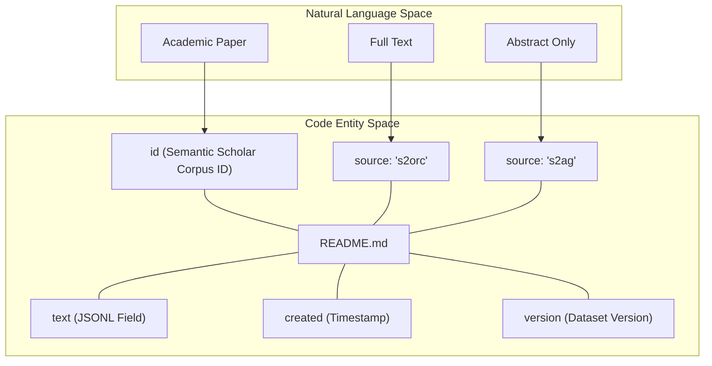
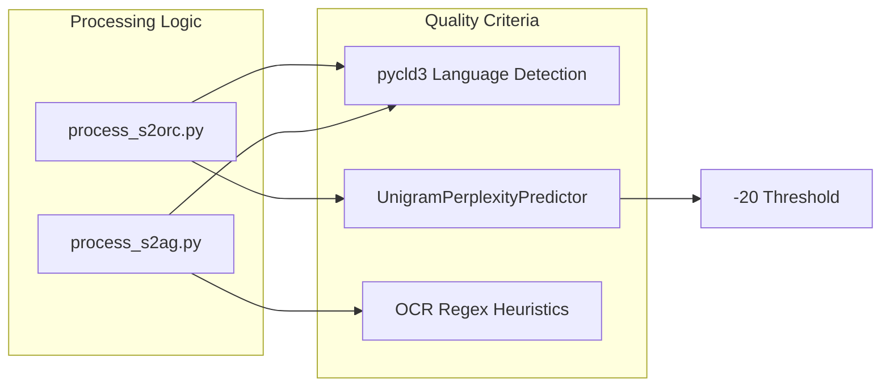

<!-- source: DeepWiki mcp.deepwiki.com · repo allenai/peS2o · page 1 Overview · fetched 2026-10-26 -->

# Overview

<details>
<summary>Relevant source files</summary>

The following files were used as context for generating this wiki page:

- [CITATION.cff](CITATION.cff)
- [LICENSE](LICENSE)
- [README.md](README.md)
- [res/hf-logo.png](res/hf-logo.png)
- [res/logo.png](res/logo.png)

</details>


The **peS2o** (Pretraining Effectively on [S2ORC](https://github.com/allenai/s2orc)) dataset is a curated collection of approximately 40 million open-access academic papers [README.md:7-9](). It is designed specifically for the pre-training of large language models, providing a cleaned, filtered, and formatted version of the Semantic Scholar Open Research Corpus [README.md:24-24]().

The project provides both the final dataset (available on Hugging Face) and the end-to-end pipeline used to transform raw Semantic Scholar data into a high-quality corpus [README.md:11-17]().

### Purpose and Scope
The primary goal of peS2o is to provide a massive, high-quality scientific corpus that minimizes "noise" typical in raw academic data—such as OCR errors, non-textual elements (tables/figures), and non-English content [README.md:61-76](). By applying rigorous filtering heuristics based on perplexity and structural criteria, peS2o aims to be a more effective pre-training source than raw web crawls or unfiltered academic dumps.

### Dataset Consumption
The dataset is published on the Hugging Face Hub and can be consumed using the `datasets` library:

```python
from datasets import load_dataset

# Load the latest version (v2) of the training split
dataset = load_dataset("allenai/peS2o", "v2", split="train")
```
[README.md:14-17]()

### Core Components and Entities

The following diagram illustrates how the logical concepts of the peS2o dataset map to the underlying data sources and code-level attributes.

**peS2o Entity Mapping**

**Sources:** [README.md:34-45]()

---

### Dataset Description and Schema
The peS2o corpus is released in versions, with **V2** being the current standard [README.md:19-20](). It contains roughly 38.97M documents and 42.01B whitespace-separated tokens [README.md:115-116]().

Each document follows a standardized schema:
*   `id`: The Semantic Scholar Corpus ID [README.md:40-40]().
*   `text`: The cleaned text content, with paragraphs separated by `\n\n` [README.md:44-44]().
*   `source`: Indicates if the document came from the full-text `s2orc` pipeline or the title/abstract `s2ag` pipeline [README.md:41-43]().
*   `added` / `created`: Temporal metadata for versioning and splitting [README.md:38-39]().

For a detailed breakdown of version history and the internal structure of these files, see **[Dataset Description and Schema](#1.1)**.

---

### Filtering and Quality Logic
The value of peS2o lies in its multi-stage filtering. The pipeline removes documents based on:
1.  **Language**: Using `pycld3` to ensure English-only content [README.md:67-70]().
2.  **Quality**: Removing sections with an average log word probability (perplexity) below `-20` [README.md:74-75]().
3.  **Structure**: Enforcing minimum word counts and paragraph counts [README.md:71-73]().
4.  **Heuristics**: Identifying OCR errors in V2 through regex-based subsequence matching [README.md:120-123]().

The relationship between these filters and the processing scripts is shown below:

**Filter Implementation Flow**

**Sources:** [README.md:68-75](), [README.md:120-123]()

For the comprehensive reference of all quality filters and the logic behind temporal splits, see **[Filtering Heuristics and Quality Criteria](#1.2)**.

---

### Pipeline Architecture
The peS2o dataset is the result of a four-stage production recipe:
1.  **Extraction**: SQL queries against AWS Athena tables [Stage 2.1]().
2.  **Processing**: Python scripts for cleaning and scoring [Stage 2.2]().
3.  **Registration**: Loading processed data back into Athena [Stage 2.3]().
4.  **Mixing**: Final filtering and deduplication [Stage 2.4]().

For an overview of the architecture and links to stage-specific details, see **[Data Pipeline Architecture](#2)**.

---
**Sources:** [README.md:1-134](), [CITATION.cff:1-25]()

---

