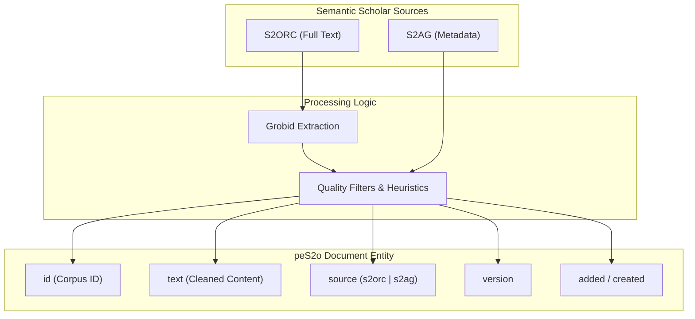
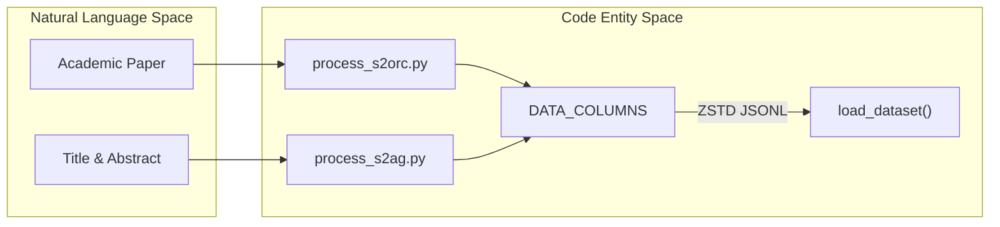

<!-- source: DeepWiki mcp.deepwiki.com · repo allenai/peS2o · page 1.1 Dataset Description and Schema · fetched 2026-10-26 -->

# Dataset Description and Schema

<details>
<summary>Relevant source files</summary>

The following files were used as context for generating this wiki page:

- [CITATION.cff](CITATION.cff)
- [LICENSE](LICENSE)
- [README.md](README.md)

</details>


The peS2o dataset is a large-scale collection of open-access academic papers designed for the pre-training of language models. It is derived from the [Semantic Scholar Open Research Corpus (S2ORC)](https://github.com/allenai/s2orc) and undergoes extensive cleaning, filtering, and formatting to ensure high data quality [README.md:7-9]().

## Dataset Statistics and Versioning

The dataset is released in versions, each reflecting improvements in processing heuristics or updated knowledge cutoffs.

| Version | Knowledge Cutoff | Documents | Tokens (approx.) | Primary Improvements |
| :--- | :--- | :--- | :--- | :--- |
| **v1** | 2023-01-03 | 67.56M | 47.37B | Initial release; basic language and quality filters. |
| **v2** | 2023-01-03 | 38.97M | 42.01B | Added OCR error detection for S2AG abstracts. |

**Sources:** [README.md:49-56](), [README.md:109-116](), [README.md:120-123]()

### Source Pipelines
The corpus is constructed from two primary sources within the Semantic Scholar ecosystem:
1.  **s2orc**: Full-text papers where section headers and paragraphs are extracted via [Grobid](https://github.com/kermitt2/grobid). Non-textual elements like figures, tables, and references are stripped [README.md:61-66]().
2.  **s2ag**: Titles and abstracts from the Semantic Scholar Academic Graph. This source provides broad coverage for papers where full text is unavailable or restricted [README.md:82-85]().

## Document Schema

Each document in peS2o is represented as a dictionary with a consistent set of fields across both `s2orc` and `s2ag` sources.

| Field | Type | Description |
| :--- | :--- | :--- |
| `id` | String | Semantic Scholar Corpus ID. Can be used with the S2 API to fetch metadata (e.g., authors, FOS) [README.md:40](). |
| `text` | String | The document content. Paragraphs are delimited by double newlines (`\n\n`) [README.md:44](). |
| `source` | String | Origin of the data: either `s2orc` (full-text) or `s2ag` (abstracts) [README.md:41-43](). |
| `added` | String | ISO date the document was added to the peS2o corpus [README.md:38](). |
| `created` | String | Best-guess publication date (resolution varies from YYYY to YYYY-MM-DD) [README.md:39](). |
| `version` | String | The peS2o version (e.g., "v2") [README.md:45](). |

**Sources:** [README.md:34-46]()

## Data Flow and Source Mapping

The following diagram illustrates how raw Semantic Scholar data sources are transformed into the final peS2o schema.

### Data Origin to Schema Mapping

**Sources:** [README.md:34-46](), [README.md:61-66](), [README.md:82-85]()

## Loading the Dataset

The dataset is hosted on the Hugging Face Hub and can be consumed using the `datasets` library. Users can specify the version (e.g., `v2`) as the configuration name.

```python
from datasets import load_dataset

# Load the train split of peS2o v2
dataset = load_dataset("allenai/peS2o", "v2", split="train")

# Example of accessing a document
print(dataset[0]["text"])
```
**Sources:** [README.md:11-17]()

## System Architecture: Source to Output

This diagram maps the logical data flow to the conceptual code entities that manage the transformation from source collections to the unified output format.

### Conceptual Pipeline Entities

**Sources:** [README.md:14-17](), [README.md:59-60](), [README.md:120-123]()

---

