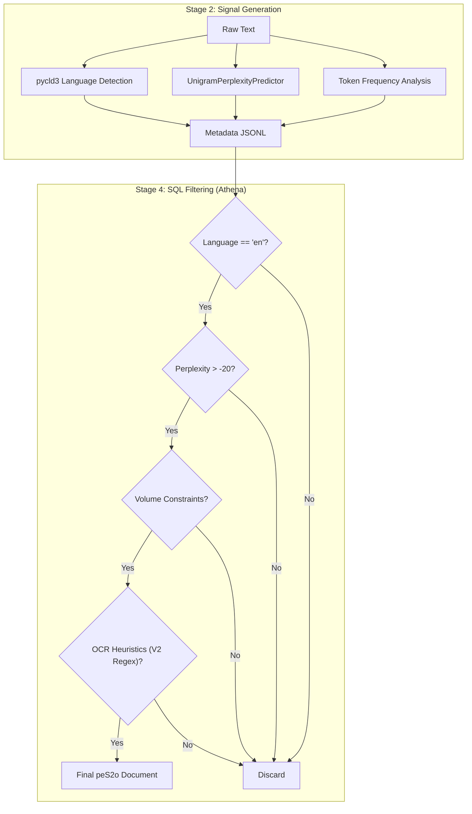
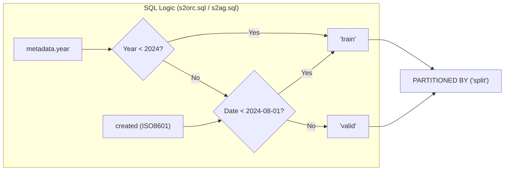

<!-- source: DeepWiki mcp.deepwiki.com · repo allenai/peS2o · page 1.2 Filtering Heuristics and Quality Criteria · fetched 2026-10-26 -->

# Filtering Heuristics and Quality Criteria

Relevant source files

The following files were used as context for generating this wiki page:

- [LICENSE](LICENSE)
- [README.md](README.md)
- [recipe/4_mix_final/s2ag.sql](recipe/4_mix_final/s2ag.sql)
- [recipe/4_mix_final/s2orc.sql](recipe/4_mix_final/s2orc.sql)

This page provides a comprehensive technical reference for the quality filters and heuristics applied to the peS2o dataset. These filters ensure that the resulting corpus is suitable for language model pre-training by removing low-quality OCR, non-English content, and structural anomalies from both the `s2orc` (full-text) and `s2ag` (title and abstract) pipelines.

## Filtering Logic Overview

The filtering process is split between Stage 2 (Python-based signal generation) and Stage 4 (SQL-based final selection). The Python scripts calculate metrics like perplexity and language, while the Athena SQL queries apply the definitive thresholds and structural constraints.

### Quality Criteria Data Flow

The following diagram illustrates how raw text is transformed into filtered documents by passing through various heuristic checks.

**Title: Quality Filtering Pipeline Flow**

**Sources:** [README.md:57-81](), [recipe/4_mix_final/s2orc.sql:1-101](), [recipe/4_mix_final/s2ag.sql:1-85]()

---

## Language Detection

PeS2o is primarily an English corpus. Language detection is performed using the `pycld3` library.

*   **S2ORC Implementation:** Language is detected at the paragraph level. The system runs `pycld3` on the first 2000 characters of each paragraph [README.md:68-70](). The document-level language is determined by the most frequent paragraph language [recipe/4_mix_final/s2orc.sql:40-60]().
*   **S2AG Implementation:** Both the title and abstract must be identified as English (`en`) [recipe/4_mix_final/s2ag.sql:56-57](). However, a title may bypass the language check if it has a high unigram log probability (>-20) [README.md:89]().

**Sources:** [README.md:67-70](), [README.md:87-91](), [recipe/4_mix_final/s2ag.sql:56-57](), [recipe/4_mix_final/s2orc.sql:40-60]()

---

## Perplexity and Unigram Probability

To filter out "gibberish" or poorly formatted text, peS2o uses an average log word probability threshold of **-20**.

*   **Model:** Probabilities are derived from the [1T Web Ngram corpus](https://catalog.ldc.upenn.edu/LDC2006T13) [README.md:75]().
*   **S2ORC:** Applied at the paragraph level. Any paragraph with a perplexity score below -20 is removed before the final text reconstruction [recipe/4_mix_final/s2orc.sql:18-21](). A document must retain at least 5 "valid" paragraphs to be included [recipe/4_mix_final/s2orc.sql:97]().
*   **S2AG:** Applied to both title and abstract. If the abstract's average log probability is below -20, the document is discarded [recipe/4_mix_final/s2ag.sql:58]().

**Sources:** [README.md:74-75](), [recipe/4_mix_final/s2orc.sql:18-21](), [recipe/4_mix_final/s2ag.sql:58]()

---

## Volume and Temporal Constraints

The pipeline enforces limits on document length and publication dates to ensure content density and avoid early OCR-heavy eras.

| Metric | S2ORC Requirement | S2AG Requirement |
| :--- | :--- | :--- |
| **Minimum Length** | > 500 words [README.md:71]() | > 50 words (abstract) [README.md:92]() |
| **Maximum Length** | < 50,000 words [recipe/4_mix_final/s2orc.sql:94]() | < 1000 words (abstract) [README.md:93]() |
| **Minimum Date** | $\ge$ 1970 [recipe/4_mix_final/s2orc.sql:100]() | $\ge$ 1970 [recipe/4_mix_final/s2ag.sql:62]() |
| **Paragraph Count** | $\ge$ 5 valid paragraphs [README.md:73]() | N/A |

**Sources:** [README.md:71-73](), [README.md:92-95](), [recipe/4_mix_final/s2orc.sql:94-100](), [recipe/4_mix_final/s2ag.sql:60-62]()

---

## OCR Error Heuristics (V2 Regex)

Introduced in peS2o V2, specific heuristics target "exploded" words caused by erroneous space insertion during OCR (e.g., `A b stra ct`).

The system uses a regular expression to find sequences of individual alpha letters separated by spaces: `\b([A-Za-z]\s)([a-z]\s)*[A-Za-z]\b` [README.md:122]().

*   **Logic:** For abstracts derived from sources known to contain OCR content (e.g., `Unpaywall`, `ScienceParse`, `Crawler`), the pipeline counts these matching subsequences [recipe/4_mix_final/s2ag.sql:43-53]().
*   **Threshold:** Any abstract with more than 4 such sequences is removed [README.md:123]().

**Sources:** [README.md:120-123](), [recipe/4_mix_final/s2ag.sql:41-53](), [recipe/4_mix_final/s2ag.sql:77-85]()

---

## Top-Word Frequency Cap

To prevent documents dominated by repetitive boilerplate or extraction artifacts, peS2o limits the frequency of the most common word.

*   **S2ORC:** The most frequent alpha-only word must appear in less than 7.5% of the document (for docs > 500 words) or less than 30% (for docs $\le$ 500 words) [recipe/4_mix_final/s2orc.sql:22-39]().
*   **S2AG:** The most frequent word must be a 2+ character alpha word, or the word "a" followed by a 2+ character alpha word [README.md:94](). This is enforced via regex on `metadata.top_frequencies` in SQL [recipe/4_mix_final/s2ag.sql:63-75]().

**Sources:** [README.md:76](), [README.md:94](), [recipe/4_mix_final/s2orc.sql:22-39](), [recipe/4_mix_final/s2ag.sql:63-75]()

---

## Train/Validation Temporal Split

The dataset is split into `train` and `valid` sets based on a temporal cutoff to ensure the validation set represents the most recent knowledge.

*   **Cutoff Logic:** Documents published before 2024-08-01 are assigned to `train`. Documents published on or after that date (within the 2024 window) are assigned to `valid` [recipe/4_mix_final/s2orc.sql:82-90]().
*   **Implementation:** The `split` column is used as a partition key during the Athena `UNLOAD` process [recipe/4_mix_final/s2ag.sql:147]().

**Title: Temporal Split Implementation**

**Sources:** [README.md:79-80](), [recipe/4_mix_final/s2orc.sql:82-90](), [recipe/4_mix_final/s2ag.sql:29-37](), [recipe/4_mix_final/s2ag.sql:147]()

---

