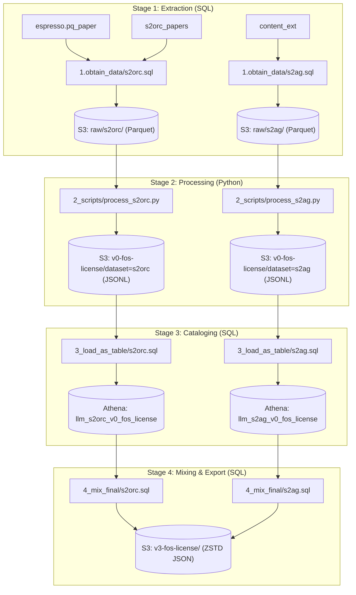

<!-- source: DeepWiki mcp.deepwiki.com · repo allenai/peS2o · page 2 Data Pipeline Architecture · fetched 2026-10-26 -->

# Data Pipeline Architecture

Relevant source files

The following files were used as context for generating this wiki page:

- [recipe/README.md](recipe/README.md)

The peS2o dataset is produced through a four-stage production recipe that transforms raw internal Semantic Scholar data into a cleaned, filtered, and deduplicated corpus suitable for LLM pre-training. This pipeline bridges massive data stores in AWS Athena with local Python-based heuristic processing to ensure high linguistic quality.

### Pipeline Overview

The architecture is designed to handle multi-terabyte datasets by alternating between massive parallel SQL operations in AWS Athena and high-throughput Python multiprocessing. The flow moves from raw internal tables to intermediate Parquet extracts, then to cleaned JSONL documents, and finally to a unified, mixed dataset.

### High-Level Data Flow

The following diagram illustrates the progression of data from Semantic Scholar's internal "Espresso" ecosystem to the final published ZSTD-compressed JSONL files.

**System Data Flow: Raw to Published**

Sources: [recipe/README.md:1-62]()

---

### Stage 1: Data Extraction
The first stage involves querying Semantic Scholar's internal data lake via AWS Athena. These queries align partitions across different internal tables, such as `espresso.pq_paper` and `content_ext`, to extract text content, metadata, and Grobid-processed annotations. 

*   **S2ORC Extraction:** Scans approximately 2.60 TB of data to extract full-text and bibliography information.
*   **S2AG Extraction:** Scans approximately 155 GB to extract abstracts and associated metadata for papers without full-text availability.

The output of this stage is partitioned Parquet files stored on S3, which serve as the raw input for the Python processing layer.

For details, see [Stage 1 – Data Extraction (SQL Queries)](#2.1).

Sources: [recipe/README.md:3-18]()

---

### Stage 2: Python Processing Scripts
Raw Parquet data is processed using `2_scripts/process_s2ag.py` and `2_scripts/process_s2orc.py`. These scripts apply heavy-duty cleaning and quality estimation that is difficult to perform in SQL.

*   **Heuristics:** Implements NFC normalization, merges section headers, and applies a parenthetical-spanning heuristic to clean Grobid artifacts.
*   **Quality Signals:** Calculates document perplexity using the `UnigramPerplexityPredictor` and performs language detection via `pycld3`.
*   **Performance:** Utilizes a multiprocessing architecture (using `spawn` and `Pool.imap_unordered`) to process the multi-terabyte dataset in under an hour.

The output is compressed JSONL files containing the cleaned text and a `metadata` struct for every document.

For details, see [Stage 2 – Python Processing Scripts](#2.2).

Sources: [recipe/README.md:19-41]()

---

### Stage 3: Loading Data as Athena Tables
The processed JSONL files are registered back into AWS Athena as external Hive tables using DDL scripts found in `3_load_as_table/`. This stage allows the pipeline to use SQL for the final, complex mixing and deduplication logic.

*   **Schema Registration:** Uses `org.openx.data.jsonserde.JsonSerDe` to map the nested JSON metadata (perplexity, language, frequencies) into queryable columns.
*   **Partitioning:** Uses `MSCK REPAIR TABLE` to discover the S3 partitions created by the Stage 2 scripts.

For details, see [Stage 3 – Loading Data as Athena Tables](#2.3).

Sources: [recipe/README.md:44-53]()

---

### Stage 4: Final Mixing and Dataset Production
The final stage uses Athena to perform the definitive "mixing" of the corpus. This includes applying final quality thresholds, deduplicating papers that appear in both S2ORC and S2AG sources, and assigning documents to `train` or `validation` splits based on temporal metadata.

*   **Filtering:** Filters documents based on the signals generated in Stage 2 (e.g., perplexity < -20).
*   **Deduplication:** Uses `ARBITRARY() GROUP BY` logic to ensure each paper ID only appears once in the final corpus.
*   **Export:** The results are `UNLOAD`ed to S3 as ZSTD-compressed JSON files, which constitute the published peS2o dataset.

For details, see [Stage 4 – Final Mixing and Dataset Production](#2.4).

Sources: [recipe/README.md:54-62]()

---

