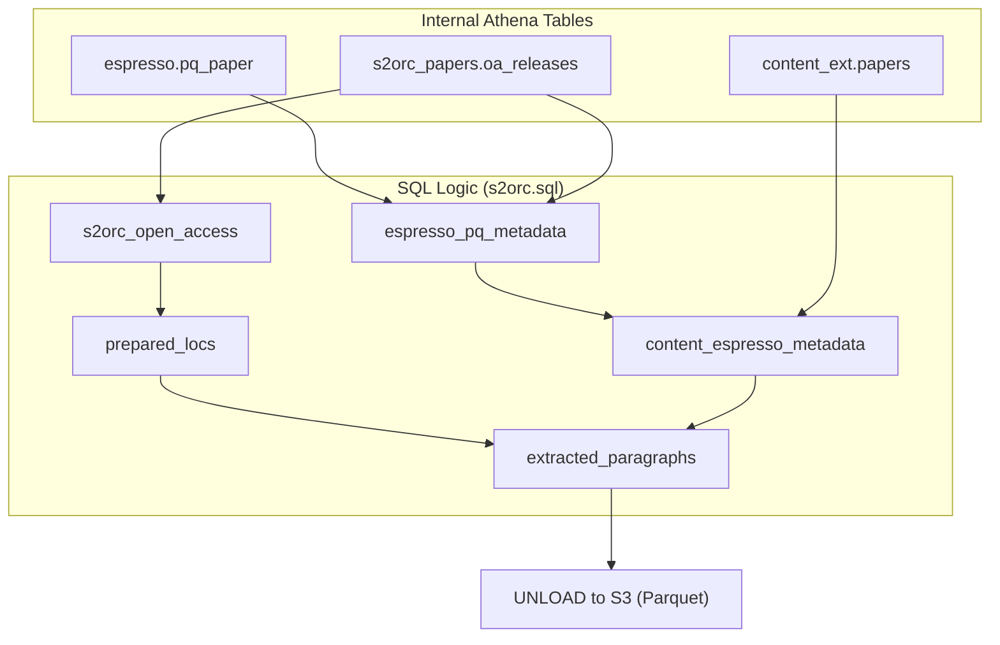
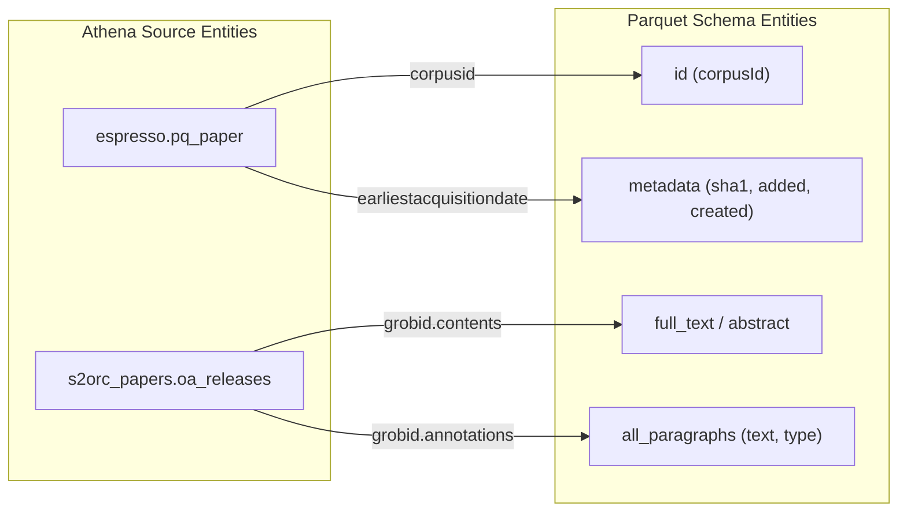

<!-- source: DeepWiki mcp.deepwiki.com · repo allenai/peS2o · page 2.1 Stage 1 – Data Extraction (SQL Queries) · fetched 2026-10-26 -->

# Stage 1 – Data Extraction (SQL Queries)

Relevant source files

The following files were used as context for generating this wiki page:

- [recipe/1_obtain_data/s2ag.sql](recipe/1_obtain_data/s2ag.sql)
- [recipe/1_obtain_data/s2orc.sql](recipe/1_obtain_data/s2orc.sql)
- [recipe/README.md](recipe/README.md)

The first stage of the peS2o pipeline involves extracting raw academic data from Semantic Scholar's internal data lake using AWS Athena. This stage targets two primary sources: **S2ORC** (full-text papers with Grobid annotations) and **S2AG** (abstracts and metadata). The goal is to align disparate internal tables, normalize temporal data, and export the results into a partitioned Parquet format for downstream Python processing.

## Data Sources and Volumes

The extraction process queries three main internal Semantic Scholar schemas:
1.  `espresso.pq_paper`: The primary metadata table containing paper IDs, fields of study, and acquisition dates [recipe/1_obtain_data/s2orc.sql:2-10]().
2.  `s2orc_papers.oa_releases`: Contains the full-text content and Grobid-derived structural annotations [recipe/1_obtain_data/s2orc.sql:73-79]().
3.  `content_ext.papers`: Used for high-fidelity publication date normalization [recipe/1_obtain_data/s2ag.sql:115-118]().

| Source | Query File | Data Scanned | Runtime (Approx) |
| :--- | :--- | :--- | :--- |
| **S2ORC** | `s2orc.sql` | 2.60 TB | 26.5 minutes |
| **S2AG** | `s2ag.sql` | 155.21 GB | 13 minutes |

Sources: [recipe/README.md:7-10]()

## S2ORC Extraction Logic

The S2ORC extraction is complex because it must reconstruct the document structure from Grobid annotations. Instead of exporting a single text blob, the query extracts specific byte offsets for paragraphs and section headers to maintain structural integrity during filtering.

### Grobid Annotation Processing
The query parses JSON-encoded annotations from the `content.grobid.annotations` column. It extracts `paragraph` and `section_header` locations, converting them into a unified `ROW(bos INTEGER, eos INTEGER, type VARCHAR)` format [recipe/1_obtain_data/s2orc.sql:47-72](). These locations are then used with `SUBSTR` to slice the `full_text` into an array of typed paragraphs [recipe/1_obtain_data/s2orc.sql:103-111]().

### Data Flow: S2ORC Raw to Parquet
The following diagram illustrates how internal Athena tables are joined and transformed into the `extracted_paragraphs` structure.

**Diagram: S2ORC Extraction Pipeline**

Sources: [recipe/1_obtain_data/s2orc.sql:1-136]()

## S2AG Extraction Logic

The S2AG query focuses on extracting abstracts for papers that do not have full-text available in S2ORC. It includes specific logic for publisher filtering and de-duplication.

### Publisher Filtering (Springer)
To comply with data usage restrictions, the query explicitly filters out abstracts from Springer-related DOI prefixes. If a DOI matches prefixes like `10.1007/%` or `10.1038/%` (Nature), the `abstract` field is set to `NULL` [recipe/1_obtain_data/s2ag.sql:48-83]().

### S2ORC De-duplication
To avoid redundancy, S2AG extraction performs a `LEFT OUTER JOIN` against the `s2orc_papers.oa_releases` table. Any `corpusId` already present in the S2ORC release is excluded from the S2AG dump [recipe/1_obtain_data/s2ag.sql:131-134]().

### External ID Mapping
The query aggregates various external identifiers (DOI, ArXiv, ACL, PubMedCentral, MAG) into a standardized map [recipe/1_obtain_data/s2ag.sql:36-47](). This is later transformed into an array of rows containing `source` and `id` for the final schema [recipe/1_obtain_data/s2ag.sql:9-18]().

## Date Normalization and Partitioning

Both queries implement a standardized date normalization strategy to ensure consistency across the dataset.

1.  **`added`**: Derived from `earliestacquisitiondate` in the Espresso metadata, converted to ISO8601 format [recipe/1_obtain_data/s2ag.sql:84](), [recipe/1_obtain_data/s2orc.sql:7-9]().
2.  **`created`**: A fallback-based publication date. It prioritizes `pub_date` from `content_ext.papers`. If null, it uses the `year` field; if both are null, it defaults to `0001-01-01` [recipe/1_obtain_data/s2ag.sql:101-114](), [recipe/1_obtain_data/s2orc.sql:17-30]().

### Output Partitioning
To facilitate parallel processing in Stage 2, the data is partitioned using a modulo of the paper ID:
*   **S2AG**: `corpusId % 50` creates 50 partitions [recipe/1_obtain_data/s2ag.sql:129-140]().
*   **S2ORC**: `id % 100` creates 100 partitions [recipe/1_obtain_data/s2orc.sql:126-134]().

**Diagram: Entity Mapping (SQL to Parquet)**

Sources: [recipe/1_obtain_data/s2orc.sql:1-136](), [recipe/1_obtain_data/s2ag.sql:1-141]()

---

