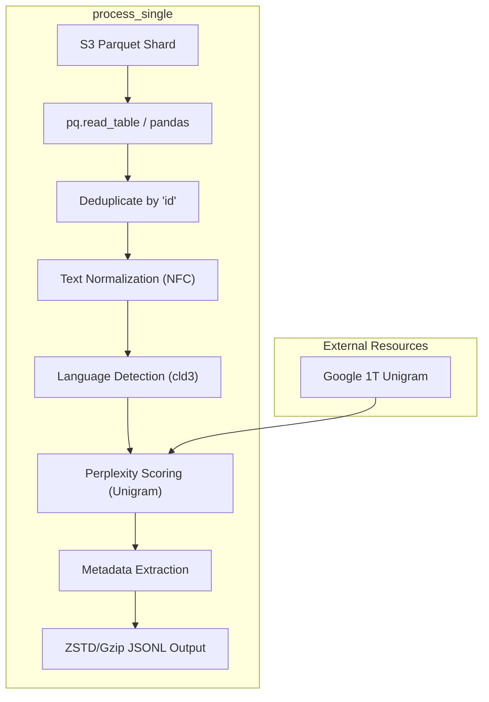
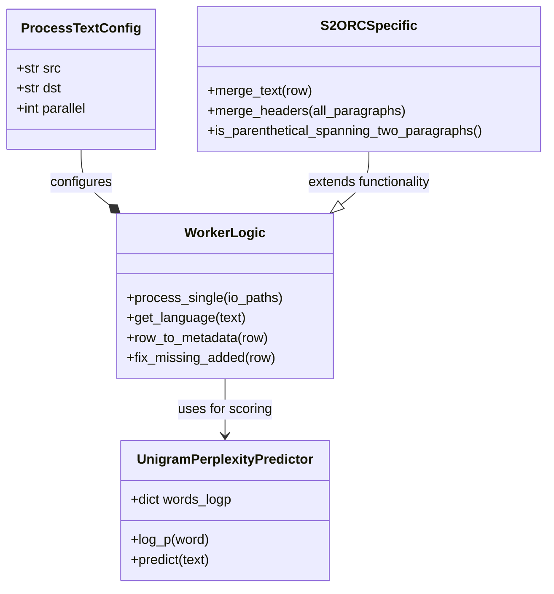

<!-- source: DeepWiki mcp.deepwiki.com · repo allenai/peS2o · page 2.2 Stage 2 – Python Processing Scripts · fetched 2026-10-26 -->

# Stage 2 – Python Processing Scripts

Relevant source files

The following files were used as context for generating this wiki page:

- [recipe/2_scripts/process_s2ag.py](recipe/2_scripts/process_s2ag.py)
- [recipe/2_scripts/process_s2orc.py](recipe/2_scripts/process_s2orc.py)
- [recipe/requirements.txt](recipe/requirements.txt)

Stage 2 of the peS2o pipeline transforms the raw Parquet files extracted in Stage 1 into enriched, compressed JSONL files. This stage is handled by two primary scripts: `process_s2ag.py` for metadata-only records and `process_s2orc.py` for full-text documents. These scripts perform language detection, perplexity calculation, text normalization, and structural merging of document fragments.

## Processing Architecture

Both scripts utilize a multiprocessing architecture to handle large-scale data transformation. The execution follows a "spawn" start method to ensure clean process isolation, particularly when dealing with C-extensions like `pycld3`.

### Parallel Execution Flow
The pipeline uses `multiprocessing.Pool.imap_unordered` to process Parquet files in parallel. A `Manager.Queue` is used to synchronize progress tracking across worker processes via `tqdm`.

| Component | Entity | Role |
| :--- | :--- | :--- |
| **Config** | `ProcessTextConfig` | Defines `src`, `dst`, and `parallel` process counts [recipe/2_scripts/process_s2ag.py:46-51](). |
| **Orchestrator** | `main` | Discovers files using `io_utils.recursively_list_files` and initializes the process pool [recipe/2_scripts/process_s2ag.py:270-310](). |
| **Worker** | `process_single` | The primary unit of work that processes a single Parquet file into a `.jsonl.gz` file [recipe/2_scripts/process_s2ag.py:143-169](). |
| **Progress** | `Queue` | Collects completion signals from workers to update a global progress bar [recipe/2_scripts/process_s2ag.py:277-290](). |

### Data Flow Diagram: Stage 2 Worker
The following diagram illustrates the transformation of a single data shard within the `process_single` function.

**Sources:** [recipe/2_scripts/process_s2ag.py:143-260](), [recipe/2_scripts/process_s2orc.py:136-240]()

## Text Enrichment and Quality Signals

### Unigram Perplexity Predictor
The `UnigramPerplexityPredictor` class estimates the "naturalness" of the text based on word frequencies from the Google 1T Web Unigram corpus [recipe/2_scripts/process_s2ag.py:41-43]().

*   **Initialization**: Loads unigram counts and calculates log probabilities. It assigns a fictional count to the `<unk>` token based on the square root of the vocabulary size [recipe/2_scripts/process_s2ag.py:60-72]().
*   **Prediction**: Tokenizes text using `blingfire.text_to_words` and returns the average log probability of the words [recipe/2_scripts/process_s2ag.py:77-82]().

### Language Detection
Language identification is performed using `cld3`. To optimize performance, only the first 2,000 characters of a document are used for detection [recipe/2_scripts/process_s2ag.py:39](), [recipe/2_scripts/process_s2ag.py:137-141]().

### Structural Heuristics (S2ORC)
In `process_s2orc.py`, specific heuristics are applied to reconstruct clean text from the `all_paragraphs` JSON structure:
1.  **Section Header Merging**: Section headers are identified and prepended to the subsequent paragraph to maintain context [recipe/2_scripts/process_s2orc.py:168-174]().
2.  **Parenthetical Spanning**: The `is_parenthetical_spanning_two_paragraphs` function detects if a paragraph break incorrectly splits a parenthetical statement (e.g., a citation or math formula) and merges them [recipe/2_scripts/process_s2orc.py:77-113]().
3.  **Punctuation-based Merging**: Paragraphs not ending in `.`, `?`, or `!` are merged with the following paragraph, assuming a premature break [recipe/2_scripts/process_s2orc.py:186-189]().

## Output Schema (`DATA_COLUMNS`)

The scripts enforce a standardized schema for the processed JSONL files. Any column present in the input Parquet that is not in the `DATA_COLUMNS` set is moved into a nested `metadata` dictionary.

| Field | Description | Source |
| :--- | :--- | :--- |
| `id` | Unique identifier (stringified) | [recipe/2_scripts/process_s2ag.py:204]() |
| `text` | The main content (Title + Abstract + Body) | [recipe/2_scripts/process_s2orc.py:115-119]() |
| `source` | Source identifier (e.g., `pes2o/s2ag`) | [recipe/2_scripts/process_s2ag.py:195]() |
| `added` | ISO8601 timestamp of processing | [recipe/2_scripts/process_s2ag.py:122-127]() |
| `created` | Estimated creation date (normalized to YYYY-01-01) | [recipe/2_scripts/process_s2ag.py:130-134]() |
| `version` | Dataset version (e.g., `v0-fos-license`) | [recipe/2_scripts/process_s2ag.py:194]() |
| `metadata` | Nested struct containing perplexity, language, and original columns | [recipe/2_scripts/process_s2ag.py:119-120]() |

**Sources:** [recipe/2_scripts/process_s2ag.py:116-120](), [recipe/2_scripts/process_s2orc.py:108-112]()

## Code Entity Map

The following diagram maps the logical processing steps to the specific Python classes and functions responsible for them.

**Sources:** [recipe/2_scripts/process_s2ag.py:46-83](), [recipe/2_scripts/process_s2orc.py:77-119]()

---

