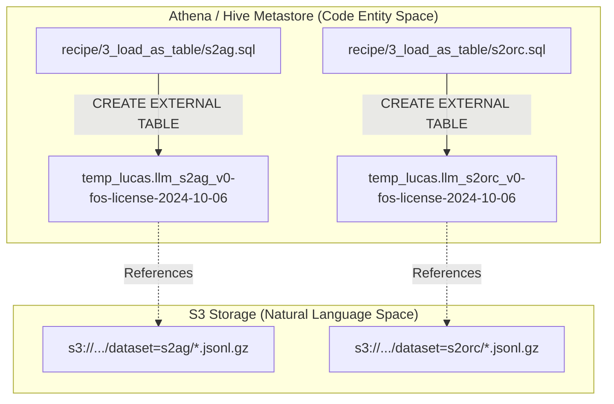
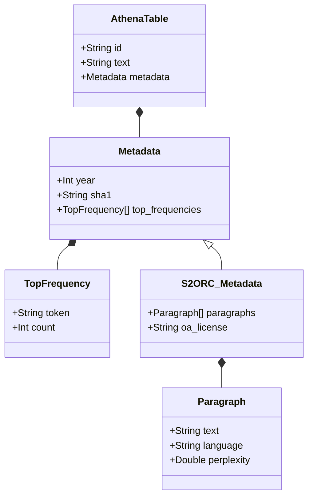

<!-- source: DeepWiki mcp.deepwiki.com · repo allenai/peS2o · page 2.3 Stage 3 – Loading Data as Athena Tables · fetched 2026-10-26 -->

# Stage 3 – Loading Data as Athena Tables

<details>
<summary>Relevant source files</summary>

The following files were used as context for generating this wiki page:

- [recipe/3_load_as_table/s2ag.sql](recipe/3_load_as_table/s2ag.sql)
- [recipe/3_load_as_table/s2orc.sql](recipe/3_load_as_table/s2orc.sql)

</details>


The third stage of the peS2o pipeline involves registering the processed JSONL files generated in Stage 2 as queryable external tables in AWS Athena. This step bridges the gap between raw S3 storage and SQL-based data manipulation, allowing the pipeline to perform final quality filtering and data mixing in Stage 4 using standard Hive DDL and SQL.

### Overview of Table Registration

The pipeline uses Hive Data Definition Language (DDL) to create external tables that point to specific S3 prefixes. These tables utilize the `org.apache.hive.hcatalog.data.JsonSerDe` [recipe/3_load_as_table/s2ag.sql:24-24](), [recipe/3_load_as_table/s2orc.sql:25-25]() to parse the compressed JSONL objects into a structured schema. 

Two primary tables are registered during this stage:
1.  `llm_s2ag_v0-fos-license`: Contains metadata and text extracted from the Semantic Scholar Academic Graph.
2.  `llm_s2orc_v0-fos-license`: Contains full-text paragraphs and metadata from the S2ORC corpus.

### System Architecture and Data Flow

The following diagram illustrates how the SQL scripts interact with the S3 data produced in Stage 2 to create a structured interface for Stage 4.

**Data Registration Flow**

**Sources:** [recipe/3_load_as_table/s2ag.sql:1-25](), [recipe/3_load_as_table/s2orc.sql:2-26]()

### Schema Definitions

The tables share a common top-level structure (id, source, text, version, added, created) but differ significantly in their nested `metadata` structs to accommodate the specific attributes of S2AG and S2ORC.

#### S2AG Table Schema
The S2AG table focuses on bibliographic metadata and quality signals for titles and abstracts.

| Column | Type | Description |
| :--- | :--- | :--- |
| `id` | STRING | Unique identifier for the document. |
| `source` | STRING | Originating source (s2ag). |
| `text` | STRING | The concatenated text content. |
| `metadata` | STRUCT | Complex object containing paper details. |
| `metadata.external_ids` | ARRAY<STRUCT> | Mapping of source name to ID (e.g., DOI, PubMed). |
| `metadata.top_frequencies` | ARRAY<STRUCT> | Most frequent tokens and their counts for filtering. |
| `metadata.title_perplexity` | DOUBLE | Perplexity score for the title. |

**Sources:** [recipe/3_load_as_table/s2ag.sql:1-23]()

#### S2ORC Table Schema
The S2ORC table includes detailed paragraph-level information and Open Access (OA) licensing data.

| Column | Type | Description |
| :--- | :--- | :--- |
| `metadata.paragraphs` | ARRAY<STRUCT> | List of objects containing `text`, `language`, and `perplexity`. |
| `metadata.fields_of_study`| ARRAY<STRING> | High-level academic disciplines. |
| `metadata.oa_license` | STRING | The specific license (e.g., CC-BY). |
| `metadata.pdf_hash` | STRING | Hash of the source PDF file. |

**Sources:** [recipe/3_load_as_table/s2orc.sql:9-23]()

### Implementation Details

#### JsonSerDe Configuration
The tables are defined with `ROW FORMAT serde 'org.apache.hive.hcatalog.data.JsonSerDe'` [recipe/3_load_as_table/s2ag.sql:24-24](). This allows Athena to map JSON keys directly to table columns. Because the Stage 2 processing scripts output one JSON object per line, this SerDe can efficiently scan the files without requiring a full load into a database.

#### Metadata Structs
The use of `STRUCT` and `ARRAY<STRUCT>` is critical for maintaining the relationship between text segments and their quality scores. For instance, in S2ORC, each paragraph's language and perplexity are stored alongside its text within the `paragraphs` array [recipe/3_load_as_table/s2orc.sql:15-15](). This enables Stage 4 queries to filter out individual low-quality paragraphs while retaining the rest of the document.

**Entity Mapping: SQL Schema to Data Structure**

**Sources:** [recipe/3_load_as_table/s2ag.sql:8-22](), [recipe/3_load_as_table/s2orc.sql:9-23]()

### Partitioning and Repair
While the provided DDL scripts define the table structure and location [recipe/3_load_as_table/s2ag.sql:25-25](), the data is often partitioned by date or dataset type. After running the `CREATE EXTERNAL TABLE` command, users must typically run:

```sql
MSCK REPAIR TABLE `temp_lucas`.`llm_s2ag_v0-fos-license-2024-10-06`;
```

This command updates the Hive Metastore with the partitions present on S3, making the data available for querying in Stage 4.

**Sources:** [recipe/3_load_as_table/s2ag.sql:1-25](), [recipe/3_load_as_table/s2orc.sql:2-26]()

---

