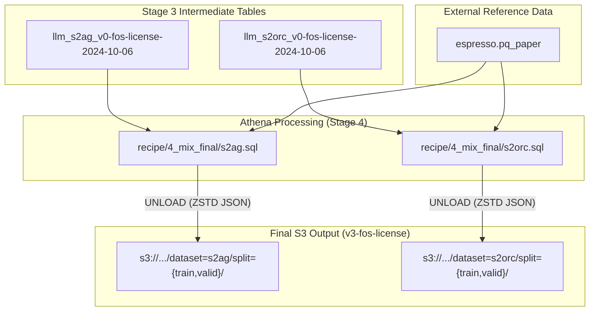
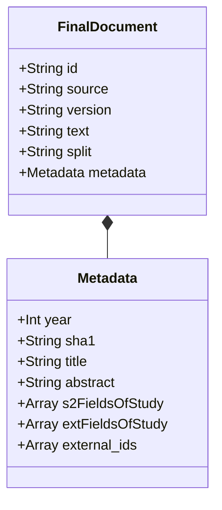

<!-- source: DeepWiki mcp.deepwiki.com · repo allenai/peS2o · page 2.4 Stage 4 – Final Mixing and Dataset Production · fetched 2026-10-26 -->

# Stage 4 – Final Mixing and Dataset Production

Relevant source files

The following files were used as context for generating this wiki page:

- [recipe/4_mix_final/s2ag.sql](recipe/4_mix_final/s2ag.sql)
- [recipe/4_mix_final/s2orc.sql](recipe/4_mix_final/s2orc.sql)
- [recipe/README.md](recipe/README.md)

Stage 4 is the final phase of the peS2o pipeline. It uses AWS Athena to execute complex SQL queries that perform the definitive quality filtering, metadata enrichment, and dataset partitioning. During this stage, documents from the intermediate tables (created in Stage 3) are joined with the Semantic Scholar `espresso.pq_paper` table to acquire Field of Study (FoS) information, deduplicated, and finally exported as ZSTD-compressed JSON files.

## Overview of Production Logic

The production phase is split into two primary SQL workflows: one for the S2AG (Abstracts) stream and one for the S2ORC (Full-text) stream. While both follow a similar pattern of filtering and enrichment, they apply different heuristics suited to their content types.

### Key Objectives:
1.  **Enrichment**: Join with `espresso.pq_paper` to add `s2FieldsOfStudy` and `fieldsOfStudy` [recipe/4_mix_final/s2ag.sql:87-95](), [recipe/4_mix_final/s2orc.sql:102-110]().
2.  **Filtering**: Apply final thresholds for perplexity, language, and length [recipe/4_mix_final/s2ag.sql:55-62](), [recipe/4_mix_final/s2orc.sql:92-100]().
3.  **Deduplication**: Use `GROUP BY id` with `ARBITRARY()` aggregations to ensure unique Corpus IDs [recipe/4_mix_final/s2ag.sql:131-141](), [recipe/4_mix_final/s2orc.sql:132-176]().
4.  **Partitioning**: Assign documents to `train` or `valid` splits based on a temporal cutoff (August 1, 2024) [recipe/4_mix_final/s2ag.sql:29-37](), [recipe/4_mix_final/s2orc.sql:82-90]().

### Data Flow: Stage 3 to Final Production

The following diagram illustrates how data moves from the intermediate Hive tables into the final S3 destination.

**Diagram: Final Mixing Data Flow**

Sources: [recipe/4_mix_final/s2ag.sql:1-148](), [recipe/4_mix_final/s2orc.sql:1-184](), [recipe/README.md:54-62]()

---

## S2ORC Final Processing

The S2ORC pipeline focuses on reconstructing the full-text document from valid paragraphs.

### Quality Heuristics and Filtering
The `s2orc_stats` Common Table Expression (CTE) performs paragraph-level filtering:
*   **Perplexity Filter**: Only paragraphs with a perplexity $\ge -20$ are retained in the `valid_paragraphs` array [recipe/4_mix_final/s2orc.sql:18-21]().
*   **Top-Word Frequency**: Implements a cap on the most frequent token to catch "spammy" or repetitive documents. For docs > 500 tokens, the top word must be $\le 7.5\%$ of the total; for smaller docs, $\le 30\%$ [recipe/4_mix_final/s2orc.sql:22-39]().
*   **Language Majority**: The document language is determined by the most frequent language across all paragraphs [recipe/4_mix_final/s2orc.sql:40-60]().

### Text Reconstruction
The final text blob is assembled by concatenating the title, abstract, and all `valid_paragraphs` using double newlines (`CHR(10) || CHR(10)`) [recipe/4_mix_final/s2orc.sql:77-81]().

Sources: [recipe/4_mix_final/s2orc.sql:1-101]()

---

## S2AG Final Processing

The S2AG pipeline focuses on metadata cleaning and title/abstract quality.

### External ID Parsing
The query includes complex `regexp_replace` logic to clean and parse the `metadata.external_ids` string into a structured JSON array of `source` and `id` pairs [recipe/4_mix_final/s2ag.sql:9-26]().

### Source Filtering and OCR Heuristics
S2AG applies specific filters to exclude low-quality extraction sources:
*   **Source Exclusion**: Filters out sources like `Unpaywall`, `ScienceParse`, and `MAG` [recipe/4_mix_final/s2ag.sql:47-53]().
*   **Single Letter Sequences**: Detects OCR failures by checking for sequences of single letters (e.g., "a b c d"). Documents with `max_single_letter_sequence >= 4` are excluded unless they come from specific trusted sources [recipe/4_mix_final/s2ag.sql:41-46](), [recipe/4_mix_final/s2ag.sql:77-85]().

Sources: [recipe/4_mix_final/s2ag.sql:1-86]()

---

## Field of Study (FoS) Enrichment

Both pipelines perform a `RIGHT JOIN` (for S2AG) or `INNER JOIN` (for S2ORC) against the `espresso.pq_paper` table using the `corpusid` [recipe/4_mix_final/s2ag.sql:93-94](), [recipe/4_mix_final/s2orc.sql:107-109](). This allows the final dataset to include Semantic Scholar's internal Field of Study classifications.

**Diagram: Metadata Schema Reconstruction**

Sources: [recipe/4_mix_final/s2ag.sql:104-126](), [recipe/4_mix_final/s2orc.sql:150-173]()

---

## Export and Partitioning

The final step uses the Athena `UNLOAD` command to write the data to S3.

| Feature | Configuration |
| :--- | :--- |
| **Format** | JSON [recipe/4_mix_final/s2ag.sql:145]() |
| **Compression** | ZSTD [recipe/4_mix_final/s2ag.sql:146]() |
| **Partitioning** | `split` (train/valid) [recipe/4_mix_final/s2ag.sql:147]() |
| **Destination Path** | `s3://ai2-llm/pretraining-data/sources/s2/v3-fos-license/documents/...` [recipe/4_mix_final/s2ag.sql:143]() |

### Temporal Split Logic
The `split` column is assigned dynamically:
*   **Train**: `year < 2024` OR (`year == 2024` AND `created < 2024-08-01`) [recipe/4_mix_final/s2ag.sql:29-37]().
*   **Valid**: All documents created on or after August 1, 2024 [recipe/4_mix_final/s2ag.sql:36]().

Sources: [recipe/4_mix_final/s2ag.sql:142-148](), [recipe/4_mix_final/s2orc.sql:178-184]()

---

