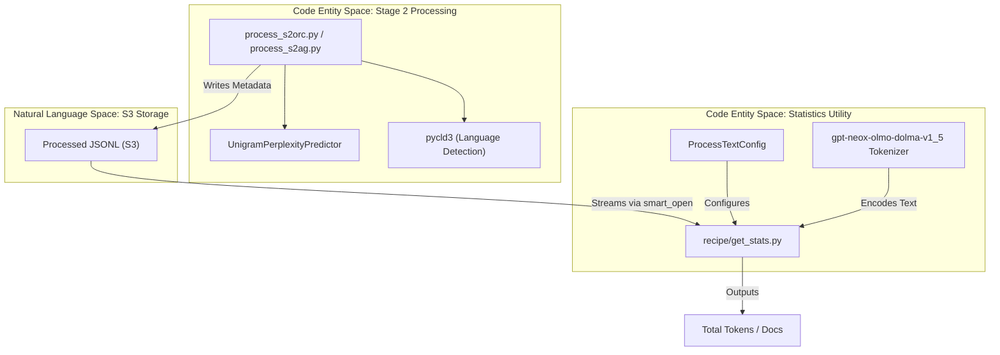
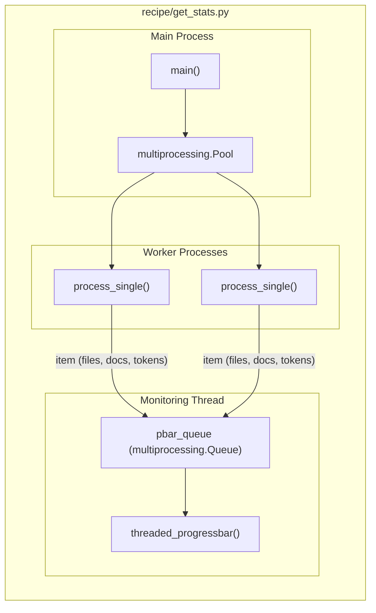

<!-- source: DeepWiki mcp.deepwiki.com · repo allenai/peS2o · page 3 Quality Metrics and Statistics · fetched 2026-10-26 -->

# Quality Metrics and Statistics

Relevant source files

The following files were used as context for generating this wiki page:

- [recipe/get_stats.py](recipe/get_stats.py)
- [recipe/requirements.txt](recipe/requirements.txt)

The peS2o pipeline incorporates several mechanisms to measure, monitor, and enforce data quality across the corpus. These range from real-time language detection and perplexity scoring during document processing to post-hoc statistical auditing of token counts and document distributions.

### Statistical Auditing and Counting
The pipeline provides specialized tooling to audit the scale of the dataset. Because peS2o scales to tens of billions of tokens, standard counting methods are often insufficient for data stored in S3. The utility script `recipe/get_stats.py` is used to stream processed JSONL files and calculate precise document and token counts using the project's standard tokenizer [recipe/get_stats.py:57-68]().

This utility is designed for high-throughput environments, utilizing a multiprocessing "spawn" architecture and `smart_open` for streaming data directly from cloud storage [recipe/get_stats.py:121-133]().

For details, see [get_stats.py – Token and Document Counting](#3.1).

### Quality Signals and Language Detection
Quality is enforced through a combination of linguistic and statistical signals calculated during the transformation stages. These signals are embedded into the document metadata and used for downstream filtering in Athena.

Key metrics include:
*   **Language Detection:** Identification of document language using `pycld3` to ensure the corpus remains primarily English-centric [recipe/requirements.txt:7-7]().
*   **Unigram Perplexity:** A measure of "naturalness" calculated via the `UnigramPerplexityPredictor`. Documents with an average log word probability below -20 are typically flagged as low quality or non-prose.
*   **Frequency Heuristics:** Monitoring the frequency of top words to identify OCR failures or repetitive boilerplate.

For details, see [Perplexity and Language Quality Signals](#3.2).

### System Integration Diagram
The following diagram illustrates how quality metrics flow from the raw data processing stage into the final statistical reporting.

**Data Quality Flow: From Processing to Statistics**

Sources: [recipe/get_stats.py:30-34](), [recipe/get_stats.py:57-63](), [recipe/get_stats.py:121-137](), [recipe/requirements.txt:7-14]()

### Metric Collection Architecture
The statistical auditing tool uses a threaded progress management system to track multi-process work without overwhelming the system I/O.

**Process Architecture for Statistics Collection**

Sources: [recipe/get_stats.py:78-101](), [recipe/get_stats.py:123-138]()

### Summary of Metrics

| Metric | Tool / Class | Purpose |
| :--- | :--- | :--- |
| **Token Count** | `Tokenizer` (GPT-NeoX) | Measuring corpus size for training budgets [recipe/get_stats.py:57-63](). |
| **Perplexity** | `UnigramPerplexityPredictor` | Filtering out "gibberish" or OCR errors. |
| **Language** | `pycld3` | Ensuring document language matches target (English) [recipe/requirements.txt:7-7](). |
| **Document Count** | `get_stats.py` | Auditing S3 prefixes for file/document integrity [recipe/get_stats.py:144-146](). |

---
## Child Pages
*   [get_stats.py – Token and Document Counting](#3.1)
*   [Perplexity and Language Quality Signals](#3.2)

---

