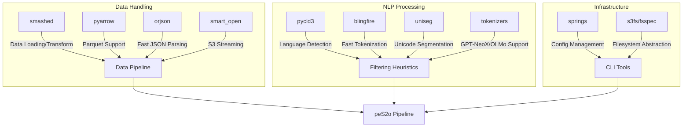

<!-- source: DeepWiki mcp.deepwiki.com · repo allenai/peS2o · page 4 Development Environment and Tooling · fetched 2026-10-26 -->

# Development Environment and Tooling

Relevant source files

The following files were used as context for generating this wiki page:

- [.gitignore](.gitignore)
- [.vscode/settings.json](.vscode/settings.json)
- [recipe/requirements.txt](recipe/requirements.txt)

This section provides an overview of the development environment, dependency management, and IDE configurations required to contribute to the peS2o pipeline. The project relies on a specific stack of data processing and NLP libraries to handle large-scale scientific document extraction and filtering.

## Overview of the Development Stack

The peS2o development environment is designed to handle high-throughput data processing, often involving large Parquet and JSONL files stored in cloud environments (AWS S3). The tooling is centered around Python, utilizing a mix of high-performance serialization formats (Apache Arrow, Zstandard) and specialized NLP utilities (Blingfire, CLD3).

### Key Components

*   **Data Orchestration**: Uses `smashed` and `springs` for managing data transformations and configurations.
*   **High-Performance IO**: Leverages `pyarrow`, `orjson`, and `smart_open` to stream and parse massive datasets without exhausting local memory.
*   **NLP & Filtering**: Employs `pycld3` for language identification and `blingfire` for rapid text tokenization and normalization.
*   **Cloud Integration**: Deeply integrated with AWS S3 via `s3fs` and `fsspec` for seamless remote file access.

For details on specific library versions and their roles in the pipeline, see [Dependencies and Environment Setup](#4.1).

## Environment and Dependency Mapping

The following diagram bridges the high-level functional requirements of the pipeline to the specific libraries defined in the project's requirements.

### Library-to-Function Mapping

**Sources:** [recipe/requirements.txt:1-16]()

## IDE and Repository Configuration

To maintain consistency across development environments and prevent performance degradation when handling large-scale data scripts, the repository includes specific configurations for VS Code and Git.

### Workspace Optimization
The repository includes a `.vscode/settings.json` file that explicitly disables the default Python language server: `{"python.languageServer": "None"}` [[.vscode/settings.json:1-3]()] . This is a strategic choice for repositories dealing with large generated files or massive data schemas, where background indexing can lead to high CPU usage and IDE instability.

### Git Maintenance
The `.gitignore` configuration is comprehensive, ensuring that environment-specific artifacts (like `.venv`, `__pycache__`, and `.pytest_cache`) do not enter version control [[.gitignore:2-164]()] . This keeps the repository clean and focused on the core processing logic.

For details on how to configure your local editor and manage virtual environments, see [IDE and Repository Configuration](#4.2).

## Child Pages

*   [Dependencies and Environment Setup](#4.1)
    Documents the `recipe/requirements.txt` stack, explaining the role of each library (e.g., `smashed`, `pycld3`, `zstandard`) and the installation process.
*   [IDE and Repository Configuration](#4.2)
    Covers the `.vscode/settings.json` workspace configuration, `.gitignore` exclusions, and general contributor workflow notes for maintaining a performant development environment.

**Sources:** [.vscode/settings.json:1-3](), [.gitignore:1-164](), [recipe/requirements.txt:1-16]()

---

