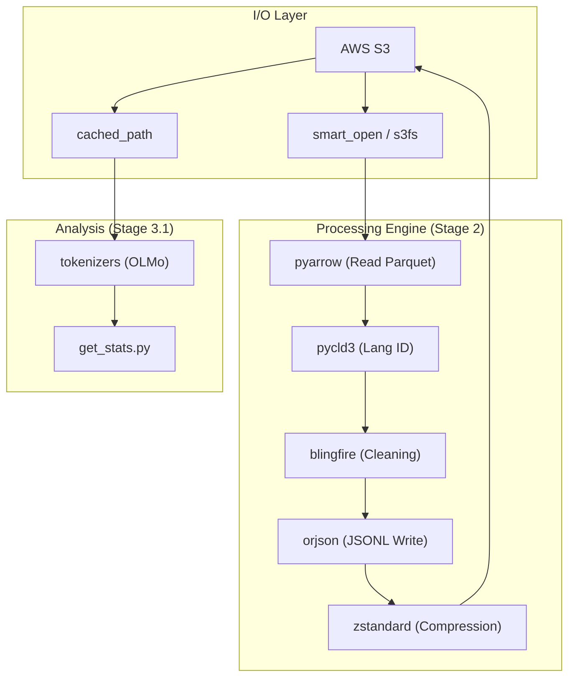
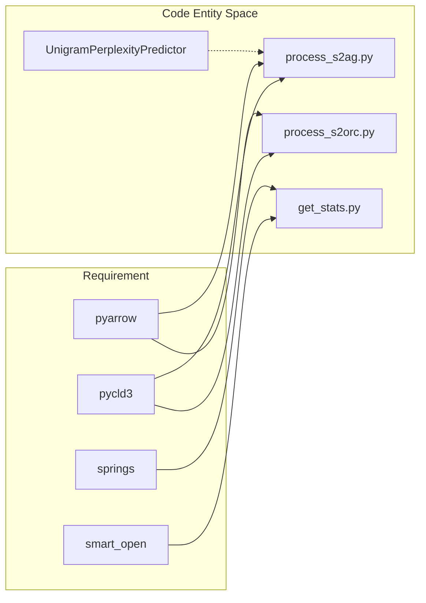

<!-- source: DeepWiki mcp.deepwiki.com · repo allenai/peS2o · page 4.1 Dependencies and Environment Setup · fetched 2026-10-26 -->

# Dependencies and Environment Setup

<details>
<summary>Relevant source files</summary>

The following files were used as context for generating this wiki page:

- [.gitignore](.gitignore)
- [recipe/requirements.txt](recipe/requirements.txt)

</details>


This page documents the software requirements and environment configuration necessary to run and develop the peS2o data pipeline. The project relies on a specialized stack of libraries for high-performance data processing, linguistic filtering, and cloud-native I/O.

## 1. Core Dependency Stack

The peS2o pipeline is built on a set of Python libraries defined in `recipe/requirements.txt` [recipe/requirements.txt:1-16](). These dependencies facilitate every stage from raw data extraction to final quality scoring.

### Data Processing & Serialization
| Library | Role in peS2o |
| :--- | :--- |
| `pyarrow` | Handles high-performance reading and writing of Parquet files during Stage 1 and Stage 2 [recipe/requirements.txt:9](). |
| `orjson` | Used for fast JSON serialization and deserialization when processing document streams [recipe/requirements.txt:10](). |
| `zstandard` | Provides compression for the final JSONL output files, ensuring efficient storage and transfer [recipe/requirements.txt:15](). |
| `pandas` | Used for intermediate data manipulation and schema management [recipe/requirements.txt:1](). |

### Linguistic & Text Utilities
| Library | Role in peS2o |
| :--- | :--- |
| `pycld3` | Provides Google's Compact Language Detector v3 for identifying document languages [recipe/requirements.txt:7](). |
| `blingfire` | High-speed text tokenization and segmentation used in text cleaning [recipe/requirements.txt:11](). |
| `uniseg` | Handles Unicode text segmentation, ensuring correct handling of multi-byte characters [recipe/requirements.txt:6](). |
| `tokenizers` | Provides the backend for the `allenai/gpt-neox-olmo-dolma-v1_5` tokenizer used in statistics gathering [recipe/requirements.txt:13](). |

### Cloud Infrastructure & I/O
| Library | Role in peS2o |
| :--- | :--- |
| `s3fs` / `fsspec` | Provides a filesystem interface for interacting directly with AWS S3 buckets [recipe/requirements.txt:4-5](). |
| `smart_open` | Enables seamless streaming of large files from S3, crucial for processing TB-scale datasets without local disk exhaustion [recipe/requirements.txt:14](). |
| `cached_path` | Manages local caching of remote resources, such as model weights or unigram frequency files [recipe/requirements.txt:8](). |
| `smashed[remote]` | A toolkit for data transformation pipelines, supporting remote execution and dataset mapping [recipe/requirements.txt:2](). |
| `springs` | A configuration management library used to parameterize the Python scripts [recipe/requirements.txt:3](). |

**Sources:** [recipe/requirements.txt:1-16]()

---

## 2. Environment Configuration

### Virtual Environment Management
The project is designed to run in a clean Python environment. Standard environment directories like `.venv`, `venv`, and `env` are excluded from version control to prevent local binary contamination [ .gitignore:124-127]().

### IDE Integration
For developers using VS Code, the repository includes specific configurations to handle the scale of the codebase.
* **Language Server:** The configuration often sets `python.languageServer: None` to avoid performance degradation when the IDE attempts to index large generated files or massive data samples.
* **Ignored Artifacts:** The `.gitignore` file excludes common build artifacts (`build/`, `dist/`), Python cache (`__pycache__`), and test reports (`.pytest_cache/`, `coverage.xml`) [ .gitignore:2-51]().

**Sources:** [ .gitignore:2-127]()

---

## 3. Data Flow and Library Interaction

The following diagram illustrates how the primary libraries interact within the Python processing scripts (Stage 2) and the statistics utility (Stage 3.1).

### Library Interaction Map


**Sources:** [recipe/requirements.txt:1-16]()

---

## 4. Entity Mapping: From Requirements to Code

This diagram bridges the libraries defined in `requirements.txt` to the specific modules and logic implemented in the peS2o pipeline.

### Dependency-to-Entity Association


**Sources:** [recipe/requirements.txt:1-16]()

---

## 5. Installation

To set up the environment, it is recommended to use a virtual environment and install the requirements using `pip`:

```bash
# Create and activate environment
python -m venv .venv
source .venv/bin/activate

# Install dependencies
pip install -r recipe/requirements.txt
```

Note that `pycld3` requires C++ compilation headers for Google's CLD3 library, and `smashed[remote]` includes additional dependencies for S3/cloud interaction.

**Sources:** [recipe/requirements.txt:1-16]()

---

