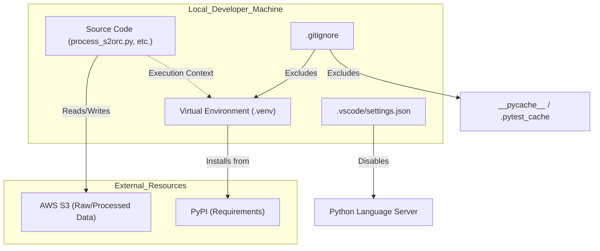
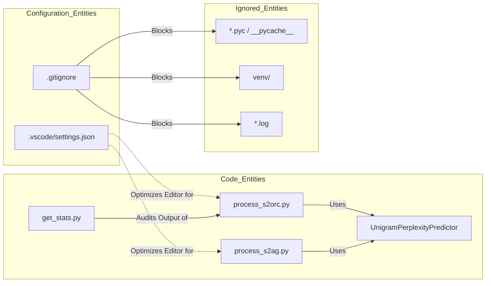

<!-- source: DeepWiki mcp.deepwiki.com · repo allenai/peS2o · page 4.2 IDE and Repository Configuration · fetched 2026-10-26 -->

# IDE and Repository Configuration

Relevant source files

The following files were used as context for generating this wiki page:

- [.gitignore](.gitignore)
- [.vscode/settings.json](.vscode/settings.json)

This page details the development environment settings and repository management configurations for the `peS2o` project. Maintaining a consistent environment is critical for ensuring that the data processing pipelines, which handle terabytes of scholarly data, remain reproducible and performant.

## VS Code Workspace Configuration

The repository includes a workspace-specific configuration for Visual Studio Code to optimize editor performance.

### Language Server Optimization
The primary configuration in the workspace settings is the disabling of the Python Language Server:

| Setting | Value | Rationale |
| :--- | :--- | :--- |
| `python.languageServer` | `"None"` | Prevents IDE performance degradation caused by indexing large volumes of generated data or high-throughput processing scripts. |

In many data engineering projects involving large-scale datasets (like the ~40M documents in `peS2o`), standard IDE features such as "Go to Definition" or "Find All References" can become sluggish or cause the editor to crash if the language server attempts to index local data caches, temporary Parquet files, or deeply nested JSONL outputs. By setting this to `"None"`, contributors ensure that the editor remains responsive during heavy data processing tasks.

**Sources:**
- [.vscode/settings.json:1-3]()

---

## Repository Exclusions (.gitignore)

The `.gitignore` file is configured to prevent large data artifacts, environment-specific files, and build metadata from being committed to version control. This is essential for a project that interfaces with AWS S3 and local high-performance computing (HPC) environments.

### Environment and Virtualization
The project excludes all standard Python virtual environment directories to ensure that contributors do not accidentally commit local binary dependencies or platform-specific interpreter paths.

- **Standard Environments:** `.env`, `.venv`, `env/`, `venv/` [[.gitignore:123-127]()]
- **Package Manager Artifacts:** `__pypackages__/`, `.pdm.toml` [[.gitignore:110-113]()]
- **Build/Distribution:** `build/`, `dist/`, `*.egg-info/`, `wheels/` [[.gitignore:11-24]()]

### Test and Cache Management
To maintain a clean repository state, all caches generated by testing frameworks and static analysis tools are ignored:

- **Testing:** `.pytest_cache/`, `.tox/`, `.coverage`, `htmlcov/` [[.gitignore:39-52]()]
- **Type Checking:** `.mypy_cache/`, `.pyre/`, `.pytype/` [[.gitignore:141-150]()]
- **Python Internal:** `__pycache__/`, `*.pyc`, `*.pyo` [[.gitignore:1-4]()]

### Data and Notebook Artifacts
Given the data-centric nature of `peS2o`, specific exclusions are in place for data exploration and logging:

- **Jupyter:** `.ipynb_checkpoints` [[.gitignore:79]()]
- **Logs:** `*.log`, `pip-log.txt` [[.gitignore:36-59]()]
- **Local DBs:** `db.sqlite3`, `db.sqlite3-journal` [[.gitignore:61-62]()]

**Sources:**
- [.gitignore:1-164]()

---

## Contributor Workflow

The following diagram illustrates the relationship between the repository configuration, the developer's local environment, and the execution of the processing scripts.

### Workspace Data Flow and Environment
Title: Development Environment and Tooling Flow

**Sources:**
- [.vscode/settings.json:1-3]()
- [.gitignore:1-164]()

---

## Code Entity Mapping

To bridge the gap between repository configuration and the actual codebase, the following diagram maps the configuration files to the entities they govern during the execution of the pipeline stages.

### Configuration to Code Entity Mapping
Title: Configuration Governance over Code Entities

**Sources:**
- [.vscode/settings.json:1-3]()
- [.gitignore:1-164]()

---

