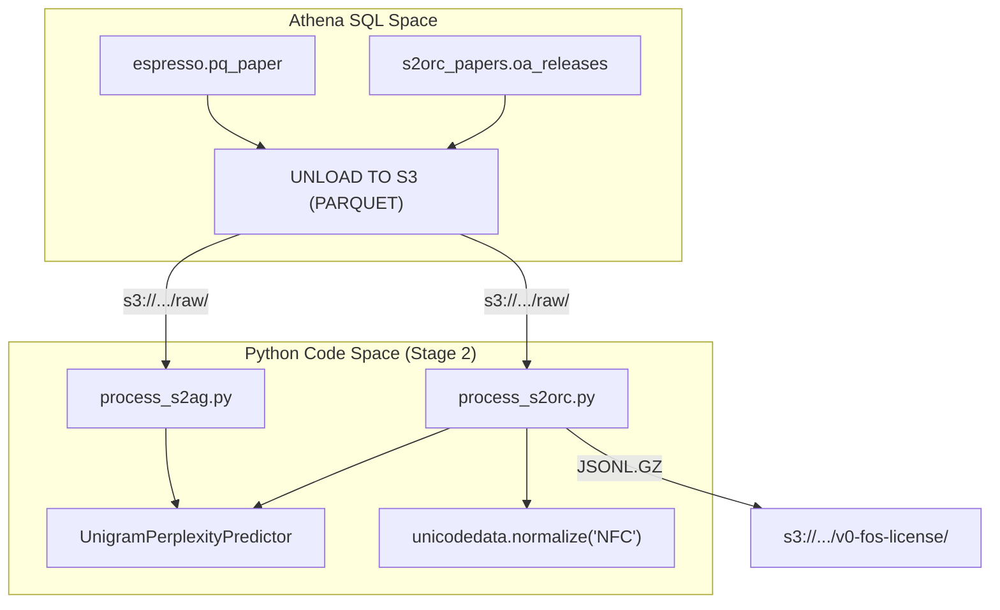
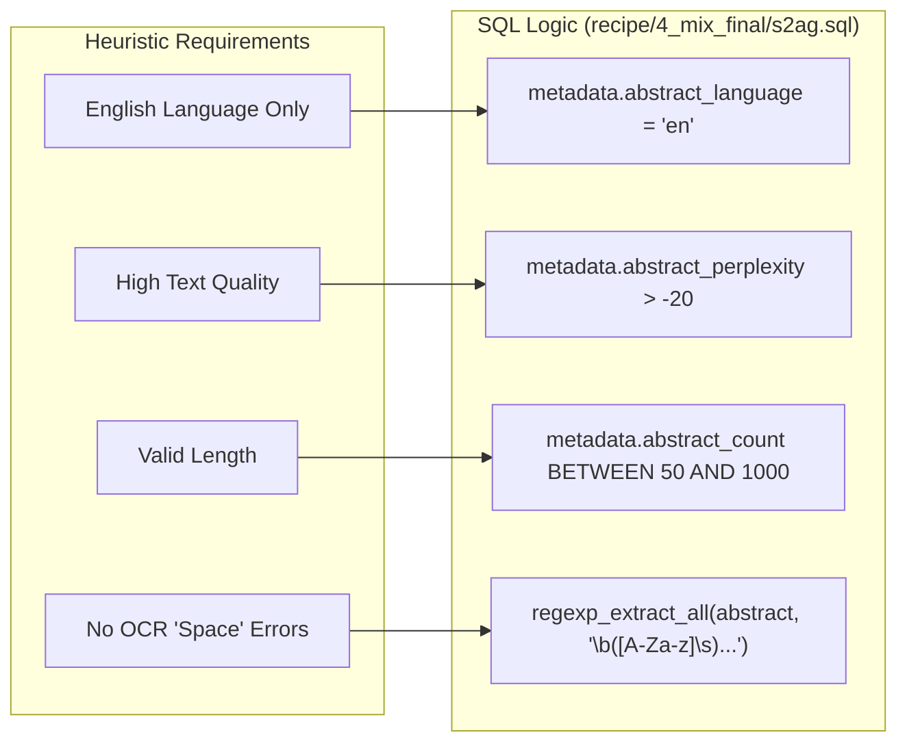

<!-- source: DeepWiki mcp.deepwiki.com · repo allenai/peS2o · page 5 Glossary · fetched 2026-10-26 -->

# Glossary

Relevant source files

The following files were used as context for generating this wiki page:

- [CITATION.cff](CITATION.cff)
- [LICENSE](LICENSE)
- [README.md](README.md)
- [recipe/1_obtain_data/s2ag.sql](recipe/1_obtain_data/s2ag.sql)
- [recipe/1_obtain_data/s2orc.sql](recipe/1_obtain_data/s2orc.sql)
- [recipe/2_scripts/process_s2ag.py](recipe/2_scripts/process_s2ag.py)
- [recipe/2_scripts/process_s2orc.py](recipe/2_scripts/process_s2orc.py)
- [recipe/3_load_as_table/s2ag.sql](recipe/3_load_as_table/s2ag.sql)
- [recipe/3_load_as_table/s2orc.sql](recipe/3_load_as_table/s2orc.sql)
- [recipe/4_mix_final/s2ag.sql](recipe/4_mix_final/s2ag.sql)
- [recipe/4_mix_final/s2orc.sql](recipe/4_mix_final/s2orc.sql)
- [recipe/get_stats.py](recipe/get_stats.py)
- [recipe/requirements.txt](recipe/requirements.txt)

This page provides a comprehensive reference for the terms, abbreviations, and domain-specific concepts used throughout the peS2o codebase. It bridges the gap between high-level dataset concepts and their specific implementations in SQL and Python.

## Core Concepts

### S2ORC (Semantic Scholar Open Research Corpus)
The primary source for the peS2o dataset. It contains full-text papers extracted from PDFs using Grobid. In the pipeline, S2ORC data is accessed via the `s2orc_papers` schema in Athena [recipe/1_obtain_data/s2orc.sql:73-77]().

### S2AG (Semantic Scholar Academic Graph)
A source containing metadata, titles, and abstracts for a much larger set of papers than S2ORC. It is used to supplement the corpus when full text is unavailable. In the pipeline, it is extracted from the `espresso.pq_paper` table [recipe/1_obtain_data/s2ag.sql:85]().

### Grobid
An invisible but critical dependency; a machine learning library for extracting and structuring content from PDF documents. The pipeline consumes Grobid's output in the form of `annotations` (paragraphs and section headers) [recipe/1_obtain_data/s2orc.sql:41-72]().

### Perplexity (Unigram)
A quality metric used to filter out "garbage" text (e.g., OCR errors, non-linguistic sequences). It is calculated by the `UnigramPerplexityPredictor` class [recipe/2_scripts/process_s2orc.py:46-75](). A threshold of `-20` is generally applied to determine if a paragraph or abstract is high-quality [recipe/4_mix_final/s2orc.sql:20]().

---

## Technical Terms and Entities

### Dataset Versions
*   **v0-fos-license**: The intermediate processing stage where data is enriched with Field of Study (FOS) and license information but not yet final-filtered [recipe/3_load_as_table/s2orc.sql:2]().
*   **v3-fos-license**: The final production version of the dataset after all quality filters and deduplication have been applied [recipe/4_mix_final/s2orc.sql:134]().

### Data Fields
| Field | Description | Code Pointer |
| :--- | :--- | :--- |
| `corpusId` | The unique integer identifier from Semantic Scholar. | [recipe/1_obtain_data/s2ag.sql:4]() |
| `sha1` | The hash of the original PDF, used for tracking and deduplication. | [recipe/1_obtain_data/s2ag.sql:20]() |
| `added` | ISO8601 timestamp of when the paper was first seen by Semantic Scholar. | [recipe/2_scripts/process_s2ag.py:123-127]() |
| `created` | Best-guess publication date, often normalized to the first of the year if specific date is unknown. | [recipe/2_scripts/process_s2ag.py:130-134]() |

### Code Entities

#### `UnigramPerplexityPredictor`
A class that loads the Google 1T Web Ngram word frequencies to calculate the log probability of a text sequence.
*   **Implementation**: Uses `np.log2` for probability calculations and handles unknown tokens with a fictional count [recipe/2_scripts/process_s2orc.py:61-72]().
*   **Sources**: [recipe/2_scripts/process_s2orc.py:46-75](), [recipe/2_scripts/process_s2ag.py:54-83]().

#### `is_parenthetical_spanning_two_paragraphs`
A heuristic function used during S2ORC processing to decide if two blocks of text separated by a newline should be merged. It checks if the first block ends with an open parenthesis and the second starts with a closing one.
*   **Source**: [recipe/2_scripts/process_s2orc.py:77-105]().

#### `process_single`
The entry point for worker processes in the Stage 2 Python scripts. It handles reading Parquet, applying normalization (NFC), calculating metrics, and writing compressed JSONL.
*   **Sources**: [recipe/2_scripts/process_s2ag.py:143-210](), [recipe/2_scripts/process_s2orc.py:136-210]().

---

## System Mapping Diagrams

### Data Flow: Raw to Processed
The following diagram maps the transformation of data from SQL-defined source tables into Python-processed entities.

**Diagram: Pipeline Entity Mapping**

**Sources**: [recipe/1_obtain_data/s2orc.sql:131](), [recipe/2_scripts/process_s2orc.py:143-150](), [recipe/3_load_as_table/s2orc.sql:26]().

### Logic Mapping: Filtering Heuristics
This diagram associates specific filtering requirements with the SQL logic used in the final "Mixing" stage (Stage 4).

**Diagram: Quality Filter Implementation**

**Sources**: [recipe/4_mix_final/s2ag.sql:43-62](), [recipe/4_mix_final/s2orc.sql:92-101]().

---

## Statistical Terms

### Top Word Frequency
A heuristic to detect repetitive or non-natural text. The pipeline calculates the frequency of the most common word. For S2ORC, if the document has >500 words, the top word must constitute ≤7.5% of the total text [recipe/4_mix_final/s2orc.sql:28-32]().

### Knowledge Cutoff
The temporal boundary for the dataset. For peS2o v3, papers published or added after **2024-08-01** are assigned to the `valid` split, while earlier papers are assigned to `train` [recipe/4_mix_final/s2ag.sql:29-37]().

### Field of Study (FOS)
Subject matter classifications (e.g., "Biology", "Computer Science"). These are retrieved from the `espresso.pq_paper` table and joined back to the documents in the final stage to allow for category-based filtering by consumers [recipe/4_mix_final/s2ag.sql:87-95]().

**Sources**: [README.md:34-45](), [recipe/4_mix_final/s2ag.sql:1-149](), [recipe/4_mix_final/s2orc.sql:1-185](), [recipe/2_scripts/process_s2orc.py:1-210]().